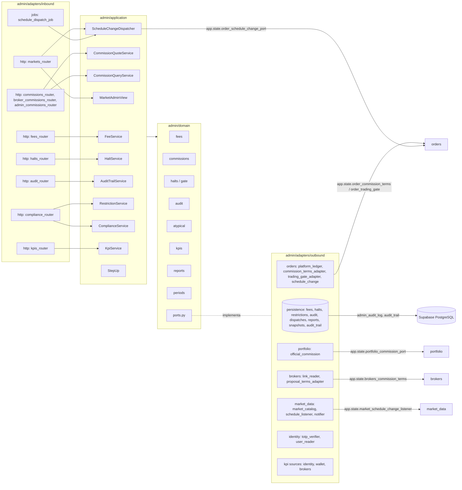
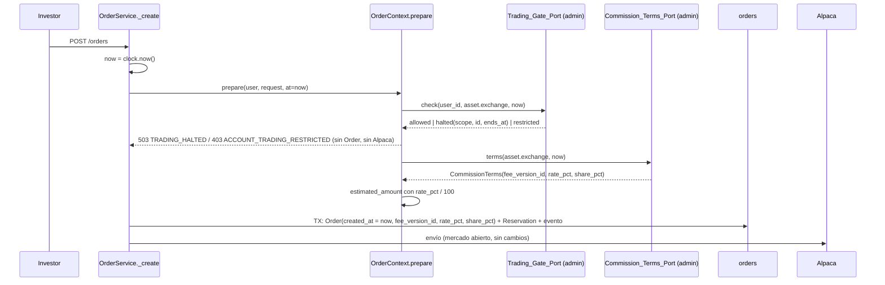
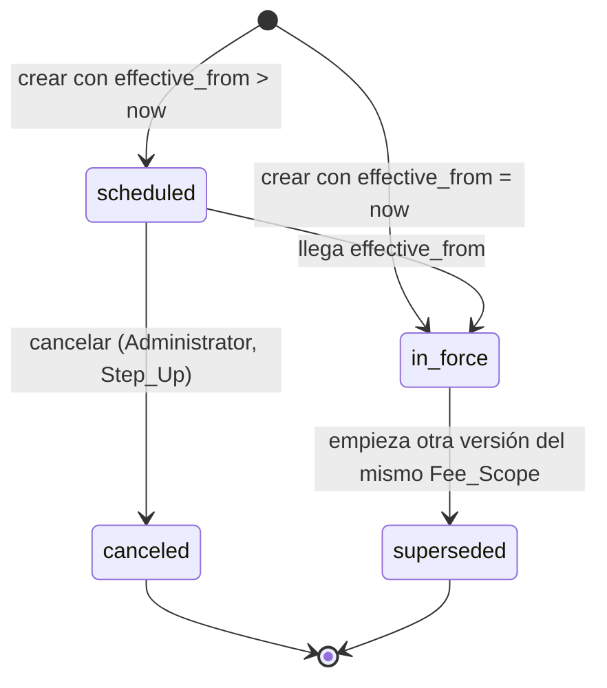
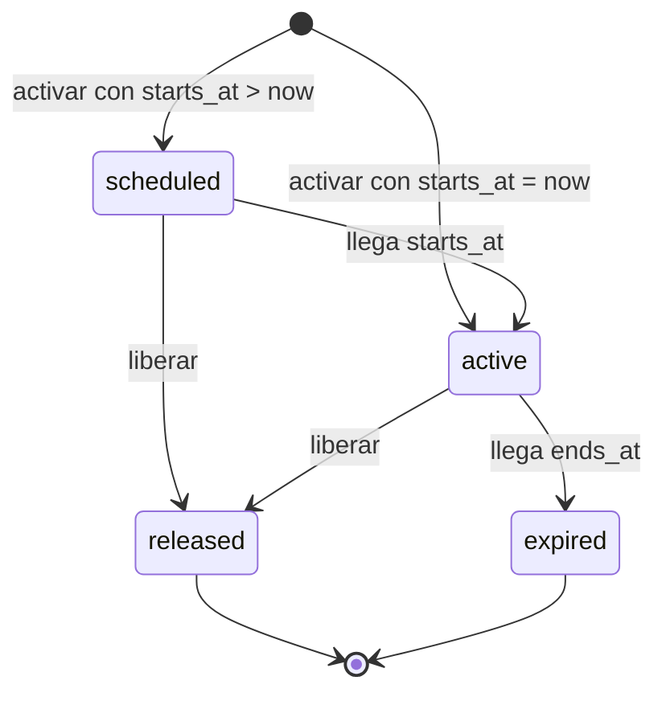
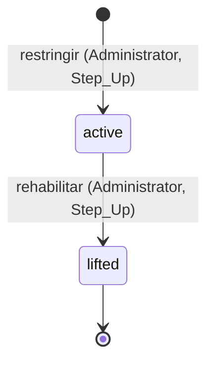

# Design Document: admin-mod-07

> Las [decisiones de implementación](implementation-decisions.md) prevalecen
> sobre las propuestas originales: ADR-6 incorpora auditor/analyst, los términos
> históricos sin evidencia son desconocidos y la detección usa atypical-v2.

## Overview

Este diseño implementa MOD-07 como el paquete `admin` (`src/acciones_ud/admin/`) del monolito modular hexagonal. Cubre la matriz versionada de comisiones y reparto (RF-46), el cálculo, la cotización y la consulta oficial de comisiones (RF-43), la vista consolidada de mercados con la auditoría y la propagación de cambios de horario (RF-46, RFP-10), los interruptores de negociación (RF-46), el registro central de auditoría con su consulta unificada y la cadena de custodia de órdenes (RF-44), las restricciones de cuenta y la detección de operaciones atípicas (RF-45), el reporte de auditoría de un usuario (RFP-13) y el tablero de indicadores (RF-47).

El módulo no tiene integración externa propia. No llama a Alpaca ni a Stripe. Lee datos de los demás módulos con adaptadores de solo lectura (G25) y actúa sobre ellos por los puntos de extensión que esos módulos ya publican o que este spec agrega de forma aditiva:

- `orders`: Commission_Terms_Port y Trading_Gate_Port (nuevos, con adaptador por defecto que conserva el comportamiento actual), Schedule_Change_Port (existente, sin invocador hoy) y una consulta de Executions de toda la plataforma (nueva).
- `portfolio`: Commission_Port (existente, con `app.state.portfolio_commission_port`).
- `brokers`: un puerto de términos de comisión para el costo estimado (nuevo, con adaptador por defecto).
- `market_data`: escritura del Audit_Entry de cada cambio de horario en la misma transacción y un listener posterior al commit (nuevos).
- `identity`: columnas nuevas del Audit_Log, protección contra escalamiento de privilegios y tipo de evento `market_schedule_changes` (aditivos).

Decisiones de diseño adicionales a las del requisito (G1 a G30, A1 a A3):

- **D1 (comisión calculada al leer):** la comisión de una Execution no se guarda. Se calcula cada vez con el Commission_Calculator a partir de los Commission_Terms guardados en la Order (G7), la cantidad, el precio y la firma. La función es pura y los términos no cambian, así que el resultado es reproducible. La alternativa de guardar la comisión en `order_executions` obligaría a `orders` a llamar a `admin` en la reconciliación; se descarta en esta fase (ADR-2).
- **D2 (serialización por Fee_Scope y Halt_Scope):** crear una Fee_Version o un Trading_Halt toma `pg_advisory_xact_lock(hashtext('admin_fee:' || scope))` o `pg_advisory_xact_lock(hashtext('admin_halt:' || scope))` dentro de la transacción, lee el estado, valida y guarda. Los índices únicos son una segunda barrera (Req. 1.13, 8.10).
- **D3 (actualizaciones condicionales):** cancelar, liberar y rehabilitar usan `SELECT ... FOR UPDATE` y `UPDATE ... WHERE <campo> IS NULL RETURNING`. Una segunda solicitud concurrente encuentra el campo ya fijado y recibe el 409 del requisito.
- **D4 (auditoría en la misma transacción):** cada caso de uso de escritura de `admin` agrega el Audit_Entry con el repositorio `AuditWriter` de su propia unidad de trabajo, que escribe en `admin_audit_log`. `market_data` hace lo mismo con su propio repositorio sobre la misma tabla (G16). Un fallo de la inserción revierte la operación (Req. 10.2, 7.2).
- **D5 (rastro unificado con vista SQL):** la migración del Sprint 2 crea la vista de solo lectura `audit_trail`, que une con `UNION ALL` `admin_audit_log`, `order_events` (con `orders`), `broker_events` (con `broker_links`, `broker_trading_authorizations` y `broker_proposals`) y `auth_events` en columnas comunes. El Audit_Trail_Service pagina sobre la vista por `(occurred_at, source, event_id)` (ADR-3).
- **D6 (despacho de cambios de horario):** el listener de `market_data` llama a `ScheduleChangeListener.changed(entry_id)` después del commit. El adaptador de `admin` crea una tarea asyncio registrada (no bloquea la respuesta) que ejecuta el Schedule_Change_Dispatcher. El job periódico procesa los cambios sin despacho. El despacho toma `pg_advisory_xact_lock(hashtext('admin_dispatch:' || entry_id))`, comprueba `admin_schedule_dispatches`, invoca Schedule_Change_Port (idempotente por `change_id` en `orders`), inserta el despacho y confirma; después notifica. Las notificaciones son como máximo una vez por usuario y cambio: si el proceso cae entre el commit y el envío, esas notificaciones se pierden (Req. 7.4).
- **D7 (Trading_Gate en `prepare` y en el envío):** `orders` evalúa el Trading_Gate en `OrderContext.prepare`, que usan la creación, la vista previa, `create_from_proposal` y el envío diferido (`OrderSubmitter.submit(waited=True)`). Si la evaluación falla por la base de datos, el error se propaga y no hay envío (Req. 9.7). Entre la confirmación de una activación y una evaluación que ya pasó el control puede salir una orden; la ventana es la duración de una llamada de envío (4 s, O4 de `orders-mod-03`) y se documenta como riesgo R4.
- **D8 (términos al crear):** `OrderService._create` obtiene `now` una sola vez antes de `prepare`, pasa `at=now` y usa ese valor como `created_at`, de modo que los Commission_Terms se resuelven en el instante exacto de creación (Req. 2.3). En el envío diferido, `prepare` recibe los términos guardados en la Order para revalidar el poder de compra con la tasa pactada.
- **D9 (indicadores en Python con agregados SQL):** los conteos y la suma de volumen se calculan con agregados SQL de solo lectura. Las comisiones se calculan en Python recorriendo las Executions en lotes de 1000 con la consulta de plataforma de `orders`, porque el redondeo por Execution es `ROUND_HALF_EVEN` y `round()` de PostgreSQL redondea hacia arriba en los empates. El resultado se guarda como KPI_Snapshot (G24).
- **D10 (`TRADING_HALTED` como 503):** con 503, el manejo existente de `create_from_proposal` (`proposal_orders.py`: `exc.status >= 500` se propaga) deja la Proposal en `accepted` sin cambiar código de `brokers` (G15). `ACCOUNT_TRADING_RESTRICTED` es 403 y ese mismo código lo convierte en `OrderRejected`.
- **D11 (Step_Up antes de la transacción):** el código TOTP se verifica con un adaptador de `admin` sobre `identity` antes de abrir la transacción de la operación, igual que `brokers` (Req. 9.3 de `brokers-mod-06`). La verificación puede actualizar `totp_last_step` del actor en su propia transacción, lo que evita reutilizar el mismo código.
- **D12 (constructor compartido de Audit_Entries):** `shared/domain/audit_entry.py` define `AuditRecord` y `build_record(action, keys, ...)`, que rechaza claves faltantes o sobrantes. Cada módulo define la lista blanca de sus acciones (`admin/domain/audit.py`, `market_data/domain/schedule_audit.py`). `identity/domain/audit.py` no cambia.

### Investigación (resumen)

- **RBAC:** `require_permission(code)` (`identity/adapters/inbound/http/deps.py`) exige `account_status == "active"` y el permiso en las Effective_Roles; responde 403 `FORBIDDEN`. Sin cookie responde 401 `NOT_AUTHENTICATED`. `create_assignment` exige rol `administrator` para asignar `broker` o `administrator`. `change_permission` no valida ni el rol ni el permiso.
- **Audit_Log:** `admin_audit_log` (`0005`) tiene CHECK de `action` con diez códigos y de `target_type` en `('user','role')`, `payload` JSONB objeto, índices por `occurred_at desc, id desc`, actor, objetivo y acción, y el trigger `trg_admin_audit_log_immutable` `BEFORE UPDATE OR DELETE`. `AuditLogRepository` solo tiene `append` y `search`.
- **Horarios:** `ScheduleAdminService` valida con `validate_default` y `validate_override` y persiste con `work.markets`. El router no pasa el actor. `CalendarService` combina las sesiones de Alpaca con el horario por defecto y las excepciones (`schedule.resolve`), y `orders` usa ese calendario para decidir si un mercado está abierto (`MarketSessionAdapter.is_open`).
- **Schedule_Change_Port:** `ScheduleChangeService.apply` inserta en `order_schedule_changes` (PK `change_id`) y, si ya existía, devuelve `already_applied=True` sin cambios. Pasa a `IN_REVIEW` las Orders no enviadas en `PENDING`, `BROKER_SIGNED` y `HELD` del `exchange` y notifica `order_updates`.
- **Comisión de referencia:** `OrderConfig.commission_rate` (fracción, por defecto `0.02`) entra en `estimated_amount` (`ROUND_UP`) y en la vista previa. `ReferenceCommission` de `portfolio` devuelve `qty × price × rate` sin redondear con `source="reference"`. `InstalledCommission` resuelve `app.state.portfolio_commission_port` en cada llamada. El contrato es síncrono y `ExecutionRecord` no trae términos de comisión.
- **Ejecuciones:** `ExecutionLedger` (`orders/application/execution_ledger.py`) expone `list` y `list_page` por usuario. La consulta atribuye la firma del Broker con un `LATERAL` sobre `order_events` hacia `BROKER_SIGNED` con `actor_type = 'broker'`.
- **Envío diferido:** `OrderScheduler.run_once` toma `orders.due(now)` (`PENDING` o `BROKER_SIGNED` con `scheduled_for <= now`, sin `submit_attempted_at`) y llama `submitter.submit(waited=True)`, que vuelve a ejecutar `prepare`. Un `AppError` distinto de `ORDER_ACCOUNT_NOT_ACTIVE`, `ASSET_NOT_TRADABLE` o `VALIDATION_ERROR` se propaga y el scheduler lo registra y reintenta.
- **Eventos existentes:** `order_events` y `order_executions` no tienen trigger y ningún código llama a `save` ni `delete` sobre ellas (verificado con búsqueda en `src/`). `broker_events` tiene trigger de fila. `auth_events` solo recibe inserciones (`identity/application/login.py`).
- **Notificaciones:** `RecipientDirectory.recipients(event_type)` devuelve los usuarios con algún canal habilitado; `Notifier.notify` guarda la notificación `in_app` y despacha los canales externos. `notification_preferences.event_type` tiene CHECK; `0009` muestra cómo ampliarlo y cómo insertar preferencias por defecto para usuarios existentes.
- **Alpaca:** Broker API admite `commission` y `commission_type` al crear órdenes ([Create an Order for an Account](https://docs.alpaca.markets/us/reference/createorderforaccount)) y la configuración de cuenta `suspend_trade`, que bloquea órdenes nuevas ([trading configurations](https://github.com/alpacahq/alpaca-docs/blob/master/content/api-references/broker-api/trading/trading-configurations.md)). Este diseño no usa ninguno de los dos (G9, ADR-5). Contenido parafraseado de las fuentes por razones de licencia.

### Respuesta al alcance inicial

| Elemento propuesto | Decisión | Justificación |
|---|---|---|
| `GET /api/v1/admin/kpis` | Se mantiene como `GET /api/v1/admin/kpis?from&to&refresh` | RF-47 pide un Period |
| `PUT /api/v1/admin/markets/{market_id}/fees` | Se sustituye por `POST /api/v1/admin/fee-schedules/{scope}/versions` y `.../cancel` | Las versiones no se sobrescriben (G4); `PUT` implicaría reemplazo |
| `PUT /api/v1/admin/markets/{market_id}/schedule` | No se crea | Duplica los endpoints de `market_data` (G10) |
| `GET /api/v1/admin/audit-logs?start&action` | Se sustituye por `GET /api/v1/admin/audit-trail?from&to&user_id&source&action...` | Ya existe `GET /admin/audit-log` de `identity`; un plural casi idéntico confundiría. RF-44 exige usuario y Period |
| `POST /api/v1/admin/circuit-breaker/trigger` | Se sustituye por `POST /api/v1/admin/trading-halts` y `.../{id}/release` | El recurso tiene ciclo de vida, alcance y vigencia (G14) |
| `market_fee_configurations` | Se sustituye por `admin_fee_versions` | Vigencias, historial y reproducibilidad (G4, G5) |
| `audit_logs` | No se crea; se amplía `admin_audit_log` y se agrega la vista `audit_trail` | Steering: no crear un registro paralelo (G16) |
| `system_kpis_cache` | Se sustituye por `admin_kpi_snapshots` | Falta el Period y la versión de definiciones (G24) |
| Operaciones faltantes | Historial de la matriz, cancelación de versiones programadas, cotización y consulta de comisiones, vista de mercados, historial de cambios de horario, consulta de interruptores, cadena de custodia, restricciones, operaciones atípicas y reportes | RF-43, RF-44, RF-45, RF-46 y RFP-13 |

## Architecture



Estructura de paquetes:

```text
src/acciones_ud/admin/
  domain/        fees.py, commissions.py, halts.py, restrictions.py, audit.py, atypical.py,
                 kpis.py, reports.py, periods.py, pagination.py, errors.py, ports.py
  application/   fee_service.py, commission_quote_service.py, commission_query_service.py,
                 market_admin_view.py, schedule_change_dispatcher.py, halt_service.py,
                 audit_trail_service.py, restriction_service.py, compliance_service.py,
                 kpi_service.py, step_up.py, dtos.py
  adapters/inbound/http/   fees_router.py, commissions_router.py, broker_commissions_router.py,
                           admin_commissions_router.py, markets_router.py, halts_router.py,
                           audit_router.py, compliance_router.py, kpis_router.py, deps.py,
                           schemas/
  adapters/inbound/jobs/   schedule_dispatch_job.py
  adapters/outbound/persistence/  tables.py, unit_of_work.py, fee_repository.py, halt_repository.py,
                                  restriction_repository.py, audit_writer.py, dispatch_repository.py,
                                  report_repository.py, kpi_snapshot_repository.py,
                                  audit_trail_reader.py, gate_reader.py
  adapters/outbound/orders/       platform_ledger.py, commission_terms_adapter.py,
                                  trading_gate_adapter.py, schedule_change.py
  adapters/outbound/portfolio/    official_commission.py
  adapters/outbound/brokers/      link_reader.py, proposal_terms_adapter.py
  adapters/outbound/market_data/  market_catalog.py, schedule_listener.py, notifier.py
  adapters/outbound/identity/     totp_verifier.py, user_reader.py, kpi_identity_source.py
  adapters/outbound/wallet/       kpi_wallet_source.py
  adapters/outbound/brokers/      kpi_brokers_source.py
  composition.py
```

`domain` y `application` no importan FastAPI, SQLAlchemy ni módulos de otros paquetes; todo cruza por los Protocol de `ports.py` (`structure.md`).

### Registro en `main.py`

`main.py` agrega `admin` al final de cada secuencia:

```text
register: identity → market_data → wallet → portfolio → orders → brokers → admin
startup:  identity → market_data → wallet → orders → portfolio → brokers → admin
shutdown: admin → brokers → orders → portfolio → wallet → market_data → identity
```

- `admin.register(app)` monta los routers y asigna en `app.state`: `order_commission_terms`, `order_trading_gate`, `portfolio_commission_port`, `brokers_commission_terms` y `market_schedule_change_listener` (Req. 20.1). Ninguno de esos adaptadores abre conexiones al construirse.
- Los consumidores deben resolverlos en cada uso. `portfolio` ya lo hace (`InstalledCommission`). `orders`, `brokers` y `market_data` agregan envoltorios equivalentes (`InstalledCommissionTerms`, `InstalledTradingGate`, `InstalledProposalTerms` y la lectura de `app.state.market_schedule_change_listener` en el router), porque `orders` construye su contexto en `register` (`orders/composition.py`, líneas 93 a 132) antes de que corra `admin.register`. La tarea de cableado lo verifica con una prueba de humo.
- `admin.startup(app)` resuelve `app.state.order_schedule_change_port` (publicado por `orders.register`) y `app.state.order_broker_link`; si falta alguno, falla con un error de configuración explícito. Arranca el job de despacho si `ADMIN_JOBS_ENABLED` es `true`.
- `admin.shutdown(app)` detiene el job y espera las tareas de despacho en curso con un límite de 10 s.

### Flujo: crear una Fee_Version (Req. 1, 10, 19)

```mermaid
sequenceDiagram
    participant A as Administrator
    participant R as fees_router
    participant SU as StepUp
    participant FS as FeeService
    participant DB as admin_fee_versions / admin_audit_log
    A->>R: POST /admin/fee-schedules/{scope}/versions {rate, share, effective_from?, reason, expected_latest_version, totp_code}
    R->>R: require_permission("admin:fees") → 401/403 antes de validar
    R->>SU: verify(actor, totp_code) → 409/401
    R->>FS: create(scope, command, actor, meta)
    FS->>FS: fees.validate_new_version(rate, share, effective_from, now) → 422
    FS->>DB: TX: advisory lock(scope); latest_version_no; comparar expected → 409
    FS->>DB: INSERT versión (índice único scope+effective_from → 409)
    FS->>DB: INSERT Audit_Entry fee_version_created {scope, version_no, before, after} + ip + request_id
    DB-->>FS: COMMIT (fallo → ROLLBACK → 503)
    FS-->>R: FeeVersionView (201)
```

### Flujo: crear una orden con términos y Trading_Gate (Req. 2, 9)



### Flujo: cambio de horario y propagación (Req. 7)

```mermaid
sequenceDiagram
    participant A as Administrator
    participant MR as market_data admin_markets router
    participant MS as ScheduleAdminService
    participant DB as markets / schedule_overrides / admin_audit_log
    participant L as ScheduleChangeListener (admin)
    participant D as ScheduleChangeDispatcher
    participant O as orders Schedule_Change_Port
    participant N as Notifier
    A->>MR: PUT /admin/markets/{code}/default-schedule
    MR->>MS: set_default(code, open, close, actor=AuditActor(user, ip, request_id))
    MS->>DB: TX: leer antes; actualizar; INSERT Audit_Entry market_default_schedule_set
    DB-->>MS: COMMIT
    MR->>L: changed(entry_id) (tarea asyncio, no bloquea)
    MR-->>A: 200 (cuerpo actual sin cambios)
    L->>D: dispatch(entry_id)
    D->>D: TX: advisory lock(entry_id); ¿existe despacho? → fin
    D->>O: apply(ScheduleChange(change_id=entry_id, market, effective_from, description))
    O-->>D: affected_order_ids, already_applied
    D->>D: INSERT admin_schedule_dispatches; COMMIT
    D->>N: market_schedule_changes a cada destinatario (después del commit)
    Note over D: el job periódico repite dispatch para entradas sin despacho
```

### Flujo: interruptor activo y envío diferido (Req. 8, 9)

```mermaid
sequenceDiagram
    participant A as Administrator
    participant HS as HaltService
    participant DB as admin_trading_halts
    participant SCH as Order_Scheduler
    participant SUB as Order_Submitter
    participant G as Trading_Gate_Port
    A->>HS: POST /admin/trading-halts {scope: NASDAQ, reason, totp_code}
    HS->>DB: TX: advisory lock(scope); solapados → 409; INSERT; Audit_Entry trading_halt_activated
    SCH->>SUB: submit(order_id, waited=True)
    SUB->>G: prepare → check(user, NASDAQ, now)
    G-->>SUB: halted
    SUB->>SUB: _defer: scheduled_for = now si era nulo; sin cambio de estado; aviso único order_updates(trading_halted)
    A->>HS: POST /admin/trading-halts/{id}/release {reason, totp_code}
    HS->>DB: TX: FOR UPDATE; released_at = now; Audit_Entry trading_halt_released
    SCH->>SUB: siguiente ciclo → submit(waited=True) → gate allowed → validaciones y envío normales
```

### Flujo: consulta del rastro de auditoría (Req. 12)

```mermaid
sequenceDiagram
    participant AU as Administrator (Auditor)
    participant R as audit_router
    participant S as AuditTrailService
    participant V as vista audit_trail
    AU->>R: GET /admin/audit-trail?from&to&user_id&cursor
    R->>R: require_permission("admin:audit")
    R->>S: page(query)
    S->>S: periods.validate → 422; decodificar cursor → 422
    S->>V: SELECT ... WHERE occurred_at en rango AND (actor_id = u OR subject_user_id = u OR related_user_id = u) AND (occurred_at, source, event_id) < cursor ORDER BY ... DESC LIMIT n+1
    S->>S: audit.sanitize(details)
    S-->>R: AuditTrailPage(items, next_cursor)
```

### Flujo: indicadores con caché (Req. 17, 18)

```mermaid
sequenceDiagram
    participant A as Administrator
    participant K as KpiService
    participant C as admin_kpi_snapshots
    participant SRC as fuentes (identity, orders, wallet, brokers)
    A->>K: GET /admin/kpis?from&to&refresh
    K->>C: get(period, KPI_DEFINITIONS_VERSION)
    alt vigente y sin refresh
        C-->>K: snapshot → cache_hit=true
    else vencido, ausente o refresh
        K->>SRC: agregados SQL + Executions en lotes
        K->>K: kpis.compute(...) puro
        K->>C: UPSERT snapshot
        Note over K,C: si falla el cálculo y hay snapshot vencido → stale=true; si no → 503
    end
    K-->>A: KpiDashboard
```

### Ciclo de vida de una Fee_Version (G4)



El estado es derivado (`fees.version_status`): no se guarda. Solo `canceled_at` se persiste.

### Ciclo de vida de un Trading_Halt (G14)



### Ciclo de vida de una Account_Restriction (G20)



## Components and Interfaces

### Puertos de salida (`admin/domain/ports.py`)

```python
FeeScope = str                      # "default" o código de Market
HaltScope = str                     # "global" o código de Market

class FeeRepository(Protocol):
    async def lock_scope(self, scope: FeeScope) -> None: ...                  # advisory lock (D2)
    async def latest_version_no(self, scope: FeeScope) -> int: ...
    async def all_versions(self) -> list[FeeVersion]: ...                     # resolución y matriz
    async def page(self, scope: FeeScope, cursor: Cursor | None, size: int) -> Page[FeeVersion]: ...
    async def get_for_update(self, version_id: UUID) -> FeeVersion | None: ...
    async def insert(self, version: FeeVersion) -> None: ...                  # FeeVersionConflictError si viola el índice
    async def cancel(self, version_id: UUID, at: datetime, actor: UUID, reason: str) -> bool: ...

class HaltRepository(Protocol):
    async def lock_scope(self, scope: HaltScope) -> None: ...
    async def overlapping(self, scope: HaltScope, starts_at: datetime, ends_at: datetime | None) -> TradingHalt | None: ...
    async def insert(self, halt: TradingHalt) -> None: ...
    async def get_for_update(self, halt_id: UUID) -> TradingHalt | None: ...
    async def release(self, halt_id: UUID, at: datetime, actor: UUID, reason: str) -> bool: ...
    async def page(self, filters: HaltFilters, cursor: Cursor | None, size: int) -> Page[TradingHalt]: ...
    async def candidates(self, market_code: str | None, at: datetime) -> list[TradingHalt]: ...

class RestrictionRepository(Protocol):
    async def insert(self, restriction: AccountRestriction) -> None: ...      # RestrictionAlreadyActiveError
    async def get_for_update(self, restriction_id: UUID) -> AccountRestriction | None: ...
    async def lift(self, restriction_id: UUID, decision: LiftDecision) -> bool: ...
    async def page(self, filters: RestrictionFilters, cursor: Cursor | None, size: int) -> Page[AccountRestriction]: ...
    async def active_for(self, user_id: UUID) -> AccountRestriction | None: ...

class AuditWriter(Protocol):
    async def append(self, record: AuditRecord) -> None: ...                  # sin update ni delete (Req. 11.3)

class AuditTrailReader(Protocol):
    async def page(self, query: AuditTrailQuery) -> Page[AuditTrailEvent]: ...
    async def order_custody(self, order_id: UUID) -> OrderCustodyRaw | None: ...
    async def counts_for_user(self, user_id: UUID, start: datetime, end: datetime) -> list[ActivityCount]: ...

class ScheduleChangeSource(Protocol):                                         # Audit_Entries de horario
    async def get(self, entry_id: UUID) -> ScheduleChangeEntry | None: ...
    async def undispatched(self, limit: int) -> list[UUID]: ...
    async def history(self, market: str, start: datetime, end: datetime,
                      cursor: Cursor | None, size: int) -> Page[ScheduleChangeView]: ...

class DispatchRepository(Protocol):
    async def lock(self, entry_id: UUID) -> None: ...
    async def exists(self, entry_id: UUID) -> bool: ...
    async def insert(self, record: ScheduleDispatch) -> None: ...

class ScheduleChangePort(Protocol):                                           # de orders, existente
    async def apply(self, change: ScheduleChange, now: datetime) -> ScheduleChangeResult: ...

class ScheduleNotifierPort(Protocol):
    async def recipients(self, event_type: Literal["market_schedule_changes"]) -> list[UUID]: ...
    async def notify(self, user_id: UUID, payload: Mapping[str, object]) -> None: ...

class PlatformLedgerPort(Protocol):                                           # nueva consulta de orders (Req. 20.2)
    async def page(self, filters: LedgerFilters, cursor: str | None, size: int) -> tuple[list[LedgerExecution], str | None]: ...
    def iterate(self, filters: LedgerFilters, batch: int = 1000) -> AsyncIterator[LedgerExecution]: ...
    async def volume(self, start: datetime, end: datetime) -> list[VolumeRow]: ...  # SUM(qty*price), COUNT por mercado y lado

class InvestorLedgerPort(Protocol):                                           # ExecutionLedger existente
    async def list_page(self, user_id: UUID, since: datetime, until: datetime, symbol: str | None,
                        cursor: str | None, size: int) -> tuple[list[LedgerExecution], str | None]: ...

class BrokerLinkPort(Protocol):                                               # app.state.order_broker_link de brokers
    async def linked_investors(self, broker_id: UUID) -> list[UUID]: ...
    async def is_linked(self, broker_id: UUID, investor_id: UUID) -> bool: ...

class MarketCatalogPort(Protocol):
    async def markets(self) -> list[MarketConfig]: ...
    async def market(self, code: str) -> MarketConfig | None: ...
    async def overrides(self, code: str, start: date, end: date) -> list[OverrideView]: ...
    async def exchange_of(self, symbol: str) -> str | None: ...               # Instrument.exchange

class UserReaderPort(Protocol):
    async def exists(self, user_id: UUID) -> bool: ...
    async def display_names(self, ids: Sequence[UUID]) -> dict[UUID, str]: ...
    async def summary(self, user_id: UUID, at: datetime) -> UserSummary | None: ...

class TotpVerifierPort(Protocol):
    async def has_active_totp(self, user_id: UUID) -> bool: ...
    async def verify(self, user_id: UUID, code: str, now: datetime) -> bool: ...

class KpiSourcePort(Protocol):
    async def registered_before(self, end: datetime) -> int: ...
    async def registrations(self, start: datetime, end: datetime) -> list[RegistrationRow]: ...   # level, interests
    async def active_users(self, start: datetime, end: datetime) -> int: ...
    async def paid_payments(self, start: datetime, end: datetime) -> list[PaymentRow]: ...
    async def subscriptions_covering(self, at: datetime) -> int: ...
    async def investors_at(self, at: datetime) -> list[InvestorTypeRow]: ...  # level, with_broker

class KpiSnapshotRepository(Protocol):
    async def get(self, period: Period, version: str) -> KpiSnapshot | None: ...
    async def upsert(self, snapshot: KpiSnapshot) -> None: ...

class ReportRepository(Protocol):
    async def insert(self, report: ComplianceReport) -> None: ...
    async def get(self, report_id: UUID) -> ComplianceReport | None: ...
    async def page_by_user(self, user_id: UUID, cursor: Cursor | None, size: int) -> Page[ComplianceReportSummary]: ...

class Clock(Protocol): ...          # reutiliza shared/domain/clock.py
```

`AdminWork` agrupa `fees`, `halts`, `restrictions`, `audit`, `dispatches`, `reports` y `snapshots` sobre una sola `AsyncSession` (`admin/adapters/outbound/persistence/unit_of_work.py`, con `shared/infrastructure/db.py::unit_of_work`). `AuditTrailReader`, `PlatformLedgerPort`, `KpiSourcePort` y `MarketCatalogPort` usan sesiones de solo lectura propias.

### Reglas de dominio puras (`admin/domain/`)

No hacen I/O y concentran la lógica crítica:

- `fees.SEED_TERMS = CommissionTerms(fee_version_id=SEED_ID, commission_rate_pct=Decimal("2.0000"), platform_share_pct=Decimal("60.00"))`, con `SEED_ID` fijo (`00000000-0000-0000-0000-000000000701`) igual al que inserta la migración (Req. 1.12, 2.6).
- `fees.validate_new_version(rate, share, effective_from, now) -> list[FieldError]`: rango y escala de G5 (`rate.as_tuple().exponent >= -4`, `share...>= -2`), finitud, `effective_from >= now` (Req. 1.2, 1.3).
- `fees.resolve_terms(versions, market_code, at) -> CommissionTerms`: filtra no canceladas con `effective_from <= at`, toma la de mayor `effective_from` del Fee_Scope del Market y, si no hay, la de `default` (Req. 2.1, 2.2). Total gracias a la semilla.
- `fees.version_status(version, scope_versions, at) -> Literal["scheduled", "in_force", "superseded", "canceled"]` (Req. 1.11).
- `fees.matrix(versions, markets, at) -> list[MatrixRow]` con origen `market` o `default` y versiones programadas (Req. 1.10).
- `fees.can_cancel(version, at) -> bool`: no cancelada y `effective_from > at` (Req. 1.7, 1.8).
- `commissions.compute(terms, side, qty, price, broker_signed) -> CommissionBreakdown`: en `localcontext(prec=40)`, `gross = qty × price`; `commission = q2(gross × rate_pct / 100)`; `platform = q2(commission × share_pct / 100)` con firma o `commission` sin firma; `broker = commission − platform`; `total = q2(gross) + commission` en compra y `net = q2(gross) − commission` en venta; `q2` es `quantize(Decimal("0.01"), ROUND_HALF_EVEN)` (Req. 3.1 a 3.5, 3.7).
- `commissions.terms_from(rate_pct, share_pct, fee_version_id) -> CommissionTerms | None`: devuelve None si faltan términos históricos; nunca hereda la semilla para una orden anterior (H3, Req. 2.6).
- `halts.effective_status(halt, at)`: regla del Req. 8.6.
- `halts.overlaps(a_start, a_end, b_start, b_end) -> bool`: `a_start < (b_end or ∞) and b_start < (a_end or ∞)` (Req. 8.2).
- `halts.gate(halts, restriction, market_code, at) -> GateDecision`: primero un Trading_Halt `active` global, después uno `active` del Market, después una Account_Restriction activa; `GateDecision.allowed()` en otro caso (Req. 9.1, 9.2). El orden hace determinista el código cuando hay varios bloqueos.
- `restrictions.validate_evidence(text, refs) -> list[FieldError]`: texto de hasta 2000 caracteres y hasta 20 referencias con forma `{"source": AuditSource | "execution", "id": str}` (Req. 14.1).
- `audit.ADMIN_ACTIONS` y `audit.PAYLOAD_KEYS`: listas blancas de las acciones de `admin` (Req. 10.1); `audit.build(...)` usa `shared/domain/audit_entry.build_record` (D12).
- `audit.SENSITIVE_KEYS` y `audit.sanitize(value) -> value`: elimina recursivamente las claves del Req. 12.5, sin importar mayúsculas.
- `periods.parse(from_, to) -> Period` y `periods.to_utc_range(period) -> tuple[datetime, datetime]`: G29; `InvalidPeriodError` con los campos inválidos.
- `atypical.flag(executions, config) -> list[AtypicalFlag]`: recibe las Executions del usuario ordenadas por `executed_at` y aplica G21 con una ventana deslizante (Req. 15.2, 15.3). Las Executions de la ventana anterior al Period se cargan para el cálculo relativo pero no se devuelven.
- `kpis.compute(inputs: KpiInputs, period, at) -> KpiResult` y `KPI_DEFINITIONS_VERSION = "kpi-v1"` (Req. 17).
- `reports.canonical_json(content) -> bytes` (claves ordenadas, separadores `(",", ":")`, `Decimal` como cadena normalizada sin exponente, `datetime` en UTC ISO 8601, `UUID` como cadena) y `reports.digest(content) -> str` (SHA-256 hexadecimal en minúsculas) (Req. 16.4).
- `reports.build(user, activity, executions, average, flags, restrictions, period, rules_version) -> dict` (Req. 16.1, 16.2).
- `pagination.encode(key) / decode(token)`: cursor opaco base64 URL-safe; un cursor inválido produce `VALIDATION_ERROR` con el campo `cursor`.

### Casos de uso (`admin/application/`)

| Servicio | Operaciones | Requisitos |
|---|---|---|
| FeeService | `create`, `cancel`, `matrix`, `history` | 1, 10.1, 19.6 |
| CommissionQuoteService | `quote` | 4 |
| CommissionQueryService | `for_investor`, `for_broker`, `for_admin` | 5 |
| MarketAdminView | `list`, `get` | 6 |
| ScheduleChangeDispatcher | `dispatch(entry_id)`, `run_once()`, `history` | 7 |
| HaltService | `activate`, `release`, `page`, `active_public` | 8, 10.1 |
| AuditTrailService | `page`, `order_custody` | 12, 13 |
| RestrictionService | `restrict`, `lift`, `page` | 14, 10.1 |
| ComplianceService | `atypical`, `generate_report`, `get_report`, `reports_for_user` | 15, 16 |
| KpiService | `dashboard(period, refresh)` | 17, 18 |
| StepUp | `verify(actor_id, code)` | 19.6, 19.7 |

Adaptadores que implementan puertos de otros módulos (sin caso de uso propio): `CommissionTermsAdapter` (Req. 2.3, 2.4), `TradingGateAdapter` (Req. 9), `OfficialCommission` (Req. 3.6), `ProposalTermsAdapter` (Req. 20.3) y `ScheduleListener` (Req. 7.5).

### Límites transaccionales

| Operación | Transacción | Fuera de la transacción |
|---|---|---|
| Crear Fee_Version | lock de scope, último número, validación de `expected`, INSERT versión, INSERT Audit_Entry | Step_Up antes; nada después |
| Cancelar Fee_Version | `FOR UPDATE`, `can_cancel`, UPDATE condicional, INSERT Audit_Entry | Step_Up antes |
| Activar Trading_Halt | lock de scope, búsqueda de solapados, INSERT, INSERT Audit_Entry | Step_Up antes |
| Liberar Trading_Halt | `FOR UPDATE`, estado efectivo, UPDATE condicional, INSERT Audit_Entry | Step_Up antes |
| Restringir / rehabilitar | existencia del usuario, INSERT o UPDATE condicional, INSERT Audit_Entry | Step_Up antes |
| Generar Compliance_Report | INSERT reporte, INSERT Audit_Entry | lecturas y cálculo antes (fuera de la transacción de escritura) |
| Cambio de horario (`market_data`) | lectura del valor anterior, cambio, INSERT Audit_Entry | listener después del commit |
| Despacho | lock del cambio, comprobación, INSERT despacho | `Schedule_Change_Port.apply` dentro del lock pero en la transacción propia de `orders`; notificaciones después del commit |
| Creación de Order (`orders`) | la existente, con `fee_version_id`, tasa y reparto en el INSERT de la Order | Trading_Gate y términos en `prepare`, antes |

### Concurrencia e idempotencia

- Fee_Versions: lock asesor por Fee_Scope + `expected_latest_version` (control optimista visible al cliente) + índice único parcial `(scope, effective_from) WHERE canceled_at IS NULL`. Repetir la misma solicitud después de un éxito responde 409 `FEE_VERSION_CONFLICT` con `latest_version`; el cliente reconoce su versión en el historial.
- Trading_Halts: lock asesor por Halt_Scope + búsqueda de solapados. Repetir una activación responde 409 `TRADING_HALT_OVERLAP` con el identificador existente, que actúa como respuesta idempotente.
- Account_Restrictions: índice único parcial `(user_id, restriction_type) WHERE lifted_at IS NULL`; la violación se traduce a 409 `RESTRICTION_ALREADY_ACTIVE`.
- Cancelar, liberar y rehabilitar: actualización condicional; la segunda solicitud ve el campo fijado y recibe el 409 del requisito.
- Despacho de horarios: lock asesor por `entry_id` + PK de `admin_schedule_dispatches` + idempotencia de `orders` por `change_id`.
- KPI_Snapshot: `INSERT ... ON CONFLICT (period_from, period_to, definitions_version) DO UPDATE`; dos cálculos simultáneos producen el mismo contenido y el último gana.
- Step_Up: el código TOTP no se puede reutilizar dentro de su ventana porque `identity` guarda `totp_last_step`.

### Endpoints HTTP

Todos usan la cookie `access_token` mediante `get_current_user` de `identity`. Las rutas administrativas usan `require_permission(<permiso>)`, que responde 401 sin sesión y 403 `FORBIDDEN` sin permiso antes de validar parámetros (Req. 19.2, 19.3). `page_size` admite 1 a 100 (por defecto 50 en auditoría y 20 en el resto). Cada ruta declara `responses=error_responses(...)` de `shared/infrastructure/http_errors.py` con el schema `ErrorBody` (Req. 21.4). Las rutas con Step_Up reciben `totp_code` en el cuerpo, como `orders` y `brokers`.

| Método y ruta | Permiso o rol | Respuesta | Errores declarados | Req. |
|---|---|---|---|---|
| `GET /admin/fee-schedules` | `admin:fees` | 200 `FeeMatrix` | 401, 403, 503 | 1.10 |
| `GET /admin/fee-schedules/{scope}/versions?cursor&page_size` | `admin:fees` | 200 `FeeVersionPage` | 401, 403, 404, 422, 503 | 1.6, 1.11 |
| `POST /admin/fee-schedules/{scope}/versions` | `admin:fees` + Step_Up | 201 `FeeVersionOut` | 401 (`EXTRA_AUTHORIZATION_INVALID`), 403, 404, 409 (`FEE_VERSION_CONFLICT`, `EXTRA_AUTHORIZATION_REQUIRED`, `MFA_ENROLLMENT_REQUIRED`), 422, 503 | 1.1–1.6, 1.13, 10.1 |
| `POST /admin/fee-schedules/{scope}/versions/{version_id}/cancel` | `admin:fees` + Step_Up | 200 `FeeVersionOut` | 401, 403, 404, 409 (`FEE_VERSION_NOT_CANCELABLE`, Step_Up), 422, 503 | 1.7, 1.8, 10.1 |
| `GET /commissions/quote?symbol&side&qty&price&with_broker` | rol `investor` o `broker` | 200 `CommissionQuoteOut` | 401, 403, 404 `SYMBOL_NOT_FOUND`, 422, 503 | 4 |
| `GET /commissions?from&to&symbol&cursor&page_size` | rol `investor` | 200 `CommissionPage` | 401, 403, 422, 503 | 5.1, 5.5 |
| `GET /broker/commissions?from&to&investor_id&cursor&page_size` | rol `broker` | 200 `BrokerCommissionPage` | 401, 403, 404 `CLIENT_NOT_FOUND`, 422, 503 | 5.2, 5.3, 5.5 |
| `GET /admin/commissions?from&to&broker_id&investor_id&market&cursor&page_size` | `admin:commissions` | 200 `AdminCommissionPage` | 401, 403, 422, 503 | 5.4, 5.5 |
| `GET /admin/markets` | `admin:markets` | 200 `MarketAdminOut[]` | 401, 403, 503 | 6.1, 6.5 |
| `GET /admin/markets/{market_code}` | `admin:markets` | 200 `MarketAdminOut` | 401, 403, 404, 503 | 6.2, 6.3 |
| `GET /admin/markets/{market_code}/schedule-changes?from&to&cursor&page_size` | `admin:markets` | 200 `ScheduleChangePage` | 401, 403, 404, 422, 503 | 7.8 |
| `POST /admin/trading-halts` | `admin:halts` + Step_Up | 201 `TradingHaltOut` | 401, 403, 404 (Market), 409 (`TRADING_HALT_OVERLAP`, Step_Up), 422, 503 | 8.1–8.3, 8.10 |
| `POST /admin/trading-halts/{halt_id}/release` | `admin:halts` + Step_Up | 200 `TradingHaltOut` | 401, 403, 404, 409 (`TRADING_HALT_NOT_RELEASABLE`, Step_Up), 422, 503 | 8.4, 8.5 |
| `GET /admin/trading-halts?status&scope&cursor&page_size` | `admin:halts` | 200 `TradingHaltPage` | 401, 403, 422, 503 | 8.7 |
| `GET /trading-halts/active` | autenticado | 200 `PublicHaltOut[]` | 401, 503 | 8.8 |
| `GET /admin/audit-trail?from&to&user_id&source&action&entity_type&entity_id&cursor&page_size` | `admin:audit` | 200 `AuditTrailPage` | 401, 403, 422, 503 | 12 |
| `GET /admin/audit-trail/orders/{order_id}` | `admin:audit` | 200 `OrderCustodyOut` | 401, 403, 404, 422, 503 | 13 |
| `POST /admin/compliance/restrictions` | `admin:compliance` + Step_Up | 201 `RestrictionOut` | 401, 403, 404, 409 (`RESTRICTION_ALREADY_ACTIVE`, Step_Up), 422, 503 | 14.1–14.3 |
| `POST /admin/compliance/restrictions/{restriction_id}/lift` | `admin:compliance` + Step_Up | 200 `RestrictionOut` | 401, 403, 404, 409 (`RESTRICTION_NOT_ACTIVE`, Step_Up), 422, 503 | 14.4, 14.5 |
| `GET /admin/compliance/restrictions?user_id&status&cursor&page_size` | `admin:compliance:read` | 200 `RestrictionPage` | 401, 403, 422, 503 | 14.6 |
| `GET /admin/compliance/atypical-operations?from&to&user_id&min_amount&cursor&page_size` | `admin:compliance:read` | 200 `AtypicalPage` | 401, 403, 422, 503 | 15 |
| `POST /admin/compliance/users/{user_id}/audit-reports` `{from, to}` | `admin:compliance` | 201 `ComplianceReportOut` | 401, 403, 404, 422, 503 | 16.1, 16.6 |
| `GET /admin/compliance/audit-reports/{report_id}` | `admin:compliance:read` | 200 `ComplianceReportOut` | 401, 403, 404, 503 | 16.3–16.5 |
| `GET /admin/compliance/users/{user_id}/audit-reports?cursor&page_size` | `admin:compliance:read` | 200 `ComplianceReportPage` | 401, 403, 404, 422, 503 | 16.3 |
| `GET /admin/kpis?from&to&refresh` | `admin:bi` | 200 `KpiDashboardOut` | 401, 403, 422, 503 | 17, 18 |

Todas las rutas llevan el prefijo `/api/v1`. Tags OpenAPI: `admin-fees`, `commissions`, `admin-markets`, `admin-halts`, `admin-audit`, `admin-compliance` y `admin-bi` (Req. 21.4). La descripción de `GET /admin/audit-trail`, `GET /admin/audit-trail/orders/{order_id}` y `GET /admin/compliance/audit-reports/{report_id}` incluye el texto de garantía de G17 (Req. 11.4).

### Ejemplos de payloads

`POST /api/v1/admin/fee-schedules/NASDAQ/versions`:

```json
{
  "commission_rate_pct": "1.7500",
  "platform_share_pct": "60.00",
  "effective_from": "2026-12-01T14:30:00Z",
  "reason": "Ajuste comercial aprobado por comité",
  "expected_latest_version": 3,
  "totp_code": "123456"
}
```

Respuesta 201:

```json
{
  "id": "6f1e...",
  "scope": "NASDAQ",
  "version_no": 4,
  "commission_rate_pct": "1.7500",
  "platform_share_pct": "60.00",
  "broker_share_pct": "40.00",
  "effective_from": "2026-12-01T09:30:00-05:00",
  "status": "scheduled",
  "reason": "Ajuste comercial aprobado por comité",
  "created_by": "b2c4...",
  "created_at": "2026-11-20T10:02:11-05:00",
  "canceled_at": null,
  "canceled_by": null,
  "cancel_reason": null
}
```

`GET /api/v1/commissions/quote?symbol=AAPL&side=buy&qty=10&price=187.35&with_broker=true`:

```json
{
  "symbol": "AAPL",
  "market": "NASDAQ",
  "fee_version_id": "6f1e...",
  "commission_rate_pct": "2.0000",
  "gross_amount": "1873.50",
  "commission": "37.47",
  "total": "1910.97",
  "net": null,
  "platform_share": "22.48",
  "broker_share": "14.99",
  "binding": false,
  "quoted_at": "2026-11-20T10:05:00-05:00"
}
```

`POST /api/v1/admin/trading-halts`:

```json
{ "scope": "global", "reason": "Incidente con el proveedor de datos", "ends_at": null, "totp_code": "654321" }
```

Elemento de `GET /api/v1/admin/audit-trail`:

```json
{
  "source": "orders",
  "event_id": "1c9d...",
  "occurred_at": "2026-11-18T09:31:02-05:00",
  "actor_type": "broker",
  "actor_id": "9a0f...",
  "subject_user_id": "47be...",
  "related_user_id": "9a0f...",
  "action": "broker_approved",
  "entity_type": "order",
  "entity_id": "60e7...",
  "from_state": "IN_REVIEW",
  "to_state": "BROKER_SIGNED",
  "details": { "authorization_method": "proposal_acceptance" },
  "ip_address": null
}
```

`GET /api/v1/admin/kpis?from=2026-11-01&to=2026-11-30` (extracto):

```json
{
  "period": { "from": "2026-11-01", "to": "2026-11-30", "time_zone": "America/New_York" },
  "definitions_version": "kpi-v1",
  "computed_at": "2026-11-20T10:10:00-05:00",
  "cache_hit": false,
  "stale": false,
  "metrics": {
    "registered_users": { "value": 412, "unit": "users", "definition": "kpi-v1.registered_users" },
    "active_users": { "value": 158, "unit": "users", "definition": "kpi-v1.active_users" },
    "traded_volume_usd": {
      "value": "254310.22", "unit": "USD", "definition": "kpi-v1.traded_volume_usd",
      "by_market": { "NASDAQ": "190000.10", "NYSE": "64310.12" },
      "by_side": { "buy": "150000.00", "sell": "104310.22" }
    },
    "platform_commissions_usd": { "value": "3120.44", "unit": "USD", "by_market": { "NASDAQ": "2400.00", "NYSE": "720.44" } },
    "active_subscriptions": { "value": 37, "unit": "subscriptions", "at": "2026-11-20T10:10:00-05:00" },
    "revenue_by_source": { "commissions": "3120.44", "subscriptions": "444.00", "excluded_non_usd_payments": 0 }
  }
}
```

### Contratos para el frontend

Los componentes de referencia son del equipo de frontend y no están en este repositorio. Este diseño solo fija qué endpoints consume cada uno:

| Componente de referencia | Mockup | Endpoints |
|---|---|---|
| `ExecutiveKpiDashboard.tsx` | 13 | `GET /admin/kpis` |
| `CommissionFeeMatrixEditor.tsx` | 14 | `GET /admin/fee-schedules`, `GET|POST /admin/fee-schedules/{scope}/versions`, `POST .../{id}/cancel`, `GET /admin/commissions` |
| `MarketHoursScheduler.tsx` | 15 | `GET /admin/markets`, `GET /admin/markets/{code}`, endpoints de horario de `market_data`, `GET /admin/markets/{code}/schedule-changes`, `GET|POST /admin/trading-halts`, `POST .../release` |
| `AuditTrailViewer.tsx` | 16 | `GET /admin/audit-trail`, `GET /admin/audit-trail/orders/{id}`, endpoints de cumplimiento |
| `UserAccessControlManager.tsx` | — | endpoints existentes de `identity` (`/admin/users`, `/admin/roles`, `/admin/permissions`, `/admin/users/{id}/roles`) y `/admin/compliance/restrictions` |

El frontend no debe ocultar funciones como única medida de control: el backend exige cada permiso (Req. 19.2). La respuesta 403 es la fuente de verdad.

### Cambios aditivos en otros módulos

1. **`shared`**
   - `shared/domain/errors.py`: `FEE_VERSION_CONFLICT`, `FEE_VERSION_NOT_CANCELABLE`, `TRADING_HALT_OVERLAP`, `TRADING_HALT_NOT_RELEASABLE`, `TRADING_HALTED`, `ACCOUNT_TRADING_RESTRICTED`, `RESTRICTION_ALREADY_ACTIVE`, `RESTRICTION_NOT_ACTIVE` y `PROTECTED_PERMISSION`, con su estado HTTP en `shared/infrastructure/http_errors.py`.
   - `shared/domain/audit_entry.py`: `AuditRecord(id, actor_user_id, action, target_type, target_id, payload, occurred_at, ip_address, request_id)` y `build_record` (D12).
   - `shared/infrastructure/request_meta.py`: `request_meta(request) -> RequestMeta(ip_address, request_id)` con `request.client.host` y el `request_id` de `RequestIdMiddleware` (G18).
2. **`identity`**
   - `tables.py`: columnas `ip_address` y `request_id` en `admin_audit_log`. `AuditLogRepository`, `AuditEntry` y `GET /admin/audit-log` no cambian (Req. 10.6).
   - `application/rbac_admin.py::change_permission`: antes de persistir, rechaza con 409 `PROTECTED_PERMISSION` agregar `admin:*` a un rol distinto de `administrator` y quitar `admin:rbac` de `administrator` (Req. 19.4, 19.5). El router de `admin.py` declara el 409 (ya lo declara para otros casos en algunas rutas; se agrega a `add_permission` y `remove_permission`).
   - `domain/preferences.py`: `market_schedule_changes` en `EVENT_TYPES` (Req. 7.9).
3. **`market_data`**
   - `domain/ports.py`: `AuditActor(user_id, ip_address, request_id)`, `ScheduleAuditWriter` en la unidad de trabajo y Protocol `ScheduleChangeListener.changed(entry_id: UUID) -> None`.
   - `domain/schedule_audit.py`: acciones y lista blanca de los cambios de horario (Req. 7.1, 10.1).
   - `application/schedule_admin.py`: cada operación recibe `actor: AuditActor`, lee el valor anterior, aplica el cambio, agrega el Audit_Entry en la misma unidad de trabajo y devuelve también el `entry_id`.
   - `adapters/inbound/http/routers/admin_markets.py`: pasa `AuditActor` (Req. 20.5) y, después del éxito, llama a `app.state.market_schedule_change_listener.changed(entry_id)` si existe. Las rutas, los cuerpos y los códigos de éxito no cambian; las rutas de escritura agregan 503 a sus errores declarados, porque un fallo del Audit_Entry responde `DATABASE_UNAVAILABLE` (Req. 7.2, 20.4).
   - `adapters/outbound/persistence/`: repositorio `schedule_audit` que inserta en `admin_audit_log` dentro de la sesión de la unidad de trabajo de `market_data`.
4. **`orders`**
   - `domain/ports.py`: `CommissionTermsPort.terms(exchange: str, at: datetime) -> CommissionTerms` y `TradingGatePort.check(user_id: UUID, exchange: str, at: datetime) -> GateDecision`. Adaptadores por defecto: `ReferenceCommissionTerms(rate)` (Req. 2.8) y `AllowAllGate`.
   - `composition.py`: `InstalledCommissionTerms` e `InstalledTradingGate` resuelven `app.state.order_commission_terms` y `app.state.order_trading_gate` en cada llamada.
   - `domain/model.py`: `Order` agrega `fee_version_id: UUID | None`, `commission_rate_pct: Decimal | None` y `platform_share_pct: Decimal | None` al final, con valor por defecto `None`. `tables.py` fija sus tipos `Numeric(6, 4)` y `Numeric(5, 2)`.
   - `application/context.py::prepare`: parámetros `at: datetime | None` y `terms: CommissionTerms | None`; evalúa el gate y lanza `OrderDomainError(503, TRADING_HALTED, ...)` o `OrderDomainError(403, ACCOUNT_TRADING_RESTRICTED, ...)`; obtiene los términos si no se pasaron y usa `terms.commission_rate_pct / 100` en `estimated_amount`. `Prepared` incluye `terms`.
   - `application/order_service.py`: `_create` toma `now` antes de `prepare` (D8) y guarda los términos en la Order; `preview` y `get` usan los términos (los de la Order en `get`).
   - `application/order_submitter.py::submit(waited=True)`: pasa los términos de la Order a `prepare`; ante `TRADING_HALTED` o `ACCOUNT_TRADING_RESTRICTED` ejecuta `_defer(order, cause)`: con `lock_user`, si `scheduled_for` es nulo lo fija en `now` y `scheduled_session_end` en el cierre de la sesión vigente que devuelve `MarketSessionAdapter.current_window`; guarda sin cambiar `status`; si es el primer aplazamiento de esa causa (marca `metadata.deferred_by` en un Order_Event `cause = trading_halted|account_trading_restricted`, `from_status = to_status`), notifica `order_updates`. No llama a Alpaca (Req. 9.3).
   - `adapters/outbound/market_data/market_session.py`: `current_window(exchange, at) -> SessionWindow | None`.
   - `application/execution_ledger.py`: `LedgerExecution` agrega `fee_version_id`, `commission_rate_pct`, `platform_share_pct` (opcionales) y `ExecutionLedger` agrega `list_platform_page(filters, cursor, size)`, `iterate_platform(filters, batch)` y `volume(start, end)`, con la misma atribución de firma (Req. 20.2).
   - `adapters/inbound/http/routers/orders.py`: declara 403 `ACCOUNT_TRADING_RESTRICTED` y 503 `TRADING_HALTED` en creación y vista previa.
   - `create_from_proposal` no cambia: un 503 se propaga y un 403 se convierte en `OrderRejected` (D10); una prueba de regresión lo fija.
5. **`portfolio`**
   - `domain/model.py::ExecutionRecord`: `fee_version_id`, `commission_rate_pct` y `platform_share_pct` opcionales; `adapters/outbound/orders/execution_reader.py` los copia de `LedgerExecution`.
   - `InstalledCommission` no cambia; `admin` instala `OfficialCommission` en `app.state.portfolio_commission_port` (Req. 3.6).
6. **`brokers`**
   - `domain/ports.py`: `CommissionTermsBySymbolPort.rate_pct(symbol: str, at: datetime) -> Decimal`; adaptador por defecto con `ORDER_REFERENCE_COMMISSION_RATE × 100`; `composition.py` lo resuelve desde `app.state.brokers_commission_terms` en cada llamada.
   - `domain/estimates.py::estimated_cost` recibe la tasa en porcentaje y la divide entre 100; la fórmula y el redondeo de B10 no cambian (Req. 20.3).
   - `broker_proposals_router.py`: declara 503 `TRADING_HALTED` en `POST /broker/proposals/{id}/decision`.

### Jobs

`admin/adapters/inbound/jobs/schedule_dispatch_job.py` usa `shared/infrastructure/periodic_job.py::PeriodicJob` con intervalo `ADMIN_SCHEDULE_DISPATCH_INTERVAL_SECONDS` (por defecto 30). `ScheduleChangeDispatcher.run_once()` toma hasta 50 Audit_Entries de horario sin despacho, en orden de `occurred_at`, y llama `dispatch` para cada uno. Una excepción se registra y el ciclo siguiente reintenta (Req. 7.5, 7.7). Las tareas lanzadas por el listener se guardan en `app.state.admin_dispatch_tasks` para esperarlas en `shutdown`.

## Data Models

### Entidades de dominio (dataclasses `frozen=True`)

- `CommissionTerms(fee_version_id: UUID | None, commission_rate_pct: Decimal, platform_share_pct: Decimal)`; `broker_share_pct` es una propiedad derivada.
- `FeeVersion(id, scope: FeeScope, version_no: int, commission_rate_pct, platform_share_pct, effective_from, reason, created_by: UUID | None, created_at, canceled_at, canceled_by, cancel_reason)`.
- `CommissionBreakdown(gross: Decimal, commission, platform_share, broker_share, total: Decimal | None, net: Decimal | None, terms: CommissionTerms)`.
- `TradingHalt(id, scope: HaltScope, reason, starts_at, ends_at: datetime | None, created_by, created_at, released_at, released_by, release_reason)`.
- `GateDecision(allowed: bool, code: Literal["TRADING_HALTED", "ACCOUNT_TRADING_RESTRICTED"] | None, details: Mapping[str, object])`.
- `AccountRestriction(id, user_id, restriction_type: Literal["trading"], reason, evidence_text, evidence_refs: tuple[EvidenceRef, ...], restricted_by, restricted_at, lifted_at, lifted_by, lift_reason, lift_evidence_text, lift_evidence_refs)`.
- `AuditRecord` (en `shared/domain/audit_entry.py`) y `AuditTrailEvent(source, event_id, occurred_at, actor_type, actor_id, subject_user_id, related_user_id, action, entity_type, entity_id, from_state, to_state, details, ip_address)`.
- `ScheduleDispatch(audit_entry_id, market_code, dispatched_at, affected_orders: int | None, already_applied: bool, notified_users: int)`.
- `AtypicalFlag(execution_id, user_id, symbol, market, side, gross, executed_at, reasons: tuple[Literal["absolute_threshold", "relative_to_history"], ...], baseline_mean: Decimal | None, baseline_count: int)`.
- `ComplianceReport(id, user_id, period_from, period_to, rules_version, content: dict, content_sha256: str, generated_by, generated_at)`.
- `KpiSnapshot(period_from, period_to, definitions_version, payload: dict, computed_at)`.
- `Period(from_: date, to: date)`.

### Migraciones

La numeración se confirma en la tarea 1.1. Si `0009_brokers_schema` sigue siendo la última revisión, las migraciones son `0010_admin_fees_audit` (Sprint 1), `0011_admin_audit_trail_halts` (Sprint 2) y `0012_admin_compliance_bi` (Sprint 3), cada una con `downgrade` en orden inverso. Las tablas nuevas habilitan RLS sin políticas, como el resto del esquema. Aplicarlas es un paso manual (`uv run alembic upgrade head`, `tech.md`).

#### `0010_admin_fees_audit`

| Objeto | Definición | Restricciones |
|---|---|---|
| `permissions`, `role_permissions` | Inserta `admin:fees`, `admin:commissions`, `admin:halts`, `admin:audit`, `admin:compliance`, `admin:bi` y los asocia a `administrator` | Sin cambios en otros roles (Req. 19.1) |
| `admin_audit_log` | `ADD COLUMN ip_address text`, `ADD COLUMN request_id text` | CHECK `char_length(ip_address) <= 64` y `char_length(request_id) <= 64`; amplía `ck_admin_audit_action` con `fee_version_created` y `fee_version_canceled`, y `ck_admin_audit_target_type` con `fee_version`; trigger `BEFORE TRUNCATE ... FOR EACH STATEMENT` que lanza error |
| `admin_fee_versions` | `id uuid PK`, `market_code text NULL REFERENCES markets(code) ON DELETE RESTRICT` (NULL = `default`), `version_no int`, `commission_rate_pct numeric(6,4)`, `platform_share_pct numeric(5,2)`, `effective_from timestamptz`, `reason text`, `created_by uuid NULL REFERENCES users(id)`, `created_at timestamptz`, `canceled_at timestamptz`, `canceled_by uuid REFERENCES users(id)`, `cancel_reason text` | CHECK `version_no > 0`; CHECK `commission_rate_pct BETWEEN 0 AND 10`; CHECK `platform_share_pct BETWEEN 0 AND 100`; CHECK `char_length(reason) BETWEEN 1 AND 500`; CHECK `(created_by IS NULL) = (version_no = 1 AND market_code IS NULL)` (solo la semilla no tiene actor); CHECK `created_by IS NULL OR effective_from >= created_at`; CHECK campos de cancelación todos nulos o todos no nulos; índice único `ux_fee_versions_scope_no` sobre `(COALESCE(market_code, '~default'), version_no)`; índice único parcial `ux_fee_versions_scope_from` sobre `(COALESCE(market_code, '~default'), effective_from) WHERE canceled_at IS NULL` |
| Semilla | Fee_Version `00000000-0000-0000-0000-000000000701`, `default`, 1, 2.0000, 60.00, `1970-01-01T00:00:00Z`, motivo "Tarifa base del catálogo (RF-43)" | Req. 1.12 |
| Trigger `admin_fee_versions_guard` | `BEFORE UPDATE OR DELETE` por fila y `BEFORE TRUNCATE` por sentencia | `DELETE` y `TRUNCATE` siempre fallan; `UPDATE` solo si `OLD.canceled_at IS NULL`, `OLD.effective_from > now()`, cambian únicamente `canceled_at`, `canceled_by` y `cancel_reason`, y quedan no nulos (Req. 11.2) |

#### `0011_admin_audit_trail_halts`

| Objeto | Definición | Restricciones |
|---|---|---|
| `admin_audit_log` | Amplía `ck_admin_audit_action` con `trading_halt_activated`, `trading_halt_released`, `market_default_schedule_set`, `market_default_schedule_cleared`, `schedule_override_created`, `schedule_override_updated`, `schedule_override_deleted`, y `ck_admin_audit_target_type` con `trading_halt` y `market` | — |
| Triggers de inmutabilidad | `order_events`, `order_executions` y `auth_events`: `BEFORE UPDATE OR DELETE` por fila y `BEFORE TRUNCATE` por sentencia; `broker_events`: solo `BEFORE TRUNCATE` (el de fila existe) | Req. 11.1. La tarea 13.1 verifica antes que ningún código actualiza ni borra esas tablas |
| Índices de auditoría | `ix_order_events_at (at DESC, id DESC)`, `ix_order_events_actor_at (actor_id, at DESC)`, `ix_orders_broker (broker_id) WHERE broker_id IS NOT NULL`, `ix_broker_events_at (at DESC, id DESC)`, `ix_broker_events_actor_at (actor_id, at DESC)`, `ix_auth_events_user_at (user_id, occurred_at DESC)`, `ix_auth_events_at (occurred_at DESC)` | Req. 21.7 |
| Vista `audit_trail` | Ver SQL abajo | Solo lectura; sin `INSERT`, `UPDATE` ni `DELETE` posibles sobre una vista con `UNION ALL` |
| `admin_trading_halts` | `id uuid PK`, `market_code text NULL REFERENCES markets(code) ON DELETE RESTRICT` (NULL = `global`), `reason text`, `starts_at timestamptz`, `ends_at timestamptz NULL`, `created_by uuid REFERENCES users(id)`, `created_at`, `released_at`, `released_by uuid REFERENCES users(id)`, `release_reason text` | CHECK `char_length(reason) BETWEEN 1 AND 500`; CHECK `ends_at IS NULL OR ends_at > starts_at`; CHECK campos de liberación todos nulos o todos no nulos; índice `ix_halts_open (COALESCE(market_code, '~global'), starts_at) WHERE released_at IS NULL`; trigger guard: `DELETE`/`TRUNCATE` fallan, `UPDATE` solo fija una vez los campos de liberación |
| `admin_schedule_dispatches` | `audit_entry_id uuid PK REFERENCES admin_audit_log(id)`, `market_code text`, `dispatched_at timestamptz`, `affected_orders int NULL`, `already_applied boolean`, `notified_users int` | CHECK `affected_orders IS NULL OR affected_orders >= 0`; CHECK `notified_users >= 0` |
| `orders` | `ADD COLUMN fee_version_id uuid REFERENCES admin_fee_versions(id)`, `ADD COLUMN commission_rate_pct numeric(6,4)`, `ADD COLUMN platform_share_pct numeric(5,2)` | CHECK `(commission_rate_pct IS NULL) = (platform_share_pct IS NULL)`; filas existentes con NULL (Req. 2.6) |
| `notification_preferences` | Amplía el CHECK de `event_type` con `market_schedule_changes` e inserta, para cada usuario existente, los cuatro canales con `enabled = (channel = 'in_app')` | Mismo patrón que `0009` (Req. 7.9) |

SQL de la vista (D5):

```sql
CREATE VIEW audit_trail AS
SELECT 'admin'::text AS source, a.id::text AS event_id, a.occurred_at,
       'user'::text AS actor_type, a.actor_user_id AS actor_id,
       CASE WHEN a.target_type = 'user' THEN a.target_id::uuid END AS subject_user_id,
       NULL::uuid AS related_user_id, a.action, a.target_type AS entity_type,
       a.target_id AS entity_id, NULL::text AS from_state, NULL::text AS to_state,
       a.payload AS details, a.ip_address
FROM admin_audit_log a
UNION ALL
SELECT 'orders', e.id::text, e.at, e.actor_type, e.actor_id, o.user_id, o.broker_id,
       e.cause, 'order', e.order_id::text, e.from_status, e.to_status, e.metadata, NULL
FROM order_events e JOIN orders o ON o.id = e.order_id
UNION ALL
SELECT 'brokers', b.id::text, b.at, b.actor_type, b.actor_id,
       COALESCE(l.investor_id, p.investor_id), COALESCE(l.broker_id, p.broker_id),
       b.entity_type || '.' || b.to_status, b.entity_type, b.entity_id::text,
       b.from_status, b.to_status,
       b.details || jsonb_build_object('reason', b.reason), NULL
FROM broker_events b
LEFT JOIN broker_trading_authorizations t
       ON b.entity_type = 'trading_authorization' AND t.id = b.entity_id
LEFT JOIN broker_links l
       ON l.id = CASE WHEN b.entity_type = 'link' THEN b.entity_id
                      WHEN b.entity_type = 'trading_authorization' THEN t.link_id END
LEFT JOIN broker_proposals p ON b.entity_type = 'proposal' AND p.id = b.entity_id
UNION ALL
SELECT 'auth', x.id::text, x.occurred_at, 'user', x.user_id, x.user_id, NULL,
       x.kind || '.' || x.result, 'session', NULL, NULL, NULL,
       jsonb_build_object('method', x.method, 'user_agent', x.user_agent), x.ip_address
FROM auth_events x;
```

La consulta del Audit_Trail_Service filtra por `occurred_at` en el rango UTC del Period, por usuario con `(actor_id = :u OR subject_user_id = :u OR related_user_id = :u)` y por el resto de filtros; ordena por `occurred_at DESC, source DESC, event_id DESC` y aplica el cursor con `(occurred_at, source, event_id) < (:t, :s, :e)`. PostgreSQL empuja los predicados a cada rama del `UNION ALL`. Si una revisión futura de `orders`, `brokers` o `identity` cambia una columna usada por la vista, debe actualizar la vista en su migración (riesgo R6).

#### `0012_admin_compliance_bi`

| Objeto | Definición | Restricciones |
|---|---|---|
| `admin_audit_log` | Amplía `ck_admin_audit_action` con `account_restricted`, `account_rehabilitated` y `compliance_report_generated` | — |
| `admin_account_restrictions` | `id uuid PK`, `user_id uuid REFERENCES users(id)`, `restriction_type text`, `reason text`, `evidence_text text`, `evidence_refs jsonb`, `restricted_by uuid REFERENCES users(id)`, `restricted_at`, `lifted_at`, `lifted_by uuid REFERENCES users(id)`, `lift_reason text`, `lift_evidence_text text`, `lift_evidence_refs jsonb` | CHECK `restriction_type IN ('trading')`; CHECK `user_id <> restricted_by`; CHECK longitudes (motivo 1–500, evidencia ≤ 2000); CHECK `jsonb_typeof(evidence_refs) = 'array' AND jsonb_array_length(evidence_refs) <= 20`; CHECK campos de rehabilitación todos nulos o todos no nulos; índice único parcial `ux_restrictions_active (user_id, restriction_type) WHERE lifted_at IS NULL`; índice `(restricted_at DESC, id DESC)`; trigger guard como en `admin_trading_halts` |
| `admin_compliance_reports` | `id uuid PK`, `user_id uuid REFERENCES users(id)`, `period_from date`, `period_to date`, `rules_version text`, `content jsonb`, `content_sha256 char(64)`, `generated_by uuid REFERENCES users(id)`, `generated_at timestamptz` | CHECK `period_from <= period_to`; CHECK `content_sha256 ~ '^[0-9a-f]{64}$'`; índice `(user_id, generated_at DESC, id DESC)`; trigger `BEFORE UPDATE OR DELETE` y `BEFORE TRUNCATE` que lanzan error (Req. 11.1) |
| `admin_kpi_snapshots` | `period_from date`, `period_to date`, `definitions_version text`, `payload jsonb`, `computed_at timestamptz` | PK `(period_from, period_to, definitions_version)`; caché, no evidencia: admite `UPDATE` y `DELETE` |

### Configuración (`config/settings.py` y `require_api_settings`)

| Variable | Tipo | Defecto | Validación |
|---|---|---|---|
| `ADMIN_JOBS_ENABLED` | str booleano | `"true"` | `true` o `false` |
| `ADMIN_SCHEDULE_DISPATCH_INTERVAL_SECONDS` | int | 30 | 5 a 3600 |
| `ADMIN_KPI_CACHE_TTL_SECONDS` | int | 300 | 0 a 86400 |
| `ADMIN_ATYPICAL_ABSOLUTE_USD` | decimal | `"10000.00"` | mayor que 0, a lo sumo 2 decimales |
| `ADMIN_ATYPICAL_MULTIPLIER` | decimal | `"3"` | 1 a 100 |
| `ADMIN_ATYPICAL_WINDOW_DAYS` | int | 90 | 7 a 365 |
| `ADMIN_ATYPICAL_MIN_HISTORY` | int | 5 | 1 a 1000 |

Se agregan a los mapas de validación existentes de `require_api_settings` (rangos enteros, booleanos y decimales) y a `.env.example` (Req. 21.1). `ORDER_REFERENCE_COMMISSION_RATE` se conserva para los adaptadores por defecto (Req. 2.8, 20.6).

### Volumen de referencia

Para el Req. 21.7 se usa: 5.000 usuarios (tabla 25 del catálogo), 200.000 Executions, 1.000.000 de filas entre las Audit_Sources, 50 Fee_Versions y 100 Trading_Halts. Son supuestos de dimensionamiento de este diseño, no datos del catálogo, salvo los 5.000 usuarios.

## Correctness Properties

*A property is a characteristic or behavior that should hold true across all valid executions of a system-essentially, a formal statement about what the system should do. Properties serve as the bridge between human-readable specifications and machine-verifiable correctness guarantees.*

### Property 1: Resolución total y no retroactiva de Commission_Terms

*For any* conjunto de Fee_Versions de Fee_Scopes arbitrarios (siempre con la semilla), con `effective_from` y cancelaciones arbitrarias, *for any* código de mercado (de la matriz o desconocido) y *for any* instante t, `fees.resolve_terms` devuelve la Fee_Version no cancelada de mayor `effective_from <= t` del Fee_Scope del mercado o, si no hay, la de `default`, igual al modelo de referencia; y agregar una Fee_Version con `effective_from > t` o cancelar una con `effective_from > t` no cambia el resultado para t.

**Validates: Requirements 1.7, 1.9, 2.1, 2.2, 2.5**

### Property 2: Validación de una Fee_Version nueva

*For any* `commission_rate_pct`, `platform_share_pct` (decimales con cualquier escala, negativos, no finitos o fuera de rango) y `effective_from` relativo a `now`, `fees.validate_new_version` devuelve una lista vacía exactamente cuando la tasa está en [0, 10] con a lo sumo 4 decimales, el reparto en [0, 100] con a lo sumo 2 decimales y `effective_from >= now`; y en otro caso nombra cada campo inválido, con `reason = retroactive` para la fecha.

**Validates: Requirements 1.2, 1.3**

### Property 3: Secuencias de operaciones sobre la matriz

*For any* secuencia de `create` (con `expected_latest_version` correcto o no, y fechas repetidas o no), `cancel` y avance del reloj sobre el FeeService con repositorios en memoria que aplican los índices únicos, después de cada paso: los números de versión de cada Fee_Scope son 1..n sin huecos; no hay dos versiones no canceladas con el mismo `effective_from` en un Fee_Scope; un `expected` incorrecto responde `FEE_VERSION_CONFLICT` sin cambios; `cancel` solo se aplica a versiones con `effective_from > now` no canceladas y en otro caso responde `FEE_VERSION_NOT_CANCELABLE`; y toda versión guardada conserva sus valores, salvo los campos de cancelación fijados una vez.

**Validates: Requirements 1.1, 1.4, 1.5, 1.7, 1.8, 1.9, 1.13**

### Property 4: Cálculo y reparto de la comisión

*For any* Commission_Terms válidos, lado, cantidad y precio positivos (con las escalas de `orders`: 9 decimales de cantidad y precio sin límite) y firma presente o ausente, `commissions.compute` cumple: `commission = q2(qty × price × rate / 100)` comparado con `Fraction`; `platform + broker = commission`; `0 <= broker <= commission`; sin firma `broker = 0`; con firma `platform = q2(commission × share / 100)`; `total = q2(qty × price) + commission` en compra y `net = q2(qty × price) − commission` en venta; y la comisión no decrece al aumentar la tasa con cantidad y precio fijos.

**Validates: Requirements 3.1, 3.2, 3.3, 3.4, 3.5, 3.7**

### Property 5: Reproducibilidad de la comisión de una Execution

*For any* Order con términos guardados y cambios posteriores de Fee_Versions, cada comisión se reproduce en consulta, portfolio y KPIs. Las órdenes sin términos tienen comisión oficial desconocida, quedan excluidas de importes oficiales y conservan una estimación reference en portfolio (H3).

**Validates: Requirements 2.5, 2.6, 3.6, 5.6**

### Property 6: Estado efectivo del Trading_Halt y decisión del Trading_Gate

*For any* conjunto de Trading_Halts globales y por mercado con `starts_at`, `ends_at` y liberaciones arbitrarias, *for any* Account_Restriction activa o ausente, mercado e instante, `halts.effective_status` coincide con la regla del Req. 8.6 y `halts.gate` deniega exactamente cuando hay un Trading_Halt `active` global o del mercado (código `TRADING_HALTED`, con prioridad del global) o, si no, una Account_Restriction activa (código `ACCOUNT_TRADING_RESTRICTED`), igual al modelo de referencia.

**Validates: Requirements 8.6, 9.1, 9.2**

### Property 7: Trading_Halts sin solapamiento por alcance

*For any* secuencia de `activate` y `release` con alcances, intervalos y relojes arbitrarios sobre el HaltService con repositorios en memoria, después de cada paso no hay dos Trading_Halts no liberados del mismo Halt_Scope con intervalos solapados; una activación solapada responde `TRADING_HALT_OVERLAP` con el identificador existente; liberar un halt `released` o `expired` responde `TRADING_HALT_NOT_RELEASABLE`; y los campos de liberación se fijan como máximo una vez.

**Validates: Requirements 8.2, 8.4, 8.5, 8.10**

### Property 8: Bloqueo de órdenes sin llamadas a Alpaca

*For any* decisión del Trading_Gate (permitida, `TRADING_HALTED`, `ACCOUNT_TRADING_RESTRICTED` o error de base de datos) y *for any* flujo de `orders` (creación, vista previa, envío programado, reenvío, reanudación, aprobación del Broker y `create_from_proposal`), con fakes de los puertos de `orders`: si la decisión deniega o falla, el fake de Alpaca registra cero llamadas de creación, no se crea Order ni Reservation en los flujos de creación, el Order_Status no cambia en los flujos de envío, y `create_from_proposal` lanza el error para `TRADING_HALTED` y devuelve `OrderRejected` para `ACCOUNT_TRADING_RESTRICTED`; si la decisión permite, el resultado es igual al de `orders` con el adaptador `AllowAllGate`.

**Validates: Requirements 9.1, 9.2, 9.3, 9.5, 9.6, 9.7, 20.6**

### Property 9: Lista blanca y ausencia de secretos en Audit_Entries

*For any* acción de `admin` o de `market_data` y *for any* diccionario de `payload` (con claves faltantes, sobrantes o anidadas), `build_record` acepta exactamente el conjunto de claves de su lista blanca; y *for any* solicitud de las operaciones con Step_Up, el código TOTP enviado no aparece en el Audit_Entry guardado, en la respuesta ni en los registros de log capturados.

**Validates: Requirements 10.4, 10.5, 19.7**

### Property 10: Atomicidad entre la operación y su Audit_Entry

*For any* operación de escritura del Req. 10.1 y del Req. 7.1 y *for any* punto de fallo inyectado (antes del cambio, entre el cambio y el Audit_Entry, en el Audit_Entry o en el commit), con una unidad de trabajo en memoria transaccional, al final existen el cambio y exactamente un Audit_Entry, o ninguno de los dos; y una respuesta de error nunca deja un Audit_Entry.

**Validates: Requirements 7.1, 7.2, 10.1, 10.2, 10.3**

### Property 11: Selección y paginación del rastro de auditoría

*For any* conjunto de eventos generados en las cuatro Audit_Sources (con empates de `occurred_at`), *for any* Period válido, filtros y `page_size`, recorrer todas las páginas devuelve exactamente los eventos que el modelo de referencia selecciona (Period, filtros y regla de usuario del Req. 12.2), cada uno una vez y en el orden `(occurred_at, source, event_id)` descendente; y ningún `details` devuelto contiene una clave de `SENSITIVE_KEYS` en ningún nivel.

**Validates: Requirements 12.1, 12.2, 12.4, 12.5**

### Property 12: Despacho idempotente de cambios de horario

*For any* conjunto de cambios de horario y *for any* intercalado de llamadas a `dispatch` (inmediatas y del job, repetidas y con fallos inyectados en Schedule_Change_Port), con fakes que cuentan llamadas, al final cada cambio tiene exactamente un despacho registrado si alguna llamada a Schedule_Change_Port tuvo éxito; ningún usuario recibe más de una notificación `market_schedule_changes` por cambio; un fallo deja el cambio sin despacho; y `orders` queda en el mismo estado que tras una sola aplicación.

**Validates: Requirements 7.3, 7.4, 7.6, 7.7**

### Property 13: Restricciones de cuenta únicas

*For any* secuencia de `restrict` y `lift` sobre usuarios arbitrarios (incluido el propio actor), cada usuario tiene como máximo una Account_Restriction activa de tipo `trading`; restringir con una activa responde `RESTRICTION_ALREADY_ACTIVE`; rehabilitar una levantada responde `RESTRICTION_NOT_ACTIVE`; restringirse a sí mismo responde `VALIDATION_ERROR`; y el Trading_Gate deniega con `ACCOUNT_TRADING_RESTRICTED` exactamente mientras hay una activa.

**Validates: Requirements 9.2, 14.2, 14.3, 14.4, 14.5**

### Property 14: Regla de operaciones atípicas

*For any* lista de Executions de varios usuarios con importes y fechas arbitrarios y *for any* configuración válida de G21, `atypical.flag` señala exactamente las Executions que el modelo de referencia (recorrido cuadrático por Execution) señala, con las mismas razones, media y cantidad de referencia; y el resultado no depende del orden de entrada.

**Validates: Requirements 15.2, 15.3**

### Property 15: Resumen canónico del Compliance_Report

*For any* contenido de reporte con decimales de distintas escalas, fechas con distintas zonas y claves en cualquier orden, `reports.digest` es igual para contenidos semánticamente iguales, cambia si cambia cualquier valor, y es igual al SHA-256 recalculado sobre `reports.canonical_json` del contenido leído de vuelta del repositorio; y cada razón del Req. 16.2 es null cuando el patrón es cero.

**Validates: Requirements 16.2, 16.4**

### Property 16: Fórmulas y consistencia de los indicadores

*For any* conjunto generado de usuarios, eventos de autenticación, asignaciones de rol, vinculaciones, Executions con términos y pagos de suscripción, y *for any* Period, `kpis.compute` devuelve los valores de los Req. 17.2 a 17.9 iguales al modelo de referencia; cada desglose aditivo suma su total (Req. 17.11); y sin datos devuelve 0 en cantidades e importes y null en porcentajes con denominador cero.

**Validates: Requirements 17.2, 17.3, 17.4, 17.5, 17.6, 17.7, 17.8, 17.9, 17.11, 17.12**

### Property 17: Control de acceso de los endpoints

*For any* endpoint de este módulo y *for any* combinación de sesión (ausente, inválida o válida), `account_status`, roles vigentes y conjunto de permisos, el estado HTTP y el `code` coinciden con un modelo que aplica en orden 401, 403 `FORBIDDEN` y la validación del endpoint; en 401 y 403 los fakes de repositorios y de puertos externos registran cero escrituras y cero llamadas; y con Step_Up ausente, inválido o sin TOTP confirmado se obtienen los códigos del Req. 19.6 sin cambios.

**Validates: Requirements 4.5, 5.3, 19.2, 19.3, 19.6**

### Property 18: Protección de permisos administrativos

*For any* rol (investor, broker, administrator, auditor, analyst), permiso y operación, se rechazan exactamente las concesiones admin:* fuera de la matriz cerrada de G26 y quitar admin:rbac de administrator. No cambian permisos ni auditoría en rechazos; las concesiones de lectura autorizadas y las operaciones restantes conservan el contrato de identity.

**Validates: Requirements 19.4, 19.5**

## Error Handling

| Situación | Error | HTTP | `code` |
|---|---|---|---|
| Sin cookie o token inválido | dependencia de `identity` | 401 | `NOT_AUTHENTICATED` (existente) |
| Sin permiso o rol requerido | `require_permission` | 403 | `FORBIDDEN` (existente) |
| Step_Up ausente | `StepUpRequiredError` | 409 | `EXTRA_AUTHORIZATION_REQUIRED` (existente) |
| Step_Up inválido | `StepUpInvalidError` | 401 | `EXTRA_AUTHORIZATION_INVALID` (existente) |
| Actor sin TOTP confirmado | `MfaEnrollmentRequiredError` | 409 | `MFA_ENROLLMENT_REQUIRED` (existente) |
| Fee_Scope, Market, Fee_Version, Trading_Halt, Account_Restriction, Order, usuario o reporte inexistente | `AppError` | 404 | `NOT_FOUND` con `details.resource` (existente, patrón de `market_data`) |
| Símbolo inexistente en la cotización | `AppError` | 404 | `SYMBOL_NOT_FOUND` (existente) |
| Cliente sin Active_Link en la consulta del Broker | `AppError` | 404 | `CLIENT_NOT_FOUND` (existente) |
| Campos, Period, cursor o `page_size` inválidos; autorrestricción; fecha retroactiva | `ValidationError` o validación de FastAPI | 422 | `VALIDATION_ERROR` (existente) |
| Versión esperada distinta o `effective_from` repetido | `FeeVersionConflictError` | 409 | `FEE_VERSION_CONFLICT` |
| Fee_Version ya vigente o cancelada | `FeeVersionNotCancelableError` | 409 | `FEE_VERSION_NOT_CANCELABLE` |
| Trading_Halt solapado | `TradingHaltOverlapError` | 409 | `TRADING_HALT_OVERLAP` |
| Trading_Halt `released` o `expired` | `TradingHaltNotReleasableError` | 409 | `TRADING_HALT_NOT_RELEASABLE` |
| Orden con Trading_Halt activo | `OrderDomainError` en `orders` | 503 | `TRADING_HALTED` |
| Orden con Account_Restriction activa | `OrderDomainError` en `orders` | 403 | `ACCOUNT_TRADING_RESTRICTED` |
| Restricción activa existente | `RestrictionAlreadyActiveError` | 409 | `RESTRICTION_ALREADY_ACTIVE` |
| Restricción ya levantada | `RestrictionNotActiveError` | 409 | `RESTRICTION_NOT_ACTIVE` |
| Permiso protegido | `ProtectedPermissionError` en `identity` | 409 | `PROTECTED_PERMISSION` |
| Lista blanca de auditoría violada | `ValueError` traducido | 500 | `INTERNAL_ERROR` (existente) |
| Base de datos no disponible | `DatabaseUnavailableError` | 503 | `DATABASE_UNAVAILABLE` (existente) |

- `details` lleva: `{"latest_version": n}` en `FEE_VERSION_CONFLICT`; `{"status": ...}` en `FEE_VERSION_NOT_CANCELABLE` y `TRADING_HALT_NOT_RELEASABLE`; `{"halt_id": ..., "scope": ..., "ends_at": ...}` en `TRADING_HALT_OVERLAP` y `TRADING_HALTED`; `{"restriction_id": ...}` en `RESTRICTION_ALREADY_ACTIVE`; `{"permission_code": ..., "role": ...}` en `PROTECTED_PERMISSION`; `{"fields": [...]}` o `{"field": ..., "reason": ...}` en `VALIDATION_ERROR`, según el patrón del módulo que responde.
- `ACCOUNT_TRADING_RESTRICTED` no incluye el motivo ni la evidencia de la restricción; solo indica que la cuenta tiene operaciones restringidas.
- Un fallo del Notifier en el despacho o en el aplazamiento de órdenes se registra en el log con el identificador del cambio u orden y no revierte la operación.
- Ningún Error_Body, log ni Audit_Entry incluye el código TOTP, cookies, tokens, credenciales de Alpaca o Stripe ni datos personales de usuarios distintos del objeto consultado (Req. 21.3).
- Los 401 y 403 de endpoints de `admin` se registran en el log estructurado (Req. 10.7) con un manejador de excepciones del router de `admin` que solo agrega el registro y reutiliza la traducción de `http_errors.py`.

## Security

- **Autenticación y autorización:** `get_current_user` y `require_permission` de `identity`. La autorización se evalúa en cada solicitud con las Effective_Roles vigentes; no hay caché de permisos en `admin` (Req. 19.2). La comprobación ocurre antes de validar parámetros, como en el Requisito 20 criterio 14 de `identity-market-backend`.
- **Mínimo privilegio:** matriz H1 de implementation-decisions.md. Se comprueban permiso y rol por solicitud; las mutaciones y la generación de reportes usan admin:compliance, las lecturas admin:compliance:read.
- **Escalamiento:** protección del Req. 19.4 y 19.5 en `identity`; `create_assignment` ya exige rol `administrator` para asignar roles privilegiados; `guard_last_administrator` impide quedarse sin administradores.
- **Operaciones críticas:** Step_Up TOTP (G3), motivo obligatorio y Audit_Entry con IP y `request_id`.
- **Entradas:** Pydantic valida tipos, rangos y longitudes; los textos libres (motivos, evidencia) se guardan tal cual, sin interpretarse, y se devuelven como JSON. Los filtros de texto usan parámetros enlazados de SQLAlchemy; no hay SQL concatenado con valores de usuario.
- **Exposición de datos:** `GET /trading-halts/active` omite motivo y actores; `ACCOUNT_TRADING_RESTRICTED` omite motivo y evidencia; el rastro de auditoría elimina las `SENSITIVE_KEYS`; las consultas del Broker respetan B4.
- **Solicitudes repetidas o concurrentes:** controles de la sección "Concurrencia e idempotencia".
- **Base de datos:** triggers de G17. La recomendación operativa (H9) es conectar la aplicación con un rol sin propiedad de las tablas y sin `TRUNCATE`, y reservar el rol propietario para Alembic (`MIGRATION_DATABASE_URL`). Ese cambio no forma parte de las tareas.

## Testing Strategy

**Obligatorias (propiedades):** Properties 1 a 18 con `hypothesis`, mínimo 100 ejemplos (`@settings(max_examples=100)`), una prueba por propiedad, con el comentario `# Feature: admin-mod-07, Property {n}: {texto}`. Ubicación: `tests/admin/property/`, salvo la Property 8 (`tests/orders/property/test_trading_gate.py`) y la Property 18 (`tests/identity/property/test_protected_permissions.py`).

- Properties 1, 2, 4, 6, 14 y 15 prueban funciones puras de `admin/domain/`.
- Properties 3, 7, 10, 12 y 13 usan `RuleBasedStateMachine` sobre los servicios con repositorios en memoria que aplican las mismas restricciones únicas que las migraciones, un `Clock` falso y fakes de Step_Up, Schedule_Change_Port y Notifier que cuentan llamadas.
- Property 5 combina el Commission_Calculator, `OfficialCommission` y el agregador de KPIs sobre las mismas Executions.
- Property 8 usa los fakes de `orders` existentes (`tests/orders/`) con un `TradingGatePort` falso.
- Property 11 genera eventos de las cuatro fuentes y compara un `AuditTrailReader` en memoria con el modelo; la versión SQL se compara con el mismo modelo en una prueba `db`.
- Property 16 compara `kpis.compute` con un modelo de referencia escrito con bucles simples.
- Property 17 usa `TestClient` con fakes de todos los puertos.

**Obligatorias (ejemplos y `db`):**

- Prueba `db` de triggers: `UPDATE`, `DELETE` y `TRUNCATE` fallan en las tablas del Req. 11.1; las actualizaciones permitidas del Req. 11.2 pasan una vez y fallan la segunda (Req. 11.1, 11.2).
- Prueba `db` de la vista `audit_trail` contra el modelo de la Property 11.
- Prueba `db` de `upgrade` y `downgrade` de cada migración, incluida la prueba fuera de línea existente (`tests/migrations/test_offline_schema.py`).
- Prueba de humo del cableado: `admin.register` instala los cinco adaptadores en `app.state` y `orders`, `portfolio`, `brokers` y `market_data` los usan después de `startup` (Req. 20.1).
- Regresión: la suite completa de `identity`, `market_data`, `orders`, `portfolio`, `brokers` y `wallet` pasa sin cambios de aserciones, salvo las que el diseño cambia de forma explícita (errores declarados nuevos) (Req. 11.5, 20.6).

Las pruebas `db` se saltan sin `TEST_DATABASE_URL` y se ejecutan contra el PostgreSQL desechable de `tests/db`, como en los módulos previos.

**Opcionales:** ejemplos de API de cada endpoint (camino feliz y errores declarados), esquemas de error en `/openapi.json` (Req. 21.4), configuración inválida (Req. 21.1), log de 401 y 403 (Req. 10.7), vista de mercados (Req. 6), historial de cambios de horario (Req. 7.8), cadena de custodia (Req. 13), caché de KPIs con reloj falso (Req. 18) y una prueba de carga con el volumen de referencia (Req. 21.7).

**Por qué PBT aplica:** las partes críticas son aritmética decimal con redondeo, resolución temporal de versiones, máquinas de estados con vigencias, invariantes de unicidad, idempotencia, filtros con paginación y agregaciones, todas con espacios de entrada grandes y modelos de referencia simples. Las partes de I/O usan fakes o pruebas `db`.

## Riesgos y decisiones arquitectónicas

| ID | Decisión | Alternativas consideradas | Consecuencias |
|---|---|---|---|
| ADR-1 | Matriz como historial de Fee_Versions con `effective_from` y sin borrado (G4) | Fila mutable por mercado (`market_fee_configurations`); intervalos `[from, to)` explícitos | Reproducible y auditable; la vigencia se deriva; cancelar solo versiones futuras evita reescribir el pasado. Requiere resolver por instante |
| ADR-2 | Términos guardados en la Order y comisión calculada al leer (G7, D1) | Tasa vigente al ejecutar; comisión materializada por Execution en `orders` | La comisión informada se respeta; cambio aditivo en `orders`; los agregados recorren Executions en Python (D9). Materializar queda para cuando el volumen lo exija |
| ADR-3 | Vista `audit_trail` sobre las fuentes existentes (G16, D5) | Copiar cada evento en `admin_audit_log` desde cada módulo; un puerto de lectura por módulo | Sin doble escritura ni registro paralelo; acopla la vista al esquema de otros módulos (R6); paginación simple en SQL |
| ADR-4 | `market_data` escribe el Audit_Entry del cambio de horario y avisa a un listener (D4, D6) | Endpoints nuevos en `admin` que reemplacen a los de `market_data`; envolver el servicio desde `admin` | Auditoría atómica sin duplicar endpoints; `market_data` conoce la tabla de auditoría compartida; el despacho es asíncrono con reintento |
| ADR-5 | Trading_Gate dentro de `orders` mediante puerto (G14, D7) | Middleware HTTP; `suspend_trade` de Alpaca por cuenta; bloquear solo en el scheduler | Cubre HTTP, jobs y propuestas en un punto; no depende de Alpaca; `suspend_trade` queda como defensa en profundidad futura para restricciones de cuenta |
| ADR-6 | Roles auditor/analyst con listas cerradas de permisos (H1) | Todos los supervisores como administrator | Auditor solo lee evidencia; analyst solo BI agregado; control y asignación privilegiada reservados a administrator |
| ADR-7 | KPI_Snapshot en base de datos (G24) | Caché en memoria por proceso; vistas materializadas | Compartido entre instancias y con fecha de cálculo; una tabla más sin valor de evidencia |

| ID | Riesgo | Mitigación |
|---|---|---|
| R1 | Los triggers nuevos rompen un flujo que actualiza `order_events`, `order_executions` o `auth_events` | Búsqueda previa (tarea 13.1) y regresión completa (Req. 11.5) |
| R2 | Horarios internos que extienden la sesión real (G12) | Documentado; propuesta H12; la vista de mercados muestra las excepciones para revisión |
| R3 | Diferencia entre el reloj de la aplicación y `now()` de PostgreSQL al cancelar una Fee_Version cerca de su `effective_from` | El trigger rechaza la cancelación si ya empezó según la base de datos; el servicio usa su reloj; la diferencia esperada es de segundos (A3) |
| R4 | Una orden que pasó el Trading_Gate justo antes de la activación se envía | Ventana acotada por el timeout de envío de 4 s; documentado en el Req. 8.9 |
| R5 | Volumen de Executions alto vuelve lentos los agregados de comisión | KPI_Snapshot; prueba de carga opcional; ADR-2 deja abierta la materialización |
| R6 | Un cambio de esquema en otro módulo rompe la vista `audit_trail` | La prueba `db` de la vista forma parte de la suite; los specs futuros deben revisar la vista |
| R7 | Una concesión administrativa errónea amplía acceso | Lista cerrada por rol en RBAC y endpoints; auditor/analyst sin permisos de control |
| R8 | La IP registrada es la del proxy | G18; configuración del despliegue fuera de este spec |
| R9 | Notificaciones de cambio de horario perdidas si el proceso cae tras el commit del despacho | Aceptado como "como máximo una vez"; la notificación `order_updates` de `orders` sí llega a los dueños de órdenes afectadas |
| R10 | El reparto 60/40 se aplica a órdenes revisadas por el Broker y no solo a propuestas (G8) | Decisión explícita para aprobación junto con H11 |

## Trazabilidad

Requisito → componentes del diseño → propiedades y pruebas → tareas (numeración de `tasks.md`).

| Requisito | Componentes | Propiedades y pruebas | Tareas |
|---|---|---|---|
| 1 | `fees`, FeeService, FeeRepository, `fees_router`, `admin_fee_versions` | P1, P2, P3, P10; `db` de Fee_Versions | 5.1–5.3, 7.1–7.3, 8.1–8.5 |
| 2 | `fees.resolve_terms`, CommissionTermsAdapter, `orders.prepare` y `_create`, columnas de `orders` | P1, P5, P8 | 5.1, 5.2, 13.2–13.4 |
| 3 | `commissions`, OfficialCommission | P4, P5 | 6.1, 6.2, 14.1, 14.2 |
| 4 | CommissionQuoteService, MarketCatalogPort, `commissions_router` | P17 | 9.1, 9.2, 22.1 |
| 5 | CommissionQueryService, PlatformLedgerPort, BrokerLinkPort, routers de comisiones | P5, P17 | 14.1–14.4, 15.1–15.5 |
| 6 | MarketAdminView, MarketCatalogPort, `markets_router` | ejemplos opcionales | 11.2, 11.6, 11.8 |
| 7 | ScheduleAdminService de `market_data`, ScheduleChangeDispatcher, listener, job, `admin_schedule_dispatches` | P10, P12 | 11.1–11.5, 11.7 |
| 8 | `halts`, HaltService, HaltRepository, `halts_router` | P6, P7, P10 | 12.1–12.5, 13.7 |
| 9 | `halts.gate`, TradingGateAdapter, `gate_reader`, `orders.prepare`, `OrderSubmitter._defer` | P6, P8, P13 | 12.1, 12.2, 13.5–13.8, 14.5, 18.1, 18.4 |
| 10 | `shared/domain/audit_entry`, `admin/domain/audit`, AuditWriter, columnas de `admin_audit_log`, manejador de 401 y 403 | P9, P10 | 3.1–3.6, 8.1, 8.4 |
| 11 | Triggers de `0010`, `0011` y `0012`; repositorios sin mutadores; descripción G17 | `db` de triggers; regresión | 3.3, 3.4, 7.1, 7.3, 12.3, 13.1, 16.1, 16.4, 18.1, 19.5, 23.1, 23.2 |
| 12 | AuditTrailService, vista `audit_trail`, AuditTrailReader | P11; `db` de la vista | 16.1–16.4, 16.6 |
| 13 | `AuditTrailReader.order_custody` | ejemplos opcionales | 16.5, 16.6 |
| 14 | RestrictionService, RestrictionRepository, `admin_account_restrictions`, Trading_Gate | P10, P13 | 18.1–18.4 |
| 15 | `atypical`, ComplianceService | P14 | 19.1, 19.2, 19.4 |
| 16 | `reports`, ComplianceService, ReportRepository, `admin_compliance_reports` | P15 | 19.3, 19.5, 19.6 |
| 17 | `kpis`, KpiService, KpiSourcePort, PlatformLedgerPort | P5, P16 | 20.1, 20.2, 21.1, 21.2, 21.4, 21.5 |
| 18 | KpiService, KpiSnapshotRepository | ejemplos opcionales | 21.3, 21.4, 21.6 |
| 19 | permisos de `0010`, `require_permission`, StepUp, `identity.change_permission` | P9, P17, P18 | 4.1–4.5, 22.1 |
| 20 | `composition.py`, envoltorios `Installed*`, cambios aditivos en otros módulos | humo de cableado; P8; regresión | 1.1, 10.1, 11.2, 13.3, 13.5, 14.1, 14.4, 14.5, 17, 22.3, 23.1 |
| 21 | `Settings`, `require_api_settings`, `http_errors`, schemas, OpenAPI | ejemplos opcionales; carga opcional | 2.1–2.6, 11.4, 22.2–22.4 |

Revisión de cobertura: todos los criterios de los Requisitos 1 a 21 tienen al menos un componente y una tarea. Los criterios cubiertos solo por pruebas opcionales son 6.1 a 6.5, 7.8, 13.1 a 13.3, 18.1 a 18.5, 21.1 y 21.4 a 21.7; su comportamiento se implementa en tareas obligatorias. Ninguna tarea carece de requisito: las tareas sin `_Requirements_` son checkpoints.

## Concreción verificada de la implementación

- Las revisiones 0010/0011/0012 parten de 0009. 0010 amplía de una vez acciones
  y objetivos de auditoría; las tablas conservan su revisión prevista. Los DDL
  son snapshots independientes de los modelos de aplicación.
- Los repositorios SQL se agrupan en `persistence/repositories.py`; los lectores
  G25 en `outbound/sources.py`; cotización/consulta en commission_service.py.
  Estas agrupaciones mantienen las dependencias hacia adentro.
- CommissionTerms y GateDecision viven en shared/domain. Cada consumidor usa su
  Protocol y resuelve el adaptador instalado al usarlo, sin conexiones al construir.
- orders publica LedgerFilters, páginas de plataforma, iterate_platform y volume.
  Los filtros de usuario, mercado, firma y clientes se aplican en SQL antes de
  paginar. Los recorridos usan lotes de 1000 y los totales cubren todo el Period.
- KPI calcula comisiones y desgloses de volumen desde las mismas ejecuciones,
  evitando mezclar cortes distintos. La consulta SQL volume también queda
  publicada. Los centavos de los desgloses se distribuyen por resto mayor para
  sumar exactamente el volumen total redondeado (RNF-07).
- Los repositorios de evidencia de orders/brokers no exponen save ni delete.
  Los fixtures PostgreSQL deshabilitan temporalmente sus triggers de fila solo
  para limpiar registros de prueba. La aplicación nunca deshabilita triggers.
- El despacho recupera affected_count de orders al reintentar un cambio ya
  aplicado y no guarda una bandera redundante already_applied. notified_users
  cuenta destinatarios del intento. Se conserva la garantía de a lo sumo un
  intento tras confirmar el marcador, con posible pérdida ante caída (D6).
- Los errores PostgreSQL conservan la clasificación común DATABASE_* del
  proyecto, incluidos errores de configuración 500; el fallo revierte la operación.
- H7 añade ADMIN_ORDER_FREQUENCY_COUNT=20, ADMIN_ORDER_FREQUENCY_SECONDS=300,
  ADMIN_CANCELLATION_COUNT=10, ADMIN_CANCELLATION_SECONDS=300,
  ADMIN_REJECTION_COUNT=5 y ADMIN_REJECTION_SECONDS=3600. Conteos: 2..10000;
  ventanas: 1..86400 s. ADMIN_ATYPICAL_ABSOLUTE_USD: 0.01..1000000000000,
  escala máxima 2. Multiplicador: 1..100; historia: 7..365 días.
- Properties 1/2/4/5/6/9/11/14/15/16: tests/admin/property/test_rules.py;
  máquinas 3/7/10/12/13: test_services.py; 17: api/test_access_control.py;
  8: tests/orders/property/test_trading_gate.py; 18: identity/property.
  Escenarios H7, caché, reportes, configuración y cableado: admin/unit.
  Triggers, vista y fuentes reales: unit/test_database.py. Migraciones:
  pruebas offline nuevas y round-trip PostgreSQL de la suite existente.
