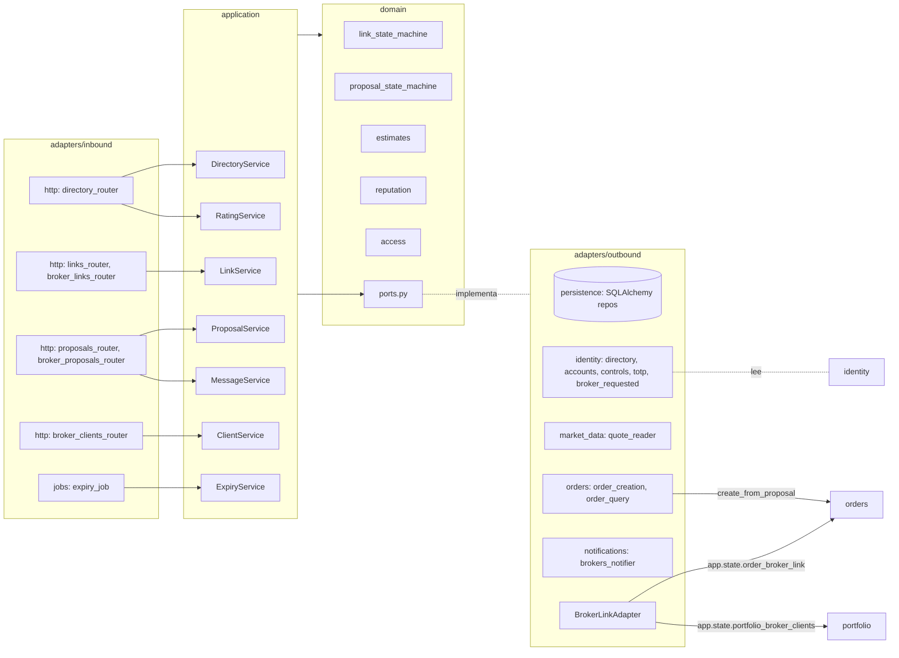
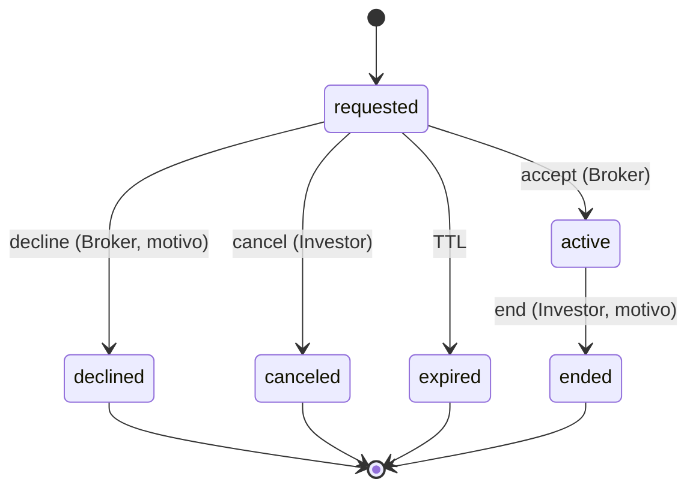
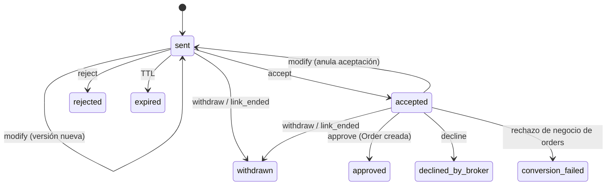

# Design Document: brokers-mod-06

## Overview

Este diseño implementa MOD-06 como el paquete `brokers` (`src/acciones_ud/brokers/`) del monolito modular hexagonal. Cubre el perfil público del comisionista y el directorio (RF-13, RF-23), el ciclo de vida de la vinculación y su historial (RF-13, RF-14, RF-15), la solicitud de comisionista y la autorización para operar (RFP-09), las propuestas con versiones, decisiones, mensajes, aprobación interna y conversión en orden (RF-16 a RF-21), las calificaciones y la reputación (RF-22, RF-23) y el portal de clientes del comisionista (RFP-05) con la regla de pertenencia de RFP-04.

El módulo reemplaza los adaptadores nulos que dejaron los módulos previos: `NullBrokerLink` de `orders` (`app.state.order_broker_link`) y `NullBrokerClient` de `portfolio` (`app.state.portfolio_broker_clients`) quedan sustituidos por un único Broker_Link_Adapter. También provee a `identity` el adaptador de `associated_broker` de `/users/me`. Requiere dos cambios aditivos en `orders` (caso de uso `create_from_proposal` y consulta de órdenes por Investor) y dos en `identity` (tipos de evento y lector de `associated_broker`), descritos en "Cambios aditivos en otros módulos".

Decisiones de diseño adicionales a las del requisito (B1 a B23, A1 a A3):

- **D1 (conversión en dos transacciones, interpretación de Req. 10.2):** la Order no puede crearse dentro de la transacción de `brokers`, porque `create_from_proposal` de `orders` confirma su propia transacción (Order, Reservation, Idempotency_Key y evento) y luego llama a Alpaca fuera de ella (D1 de `orders-mod-03`). Por eso la aprobación sigue este orden: (1) `orders` crea la Order con la clave de idempotencia `proposal:{proposal_id}`; (2) `brokers` confirma en una sola transacción la Proposal en `approved`, el `order_id`, la decisión con evidencia y el evento. "En la misma transacción" del Req. 10.2 se cumple para el estado de `brokers`. Si el proceso cae entre (1) y (2), la Order existe y la Proposal sigue `accepted`; el siguiente intento de aprobación o el Expiry_Job la completan consultando la Order por la clave de idempotencia (D3). La clave única `(user_id, idempotency_key)` de `order_idempotency_keys` garantiza una sola Order por Proposal (B13).
- **D2 (frontera entre rechazo e indisponibilidad):** `create_from_proposal` devuelve uno de tres resultados. `OrderCreated(order_id)` significa que la Order quedó persistida, cualquiera que sea su estado posterior; un fallo de Alpaca al enviarla después de persistirla es parte del ciclo de vida de la Order en `orders` (puede terminar Fallida y `orders` lo notifica con `order_updates`). `OrderRejected(code)` es un rechazo de negocio antes de persistir (instrumento, poder de compra, tenencia, límite diario, `ORDER_REJECTED`) y lleva la Proposal a `conversion_failed` (Req. 10.5). Las excepciones `AlpacaUnavailableError`, `AlpacaRateLimitedError` y `DatabaseUnavailableError` antes de persistir dejan la Proposal en `accepted` (Req. 10.6).
- **D3 (Expiry_Job y Orders huérfanas):** las Proposals `accepted` no expiran (Req. 8.6). En cada ejecución, el Expiry_Job revisa las Proposals `accepted` con una decisión `approve` intentada y consulta `Order_Query_Port.find_by_idempotency_key(investor_id, "proposal:{id}")`. Si existe una Order, la Proposal pasa a `approved` con ese `order_id` y la evidencia de esa decisión. Así nunca queda una Order huérfana de una Proposal.
- **D4 (umbral de TOTP en la aceptación):** el umbral es `high_order_threshold_usd` de las Order_Controls del Investor (las mismas que lee `orders`). B12 dice "alcanza", así que la comparación es `estimated_cost >= high_order_threshold_usd`. `orders` usa `>` estricto (O10); la diferencia solo aplica en la igualdad exacta y deja la aceptación de la propuesta del lado más estricto.
- **D5 (Link de la calificación):** si el Investor tuvo varias Links con el mismo Broker, la Rating se asocia a la Link más reciente en `active` o `ended` (mayor `requested_at`). Publicar de nuevo reemplaza la Rating de esa Link (B17).
- **D6 (expiración al leer sin escribir):** las consultas aplican la regla pura `effective_status` y devuelven `expired` sin persistir. Las transiciones y el Expiry_Job persisten la expiración con una actualización condicional (`WHERE status = :esperado`), que garantiza una sola notificación por transición (Req. 18.6). Antes de insertar una Link nueva, el Link_Service persiste la expiración de la Link `requested` vencida del mismo Investor para no chocar con el índice único de B2.
- **D7 (prefijos por rol):** las rutas de Broker empiezan con `/broker/` y las de Investor con `/broker-links`, `/proposals` o `/brokers`. Un usuario con ambos roles (A1) elige el rol por la ruta, sin parámetro adicional.
- **D8 (fuente de datos de `identity`):** `brokers` lee `users`, `role_assignments`, `kyc_accounts`, `broker_requested`, `firm_name` y las Order_Controls mediante adaptadores de salida propios en `brokers/adapters/outbound/identity/`, por decisión explícita de la regla de módulos, igual que `orders` y `wallet`. No escribe en tablas de `identity`.

### Investigación (resumen)

- **Contratos previos:** `orders-mod-03/design.md` (sección "Contratos publicados para módulos futuros") define `BrokerLinkPort` con `reviewing_broker`, `is_linked` y `linked_investors`; `orders.composition` toma `app.state.order_broker_link` si existe antes de `orders.startup`. `BROKER_SIGNED` admite salidas a `SUBMITTED`, `HELD` e `IN_REVIEW`, y el Order_Scheduler selecciona Orders en `BROKER_SIGNED` con `scheduled_for <= now`. La firma del Broker se reconoce por el evento hacia `BROKER_SIGNED` con `actor_type = 'broker'` (D2 de `portfolio-mod-05`, `ExecutionLedger`).
- **`portfolio-mod-05/design.md`:** `BrokerClientPort` con `linked_investors` e `is_linked`, resuelto desde `app.state.portfolio_broker_clients`; es el mismo contrato que `BrokerLinkPort` sin `reviewing_broker`, así que un solo adaptador implementa ambos Protocol.
- **Patrón de lectores en `identity`:** `wallet-mod-04` agregó `ContractedPlanReader` en `identity/domain/` resuelto desde `app.state.contracted_plan_reader`. `associated_broker` sigue el mismo patrón.
- **Notificaciones:** `RecipientDirectory.recipient(user_id, event_type)` (agregado por `wallet`) y `Notifier.notify` de `market_data`.
- **Alpaca:** el módulo no llama a Alpaca directamente. La cotización y el estado de negociación vienen de `market_data`; la creación y el envío de la Order los hace `orders`.

## Architecture



Estructura de paquetes:

```text
src/acciones_ud/brokers/
  domain/        entities.py, link_state_machine.py, proposal_state_machine.py, estimates.py,
                 reputation.py, access.py, periods.py, errors.py, ports.py
  application/   directory_service.py, link_service.py, proposal_service.py, message_service.py,
                 rating_service.py, client_service.py, expiry_service.py, commands.py, dtos.py
  adapters/inbound/http/   directory_router.py, links_router.py, broker_links_router.py,
                           proposals_router.py, broker_proposals_router.py, broker_clients_router.py,
                           schemas/
  adapters/inbound/jobs/   expiry_job.py
  adapters/outbound/persistence/   models.py, link_repository.py, proposal_repository.py,
                                   rating_repository.py, profile_repository.py, event_repository.py
  adapters/outbound/identity/      broker_directory.py, linked_account_reader.py, controls_reader.py,
                                   totp_verifier.py, broker_request_reader.py, associated_broker_reader.py
  adapters/outbound/market_data/   quote_reader.py
  adapters/outbound/orders/        order_creation.py, order_query.py
  adapters/outbound/notifications/ brokers_notifier.py
  adapters/outbound/broker_link_adapter.py
  composition.py
```

### Registro en `main.py`

`main.py` registra los módulos en este orden:

```text
register: identity → market_data → wallet → orders → portfolio → brokers
startup:  identity → market_data → wallet → orders → portfolio → brokers
shutdown: brokers → portfolio → orders → wallet → market_data → identity
```

- `brokers.register(app)` monta los routers, construye el `BrokerLinkAdapter` (solo necesita `session_factory`), lo asigna a `app.state.order_broker_link` y a `app.state.portfolio_broker_clients`, y asigna `app.state.associated_broker_reader`. `orders` y `portfolio` leen esos valores en su `startup` (contratos de sus diseños) y todos los `register` corren antes que cualquier `startup`, así que el adaptador ya está instalado cuando arrancan (Req. 16.3). Si la implementación de `orders` o `portfolio` resolviera el adaptador en `register`, `brokers.register` debe moverse antes del `register` de ese módulo; la tarea de cableado lo verifica con una prueba de humo.
- `brokers.startup(app)` resuelve los puertos que publica `orders` (`app.state.order_proposal_creation` y `app.state.order_query_port`, asignados en `orders.register`) y arranca el Expiry_Job si `BROKERS_JOBS_ENABLED` es `true` (por defecto `true`; las pruebas lo apagan). Si `orders` no publicó sus puertos, `startup` falla con un error de configuración explícito.

### Flujo de vinculación

```mermaid
sequenceDiagram
    participant I as Investor
    participant API as links_router
    participant LS as LinkService
    participant DB as broker_links
    participant N as Notifier
    participant B as Broker
    I->>API: POST /broker-links {broker_id, consent_accepted}
    API->>LS: request_link
    LS->>DB: TX: expira requested vencida del Investor; INSERT requested (índice único parcial)
    LS->>N: broker_link_updates → Broker
    B->>API: POST /broker/link-requests/{id}/accept
    API->>LS: accept
    LS->>DB: TX: SELECT FOR UPDATE; transition(requested, accept) → active; evento
    LS->>N: broker_link_updates → Investor
    I->>API: POST /broker-links/{id}/trading-authorization {consent_accepted}
    I->>API: POST /broker-links/{id}/end {reason, confirmed}
    API->>LS: end_link
    LS->>DB: TX: active → ended; revoca autorización; Proposals sent/accepted → withdrawn(link_ended); eventos
    LS->>N: broker_link_updates → Broker; proposal_updates → Broker e Investor
```

### Flujo de propuesta y conversión

```mermaid
sequenceDiagram
    participant B as Broker
    participant PS as ProposalService
    participant Q as Quote_Port
    participant I as Investor
    participant OC as Order_Creation_Port
    participant ORD as orders.create_from_proposal
    participant DB as proposals
    B->>PS: create(investor_id, symbol, side, qty, type, limit_price)
    PS->>PS: access.require_active_link(broker, investor); Linked_Account
    PS->>Q: quote(symbol)
    PS->>DB: TX: Proposal sent + Version 1 + evento
    I->>PS: decide(accept, version, comment, totp_code?)
    PS->>PS: estimates.requires_totp(cost, threshold) → verificar TOTP
    PS->>DB: TX: SELECT FOR UPDATE; sent → accepted; decisión; evento
    B->>PS: broker_decide(approve, version, evidence)
    PS->>PS: estado accepted, versión vigente, Trading_Authorization vigente, evidencia del hilo
    PS->>OC: create(proposal_id, investor_id, broker_id, version aceptada)
    OC->>ORD: idempotency_key = proposal:{id}
    ORD-->>OC: OrderCreated(order_id) | OrderRejected(code) | excepción
    PS->>DB: TX: accepted → approved + order_id + decisión + evento (o → conversion_failed)
```

### Ciclo de vida de una Link (B1)



### Ciclo de vida de una Proposal (B8)



B8 define la transición de rechazo de negocio como `approved` → `conversion_failed`. Como `brokers` solo persiste `approved` cuando existe la Order (D1), el rechazo se registra en la misma transacción como `accepted` → `conversion_failed` y el evento guarda `attempted: approve`. El resultado observable es el de B13: la Proposal termina en `conversion_failed` con el código recibido y sin `order_id`.

## Components and Interfaces

### Puertos de salida (`brokers/domain/ports.py`)

```python
class BrokerDirectoryPort(Protocol):
    async def get_broker(self, user_id: UUID) -> BrokerIdentity | None: ...      # solo con rol broker vigente
    async def search(self, text: str, exclude: UUID, cursor: SearchCursor | None,
                     limit: int) -> list[BrokerIdentity]: ...
    async def all_active(self, exclude: UUID) -> list[BrokerIdentity]: ...
    async def has_role(self, user_id: UUID, role: Literal["investor", "broker"]) -> bool: ...
    async def display_name(self, user_id: UUID) -> str | None: ...

class BrokerRequestPort(Protocol):
    async def broker_requested(self, investor_id: UUID) -> bool: ...

class LinkedAccountPort(Protocol):
    async def has_linked_account(self, investor_id: UUID) -> bool: ...

class OrderControlsPort(Protocol):
    async def high_order_threshold_usd(self, investor_id: UUID) -> Decimal: ...

class TotpVerifierPort(Protocol):
    async def verify(self, user_id: UUID, code: str) -> bool: ...

class QuotePort(Protocol):
    async def tradable(self, symbol: str) -> bool: ...
    async def last_price(self, symbol: str) -> Decimal | None: ...

class OrderCreationPort(Protocol):
    async def create(self, command: ProposalOrderCommand) -> OrderCreated | OrderRejected: ...
    # lanza AlpacaUnavailableError, AlpacaRateLimitedError o DatabaseUnavailableError (D2)

class OrderQueryPort(Protocol):
    async def list_for_investor(self, investor_id: UUID, filters: OrderFilters) -> OrderPage: ...
    async def find_by_idempotency_key(self, investor_id: UUID, key: str) -> UUID | None: ...

class BrokersNotifierPort(Protocol):
    async def notify(self, user_id: UUID, event_type: Literal["broker_link_updates", "proposal_updates"],
                     payload: Mapping[str, object]) -> None: ...

class Clock(Protocol): ...   # reutiliza shared/domain Clock
```

`ProposalOrderCommand(proposal_id, investor_id, broker_id, symbol, side, qty, type, limit_price, time_in_force="day")`. Los repositorios (`LinkRepository`, `TradingAuthorizationRepository`, `ProposalRepository`, `MessageRepository`, `RatingRepository`, `ProfileRepository`, `BrokerEventRepository`) son Protocol en `ports.py` con implementación SQLAlchemy en `adapters/outbound/persistence/`.

### Reglas de dominio puras (`brokers/domain/`)

Concentran la lógica crítica y no hacen I/O:

- `link_state_machine.transition(current: LinkStatus, action: LinkAction) -> LinkStatus`: tabla `ALLOWED` de B1 con acciones `accept`, `decline`, `cancel`, `expire`, `end`. Lanza `InvalidLinkStateError(current)` para todo par fuera de la tabla. `is_terminal(status)` y `is_open(status)` (`requested` o `active`).
- `link_state_machine.effective_status(link, now, ttl_days) -> LinkStatus`: `expired` si `status == requested` y `now >= requested_at + ttl_days`; si no, `status` (B23, D6).
- `link_state_machine.actor_allowed(action, actor_role) -> bool`: `accept` y `decline` solo Broker; `cancel` y `end` solo Investor; `expire` solo sistema.
- `proposal_state_machine.transition(current: ProposalStatus, action: ProposalAction) -> ProposalStatus`: tabla de B8 con acciones `modify`, `accept`, `reject`, `withdraw`, `approve`, `decline`, `conversion_fail`, `expire`. Lanza `InvalidProposalStateError(current)`.
- `proposal_state_machine.check_version(current_version: int, seen_version: int) -> None`: lanza `ProposalVersionConflictError(current_version)` si difieren (B9). Toda acción comprueba el estado primero y la versión después, de modo que una acción inválida en un estado terminal responde `INVALID_PROPOSAL_STATE` aunque la versión también sea vieja.
- `proposal_state_machine.effective_status(proposal, now, ttl_hours) -> ProposalStatus`: `expired` si el estado es `sent` y `now >= last_version_at + ttl_hours`; una Proposal `accepted` conserva su estado (Req. 8.6).
- `estimates.reference_price(type, limit_price, last_price) -> Decimal`: `limit_price` para `limit`; `last_price` para `market`, o `QuoteUnavailableError` si es `None` (B10).
- `estimates.estimated_cost(qty, reference_price, rate) -> Decimal`: `(qty × reference_price × (1 + rate)).quantize(Decimal("0.01"), ROUND_HALF_EVEN)` en `localcontext(prec=40)`.
- `estimates.requires_totp(estimated_cost, threshold) -> bool`: `estimated_cost >= threshold` (D4).
- `reputation.average(stars: Sequence[int]) -> Decimal | None`: media aritmética con `ROUND_HALF_EVEN` a 2 decimales, `None` si la secuencia está vacía (B18).
- `reputation.upsert(ratings: Mapping[UUID, Rating], link_id, stars, comment, now) -> Mapping[UUID, Rating]`: reemplazo por Link (B17); el repositorio aplica la misma semántica con `INSERT ... ON CONFLICT (link_id) DO UPDATE`.
- `access.require_active_link(link: Link | None, broker_role_active: bool, resource: ResourceKind) -> Link`: devuelve la Link si está `active` y el Broker tiene rol vigente; en otro caso lanza `NotFoundError` con el código del recurso (`LINK_NOT_FOUND`, `PROPOSAL_NOT_FOUND`, `CLIENT_NOT_FOUND`) (B4).
- `access.resolve_link_membership(links, broker_roles) -> dict[UUID, set[UUID]]`: modelo de referencia del Broker_Link_Adapter usado en pruebas.
- `periods.to_utc_range(period) -> tuple[datetime, datetime]`: `[from 00:00, to+1 00:00)` en `America/New_York` convertido a UTC; `InvalidPeriodError` si `from > to`.
- `periods.link_overlaps(link, start, end, now) -> bool`: `requested_at < end` y `(ended_at or responded_at_terminal or now) >= start` (B19).

### Casos de uso (`brokers/application/`)

| Servicio | Operaciones | Requisitos |
|---|---|---|
| DirectoryService | `update_profile`, `get_profile`, `suggestions`, `search` | 1, 2 |
| LinkService | `request_link`, `accept`, `decline`, `cancel`, `end_link`, `pending_requests`, `history`, `current`, `grant_trading`, `revoke_trading`, `set_order_review` | 3, 4, 5, 6 |
| ProposalService | `create`, `modify`, `withdraw`, `investor_decide`, `broker_decide`, `history_investor`, `history_broker`, `detail` | 7, 8, 9, 10, 12 |
| MessageService | `post`, `thread` | 11 |
| RatingService | `publish`, `reputation`, `reviews` | 13, 14 |
| ClientService | `clients`, `client_orders` | 15 |
| ExpiryService | `run_once(now)` | 3.8, 8.6, 18.6 |

Reglas de transacción comunes:

- Cada transición abre una unidad de trabajo, lee la entidad con `SELECT ... FOR UPDATE`, aplica `effective_status` y persiste una expiración pendiente antes de evaluar la acción (D6), aplica la máquina de estados, guarda el `BrokerEvent` (B22) y confirma. Las notificaciones se envían después del commit; un fallo del Notifier se registra en log y no revierte la transición.
- `request_link` comprueba en orden: rol `investor` (403), `consent_accepted` (422 `CONSENT_REQUIRED`), Broker igual al solicitante (422 `VALIDATION_ERROR`), Broker existente con rol vigente (404 `BROKER_NOT_FOUND`), Link abierta del Investor (409 `LINK_ALREADY_EXISTS`). El índice único parcial `ux_broker_links_open_investor` cubre la carrera entre dos solicitudes simultáneas: la violación de unicidad se traduce a `LINK_ALREADY_EXISTS`.
- `end_link` (Req. 4.3, 4.5–4.7, B20) en una sola transacción: Link `active` → `ended`; si existe Trading_Authorization vigente, `revoked_at = now` y motivo `link_ended` (sin vigente, la Link termina igual y sin error); si esa revocación falla, la transacción completa se revierte y la Link, la autorización y las Proposals quedan sin cambios; Proposals `sent` y `accepted` de la Link → `withdrawn` con `status_reason = link_ended`; un evento por cada entidad. `order_review_enabled` conserva su valor histórico, pero `reviewing_broker` ya no devuelve el Broker porque la Link no está `active`.
- `grant_trading` exige Active_Link (409 `INVALID_LINK_STATE` si no) y `consent_accepted` (422 `CONSENT_REQUIRED`). Si ya hay una Trading_Authorization vigente, la operación es idempotente y la devuelve sin crear otra. El índice único parcial `ux_trading_auth_active_link` garantiza una vigente por Link (Req. 6.5). `revoke_trading` sin autorización vigente responde 409 `INVALID_LINK_STATE` con `details.reason = "no_active_authorization"`.
- `broker_decide(approve)` comprueba en orden: Active_Link (404 `PROPOSAL_NOT_FOUND`), estado (si es `approved`, devuelve la Order existente, Req. 10.4; si no es `accepted`, 409 `INVALID_PROPOSAL_STATE`), versión (409 `PROPOSAL_VERSION_CONFLICT`), evidencia (422 `VALIDATION_ERROR` si un identificador no pertenece al hilo), Trading_Authorization vigente (409 `TRADING_AUTHORIZATION_REQUIRED`). Después libera el bloqueo, llama a `OrderCreationPort.create` con la versión aceptada y abre una segunda transacción que vuelve a leer la Proposal con `FOR UPDATE`: si sigue `accepted` en la misma versión, aplica `approve` o `conversion_fail`; si otra solicitud concurrente ya la dejó `approved` con el mismo `order_id`, devuelve esa Order; si cambió por otra causa (retirada por fin de Link), registra el `order_id` en el evento con `details.orphan_order = true` y responde 409 `INVALID_PROPOSAL_STATE`. La Order ya creada sigue su curso en `orders` (B20).
- `investor_decide(accept)` comprueba Linked_Account (409 `ACCOUNT_NOT_LINKED`, A3), estado, versión y, si `requires_totp`, el código TOTP (401 `EXTRA_AUTHORIZATION_INVALID`). El TOTP se verifica antes de abrir la transacción; el código nunca se guarda ni se registra en logs ni eventos.

### Broker_Link_Adapter (`adapters/outbound/broker_link_adapter.py`)

Implementa `BrokerLinkPort` de `orders` y `BrokerClientPort` de `portfolio` (Req. 16.1, 16.2) con una consulta por llamada:

- `is_linked(broker_id, investor_id)`: existe Link `status = 'active'` entre ambos y el Broker tiene asignación de rol `broker` en estado `ACTIVE` (join con `role_assignments`).
- `linked_investors(broker_id)`: `investor_id` de las Links `active` del Broker, con la misma condición de rol, ordenados por `started_at`.
- `reviewing_broker(investor_id)`: `broker_id` de la Link `active` del Investor si `order_review_enabled` es true y el Broker tiene rol vigente; en otro caso `None` (B7).

Las Links `requested` vencidas no cuentan, porque nunca están `active`. El adaptador no cachea resultados: al terminar la Link, la siguiente llamada ya devuelve `False` (B4).

### Endpoints HTTP

Todos usan la cookie `access_token` mediante `get_current_user` de `identity`; sin sesión válida responden 401. Las rutas de Investor usan `require_investor` y las de Broker `require_broker`; sin el rol responden 403 `FORBIDDEN` (Req. 17.4). Tags OpenAPI: `brokers`, `broker-links`, `proposals` y `broker-portal`. `page_size` admite 1 a 100 con defecto 20; `cursor` es un token opaco base64 de la clave de orden del último elemento. Cada ruta declara `responses={código: {"model": ErrorBody}}` (Req. 18.5). Cantidades, precios e importes viajan como cadenas decimales, igual que en `orders`.

| Método y ruta | Rol | Respuesta | Errores declarados | Req. |
|---|---|---|---|---|
| `GET /brokers/suggestions` | investor | 200 `BrokerSummary[]` | 401, 403, 503 | 2.1, 2.4 |
| `GET /brokers?q&cursor&page_size` | investor | 200 `BrokerPage` | 401, 403, 422, 503 | 2.2–2.4 |
| `GET /brokers/{broker_id}` | público (sin sesión) | 200 `BrokerProfileResponse` (solo campos públicos) | 404 `BROKER_NOT_FOUND`, 503 | 1.3–1.5, 17.4, 18.7 |
| `PUT /brokers/me/profile` | broker | 200 `BrokerProfileResponse` | 401, 403, 422, 503 | 1.1, 1.2 |
| `GET /brokers/{broker_id}/reputation` | autenticado | 200 `ReputationResponse` | 401, 404, 503 | 14.1–14.3 |
| `GET /brokers/{broker_id}/reviews?cursor&page_size` | autenticado | 200 `ReviewPage` | 401, 404, 503 | 14.4 |
| `PUT /brokers/{broker_id}/rating` `{stars, comment}` | investor | 200 `RatingResponse` | 401, 403, 404, 409 `RATING_NOT_ALLOWED`, 422, 503 | 13 |
| `POST /broker-links` `{broker_id, consent_accepted}` | investor | 201 `LinkResponse` | 401, 403, 404, 409 `LINK_ALREADY_EXISTS`, 422 (`CONSENT_REQUIRED`, `VALIDATION_ERROR`), 503 | 3.1–3.4 |
| `GET /broker-links/current` | investor | 200 `CurrentLinkResponse` (sin Link abierta: campos de Link y Trading_Authorization en null) | 401, 403, 503 | 5.5, 5.6, 6.1 |
| `GET /broker-links?status&from&to&cursor&page_size` | investor | 200 `LinkPage` | 401, 403, 422, 503 | 5.1–5.4 |
| `POST /broker-links/{id}/cancel` | investor | 200 `LinkResponse` | 401, 403, 404 `LINK_NOT_FOUND`, 409 `INVALID_LINK_STATE`, 503 | 3.7, 3.9 |
| `POST /broker-links/{id}/end` `{reason, confirmed}` | investor | 200 `LinkResponse` | 401, 403, 404, 409, 422 (`CONFIRMATION_REQUIRED`, `VALIDATION_ERROR`), 503 | 4 |
| `PUT /broker-links/{id}/order-review` `{enabled}` | investor | 200 `LinkResponse` | 401, 403, 404, 409, 503 | 6.6 |
| `POST /broker-links/{id}/trading-authorization` `{consent_accepted}` | investor | 201 `TradingAuthorizationResponse` | 401, 403, 404, 409, 422 `CONSENT_REQUIRED`, 503 | 6.2, 6.3, 6.5 |
| `POST /broker-links/{id}/trading-authorization/revoke` | investor | 200 `TradingAuthorizationResponse` | 401, 403, 404, 409, 503 | 6.4 |
| `GET /broker/link-requests` | broker | 200 `LinkRequest[]` | 401, 403, 503 | 3.10 |
| `POST /broker/link-requests/{id}/accept` | broker | 200 `LinkResponse` | 401, 403, 404, 409, 503 | 3.5, 3.9 |
| `POST /broker/link-requests/{id}/decline` `{reason}` | broker | 200 `LinkResponse` | 401, 403, 404, 409, 422, 503 | 3.6, 3.9 |
| `POST /broker/proposals` `{investor_id, symbol, side, qty, type, limit_price}` | broker | 201 `ProposalDetail` | 401, 403, 404 `CLIENT_NOT_FOUND`, 409 `ACCOUNT_NOT_LINKED`, 422 (`VALIDATION_ERROR`, `ASSET_NOT_TRADABLE`), 503 (`QUOTE_UNAVAILABLE`, `DATABASE_UNAVAILABLE`) | 7 |
| `GET /broker/proposals?status&from&to&cursor&page_size` | broker | 200 `ProposalPage` | 401, 403, 422, 503 | 12.2, 12.3 |
| `GET /broker/proposals/{id}` | broker | 200 `ProposalDetail` | 401, 403, 404 `PROPOSAL_NOT_FOUND`, 503 | 12.4 |
| `PUT /broker/proposals/{id}` `{version, symbol, side, qty, type, limit_price}` | broker | 200 `ProposalDetail` | 401, 403, 404, 409 (`INVALID_PROPOSAL_STATE`, `PROPOSAL_VERSION_CONFLICT`), 422, 503 | 8.1, 8.2, 8.4, 8.5 |
| `POST /broker/proposals/{id}/withdraw` `{version, reason, confirmed}` | broker | 200 `ProposalDetail` | 401, 403, 404, 409, 422 (`CONFIRMATION_REQUIRED`, `VALIDATION_ERROR`), 503 | 8.3–8.5 |
| `POST /broker/proposals/{id}/decision` `{version, decision, evidence_message_ids, evidence_text}` | broker | 200 `ProposalDetail` | 401, 403, 404, 409 (`INVALID_PROPOSAL_STATE`, `PROPOSAL_VERSION_CONFLICT`, `TRADING_AUTHORIZATION_REQUIRED`), 422, 502 `ALPACA_UNAVAILABLE`, 503 (`ALPACA_RATE_LIMITED`, `DATABASE_UNAVAILABLE`) | 10 |
| `POST /broker/proposals/{id}/messages` `{body}` / `GET ...?cursor` | broker | 201 `Message` / 200 `MessagePage` | 401, 403, 404, 422, 503 | 11 |
| `GET /proposals?status&from&to&cursor&page_size` | investor | 200 `ProposalPage` | 401, 403, 422, 503 | 12.1, 12.3 |
| `GET /proposals/{id}` | investor | 200 `ProposalDetail` | 401, 403, 404, 503 | 12.4 |
| `POST /proposals/{id}/decision` `{version, decision, comment, totp_code}` | investor | 200 `ProposalDetail` | 401 `EXTRA_AUTHORIZATION_INVALID`, 403, 404, 409 (`INVALID_PROPOSAL_STATE`, `PROPOSAL_VERSION_CONFLICT`, `ACCOUNT_NOT_LINKED`), 422, 503 | 9 |
| `POST /proposals/{id}/messages` `{body}` / `GET ...?cursor` | investor | 201 `Message` / 200 `MessagePage` | 401, 403, 404, 422, 503 | 11 |
| `GET /broker/clients` | broker | 200 `ClientSummary[]` | 401, 403, 503 | 15.1 |
| `GET /broker/clients/{investor_id}/orders?status&symbol&from&to&cursor&page_size` | broker | 200 `OrderPage` de `orders` | 401, 403, 404 `CLIENT_NOT_FOUND`, 422, 503 | 15.2, 15.3 |

- `ProposalDetail` incluye `id`, `status`, `status_reason`, `current_version`, `accepted_version`, `order_id`, `failure_code`, `broker`, `investor`, `versions[]` (número, símbolo, lado, cantidad, tipo, precio límite, precio de referencia, costo estimado, fecha), `decisions[]` (actor, decisión, versión, comentario, evidencia, fecha), `created_at`, `updated_at`, `expires_at`. El listado (`ProposalPage`) devuelve el resumen del Req. 12.1.
- `GET /broker/clients/{investor_id}/orders` reutiliza los esquemas `OrderPage` y los parámetros de `GET /orders` de `orders/adapters/inbound/http/schemas/` para que el contrato sea idéntico (Req. 15.2). El portafolio del cliente se consulta en `/portfolio/broker/clients/{investor_id}/positions` de `portfolio` (Req. 15.4).
- Una repetición de `approve` sobre una Proposal `approved` responde 200 con el mismo `ProposalDetail` y el mismo `order_id` (Req. 10.4).

Nuevos códigos en `ErrorCode` (`shared/domain/errors.py`): `BROKER_NOT_FOUND`, `CONSENT_REQUIRED`, `LINK_ALREADY_EXISTS`, `INVALID_LINK_STATE`, `LINK_NOT_FOUND`, `PROPOSAL_NOT_FOUND`, `PROPOSAL_VERSION_CONFLICT`, `INVALID_PROPOSAL_STATE`, `TRADING_AUTHORIZATION_REQUIRED`, `RATING_NOT_ALLOWED`, `CLIENT_NOT_FOUND`. `CONFIRMATION_REQUIRED`, `VALIDATION_ERROR`, `ASSET_NOT_TRADABLE`, `QUOTE_UNAVAILABLE`, `ACCOUNT_NOT_LINKED`, `EXTRA_AUTHORIZATION_INVALID`, `FORBIDDEN`, `ALPACA_UNAVAILABLE`, `ALPACA_RATE_LIMITED` y `DATABASE_UNAVAILABLE` se reutilizan si ya existen; si `CONFIRMATION_REQUIRED` no existe, se agrega.

### Cambios aditivos en otros módulos

1. **`orders`** (contrato nuevo entre módulos, B11; sin endpoints HTTP nuevos, Req. 16.5):
   - `orders/application/proposal_orders.py` define `create_from_proposal(command: ProposalOrderCommand) -> OrderCreated | OrderRejected`. Construye un `OrderRequest` con `order_class = simple`, `time_in_force = day`, `schedule_if_closed = true` y `confirmed = true`, y usa como Idempotency_Key `proposal:{proposal_id}` con `user_id` del Investor. Aplica las mismas validaciones que `POST /orders` (parámetros, instrumento negociable, cotización, poder de compra, tenencia, límite diario, bloqueo por Investor D3 de `orders`) y omite solo la autorización adicional (TOTP o reconocimiento), sustituida por la aceptación con TOTP y la Trading_Authorization (B11). La Order se crea en `BROKER_SIGNED` con un evento `null → BROKER_SIGNED`, `actor_type = 'broker'`, `actor_id = broker_id` y `reason = proposal:{proposal_id}`, de modo que `ExecutionLedger` de `portfolio` la atribuye al Broker firmante. Con el mercado abierto llama `OrderSubmitter.submit(order_id, waited=False)`; con el mercado cerrado fija `scheduled_for` en la próxima apertura y la deja al Order_Scheduler. Una repetición con la misma clave devuelve `OrderCreated` con la misma Order sin llamar a Alpaca (Property 8 de `orders-mod-03`).
   - `state_machine` de `orders` admite `BROKER_SIGNED` como estado inicial solo para Orders creadas por `create_from_proposal`. Las demás transiciones no cambian.
   - `orders.register(app)` publica `app.state.order_proposal_creation` (el caso de uso anterior) y `app.state.order_query_port`, que expone `list_for_investor(investor_id, filters)` (el mismo caso de uso que atiende `GET /orders`) y `find_by_idempotency_key(user_id, key) -> UUID | None` sobre `order_idempotency_keys`.
2. **`identity`**:
   - `EVENT_TYPES` de `identity/domain/preferences.py` agrega `broker_link_updates` y `proposal_updates` con `in_app` habilitado por defecto (Req. 18.1, B21). Si las preferencias se guardan por fila, la migración `0009_brokers_schema` inserta los valores por defecto para los usuarios existentes.
   - `identity/domain/` define el Protocol `AssociatedBrokerReader.associated_broker(investor_id) -> AssociatedBroker | None`, resuelto desde `app.state.associated_broker_reader`; si no existe, `/users/me` devuelve `associated_broker: null`. El esquema de `/users/me` pasa a `associated_broker: AssociatedBrokerOut | None` con `id`, `name`, `firm_name` y `since` (fecha de inicio de la Active_Link) (Req. 16.4). Es un cambio aditivo del contrato que el frontend debe mostrar.
3. **`market_data`**: sin cambios. `quote_reader.py` de `brokers` usa el caso de uso de cotización existente y `InstrumentRepository.get(symbol)` (`active` y `tradable`), igual que los adaptadores de `orders`.

### Expiry_Job

Tarea asyncio en `adapters/inbound/jobs/expiry_job.py` con intervalo `BROKERS_EXPIRY_INTERVAL_SECONDS` (por defecto 300). `ExpiryService.run_once(now)`:

1. Links: `UPDATE broker_links SET status = 'expired' ... WHERE status = 'requested' AND expires_at <= now RETURNING id`, un `BrokerEvent` por fila y notificación `broker_link_updates` al Investor por fila devuelta (Req. 3.8).
2. En la misma ejecución, Proposals `sent` con `expires_at <= now`, en lotes con `FOR UPDATE SKIP LOCKED`: pasan a `expired` con evento y notificación `proposal_updates` al Broker y al Investor por fila (Req. 8.6, 18.6).
3. Proposals `accepted`: no expiran; solo se aplica la reconciliación de D3.

Una excepción en un ciclo se registra en log y el siguiente ciclo reintenta. Como la actualización es condicional, una transición ya aplicada por una solicitud HTTP no se repite ni se notifica dos veces.

## Data Models

### Entidades de dominio (dataclasses `frozen=True`)

- `LinkStatus` (StrEnum): `requested`, `active`, `declined`, `canceled`, `expired`, `ended`. `LinkAction`: `accept`, `decline`, `cancel`, `expire`, `end`.
- `Link(id, investor_id, broker_id, status, requested_at, expires_at, responded_at, started_at, ended_at, decline_reason, end_reason, consent_version, consent_accepted_at, order_review_enabled)`.
- `TradingAuthorization(id, link_id, consent_version, granted_at, revoked_at, revoke_reason: "investor" | "link_ended" | None)`; vigente si `revoked_at is None`.
- `ProposalStatus` (StrEnum): `sent`, `accepted`, `rejected`, `withdrawn`, `approved`, `declined_by_broker`, `conversion_failed`, `expired`. `ProposalAction`: `modify`, `accept`, `reject`, `withdraw`, `approve`, `decline`, `conversion_fail`, `expire`.
- `Proposal(id, link_id, broker_id, investor_id, status, status_reason, current_version, accepted_version, order_id, failure_code, created_at, updated_at, last_version_at, expires_at)`.
- `ProposalVersion(proposal_id, version, symbol, side: "buy" | "sell", qty: Decimal, type: "market" | "limit", limit_price: Decimal | None, time_in_force: "day", reference_price: Decimal, estimated_cost: Decimal, created_at)`.
- `ProposalDecision(id, proposal_id, version, actor_id, actor_role, decision: "accept" | "reject" | "approve" | "decline", comment, evidence_message_ids: tuple[UUID, ...], evidence_text, at)`.
- `ProposalMessage(id, proposal_id, author_id, body, created_at)`.
- `BrokerProfile(broker_id, specialty, years_experience, certifications: tuple[str, ...], description, updated_at)`.
- `Rating(link_id, investor_id, broker_id, stars: int, comment, created_at, updated_at)`.
- `Reputation(broker_id, name, average: Decimal | None, reviews_count, converted_proposals, distinct_investors, years_experience, broker_since)`.
- `BrokerEvent(id, entity_type: "link" | "trading_authorization" | "proposal", entity_id, from_status, to_status, actor_type: "investor" | "broker" | "system", actor_id, reason, details: dict[str, object], at)`.
- `BrokerIdentity(user_id, name, firm_name, license_number, broker_since)`.

### Tablas (migración `migrations/versions/0009_brokers_schema.py`)

| Tabla | Columnas principales | Restricciones |
|---|---|---|
| `broker_profiles` | `broker_id uuid`, `specialty text`, `years_experience smallint`, `certifications text[]`, `description text`, `updated_at timestamptz` | PK `broker_id` (FK `users`); CHECK `char_length(specialty) BETWEEN 1 AND 100`; CHECK `years_experience BETWEEN 0 AND 60`; CHECK `cardinality(certifications) <= 10`; CHECK `char_length(description) <= 1000` |
| `broker_links` | campos de `Link` | PK `id`; FK `investor_id`, `broker_id` a `users`; CHECK `investor_id <> broker_id`; CHECK `status IN (…6…)`; índice único parcial `ux_broker_links_open_investor (investor_id) WHERE status IN ('requested','active')` (B2); índice `(broker_id, status)`; índice `(investor_id, requested_at DESC, id)`; índice parcial `(expires_at) WHERE status = 'requested'` |
| `broker_trading_authorizations` | campos de `TradingAuthorization` | PK `id`; FK `link_id`; índice único parcial `ux_trading_auth_active_link (link_id) WHERE revoked_at IS NULL` (Req. 6.5) |
| `broker_proposals` | campos de `Proposal` | PK `id`; FK `link_id`; UNIQUE `order_id`; CHECK `status IN (…8…)`; CHECK `(status = 'approved') = (order_id IS NOT NULL)`; índices `(investor_id, created_at DESC, id)`, `(broker_id, created_at DESC, id)`; índice parcial `(expires_at) WHERE status IN ('sent','accepted')` |
| `broker_proposal_versions` | campos de `ProposalVersion`; `qty numeric(20,9)`, precios `numeric(18,4)`, `estimated_cost numeric(20,2)` | PK `(proposal_id, version)`; CHECK `qty > 0`; CHECK `(type = 'limit') = (limit_price IS NOT NULL)`; trigger de inmutabilidad (B9) |
| `broker_proposal_decisions` | campos de `ProposalDecision`; `evidence_message_ids uuid[]` | PK `id`; índice `(proposal_id, at)`; trigger de inmutabilidad |
| `broker_proposal_messages` | campos de `ProposalMessage` | PK `id`; CHECK `char_length(body) BETWEEN 1 AND 1000`; índice `(proposal_id, created_at, id)`; trigger de inmutabilidad (B14) |
| `broker_ratings` | campos de `Rating` | PK `link_id` (una por Link, B17); CHECK `stars BETWEEN 1 AND 5`; CHECK `char_length(comment) <= 1000`; índice `(broker_id, updated_at DESC, link_id)` |
| `broker_events` | campos de `BrokerEvent` | PK `id`; índice `(entity_type, entity_id, at)`; trigger `BEFORE UPDATE OR DELETE` que lanza error, con el patrón de `admin_audit_log` (B22, Req. 17.5) |

Todas las tablas habilitan RLS sin políticas, como el resto del esquema. La CHECK `(status = 'approved') = (order_id IS NOT NULL)` implementa B13 en la base de datos. Los triggers de inmutabilidad usan una función por tabla (`<tabla>_immutable()`). `downgrade` elimina triggers, funciones y tablas en orden inverso y, si la migración insertó preferencias por defecto, las borra. La migración depende de `0008_portfolio_schema` y no modifica datos existentes de otros módulos.

### Configuración (`config/settings.py`)

| Variable | Tipo | Defecto | Validación |
|---|---|---|---|
| `BROKER_LINK_REQUEST_TTL_DAYS` | int | 7 | 1 a 90 |
| `PROPOSAL_TTL_HOURS` | int | 72 | 1 a 720 |
| `BROKER_LINK_CONSENT_VERSION` | str | `"v1"` | 1 a 32 caracteres |
| `BROKER_TRADING_CONSENT_VERSION` | str | `"v1"` | 1 a 32 caracteres |
| `BROKERS_EXPIRY_INTERVAL_SECONDS` | int | 300 | 10 a 86400 |
| `BROKERS_JOBS_ENABLED` | bool | `true` | — |

`ORDER_REFERENCE_COMMISSION_RATE` se reutiliza desde la configuración de `orders` (B10). Un valor fuera de rango hace fallar el arranque con un error de configuración explícito (Req. 18.2).

## Correctness Properties

*A property is a characteristic or behavior that should hold true across all valid executions of a system-essentially, a formal statement about what the system should do. Properties serve as the bridge between human-readable specifications and machine-verifiable correctness guarantees.*

Por la Política de pruebas del requisito, las propiedades cubren solo las partes críticas: máquina de estados y unicidad de la Link, Trading_Authorization, autorización y propiedad, transiciones y versiones de la Proposal, conversión exactamente una vez y calificaciones. Las demás reglas se prueban con ejemplos opcionales.

### Property 1: Tabla de transiciones de la Link

*For any* estado de Link y *for any* acción de `LinkAction` con su rol de actor, `link_state_machine.transition` devuelve el estado destino de la tabla de B1 cuando el par está permitido y el actor coincide (`accept` y `decline` el Broker, `cancel` y `end` el Investor, `expire` el sistema); en cualquier otro caso lanza `InvalidLinkStateError` con el estado actual, y desde `declined`, `canceled`, `expired` y `ended` toda acción se rechaza.

**Validates: Requirements 3.5, 3.6, 3.7, 3.9, 4.1**

### Property 2: Como máximo una Link abierta por Investor

*For any* conjunto de Investors y Brokers y *for any* secuencia de operaciones `request_link`, `accept`, `decline`, `cancel`, `end_link` y avance del reloj sobre el LinkService con repositorios en memoria que aplican el índice único parcial, después de cada paso cada Investor tiene como máximo una Link en `requested` o `active`; una `request_link` con Link abierta efectiva responde `LINK_ALREADY_EXISTS` sin crear Link, una con `broker_id` igual al solicitante responde `VALIDATION_ERROR`, y una Link `requested` vencida por TTL no bloquea una solicitud nueva.

**Validates: Requirements 3.3, 3.4, 3.8**

### Property 3: Cascada del fin de la Link

*For any* Active_Link con *any* conjunto de Proposals en estados arbitrarios y con o sin Trading_Authorization vigente, `end_link` con motivo válido y `confirmed` en true deja la Link en `ended` con fecha y motivo, la Trading_Authorization vigente, si existía, con `revoked_at` y motivo `link_ended` (sin vigente, termina sin error), cada Proposal `sent` o `accepted` en `withdrawn` con `status_reason = link_ended`, las Proposals en otros estados sin cambio, un `BrokerEvent` por entidad modificada y ninguna Link ni evento borrado; con `confirmed` distinto de true no cambia nada y responde `CONFIRMATION_REQUIRED`; si la revocación falla (fallo inyectado en el repositorio), la Link, la autorización y las Proposals quedan sin cambios.

**Validates: Requirements 4.1, 4.2, 4.3, 4.4, 4.5, 4.6, 4.7**

### Property 4: Trading_Authorization única y ligada a la Active_Link

*For any* secuencia de operaciones `grant_trading`, `revoke_trading`, `accept` y `end_link` sobre Links en estados arbitrarios, cada Link tiene como máximo una Trading_Authorization con `revoked_at` nulo; `grant_trading` sin Active_Link responde `INVALID_LINK_STATE` sin crear registro; `revoke_trading` fija `revoked_at` en la hora del reloj; y ninguna Link fuera de `active` tiene una Trading_Authorization vigente.

**Validates: Requirements 6.3, 6.4, 6.5**

### Property 5: Pertenencia del Broker_Link_Adapter

*For any* conjunto de Links en estados arbitrarios, valores de `order_review_enabled` y estados de la asignación de rol `broker`, `is_linked(b, i)` es true exactamente cuando existe una Link `active` entre `b` e `i` y `b` tiene rol vigente; `linked_investors(b)` es el conjunto de esos `i`; y `reviewing_broker(i)` es `b` exactamente cuando esa Link tiene además `order_review_enabled` en true, y `None` en otro caso. El resultado coincide con `access.resolve_link_membership`.

**Validates: Requirements 16.1, 16.2, 15.4**

### Property 6: Control de acceso de los endpoints

*For any* endpoint del módulo y *for any* combinación de autenticación (ausente, inválida o válida), roles vigentes (`investor`, `broker`, ambos o ninguno), dueño del recurso (el usuario u otro) y estado de la Link entre el Broker y el Investor del recurso (inexistente, `requested`, `active`, `ended`, o `active` con rol `broker` revocado), el código HTTP y el `code` del Error_Body coinciden con un modelo que aplica en orden 401, 403 `FORBIDDEN` y 404 con el código del recurso (`LINK_NOT_FOUND`, `PROPOSAL_NOT_FOUND`, `CLIENT_NOT_FOUND`); en los casos 401, 403 y 404 el cuerpo no contiene datos de otro usuario y los fakes de Order_Query_Port y Order_Creation_Port registran cero llamadas.

**Validates: Requirements 15.2, 15.3, 17.1, 17.2, 17.3, 17.4**

### Property 7: Tabla de transiciones de la Proposal

*For any* estado de Proposal y *for any* acción de `ProposalAction`, `proposal_state_machine.transition` devuelve el destino de la tabla de B8 (con `conversion_fail` desde `accepted`, según la nota del ciclo de vida) cuando el par está permitido y lanza `InvalidProposalStateError` con el estado actual en otro caso; desde `rejected`, `withdrawn`, `approved`, `declined_by_broker`, `conversion_failed` y `expired` toda acción se rechaza.

**Validates: Requirements 8.3, 8.5, 9.2**

### Property 8: Control de versión de la Proposal

*For any* Proposal y *for any* secuencia de acciones `modify`, `withdraw`, `accept`, `reject` y `decide` con versiones vistas arbitrarias, una acción permitida por el estado se aplica solo si la versión vista es la vigente y, si no, responde `PROPOSAL_VERSION_CONFLICT` con la versión vigente sin cambiar nada; cada `modify` aplicada crea la versión `current_version + 1`, deja la Proposal en `sent` y `accepted_version` nulo; cada `accept` aplicada registra `accepted_version = current_version`; y toda Proposal_Version creada antes sigue idéntica al final de la secuencia.

**Validates: Requirements 8.1, 8.2, 8.4, 9.1, 9.4**

### Property 9: TOTP en la aceptación

*For any* costo estimado, umbral `high_order_threshold_usd` y código TOTP (ausente, inválido o válido), aceptar una Proposal `sent` con la versión vigente se aplica cuando `estimated_cost < threshold` o el código es válido; cuando `estimated_cost >= threshold` y el código no es válido responde `EXTRA_AUTHORIZATION_INVALID` y la Proposal, sus decisiones y sus eventos quedan sin cambio.

**Validates: Requirements 9.3**

### Property 10: Conversión en Order exactamente una vez

*For any* Proposal `accepted` y *for any* secuencia de solicitudes `approve` (repetidas y entrelazadas), con o sin Trading_Authorization vigente y con un fake de Order_Creation_Port que responde `OrderCreated`, `OrderRejected(code)` o una excepción de indisponibilidad, se cumple: sin autorización vigente cada solicitud responde `TRADING_AUTHORIZATION_REQUIRED`, la Proposal no cambia y el fake no recibe llamadas; el fake mantiene como máximo una Order por clave `proposal:{id}`; una Proposal `approved` tiene exactamente un `order_id`, igual al que devuelve cada aprobación posterior; un `OrderRejected` deja la Proposal en `conversion_failed` con ese código y sin `order_id`; y una excepción de indisponibilidad propaga el error clasificado con la Proposal en `accepted`.

**Validates: Requirements 10.2, 10.3, 10.4, 10.5, 10.6**

### Property 11: Una Rating por Link con reemplazo

*For any* conjunto de Links en estados arbitrarios y *for any* secuencia de publicaciones de Ratings con estrellas de 1 a 5 y comentarios válidos, el RatingService guarda como máximo una Rating por Link, con las estrellas y el comentario de la última publicación aceptada sobre esa Link; una publicación sin Link `active` o `ended` entre el Investor y el Broker responde `RATING_NOT_ALLOWED` sin cambios; y la cantidad de reseñas del Broker es igual a la cantidad de Links distintas con Rating.

**Validates: Requirements 13.1, 13.2, 13.3, 14.3**

### Property 12: Promedio de reputación

*For any* lista de enteros de 1 a 5, `reputation.average` devuelve `None` si la lista está vacía y, en otro caso, el valor igual a `Fraction(sum, len)` redondeado a 2 decimales con `ROUND_HALF_EVEN`, comprendido entre 1,00 y 5,00 e independiente del orden de la lista.

**Validates: Requirements 14.2**

## Error Handling

| Situación | Error de dominio o aplicación | HTTP | `code` |
|---|---|---|---|
| Sin cookie o token inválido | dependencia de `identity` | 401 | `UNAUTHENTICATED` (existente) |
| Sin rol requerido (A1) | `ForbiddenError` | 403 | `FORBIDDEN` |
| Broker inexistente o sin rol vigente | `BrokerNotFoundError` | 404 | `BROKER_NOT_FOUND` |
| Link ajena, inexistente o de Broker sin Active_Link | `NotFoundError(LINK)` | 404 | `LINK_NOT_FOUND` |
| Proposal ajena, inexistente o sin Active_Link para el Broker | `NotFoundError(PROPOSAL)` | 404 | `PROPOSAL_NOT_FOUND` |
| Cliente sin Active_Link | `NotFoundError(CLIENT)` | 404 | `CLIENT_NOT_FOUND` |
| Consentimiento ausente | `ConsentRequiredError` | 422 | `CONSENT_REQUIRED` |
| Confirmación ausente | `ConfirmationRequiredError` | 422 | `CONFIRMATION_REQUIRED` |
| Campos inválidos, Period inválido, autovinculación, evidencia ajena | `ValidationError` o validación de FastAPI | 422 | `VALIDATION_ERROR` (existente) |
| Símbolo inexistente o no negociable | `AssetNotTradableError` | 422 | `ASSET_NOT_TRADABLE` |
| Link abierta existente | `LinkAlreadyExistsError` | 409 | `LINK_ALREADY_EXISTS` |
| Transición de Link no permitida | `InvalidLinkStateError` | 409 | `INVALID_LINK_STATE` |
| Transición de Proposal no permitida | `InvalidProposalStateError` | 409 | `INVALID_PROPOSAL_STATE` |
| Versión vista distinta de la vigente | `ProposalVersionConflictError` | 409 | `PROPOSAL_VERSION_CONFLICT` |
| Aprobación sin Trading_Authorization | `TradingAuthorizationRequiredError` | 409 | `TRADING_AUTHORIZATION_REQUIRED` |
| Calificación sin Link `active` o `ended` | `RatingNotAllowedError` | 409 | `RATING_NOT_ALLOWED` |
| Investor sin Linked_Account | `AccountNotLinkedError` | 409 | `ACCOUNT_NOT_LINKED` |
| TOTP ausente o inválido sobre el umbral | `ExtraAuthorizationInvalidError` | 401 | `EXTRA_AUTHORIZATION_INVALID` |
| Cotización no disponible en `market` | `QuoteUnavailableError` | 503 | `QUOTE_UNAVAILABLE` |
| Alpaca falla al crear la Order | `AlpacaUnavailableError` | 502 | `ALPACA_UNAVAILABLE` |
| Alpaca responde 429 | `AlpacaRateLimitedError` | 503 | `ALPACA_RATE_LIMITED` |
| Base de datos no disponible | `DatabaseUnavailableError` | 503 | `DATABASE_UNAVAILABLE` |

- La traducción vive en `shared/infrastructure/http_errors.py`; `brokers` solo registra sus errores nuevos con su `ErrorCode`.
- `details` lleva: `{"current_status": ...}` en `INVALID_LINK_STATE` e `INVALID_PROPOSAL_STATE`; `{"current_version": n}` en `PROPOSAL_VERSION_CONFLICT`; `{"field": ..., "reason": ...}` en `VALIDATION_ERROR`. Un 404 por pertenencia nunca incluye el estado ni la existencia del recurso (B4).
- Una violación del índice único `ux_broker_links_open_investor` se traduce a `LINK_ALREADY_EXISTS`; una de `ux_trading_auth_active_link`, a la Trading_Authorization vigente existente (operación idempotente).
- `OrderRejected(code)` no es un error HTTP de la aprobación: la respuesta es 200 con la Proposal en `conversion_failed` y `failure_code = code` (Req. 10.5). Las excepciones de indisponibilidad sí se propagan (Req. 10.6).
- Un fallo del Notifier se registra en log con el identificador de la entidad y no revierte la transición.
- Ningún Error_Body, log ni evento incluye el código TOTP, `alpaca_account_id`, credenciales ni datos de otro usuario (Req. 18.4).

## Testing Strategy

Por indicación del usuario, solo son obligatorias las pruebas de las partes críticas. El resto es opcional y se marca así en `tasks.md`.

**Obligatorias (propiedades):** Properties 1 a 12 con `hypothesis`, mínimo 100 ejemplos por propiedad (`@settings(max_examples=100)`), una prueba por propiedad. Cada prueba lleva el comentario `# Feature: brokers-mod-06, Property {n}: {texto}`. Ubicación: `tests/brokers/property/`.

- Properties 1, 7 y 12 prueban funciones puras de `domain/`.
- Properties 2, 3, 4, 8, 9, 10 y 11 usan `hypothesis.stateful.RuleBasedStateMachine` o secuencias generadas sobre los servicios de `application/` con repositorios en memoria que aplican las mismas restricciones únicas que la migración (Link abierta por Investor, Trading_Authorization vigente por Link, Rating por Link, `order_id` solo en `approved`), un `Clock` falso, un fake de TOTP y un fake de Order_Creation_Port con idempotencia por clave.
- Property 5 prueba el modelo `access.resolve_link_membership` y un `BrokerLinkAdapter` en memoria que usa la misma regla; la versión SQL se compara con el modelo en una prueba `db` opcional.
- Property 6 usa `TestClient` con fakes en memoria de todos los puertos y fakes de Order_Query_Port y Order_Creation_Port que cuentan llamadas; no necesita base de datos.

**Obligatorias (ejemplos y humo):** `brokers.register` instala el mismo objeto en `app.state.order_broker_link` y `app.state.portfolio_broker_clients`, y `orders` y `portfolio` lo usan después de `startup` (Req. 16.3), en `tests/brokers/unit/`.

**Opcionales (unidad y API con fakes):** perfil y sus límites (1.1–1.4), sugerencias y búsqueda (2.1–2.4), solicitud y consentimiento (3.1, 3.2, 3.10), historial y vinculación vigente con `pending_broker_selection` (5.1–5.5, 6.1), otorgamiento y `order_review_enabled` (6.2, 6.6), creación y validación de Proposals con la fórmula del costo estimado (7.1–7.6), expiración de Proposals con reloj falso (8.6), notificaciones (9.5, 11.1), decisión `decline` y evidencia (10.1, 10.7, 10.8), mensajes (11.1–11.3), historial y detalle de Proposals (12.1–12.4), reputación y reseñas (14.1, 14.4), clientes (15.1), `associated_broker` en `/users/me` (16.4), `create_from_proposal` en `orders` (16.5, con D2 y D3), configuración inválida (18.2), ausencia de secretos (18.4), esquemas de error en `/openapi.json` (18.5) y Expiry_Job con una notificación por transición (18.6).

**Opcionales (base de datos, marca `db`):** índices únicos parciales y CHECK de `broker_proposals`, triggers de inmutabilidad de versiones, mensajes, decisiones y `broker_events` (17.5), filtros por Period con solapamiento (B19), Broker_Link_Adapter SQL contra el modelo y migración `0009` con `upgrade`/`downgrade`. Sin `TEST_DATABASE_URL` se saltan.

**Por qué PBT aplica:** las partes críticas son máquinas de estados, invariantes de unicidad, control de versión, idempotencia y agregaciones decimales, con espacios de entrada grandes (secuencias de operaciones y combinaciones de roles y estados) y modelos de referencia simples. Las partes de I/O (base de datos real, `orders`, `market_data`, notificaciones) usan fakes o pruebas de ejemplo.

Validación antes de cerrar cada tarea: `uv run ruff check .`, `uv run mypy src` y `uv run pytest`.
