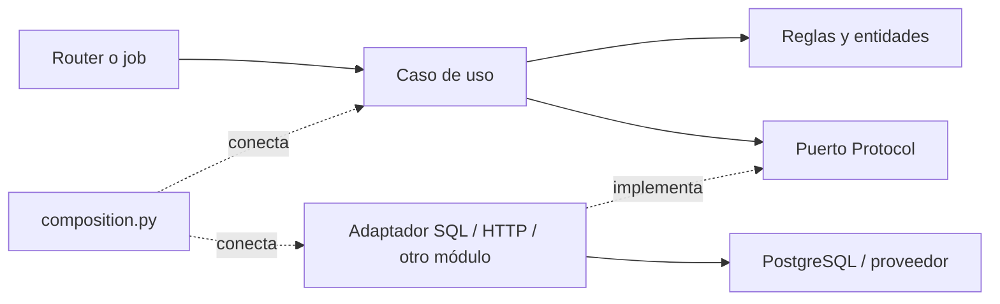

# 1. Arquitectura y tecnologías

[Índice](README.md) · [Siguiente: identidad](02-identidad.md)

## 1.1 Problema y enfoque de solución

El backend debe coordinar operaciones que tienen reglas y tiempos distintos:
una contraseña se valida localmente, un precio puede estar retrasado, una orden
puede ejecutarse después de responder al usuario y una suscripción cambia por
eventos recibidos de Stripe. La solución separa esas responsabilidades sin
fragmentarlas en servicios desplegables independientes.

Se utiliza un **monolito modular con arquitectura hexagonal**:

- **Monolito:** una aplicación ASGI y un despliegue principal.
- **Modular:** siete paquetes de negocio con reglas y casos de uso propios.
- **Hexagonal:** el negocio depende de contratos; HTTP, SQL y proveedores son
  adaptadores reemplazables.

No hay microservicios, bus de eventos externo, Redis, Celery ni motor de matching.
La decisión reduce infraestructura, coordinación y costo de desarrollo. A cambio,
los módulos comparten proceso y base de datos, los jobs compiten por recursos con
las peticiones y el escalamiento requiere atención a estado y tareas locales.

## 1.2 Las cuatro zonas de cada módulo

```text
src/acciones_ud/<modulo>/
├── domain/              Entidades, reglas, estados y puertos
├── application/         Casos de uso y orquestación
├── adapters/
│   ├── inbound/         Routers HTTP/WebSocket y jobs
│   └── outbound/        SQL, clientes externos y puentes a otros módulos
└── composition.py       Construcción y conexión de las implementaciones
```

### Dominio

Expresa el vocabulario del negocio mediante `dataclass`, enumeraciones y funciones
puras: por ejemplo, qué transición de una orden es válida, cómo se calcula una
comisión o cuándo se dispara una alerta. Define puertos mediante `typing.Protocol`.

No importa FastAPI, SQLAlchemy ni SDK de proveedor. **Motivo:** la regla no debe
cambiar si mañana cambia el transporte o la base de datos, y debe poder probarse
sin servidor ni conexión externa.

### Aplicación

Orquesta un objetivo del usuario: registrar una cuenta, crear una orden, aceptar
una propuesta o generar un reporte. Coordina puertos, reloj, unidades de trabajo
y funciones del dominio. También determina cuándo una operación debe fallar y
cuándo puede devolver información degradada.

**No es una segunda capa de controladores:** un caso de uso no recibe `Request`
ni construye `JSONResponse`, y no conoce los detalles SQL.

### Adaptadores de entrada

Los routers convierten JSON y parámetros en comandos, aplican autenticación y
autorización, invocan casos de uso y serializan resultados. Pydantic valida los
contratos de frontera. Los jobs son otra entrada: ejecutan casos de uso sin que
un usuario tenga que hacer una petición.

### Adaptadores de salida

Implementan los contratos de dominio: repositorios SQLAlchemy, clientes HTTPX
para Alpaca/Stripe y lectores de capacidades de otros módulos.

La base es compartida y algunos adaptadores leen tablas de otro módulo de forma
explícita. Esto **no equivale a bases privadas por microservicio**. La protección
arquitectónica está en que ese acoplamiento queda en adaptadores, no repartido por
el negocio.



La flecha de dependencia del código apunta al contrato interior. En ejecución,
llamar al puerto sí termina invocando el adaptador.

## 1.3 Mapa del repositorio

| Ruta | Función |
| --- | --- |
| `src/acciones_ud/main.py` | `create_app`, middleware, handlers, registro y lifespan |
| `src/acciones_ud/config/settings.py` | Variables de entorno y validación de configuración |
| `src/acciones_ud/shared/domain/` | Reloj, errores y contratos comunes de auditoría/trading |
| `src/acciones_ud/shared/infrastructure/` | Engine SQL, transacciones, cookies, logs y clientes compartidos |
| `src/acciones_ud/shared/tools/hash_password.py` | Utilidad de hash para aprovisionar administrador |
| `src/acciones_ud/{identity,market_data,orders,wallet,portfolio,brokers,admin}/` | Módulos funcionales |
| `migrations/versions/` | Historial reproducible del esquema y semillas |
| `tests/` | Pruebas de reglas, API, propiedades, persistencia y seguridad |
| `.kiro/specs/` | Requisitos, decisiones, tareas y esta guía |
| `.kiro/steering/` | Contexto y convenciones complementarias del proyecto |
| `documentation/` | Punto de acceso a la guía y evidencias de pruebas |
| `odd/` | Material auxiliar del repositorio; no se registra como módulo de la API |
| `pyproject.toml`, `uv.lock` | Dependencias, herramientas y resolución fijada |
| `Dockerfile`, `compose.yaml` | Imagen reproducible y ejecución local aislada |

No se crean módulos independientes para cada detalle técnico. Por ejemplo, las
notificaciones viven en `market_data` porque nacieron de alertas de mercado y
otros módulos las reutilizan mediante adaptadores. `shared` tampoco debe
convertirse en un depósito de reglas de negocio sin dueño.

## 1.4 Composición y contratos entre módulos

La inyección de dependencias es explícita; no hay contenedor de DI externo.
`composition.py` instancia servicios y adaptadores y publica algunos puertos en
`app.state`.

| Puerto publicado | Productor | Consumidor y propósito |
| --- | --- | --- |
| `wallet_funding_port` | `wallet` | `orders`: capacidad de compra en Alpaca |
| `contracted_plan_reader` | `wallet` | `identity`: plan en `/users/me` |
| `order_position_port` | `portfolio` | `orders`: acciones disponibles |
| `order_proposal_creation`, `order_query_port` | `orders` | `brokers`: convertir propuestas y consultar órdenes |
| `order_schedule_change_port` | `orders` | `admin`: revisar órdenes afectadas por horarios |
| `order_broker_link` | `brokers` | `orders`: relación y revisión por comisionista |
| `portfolio_broker_clients` | `brokers` | `portfolio`: pertenencia de clientes |
| `associated_broker_reader` | `brokers` | `identity`: comisionista asociado |
| `order_commission_terms`, `order_trading_gate` | `admin` | `orders`: términos económicos y restricciones |
| `portfolio_commission_port` | `admin` | `portfolio`: comisiones oficiales o referencia histórica |
| `brokers_commission_terms` | `admin` | `brokers`: tasa de estimación de propuestas |
| `market_schedule_change_listener` | `admin` | `market_data`: despacho posterior al cambio de horario |

Los envoltorios `InstalledBrokerLink`, `InstalledCommissionTerms`,
`InstalledTradingGate`, `InstalledCommission` e `InstalledProposalTerms` resuelven
el adaptador al usarlo. **Por qué:** varios consumidores se construyen antes que
el módulo que instala la implementación definitiva.

Los adaptadores nulos (`NullBrokerLink`, `NullBrokerClient`) y de referencia
permitieron desarrollar módulos por etapas. En la aplicación completa los
reemplazan `brokers` y `admin`; su presencia en el árbol no significa que las
integraciones actuales estén vacías.

## 1.5 Arranque, apagado y recorrido de una petición

`create_app()` registra, en este orden:

```text
identity → market_data → wallet → portfolio → orders → brokers → admin
```

Esto ocurre antes del lifespan. En particular, portfolio publica el puerto de
posiciones antes de construir el contexto de órdenes.

Al iniciar el lifespan:

1. Se valida la configuración mediante `require_api_settings`.
2. Se configura logging sanitizado.
3. Se abren clientes HTTPX de Broker y Market Data.
4. Se ejecutan los `startup` de identity, market_data, wallet, orders, portfolio,
   brokers y admin, en ese orden.
5. Se sirven solicitudes mientras corren los jobs habilitados.

`AsyncExitStack` registra cierres y libera recursos incluso ante errores en el
arranque. El cierre normal es admin, brokers, orders, portfolio, wallet,
market_data e identity; después se cierran los clientes HTTP. El cierre conjunto
de orders/portfolio usa `finally` para intentar detener ambos. Identity libera
el engine compartido.

Una petición protegida suele seguir este recorrido:

```text
Request-ID → CORS → lectura/validación del cuerpo → dependencias de autenticación
→ autorización → caso de uso → puertos/adaptadores → DTO → JSON
```

El orden exacto depende de FastAPI: un JSON malformado puede generar 422 antes de
resolver dependencias; no debe prometerse que toda entrada inválida anónima
responderá siempre 401.

`GET /health` devuelve `{"status":"ok"}` sin consultar PostgreSQL. Es **liveness**,
no comprobación de disponibilidad de datos o proveedores. El proceso completo
sí requiere configuración válida para arrancar.

## 1.6 Tecnologías: uso y motivo

Las cotas de versión están en `pyproject.toml`; las versiones resueltas están en
`uv.lock`. No se debe interpretar la cota mínima como versión instalada.

| Tecnología | Dónde se utiliza | Motivo y costo asumido |
| --- | --- | --- |
| Python 3.12+ | Todo el backend; Docker fija 3.12 | Tipado, ecosistema async y reglas legibles; cuidar diferencias con intérpretes locales |
| `uv` | Dependencias y comandos | Instalación y resolución reproducibles con lock |
| FastAPI | HTTP, dependencias, OpenAPI y WebSocket | Contratos tipados y documentación automática; el negocio queda fuera del framework |
| Uvicorn | Servidor ASGI | HTTP y conexiones async; un worker por el estado local actual |
| Pydantic / pydantic-settings | Esquemas y entorno | Validación en fronteras y secretos representados con `SecretStr` |
| PostgreSQL en Supabase | Persistencia administrada | Transacciones, JSONB, índices parciales, locks y triggers sin operar un servidor propio |
| SQLAlchemy 2 async + asyncpg | Adaptadores SQL | SQL parametrizado, pooling y transacciones asíncronas |
| Alembic | Revisiones 0001..0012 | Cambios de esquema versionados, explícitos y revisables |
| HTTPX | Alpaca REST, OAuth, Stripe y Telegram | Cliente async común y fácil de sustituir en pruebas |
| `websockets` | Stream saliente hacia Alpaca | Mantener una conexión upstream y distribuir actualizaciones |
| argon2-cffi | Passwords y recovery codes | Hash lento con salt para dificultar ataques offline |
| PyJWT | Access token HS256 | Firma y caducidad; no reemplaza la consulta de sesión |
| pyotp | TOTP | Segundo factor compatible con aplicaciones autenticadoras |
| cryptography/Fernet | Secreto TOTP en reposo | Cifrado autenticado con clave fuera de la base |
| `Decimal` / `numeric` | Cantidades, precios y dinero | Evitar errores binarios de `float` |
| `zoneinfo`, tzdata | Sesiones, periodos y cambios DST | Zonas IANA; portabilidad, incluida Windows |
| pycountry, email-validator | Países y contratos de identidad | Validación de catálogos y sintaxis sin inventar códigos |
| aiosmtplib | Correo SMTP opcional | Envío asíncrono sin bloquear el loop con SMTP síncrono |
| pytest, pytest-asyncio, HTTPX, asgi-lifespan | Pruebas | Casos async y API sin servidor de red obligatorio |
| Hypothesis | Propiedades de reglas críticas | Explorar combinaciones y límites, no solo ejemplos felices |
| Ruff y mypy estricto | Calidad estática | Estilo/imports y contratos de tipos verificables |
| Docker / Compose | Entorno de ejecución | Imagen pequeña, usuario no root y migraciones separadas |

## 1.7 Decisiones de alcance importantes

- Supabase se usa como PostgreSQL. **No** se usa Supabase Auth, Realtime ni Data API.
- Autenticación propia no significa identidad verificada financieramente: KYC es
  otro flujo, con estados y proveedor externo.
- Premium no es un rol: es una condición comercial independiente del RBAC.
- La persistencia de eventos aporta trazabilidad, pero el sistema **no es event
  sourcing completo**: también mantiene tablas de estado actual.
- Las consultas especializadas y el ledger separan lecturas de comandos, pero
  no hay un despliegue CQRS con almacenes independientes.
- Las comisiones oficiales son cálculos locales reproducibles. No se cobran ni
  liquidan automáticamente en Alpaca.
- La API no adquiere garantías de producción solo por usar TLS, MFA o PostgreSQL.
  Los límites de seguridad y operación se detallan en el capítulo 10.
