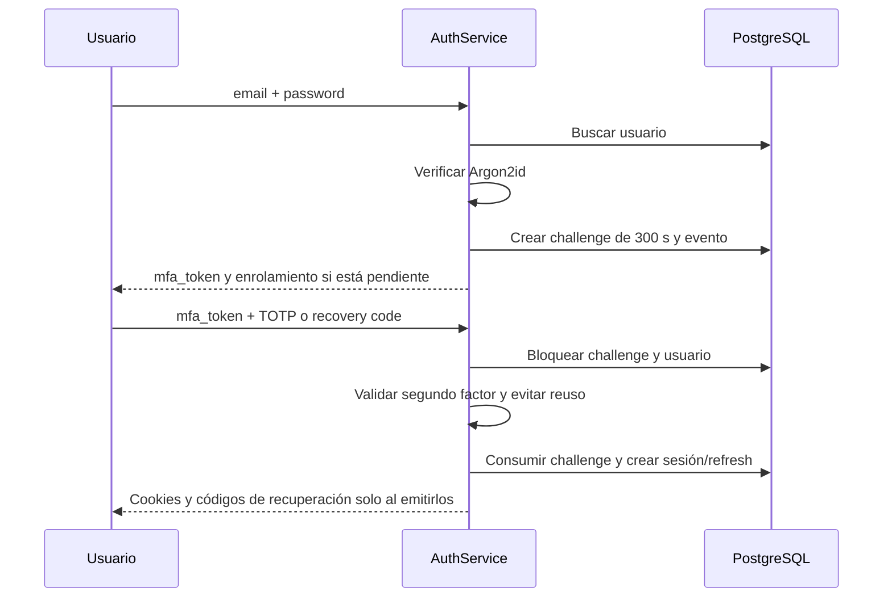

# 2. MOD-01: identidad, seguridad y acceso

[Índice](README.md) · [Anterior](01-arquitectura.md) · [Siguiente](03-mercado.md)

**Paquete:** `src/acciones_ud/identity/`.  
**Trazabilidad:** RF-01..03, RF-06..09, RFP-01..03 y RFP-08; detalles en
[requisitos](../identity-market-backend/requirements.md) y
[diseño](../identity-market-backend/design.md).

## 2.1 Responsabilidad y conceptos que no son equivalentes

Identity determina quién es el usuario, cómo demuestra su identidad de acceso y
qué puede hacer. También conserva información personal, preferencias y asociación
con una cuenta de Alpaca.

Hay cuatro dimensiones diferentes:

| Dimensión | Ejemplo | Significado |
| --- | --- | --- |
| Estado local | `active`, `pending_broker_activation` | Habilitación de la cuenta dentro de Acciones UD |
| Roles y permisos efectivos | `investor`, `broker`, `admin:audit` | Facultades vigentes de la cuenta |
| Estado KYC/Alpaca | `ACTIVE`, estados intermedios del proveedor | Situación de la cuenta financiera asociada |
| Condición comercial | `is_premium`, `contracted_plan` | Acceso a capacidades premium y plan |

Poder iniciar sesión no implica poder negociar; tener premium no concede un rol
privilegiado; solicitar ser broker no activa el rol.

## 2.2 Registro de inversionistas y comisionistas

**Qué hace.** Permite registro público de inversionista o solicitud de cuenta de
comisionista. Los administradores se crean por una ruta administrativa o por el
aprovisionamiento inicial de Alembic, no por registro público.

**Cómo funciona.**

1. Los esquemas HTTP reciben los campos de registro.
2. `domain/validation.py` valida y normaliza; el correo normalizado sirve para
   unicidad y búsqueda.
3. `domain/registration.py` construye únicamente los campos permitidos.
4. `RegistrationService` aplica Argon2id a la contraseña y registra aceptación de
   términos con el reloj del servidor.
5. En una transacción se guarda usuario, rol inicial cuando corresponda y
   preferencias predeterminadas.

Un inversionista inicia `active` con asignación `investor`. Un broker inicia
`pending_broker_activation` y sin rol efectivo; se conservan firma y licencia.
Campos extra enviados por el público no sirven para autoconcederse
`administrator`, `is_premium` o permisos.

**Por qué.** Separar solicitud de activación evita convertir un formulario en
una vía de escalamiento. La restricción de unicidad en PostgreSQL cubre además
la carrera entre registros simultáneos con el mismo correo.

## 2.3 Login en dos etapas y enrolamiento MFA

`application/login.py` contiene `AuthService`.

La primera etapa **no crea una sesión autenticada**:

- Si el correo no existe se verifica un hash ficticio; se reduce una diferencia
  de tiempo obvia respecto de una contraseña incorrecta.
- La respuesta de credenciales inválidas es genérica.
- Si TOTP aún no está confirmado, se crea o reutiliza el secreto pendiente. Se
  devuelve secreto y URI `otpauth://` para el enrolamiento, no un QR generado.
- El secreto se cifra con Fernet antes de persistirlo.
- El challenge se identifica mediante un token aleatorio cuyo digest se almacena.

La segunda etapa admite exactamente TOTP o recovery code:

- TOTP compara los pasos anterior, actual y siguiente. `totp_last_step` impide
  reutilizar un paso ya aceptado.
- El challenge vence a los 300 segundos, se consume al tener éxito y queda
  inutilizado al acumular cinco fallos.
- Se bloquean tanto challenge como usuario. Bloquear solo el challenge no
  impediría usar un TOTP simultáneamente en dos challenges distintos.
- Los eventos y fallos se confirman antes de devolver 401: si se lanzara el
  error dentro de una transacción que revierte, se perdería el contador.

**Límite importante:** cinco fallos por challenge no equivale a rate limiting
global de login. La auditoría identifica ausencia de throttling suficiente; no
debe presentarse este flujo como protección completa frente a fuerza bruta.

## 2.4 Códigos de recuperación

Al confirmar el primer enrolamiento se emiten diez códigos distintos de diez
caracteres `A-Z0-9`. Se muestran en esa respuesta y se guardan únicamente como
hashes Argon2id con salt individual.

La verificación consume un código con actualización condicional sobre una fila
sin usar e invalidar. Una carrera no debe producir dos consumos exitosos.
Regenerarlos bloquea al usuario, invalida el conjunto anterior e inserta uno
nuevo en la misma transacción.

**Por qué no se cifran para devolverlos después:** una copia de la base no debe
permitir recuperar los códigos. Si el usuario los pierde, se emite otro conjunto.

`POST /users/me/mfa/recovery-codes` requiere sesión y enrolamiento confirmado;
actualmente no exige un step-up adicional. Añadirlo sería un cambio de política,
no algo que esta documentación presupone.

## 2.5 Tokens, cookies y sesión persistida

`adapters/outbound/security/` separa las piezas:

| Archivo | Función y decisión |
| --- | --- |
| `passwords.py` | Hash/verify Argon2id y verificación ficticia |
| `tokens.py` | JWT HS256 y generación/digest de tokens opacos |
| `totp.py` | Generación de secretos, URI y códigos TOTP |
| `cipher.py` | Cifrado Fernet del secreto TOTP |

El access token JWT contiene `sub`, `sid`, `iat` y `exp`. El refresh token es
opaco, generado con 32 bytes aleatorios; solo se persiste SHA-256 del token.

Las dos cookies se configuran en `shared/infrastructure/cookies.py`:

| Cookie | Ruta | Propiedades |
| --- | --- | --- |
| `access_token` | `/` | HttpOnly, Secure, SameSite Lax o Strict |
| `refresh_token` | `/api/v1/auth` | Las mismas; no viaja a todas las rutas de usuario |

No es el patrón de almacenar un bearer token en `localStorage`. El frontend
envía `credentials: "include"` y no necesita leer las cookies desde JavaScript.

Cada petición HTTP autenticada verifica la firma/caducidad y consulta usuario,
sesión no revocada, roles y permisos efectivos. No se cachean permisos. Esto
permite que una revocación surta efecto en la siguiente comprobación, en lugar
de esperar a que expire el JWT.

## 2.6 Refresh, logout y gestión de sesiones

`application/sessions.py` coordina estos casos.

### Rotación

Refresh marca atómicamente el token vigente como rotado, crea otro y emite ambas
cookies. Si reconoce un token ya rotado, vencido o de sesión revocada, revoca su
sesión y elimina cookies. Un token desconocido no revoca sesiones ajenas.

**Consecuencia de concurrencia:** si dos pestañas renuevan con el mismo refresh,
solo una gana; la otra detecta reuso y puede revocar también la sesión de la
ganadora. El frontend debe centralizar la renovación y permitir una sola en curso.

### Cierre robusto

Logout no depende de `get_current_user`. Intenta identificar la sesión por access
válido y, si no puede, por digest del refresh, incluso si ese refresh ya rotó o
venció. Sin credenciales también devuelve 204.

Todas esas salidas borran ambas cookies. Ante errores de base de datos también
se limpian las cookies, pero no debe afirmarse que la sesión quedó revocada en
el servidor si la transacción falló.

### Otras sesiones

Se pueden listar sesiones propias, revocar una por identificador y revocar las
otras conservando la actual. La propiedad se controla en el repositorio/caso
de uso; conocer el UUID de una sesión no concede acceso a ella.

## 2.7 RBAC temporal y separación administrativa

Una asignación es efectiva si la cuenta local está activa, no está cancelada y
el instante está en `[valid_from, valid_to)`, o no tiene final.

| Rol | Finalidad |
| --- | --- |
| `investor` | Operaciones e información propia de inversión |
| `broker` | Relación con clientes, propuestas y revisión |
| `administrator` | Gestión de usuarios, permisos y controles operativos |
| `auditor` | Auditoría y lectura de compliance |
| `analyst` | Indicadores agregados |

`domain/rbac.py` aplica listas cerradas a permisos administrativos. Auditor no
puede mutar restricciones ni leer KPI por el solo hecho de ser auditor; analyst
no obtiene evidencia individual. Tampoco se puede retirar `admin:rbac` al rol
administrator ni concederlo a otro rol.

La regla del último administrador evita dejar el sistema sin administrador
efectivo. Las pruebas de concurrencia verifican que dos revocaciones no puedan
eludir la protección.

Activar un broker usa un `UPDATE` condicional de `pending_broker_activation` a
`active`; crea asignaciones `broker` e `investor` y auditoría en la misma
transacción. El segundo rol permite al comisionista gestionar su propia cuenta
financiera sin duplicar permisos de inversionista en el rol broker. Una segunda
activación recibe conflicto.

## 2.8 Perfil, intereses y preferencias

- `/users/me` compone información local, roles, estado KYC, comisionista asociado
  y plan contratado mediante lectores. No devuelve hashes o secretos TOTP.
- `PATCH /users/me` permite campos personales seleccionados y normalizados.
  Una vez existe una fila KYC, incluso reservada, bloquea la edición con
  `PROFILE_KYC_LOCKED`: evita divergencia entre identidad local y financiera.
- Intereses se validan contra mercados/sectores conocidos. Valores históricos
  propios retirados del catálogo pueden conservarse; no se habilita cualquier
  texto nuevo para todos.
- Nivel `beginner` o `experienced` alimenta la experiencia del dashboard, no el
  cálculo conductual del perfil de riesgo de portfolio.

Las preferencias de notificación cruzan trece tipos de evento y cuatro canales:
`in_app`, `email`, `sms` y `telegram`. Inicialmente se habilita `in_app`; el
validador impide deshabilitarlo. SMS requiere teléfono y Telegram requiere
`telegram_chat_id`.

Las preferencias de visualización incluyen tipo de vista, orden y umbral para
ocultar posiciones. Las de órdenes incluyen:

| Preferencia | Valor por defecto |
| --- | --- |
| Tipo | `market` |
| Límite diario | 50 |
| Umbral de orden alta | USD 10 000,00 |
| Confirmación adicional | `true` |

Son configuración del usuario, no garantía de aceptación por Alpaca.

## 2.9 KYC y apertura de cuenta financiera

`application/kyc.py` prepara la solicitud, valida edad de al menos 18 años, tipo
y formato documental y aceptación de acuerdo. Los identificadores genéricos no
se validan como si todos fueran SSN; NIT tiene validación léxica, no certificación
de registro ante DIAN.

El perfil financiero usa rangos propios en USD (`FinancialRangeCode`), incluidos
rangos personalizados. Se valida que patrimonio líquido no exceda los límites
del total. `adapters/outbound/alpaca/kyc_mapping.py` traduce al contrato externo;
los códigos locales no se presentan como enums nativos de Alpaca.

El flujo reserva primero una fila `kyc_accounts`, confirma y llama a Alpaca fuera
de la transacción. Esto evita aperturas simultáneas locales y no mantiene locks
durante una llamada externa larga. Después completa la fila con cuenta, estado
y últimos cuatro caracteres del identificador tributario; no almacena el
documento completo en esa fila.

**Ventana de fallo:** si Alpaca crea la cuenta y no se logra guardar el resultado,
se requiere reconciliación. Ante algunos errores externos el código libera la
reserva; una respuesta ambigua del proveedor no constituye prueba de que no se
haya creado nada. No se debe resolver con reintentos ciegos de apertura.

El endpoint administrativo de reconciliación busca por correo y asocia una
coincidencia exacta mediante escritura condicional. No sobrescribe una cuenta ya
enlazada por una carrera.

## 2.10 Caché KYC, directorio y auditoría de identidad

Se conservan dos tiempos distintos: cuándo cambió el estado y cuándo se consultó.
`/users/me` puede servir el estado almacenado durante el TTL, por defecto 60 s.
`/kyc/status` intenta obtener estado actual; si falla conserva el previo y marca
`stale`. El job KYC opcional refresca cuentas enlazadas, normalmente cada 900 s,
y se detiene por rate limit en vez de insistir con todas las cuentas.

Una escritura solo se acepta si `status_checked_at` no es posterior a la nueva
consulta: una respuesta lenta no hace retroceder una actualización más reciente.

El directorio administrativo permite filtrar usuarios, roles, solicitud de
broker y estado/vínculo KYC. La página y el total se obtienen en una sentencia
para compartir snapshot. El DTO enumera campos seguros en vez de seleccionar
todo `users`.

`admin_audit_log` registra cambios administrativos de identidad en su misma
transacción, con lista blanca de campos y trigger de inmutabilidad. Es distinto
de `auth_events`, dedicado a accesos y MFA, y de la vista transversal `audit_trail`.

## 2.11 Archivos y pruebas para profundizar

| Área | Implementación principal | Evidencia automatizada |
| --- | --- | --- |
| Login/MFA | `application/login.py`, `domain/totp_window.py` | `tests/identity/test_mfa_sessions.py` |
| Roles | `application/rbac_admin.py`, `domain/rbac.py` | `test_rbac_admin.py`, `property/test_protected_permissions.py` |
| Activación | `application/broker_activation.py` | `test_broker_activation.py` |
| KYC | `application/kyc.py`, `kyc_reconcile.py` | `test_kyc_identity_validation.py`, `test_kyc_reconcile.py` |
| Perfil e intereses | `application/account.py` | `test_profile_update.py`, `test_interest_consistency.py` |
| Concurrencia SQL | Repositorios outbound | `test_postgres_concurrency.py`, con PostgreSQL desechable |

Los nombres de prueba de esta tabla se resuelven bajo `tests/identity/`. Los
hallazgos transversales adicionales se mantienen en `tests/security/`.
