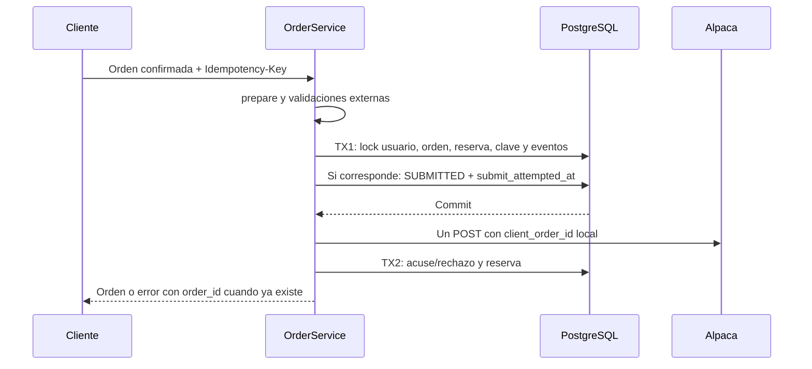

# 4. MOD-03: órdenes y ejecución

[Índice](README.md) · [Anterior](03-mercado.md) · [Siguiente](05-fondos-suscripciones.md)

**Paquete:** `src/acciones_ud/orders/`.  
**Trazabilidad:** RF-29..35 y RFP-10;
[requisitos](../orders-mod-03/requirements.md), [diseño](../orders-mod-03/design.md).

## 4.1 Qué resuelve

Una orden no es simplemente un POST a Alpaca. Debe validar intención, permisos,
cuenta, instrumento, fondos o tenencia; reservar recursos; obtener autorizaciones;
evitar duplicados; seguir el resultado y conservar evidencia.

El módulo mantiene esa coordinación local. **No calcula el matching ni garantiza
que una orden aceptada por la API llegue a ejecutarse.** El proveedor puede
rechazarla, ejecutarla parcialmente, cancelarla o mantenerla pendiente.

## 4.2 Tipos y validación pura

`domain/validation.py` devuelve el conjunto de campos inválidos, en lugar de
detenerse en el primero.

| Tipo | Información relevante |
| --- | --- |
| `market` | Sin precio impuesto por el usuario |
| `limit` | `limit_price` |
| `stop` | `stop_price` |
| `stop_limit` | `stop_price` y `limit_price` |
| `trailing_stop` | Exactamente uno de `trail_price` o `trail_percent` |

Las vigencias son `day`, `gtc`, `ioc` o `fok`, restringidas según tipo/clase.
Cantidades positivas, finitas y con hasta nueve decimales. Las fracciones exigen
activo fraccionable, clase simple, vigencia day y tipo permitido; trailing y
bracket no admiten esas fracciones.

Los precios introducidos usan hasta dos decimales si son al menos 1 USD y hasta
cuatro por debajo de 1. `trail_percent` debe estar entre 0,1 y 50.

Una bracket se limita a compra de cantidad entera, entrada market/limit y dos
piernas: take profit al menos un centavo sobre el precio base y stop loss al
menos un centavo debajo. Las piernas no son órdenes locales independientes
creadas por otro endpoint.

Las restricciones externas adicionales siguen sujetas a Alpaca. Aprobar la
validación local no elimina posibles rechazos del proveedor.

## 4.3 Vista previa y controles antes de crear

`OrderContext.prepare` concentra las lecturas y reglas comunes:

1. Cuenta Alpaca asociada y estado `ACTIVE`.
2. Activo conocido, activo y negociable.
3. Trading gate administrativo: halt o restricción.
4. Términos de comisión efectivos.
5. Cotización y controles del usuario, leídos concurrentemente mediante puertos
   con transacciones independientes.
6. Validación de parámetros y estimación.
7. Autorización adicional cuando corresponda.
8. Sesión abierta o próxima apertura.
9. Buying power para compra o acciones disponibles para venta.

`preview` usa ese contexto sin consumir TOTP ni crear orden/reserva. Devuelve
estimación, capacidad disponible, requisito de autorización y programación.
**No congela precio, tarifa, fondos ni aprobación.** La creación vuelve a evaluar.

El precio base es límite para limit/stop_limit, stop para stop y referencia para
los demás. En compra:

```text
estimado = redondear_hacia_arriba_a_centavos(cantidad × base × (1 + tasa))
```

En venta se estima `cantidad × base` y la reserva es de acciones. El redondeo
hacia arriba evita reservar menos por una fracción de centavo; no es la misma
política que el redondeo half-even de la comisión definitiva.

Una orden con importe **estrictamente mayor** que el umbral del usuario exige
TOTP si `extra_confirmation=true`, o reconocimiento explícito si es falso.
En igualdad no activa esta regla. Las propuestas usan una comparación más
estricta, descrita en el capítulo de brokers.

## 4.4 Idempotencia y reserva de recursos

`POST /orders` requiere `Idempotency-Key` de 8..128 caracteres ASCII imprimibles.
Se calcula hash de una representación canónica de la solicitud; el TOTP no forma
parte del digest.

- Mismo usuario, clave y cuerpo: devuelve la orden almacenada con su estado actual.
- Misma clave y cuerpo diferente: 409 `IDEMPOTENCY_CONFLICT`.
- Distinto usuario: espacio de claves independiente.

La comprobación rápida ocurre antes de repetir cotización/cuenta/TOTP; una
repetición genuina no deja de funcionar porque haya cambiado el mercado.
Dentro de la transacción se comprueba otra vez tras bloquear al inversionista,
para cubrir solicitudes concurrentes.

`pg_advisory_xact_lock` por usuario serializa comprobación de límite diario,
fondos/acciones y creación de reserva. Así, dos órdenes simultáneas no utilizan
ambas el mismo saldo local disponible.

`ReservationLedger` mantiene una reserva por orden:

| Estado | Significado |
| --- | --- |
| `active` | Compromiso local antes del acuse externo |
| `transferred` | Alpaca aceptó; el proveedor pasa a reflejar el compromiso |
| `released` | Operación local terminada sin compromiso externo |

No se vuelve de transferred/released a active. Al comparar capacidad externa se
restan reservas locales activas, no las transferidas: hacerlo dos veces
descontaría un compromiso que Alpaca ya considera.

**Alcance:** el lock es de PostgreSQL y coordina este backend. No impide
operaciones externas directas sobre la misma cuenta Alpaca.

## 4.5 Creación y envío en dos transacciones



**Por qué se confirma antes del POST:** si el proceso cae después del envío,
queda un identificador local para recuperar el resultado. Mantener una
transacción SQL abierta no daría atomicidad con Alpaca y prolongaría locks.

El `client_order_id` deriva de la identidad de la orden local. Después de un
intento ambiguo no se repite ciegamente el POST; se consulta por ese identificador.

| Resultado externo | Tratamiento |
| --- | --- |
| Acuse | Guarda `alpaca_order_id` y transfiere reserva |
| Rechazo de negocio | `REJECTED`, libera reserva local y devuelve error |
| Error clasificado como no recibido, incluido rate limit | `FAILED` y libera reserva |
| Timeout de lectura / resultado desconocido | Conserva `SUBMITTED` sin ID externo para reconciliar |
| 5xx ambiguo | Intenta una búsqueda por client ID; si no aparece pasa a fallo, si la búsqueda falla conserva pendiente |

El timeout del POST es como máximo 4 s. El router aplica normalmente un deadline
exterior de 5 s al caso de uso y lectura del detalle. Si se agota puede devolver
502 aunque TX1 ya haya confirmado; el cliente debe repetir **la misma clave**.
`ORDER_CREATION_DEADLINE_SECONDS=0` desactiva solo el límite exterior para
diagnóstico sandbox, no certifica rendimiento ni desactiva idempotencia.

## 4.6 Máquina de estados y evidencia

Los estados locales son:

```text
PENDING, IN_REVIEW, BROKER_SIGNED, SUBMITTED, EXECUTING,
HELD, CANCELED, REJECTED, EXPIRED, FAILED
```

La tabla autorizada está en `domain/state_machine.py`. Cada transición válida
guarda un `OrderEvent` en la misma transacción que el cambio de estado.

**Detalle importante:** no existe estado local `FILLED`. La ejecución completa
se expresa como `EXECUTING` con `fully_filled=true`, cantidad y precio promedio.
Los terminales y las transiciones deben interpretarse junto con ese flag.

`provider_status` conserva el vocabulario de Alpaca. Un estado desconocido no
se fuerza a una transición inventada: se conserva para diagnóstico.

## 4.7 Revisión del comisionista

Si existe vínculo activo con revisión habilitada, la orden entra `IN_REVIEW`
sin enviarse. `ReviewService` permite al broker vinculado:

- Consultar cola de revisión.
- Devolver con comentario para corregir.
- Aprobar y registrar firma, actor e instante.

Tras aprobar se envía si el mercado está abierto o se programa. La firma queda
en evidencia y sirve después para atribución de comisiones.

Revisión de órdenes no es lo mismo que autorización de trading de una propuesta.
Son consentimientos y recorridos distintos. Un broker no vinculado recibe
respuesta de recurso no encontrado.

## 4.8 Programación, revalidación y reautorización

Si el mercado está cerrado y `schedule_if_closed=true`, se conserva la próxima
sesión. El scheduler intenta órdenes pendientes/firmadas vencidas en fecha, nunca
se salta revisiones o autorizaciones aún pendientes.

Al enviar una orden que esperó, se vuelven a revisar cuenta, instrumento,
políticas, fondos y tenencia, conservando **los términos económicos guardados**.
Para market, si:

```text
abs(precio_actual - referencia) / referencia × 100 > umbral
```

se pasa a `HELD` y se crea petición de reautorización. Por defecto el umbral es
1 % y la ventana de respuesta 30 min.

- Aceptar a tiempo recalcula referencia/estimación/reserva y permite continuar.
- Sin fondos suficientes no se aplica la aceptación.
- Rechazar cancela.
- Vencer la petición expira la orden.

También expiran órdenes no enviadas demasiado antiguas, por defecto cinco días,
y day cuya sesión prevista terminó. No deben enviarse una sesión después por
confundir “todavía pendiente” con “todavía válida”.

Los halts/restricciones en envío diferido difieren la orden y dejan evidencia;
el scheduler puede volver a probar al levantarse el control.

## 4.9 Reconciliación y ejecuciones parciales

`OrderReconciler` corre normalmente cada 15 s:

1. Para órdenes enviadas sin ID externo consulta por client ID; dos búsquedas
   sin resultado llevan a fallo y liberación.
2. Para las que tienen ID consulta estado y piernas.
3. Consume actividades `FILL` por cuenta usando un cursor propio de orders.
4. Inserta cada ejecución una sola vez por identificador externo.
5. Recalcula cantidad y promedio desde el ledger:

```text
filled_qty = suma(qty)
filled_avg_price = suma(qty × price) / suma(qty)
fully_filled = (filled_qty == qty_solicitada)
```

No usa `filled_qty` de la respuesta de orden como sustituto de las actividades.
Si Alpaca dice filled y aún faltan fills, se conserva la discrepancia temporal.
Se rechazan cantidades/precios inválidos y ejecuciones que excedan lo solicitado.

Después del commit notifica ejecución. El cursor de órdenes es independiente
del de wallet: ambos consumen fills, pero uno registra negociación y otro
avisos de saldo.

## 4.10 Cancelaciones y cambios de horario

Una orden no enviada puede cancelarse y liberar recursos localmente. Si ya se
envió, una solicitud de cancelación aceptada por Alpaca **no es confirmación de
cancelación efectiva**.

Si aún falta ID externo, se registra cancelación pendiente y el reconciliador la
entrega cuando recupera el identificador. Si la orden terminó de ejecutarse antes,
se marca no aplicada. Las ejecuciones previas y las tardías no se borran; se
continúan consumiendo actividades incluso para cuentas con órdenes terminales.

`ScheduleChangeService` aplica cambios idempotentes por `change_id` a órdenes
afectadas no enviadas, que requieren revisión. Reanudar no sustituye una firma de
broker todavía pendiente ni una respuesta de precio. Admin actúa como invocador
del puerto; no modifica las tablas de órdenes por fuera del caso de uso.

## 4.11 Dónde está cada solución

| Archivo | Responsabilidad |
| --- | --- |
| `application/context.py` | Preparación y dependencias comunes |
| `application/order_service.py` | Crear, consultar, cancelar, responder y reanudar |
| `application/order_submitter.py` | Etapa durable y único intento de POST |
| `application/order_reconciler.py` | Recuperar acuses, estados y fills |
| `application/order_scheduler.py` | Envío programado y expiraciones |
| `application/reservation_ledger.py` | Compromisos de dinero/acciones |
| `application/execution_ledger.py` | Lecturas de ejecuciones para otros módulos |
| `application/proposal_orders.py` | Entrada desde propuestas y consultas públicas internas |
| `domain/` | Parámetros, estados, reservas, estimación, reautorización y digest |

Pruebas relevantes: `tests/orders/property/`, `unit/test_submitter.py`,
`test_reconciliation_edges.py`, `test_reservation_lock_db.py`,
`test_waited_revalidation.py` y `api/test_deadline.py`.
