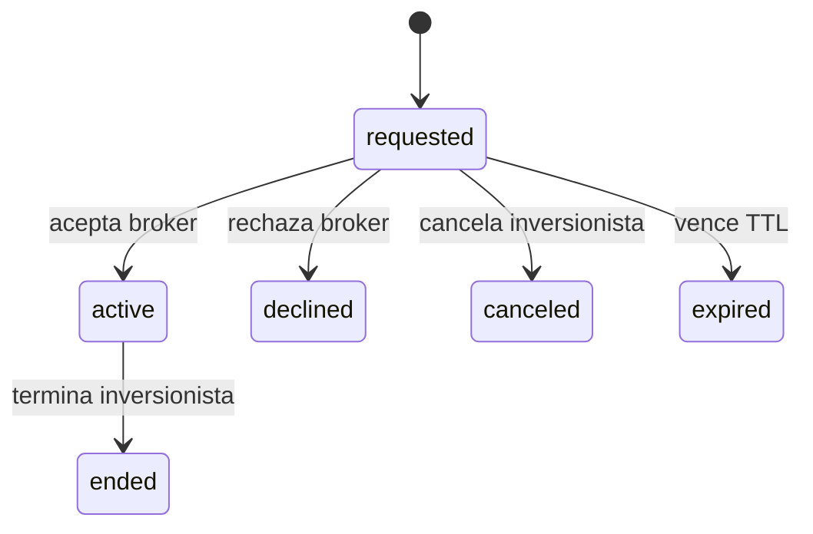

# 7. MOD-06: comisionistas, vínculos y propuestas

[Índice](README.md) · [Anterior](06-portafolio.md) · [Siguiente](08-administracion.md)

**Paquete:** `src/acciones_ud/brokers/`.  
**Trazabilidad:** RF-13..23, RFP-04..05 y RFP-09;
[requisitos](../brokers-mod-06/requirements.md), [diseño](../brokers-mod-06/design.md).

## 7.1 Qué problema resuelve

La relación entre inversionista y comisionista necesita consentimiento,
pertenencia verificable, historial y una separación entre recomendar y ejecutar.
El módulo no llama directamente a Alpaca: usa market_data para precios y orders
para crear órdenes.

Tres conceptos se mantienen separados:

1. **Vínculo:** relación activa entre dos usuarios.
2. **Revisión de órdenes:** el inversionista decide que sus órdenes propias pasen
   por la cola del broker.
3. **Autorización de trading:** consentimiento adicional para la conversión de
   propuestas aceptadas en órdenes.

Aceptar un vínculo no sustituye automáticamente los otros consentimientos.

## 7.2 Perfil público y directorio

`DirectoryService` expone perfil, búsqueda y sugerencias. El perfil editable
incluye especialidad, experiencia, certificaciones y descripción.

Solo se presenta como broker a quien tiene rol broker vigente. El perfil público
no devuelve datos privados de la cuenta ni convierte el número de licencia
declarado en una certificación profesional realizada por el software.

El registro/activación pertenece a identity; este módulo añade el contexto de
relación profesional. La ruta pública `GET /brokers/{broker_id}` es una excepción
de autenticación; búsqueda/sugerencias y reputación tienen sus propias
dependencias, descritas por el contrato HTTP.

## 7.3 Ciclo del vínculo

`LinkService` coordina la máquina de `domain/link_state_machine.py`:



La solicitud exige consentimiento, broker válido y que no sea el propio usuario.
Un índice único parcial garantiza como máximo un vínculo abierto (`requested`
o `active`) por inversionista, incluso con solicitudes concurrentes.

Se guarda versión del consentimiento, instante, respuesta y motivos. El TTL
predeterminado de solicitud es siete días.

Las lecturas calculan `effective_status`: una solicitud vencida aparece expired
aunque el job todavía no haya persistido la transición. Las mutaciones sí
persisten expiración y evento. Antes de insertar otra solicitud se expira la
anterior vencida para no chocar con el índice de vínculos abiertos.

**Por qué estado efectivo:** la pantalla no depende de que el job haya corrido
exactamente a la hora de vencimiento. **Por qué persistir al mutar:** mantiene
constraints y evidencia coherentes.

## 7.4 Terminar vínculo: cascada transaccional

Terminar requiere confirmación explícita y motivo. En una sola unidad de trabajo:

1. Pasa vínculo a ended.
2. Revoca autorización de trading vigente, si existe.
3. Retira propuestas sent y accepted de ese vínculo con motivo link_ended.
4. Inserta eventos por las entidades modificadas.

Si falla una parte, revierte el conjunto. No se borran vínculo, mensajes,
decisiones ni propuestas.

**No es cancelación retroactiva de trading:** una orden ya creada en orders sigue
su propio ciclo. Tampoco se venden posiciones ni se revierten ejecuciones por
terminar la relación.

Las notificaciones se intentan después del commit y no revierten la acción si
fallan. La siguiente comprobación de pertenencia deja de permitir consultar
órdenes/posiciones de ese inversionista.

## 7.5 Trading authorization y revisión de órdenes

`grant_trading` requiere vínculo activo y consentimiento. Una autorización ya
vigente se devuelve sin duplicarla; un índice único parcial limita a una por
vínculo. Revocar conserva cuándo y por qué.

`order_review_enabled` es otra configuración del vínculo. `BrokerLinkAdapter`
implementa para orders y portfolio:

- `is_linked`: vínculo active y rol broker efectivo.
- `linked_investors`: clientes activos del broker.
- `reviewing_broker`: además exige revisión habilitada.

No cachea los vínculos. Es una implementación compartida de dos puertos, no una
duplicación de tablas en cada módulo. El mismo contexto alimenta
`associated_broker` en `/users/me`.

## 7.6 Propuesta: recomendación versionada

`ProposalService.create` requiere vínculo activo, cuenta enlazada e instrumento
apto. Soporta propuestas simple market/limit, con cantidad, referencia y costo
estimado; la orden resultante usa vigencia day.

La estimación toma precio límite para limit o última cotización para market y
tasa del puerto instalado por admin. La propuesta no reserva buying power ni
acciones: los recursos se validan definitivamente al crear la orden.

Se crea estado sent y versión 1. Cambiar términos crea una versión nueva:
las versiones anteriores son inmutables. Si estaba accepted, vuelve a sent y
se borra la aceptación vigente; el inversionista no queda vinculado a términos
que no aceptó.

Todas las decisiones llevan `version`. Si el usuario actuó sobre una versión
vieja responde `PROPOSAL_VERSION_CONFLICT`, sin aceptar silenciosamente otra.
Primero se comprueba estado: un terminal no se reactiva por enviar una versión
que parezca correcta.

## 7.7 Aceptación y estados

```text
sent → accepted / rejected / withdrawn / expired
accepted → approved / declined_by_broker / conversion_failed / withdrawn
sent o accepted → sent al modificar con nueva versión
```

Una propuesta sent vence normalmente a las 72 h desde su versión más reciente.
**Accepted no expira por ese TTL**: su aprobación puede continuar o reconciliarse.

Aceptar registra decisión, actor y versión aceptada. Exige TOTP cuando:

```text
costo_estimado >= high_order_threshold_usd
```

En orders el comparador de importe alto es `>`; aquí es `>=` por decisión
explícita. No deben “uniformarse” ambos sin cambiar la definición funcional.
El TOTP se verifica mediante identity y no se guarda en mensajes o eventos.

## 7.8 Mensajes y evidencia

`MessageService` mantiene un hilo por propuesta. Los mensajes tienen autor,
cuerpo y fecha y no se editan ni borran desde la aplicación. La aprobación
interna permite referenciar mensajes de **ese mismo hilo** y/o evidencia textual.

**Por qué no aceptar UUIDs arbitrarios de mensaje:** una firma que cite otro hilo
produciría una cadena de evidencia falsa, aunque el mensaje exista.

Mensajes, versiones, decisiones y eventos tienen protección de inmutabilidad en
PostgreSQL. Una conversación no es un mecanismo para eludir versión o
autorización; la acción formal sigue pasando por `ProposalService`.

## 7.9 Conversión a orden y recuperación

El broker solo aprueba una propuesta accepted con versión vigente y autorización
de trading activa.

La clave determinista de orders es:

```text
proposal:{proposal_id}
```

El flujo real utiliza dos transacciones, no una transacción distribuida:

1. Brokers valida y conserva el intento de aprobación/evidencia.
2. Invoca `orders.create_from_proposal`.
3. Orders crea orden, reserva, clave y firma; envía o programa conforme a su flujo.
4. Brokers guarda approved, `order_id`, decisión y evento en su transacción.

**Resultados distintos:**

| Resultado | Qué queda en brokers |
| --- | --- |
| Orden persistida, aunque falle después al enviarse | approved con ese `order_id` |
| Rechazo de negocio antes de persistir orden | conversion_failed, código y sin orden |
| Indisponibilidad antes de crear | accepted, error propagado para reintentar |

La orden nace `BROKER_SIGNED`, con firma y motivo de propuesta. Omite el step-up
de creación directa porque lo sustituyen aceptación y autorización de trading,
pero no omite fondos, instrumento, límite diario ni políticas administrativas.

Si el proceso cae entre crear orden y guardar approved, un reintento devuelve la
misma orden y `ExpiryService` puede completar la asociación. La consulta compara
también hash esperado para no asociar una orden antigua a términos cambiados.

**Carrera residual explícita:** si mientras se crea la orden se retira la
propuesta o termina el vínculo, no se puede deshacer por rollback el trading ya
creado. Se registra la orden en evidencia de conflicto; debe investigarse.
La idempotencia evita duplicados, no convierte dos bases de estado en una
transacción global.

## 7.10 Calificaciones y reputación

`RatingService` admite calificar si el inversionista tiene o tuvo vínculo
active/ended con el broker. Si hubo varios, usa el más reciente elegible.

Se almacena una calificación por vínculo. Publicar otra sustituye estrellas y
comentario de esa calificación, no agrega infinitos votos por el mismo vínculo.
Estrellas de 1 a 5; promedio half-even a dos decimales; sin reseñas, promedio nulo.

La reputación combina reseñas, propuestas convertidas, inversionistas y
experiencia. Es información descriptiva, no un ranking de rentabilidad auditada
ni certificación de licencias.

## 7.11 Portal de clientes y jobs

`ClientService` lista clientes y consulta órdenes mediante el puerto de orders.
Las posiciones/reportes se atienden en portfolio y usan el mismo adaptador de
pertenencia. Conocer un investor_id no concede acceso a sus datos.

`ExpiryService` corre normalmente cada 300 s para:

- Expirar solicitudes requested vencidas.
- Expirar propuestas sent vencidas.
- Reconciliar aprobaciones accepted con órdenes ya creadas.

No expira accepted solo para “limpiar la cola”. Las transiciones condicionales
y eventos evitan repetir la misma expiración; no garantizan entrega de todos
los avisos tras una caída.

## 7.12 Archivos y pruebas

Aplicación: `directory_service.py`, `link_service.py`, `proposal_service.py`,
`message_service.py`, `rating_service.py`, `client_service.py`, `expiry_service.py`.
Reglas: `domain/{link_state_machine,proposal_state_machine,estimates,reputation,access}.py`.

`tests/brokers/property/` verifica estados, pertenencia, versión, autorización,
conversión y reputación. `api/test_postgres_flow.py` y
`unit/test_constraints_db.py` cubren integración SQL real en entorno desechable.
