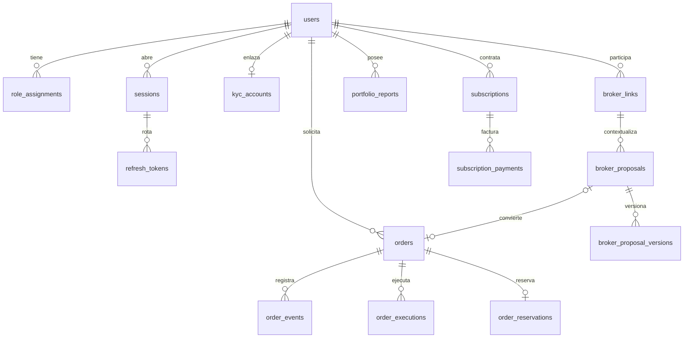

# 9. Estrategias transversales, persistencia y decisiones

[Índice](README.md) · [Anterior](08-administracion.md) · [Siguiente](10-operacion-pruebas.md)

## 9.1 Persistencia: SQL explícito, no entidades ORM como dominio

SQLAlchemy se usa principalmente con Core, objetos `Table`, sentencias
parametrizadas y `AsyncSession`. Las entidades de negocio son dataclasses
independientes.

`shared/infrastructure/entity_repository.py` reduce repetición al mapear
dataclasses a filas y ofrecer inserciones/actualizaciones tipadas.
`EvidenceRepository` restringe la superficie a lectura e inserción para evidencia.
Las consultas complejas y guards siguen en repositorios especializados.

**No hay creación automática del esquema al arrancar.** Declarar una Table no
crea la tabla. Alembic es la fuente del DDL. `migrations/env.py` tiene
`target_metadata=None`, por lo que no debe suponerse que autogenerate resolverá
automáticamente cualquier cambio de dominio.

Se elige SQL explícito por el peso de transacciones, locks, CTE, índices parciales,
triggers e inserciones idempotentes. El costo es mantener alineados contratos de
lectura, declaraciones Table y migraciones.

## 9.2 Unidades de trabajo

`shared/infrastructure/db.py` abre:

```python
async with session_factory() as session, session.begin():
    ...
```

Los repositorios de la unidad de trabajo comparten esa sesión: estado y evidencia
se confirman o revierten juntos. No se comparte una AsyncSession entre tareas
concurrentes independientes.

Ejemplos de atomicidad local:

- Usuario, preferencias y rol inicial.
- Consumo de challenge, segundo factor, sesión y refresh.
- Orden, clave idempotente, reserva y eventos.
- Terminación de vínculo, revocación y retiro de propuestas.
- Webhook Stripe, suscripción/pago y flag premium.
- Cambio administrativo y audit entry.

**Atomicidad local no es atomicidad externa.** Un rollback de SQL no deshace una
cuenta, transferencia, Checkout u orden ya creada en un proveedor. Por eso hay
reservas previas, claves y reconciliadores.

La mayor parte de flujos financieros separa transacciones y HTTP. Hay excepciones
reales, como crear/cancelar Checkout dentro de la unidad de trabajo de
suscripciones o el dispatcher que conserva su lock mientras invoca el puerto de
órdenes. Deben evaluarse por sus tiempos y recuperación, no ocultarse bajo una
regla idealizada.

## 9.3 Modelo de datos por responsabilidad

Este es un mapa de tablas, no un reemplazo del esquema detallado de migraciones.

| Área | Tablas y finalidad |
| --- | --- |
| Usuarios y RBAC | `users`, `roles`, `permissions`, `role_permissions`, `role_assignments` |
| Acceso | `sessions`, `refresh_tokens`, `mfa_challenges`, `mfa_recovery_codes`, `auth_events` |
| Preferencias | `notification_preferences`, `portfolio_view_settings`, `order_controls` |
| Identidad financiera | `kyc_accounts` |
| Mercados | `markets`, `schedule_overrides`, `instruments`, `catalog_state` |
| Copias de mercado | `instrument_snapshots`, `market_clock_state` |
| Seguimiento | `watchlists`, `watchlist_items`, `price_alerts` |
| Avisos | `notifications`, `notification_deliveries` |
| Fondos | `wallet_bank_relationships`, `wallet_transfers`, `wallet_idempotency_keys` |
| Seguimiento de fondos | `wallet_activity_cursors`, `wallet_balance_notifications` |
| Suscripción | `subscriptions`, `subscription_payments`, `stripe_events` |
| Órdenes | `orders`, `order_legs`, `order_events`, `order_executions` |
| Control de órdenes | `order_reservations`, `order_idempotency_keys`, `order_reauthorizations`, `order_cancel_requests`, `order_review_comments` |
| Coordinación órdenes | `order_schedule_changes`, `order_activity_cursors` |
| Portfolio | `portfolio_reports` |
| Relación profesional | `broker_profiles`, `broker_links`, `broker_trading_authorizations` |
| Propuestas | `broker_proposals`, `broker_proposal_versions`, `broker_proposal_decisions`, `broker_proposal_messages` |
| Reputación/evidencia | `broker_ratings`, `broker_events` |
| Administración económica | `admin_fee_versions` |
| Controles | `admin_trading_halts`, `admin_account_restrictions` |
| Evidencia administrativa | `admin_audit_log`, `admin_schedule_dispatches`, `admin_compliance_reports` |
| Indicadores | `admin_kpi_snapshots` |
| Infraestructura | `alembic_version` |

`audit_trail` es una **vista**, no otra tabla que requiera sincronizar copias de
los eventos.



Diagrama conceptual simplificado: `broker_links` tiene dos referencias a users,
y varias relaciones cuentan con restricciones parciales o temporales que no
aparecen en el dibujo.

## 9.4 Evolución del esquema

| Revisión | Cambio principal |
| --- | --- |
| `0001_identity_schema` | Identidad, RBAC, MFA, sesiones, preferencias y KYC |
| `0002_initial_admin` | Aprovisionamiento inicial con variables `INITIAL_ADMIN_*` |
| `0003_market_data_schema` | Mercados, instrumentos, snapshots, seguimiento y notificaciones |
| `0004_assignment_cancellation` | Cancelación/historial de asignaciones |
| `0005_identity_admin_gaps` | Caché KYC, directorio/auditoría administrativa |
| `0006_wallet_schema` | Fondos, suscripciones, pagos y vocabulario de avisos |
| `0007_orders_schema` | Órdenes, reservas, ejecuciones, claves y cursores |
| `0008_portfolio_schema` | Reportes de portafolio |
| `0009_brokers_schema` | Vínculos, propuestas, reputación y evidencia |
| `0010_admin_fees_audit` | Tarifas, roles de lectura y ampliación de auditoría |
| `0011_admin_audit_trail_halts` | Términos de orden, rastro unificado, halts y despachos |
| `0012_admin_compliance_bi` | Restricciones, reportes compliance y snapshots KPI |

Se aplica una transacción por revisión. Si una revisión falla, las previas ya
confirmadas no se revierten como si todo el lote fuera una única revisión.
Las migraciones guardan vocabularios/DDL propios, evitando importar constantes
de aplicación que podrían cambiar la interpretación de una migración histórica.

Los downgrades son herramientas de desarrollo/recuperación, no sinónimo de
restaurar los datos borrados. Deben revisarse antes de ejecutarlos.

## 9.5 Estrategias de concurrencia: cuál protege qué

| Mecanismo | Ejemplo | Por qué es necesario |
| --- | --- | --- |
| Lock de fila | Usuario/challenge MFA, propuesta antes de decidir | Leer, comprobar y modificar una entidad sin carrera |
| Advisory lock transaccional por usuario | Órdenes y fondos | Proteger un conjunto de filas/reservas, no solo una fila |
| Advisory lock por scope | Versiones de tarifas y halts | Serializar políticas del mismo alcance |
| Actualización condicional | Rotar refresh, activar broker, marcar alerta | Elegir un ganador y rechazar estado ya cambiado |
| Índice único parcial | Vínculo abierto, autorización activa, reporte programado | Invariante permanente incluso con dos procesos |
| Identificador externo único | FILL o factura | Repetición de proveedor sin doble efecto |
| Guard temporal | Estado KYC y transferencia | Respuesta vieja no sobrescribe estado más reciente |
| Versión esperada | Propuesta o tarifa | Evitar decisiones sobre términos obsoletos |

Un lock en memoria solo coordina un proceso. Por eso los invariantes financieros
relevantes se protegen en PostgreSQL. No obstante, algunos estados del reloj y
registro WebSocket siguen siendo locales y no heredan esa protección.

## 9.6 Idempotencia no es “reintentar cualquier cosa”

| Flujo | Clave/guard | Recuperación o límite |
| --- | --- | --- |
| Orden HTTP | Usuario + Idempotency-Key + hash | Devuelve orden previa; consulta externa por client ID |
| Orden de propuesta | `proposal:{id}` + hash esperado | Completa asociación sin duplicar orden |
| Transferencia | Usuario + clave reservada | Ambigüedad puede quedar in_progress para revisión |
| Webhook | Stripe event ID | Repetición sin nuevos efectos |
| Fill | Alpaca execution ID | Una ejecución local por actividad |
| Cambio horario | Change ID y despacho | Reintenta aplicación idempotente |
| Reporte programado | Dueño + tipo + periodo | No vuelve a generar el mismo reporte |
| Recovery code | Consumo condicional | Un solo uso |

El cliente debe repetir una operación incierta con **la misma clave y el mismo
cuerpo**, no generar una clave distinta por cada timeout. Tampoco debe borrar
registros de idempotencia para “destrabar” sin comprobar el efecto externo.

## 9.7 Consistencia eventual y políticas de entrega

Se acepta consistencia eventual donde no puede haber confirmación instantánea:
fills, transferencias, estado KYC, cambios de suscripción y propagación de
horarios.

No hay una garantía universal de exactamente una vez:

- Los webhooks pueden llegar repetidos; el efecto SQL se deduplica.
- Los reconciliadores consultan de nuevo usando claves/cursores.
- Las alertas deduplican transición, pero pueden perder un aviso posterior.
- Wallet y despachos de horario marcan antes de notificar: priorizan no duplicar.
- Portfolio marca después de notificar: prioriza reintentar, con posible duplicado
  si se pierde la marca.
- ClockWatcher conserva estado previo en memoria: no es deduplicación global.

No hay cola externa ni outbox genérico que haga todos los envíos durables.
Estas diferencias son decisiones importantes para soporte y expectativas de UI.

## 9.8 Precisión financiera y formatos

Se utiliza `Decimal` desde strings y PostgreSQL `numeric`; no se pasa primero por
float. Cantidad, precio, porcentaje y dinero no comparten la misma escala.

Tres políticas distintas son intencionales:

1. Saldos externos: conservar string exacto.
2. Reservas estimadas de órdenes: redondear hacia arriba.
3. Comisiones definitivas y DTO de portfolio: half-even con escala del dato.

Los términos capturados vuelven reproducible una comisión histórica. Los
cálculos P&L conservan costo y residuos internos; los porcentajes distribuidos
usan mayor residuo.

**Límite descubierto:** finitud y positividad no bastan para limitar magnitud.
La cotización de comisiones admite entradas extremas que pueden provocar error
500 por precisión/exponente. La guía no lo considera corregido.

## 9.9 Tiempo, cache y procedencia

- UTC/timestamps con zona para instantes persistidos.
- Nueva York para sesiones y periodos financieros por fecha.
- Zonas IANA y tzdata para DST.
- Fechas de velas sin hora se interpretan en UTC, no por la regla de reportes.
- Reloj inyectable (`Clock`) para evitar pruebas que dependan del día real.

Las cachés tienen propósitos distintos:

| Caché/copia | Propósito | Información para no engañar al consumidor |
| --- | --- | --- |
| Estado KYC | Reducir consultas en `/users/me` | Última comprobación y estado no disponible |
| Catálogo | Reducir recargas de activos | Antigüedad y flags de listado |
| Snapshot de instrumento | Degradar si falla cotización | `served_from_cache`, `is_stale`, fecha y feed |
| KPI | Evitar cálculo repetido | `computed_at`, `cache_hit`, `stale`, versión |

No se cachean permisos efectivos. Una política de caché cómoda para precios no
es apropiada para revocaciones de seguridad.

## 9.10 Errores explícitos y sanitizados

El formato compartido es:

```json
{
  "code": "IDEMPOTENCY_CONFLICT",
  "message": "Idempotency conflict.",
  "details": null
}
```

`AppError` viaja por dominio/aplicación y el handler HTTP construye la respuesta.
No se filtran excepciones del driver ni tracebacks al consumidor.

| Categoría | HTTP habitual |
| --- | --- |
| No autenticado / segundo factor inválido | 401 |
| Sin facultad / premium / restricción de trading | 403 |
| Recurso ausente o ajeno | 404 |
| Estado incompatible / idempotencia / integridad | 409 |
| Contrato o regla de entrada inválida | 422 |
| Proveedor no disponible | 502 |
| Datos no disponibles / rate limit proveedor / halt | 503 |
| Error de esquema, permisos de DB o fallo interno | 500 |

`database_error` clasifica SQLSTATE:

- `42501` y clase `28`: acceso/configuración.
- Clase `42`: esquema o consulta.
- Clase `23`: integridad.
- Clase `22`: dato no procesable.
- Conectividad/timeouts y categorías no clasificadas: indisponibilidad.

No todo error SQL es un 503 reintentable. La distinción permite diagnosticar una
migración faltante sin saturar el sistema repitiendo peticiones.

Los 404 de propiedad reducen enumeración: no se revela si existe un UUID ajeno.
Las respuestas de validación enumeran campos/tipos de problema, no el valor
recibido que podría ser contraseña o número bancario.

## 9.11 Observabilidad y protección de datos

`RequestIdMiddleware` crea un UUID por petición HTTP y lo devuelve en
`X-Request-ID`. Un `ContextVar` lo asocia a los logs del contexto.

El formatter emite nivel, mensaje y request ID en JSON. El filtro oculta
SecretStr configurados y passwords extraídos de URLs; suprime objetos de
excepción/tracebacks que podrían transportar valores sensibles.

**Tradeoff:** reduce fugas accidentales, pero también detalle de diagnóstico.
Se deben registrar códigos y contexto permitido de forma explícita, no confiar
en imprimir `str(exc)`. El formatter actual no vuelca automáticamente cualquier
campo añadido en `extra`; pasar un `extra` no garantiza que aparezca en salida.

Nunca deben publicarse `.env`, cookies, TOTP, recovery codes, firmas de webhook,
números completos de cuenta o `docker inspect` con entorno.

RLS se habilita en tablas, pero esta API conecta como backend por una URL SQL.
No utiliza JWT Supabase para establecer políticas por usuario. La autorización
de aplicación y los privilegios efectivos del rol PostgreSQL son controles
distintos; RLS habilitado sin políticas no certifica el aislamiento del
despliegue real.

## 9.12 Registro de decisiones resumido

| Decisión | Alternativa descartada o no implementada | Razón principal y costo |
| --- | --- | --- |
| Monolito modular | Microservicios | Menos operación; comparte recursos y ciclo de despliegue |
| Puertos Protocol | Negocio ligado a SDK/SQL | Pruebas aisladas; más adaptadores explícitos |
| Auth propia | Supabase Auth | Control de requisitos; mayor responsabilidad de seguridad |
| JWT + sesión DB | JWT puramente stateless | Revocación inmediata en siguiente chequeo; una consulta por petición |
| Refresh opaco rotativo | Token duradero reutilizable | Detección de reuso; frontend debe serializar refresh |
| Fernet para secreto TOTP | Texto claro | Protege fuga de DB aislada; requiere custodiar/respaldar clave |
| SQL/constraints/triggers | Solo validaciones Python | Cubre carreras y errores de otros caminos; mantenimiento de migraciones |
| Jobs asyncio | Celery/Redis/broker | Menos infraestructura; no ejecución durable independiente |
| Polling de trading | Stream de ejecución dedicado | Simplicidad; latencia de un ciclo y costo de consultas |
| Una conexión stream por proceso | Conexión por navegador | Respeta límites; estado local y clientes lentos |
| HTTPX Stripe | SDK Stripe | Cliente uniforme; parseo y versiones a cargo del equipo |
| Términos inmutables | Recalcular historia con tarifa actual | Reproducibilidad; históricos desconocidos siguen desconocidos |
| Reglas atípicas explicables | ML/antifraude externo | Trazabilidad; no detecta todo fraude ni toma decisiones sola |
| Retención sin purga nueva | Borrado automático | Política aún pendiente; crecimiento de evidencia |
| Sin CSRF/Origin explícito | Token CSRF y validación Origin | Decisión D4; riesgo residual que debe revisarse |

Estas razones no hacen que cada elección sea definitiva para cualquier escala.
Antes de evolucionar deben definirse requisito, garantía esperada, costo y plan
de migración, no añadir infraestructura solo por seguir una etiqueta arquitectónica.
