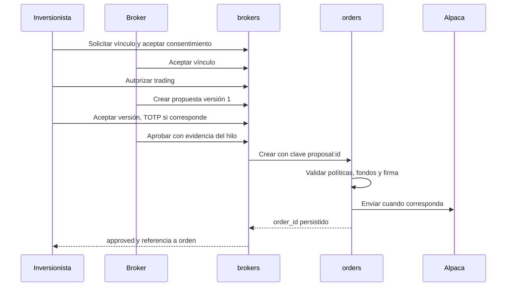

# 11. API, contratos y recorridos completos

[Índice](README.md) · [Anterior](10-operacion-pruebas.md)

## 11.1 Contrato y convenciones

FastAPI genera `/openapi.json`, `/docs` y `/redoc`. Ese contrato describe
parámetros, esquemas, respuestas y cookies; este capítulo explica el propósito.
WebSocket tiene protocolo propio y no se describe íntegramente por OpenAPI.

- Prefijo HTTP funcional: `/api/v1`.
- Autenticación habitual: cookies, no bearer en localStorage.
- Un usuario puede tener varios roles; las rutas seleccionan contexto investor/
  broker y las dependencias validan facultades.
- Cantidades/importes financieros deben conservarse como strings decimales en
  clientes; evitar convertirlos a `Number` para recomputar totales monetarios.
- Fechas, timestamps, cursors y paginación dependen del endpoint. No todos los
  módulos usan limit/offset ni todos usan la misma zona de fechas.
- Errores funcionales: `code`, `message`, `details`; correlación por
  `X-Request-ID`.
- Una respuesta GET puede actualizar caché, snapshot o estado interno. “Consulta”
  no garantiza cero escrituras internas.
- 201 significa recurso creado, **no** orden ejecutada, depósito completado o
  suscripción cobrada.

Ejemplo de consumo de cookies:

```javascript
const response = await fetch("/api/v1/users/me", {
  credentials: "include"
});
const body = await response.json();
```

La renovación debe estar centralizada para no enviar dos refresh simultáneos.
La política CORS actual no incluye PATCH: la existencia del endpoint de perfil
no elimina ese hallazgo del preflight.

## 11.2 Inventario del código revisado

Se identifican **164 operaciones HTTP sobre 141 rutas**, incluido `/health`, y
un WebSocket. No se cuentan como operaciones de negocio las rutas automáticas
de documentación de FastAPI.

En las tablas siguientes, las rutas tienen prefijo `/api/v1` salvo donde se
indique expresamente. Los métodos separados por coma representan operaciones
distintas sobre la misma ruta. `{symbol:path}` conserva la notación del router
FastAPI; el cliente la sustituye por el símbolo, no envía literalmente `:path`.

### Identity: 38 operaciones

| Métodos | Ruta | Propósito |
| --- | --- | --- |
| GET | `/auth/interest-options` | Opciones de intereses para registro/perfil |
| POST | `/auth/register` | Registro de inversionista |
| POST | `/auth/register/broker` | Solicitud de cuenta broker |
| POST | `/auth/login` | Credenciales y challenge MFA |
| POST | `/auth/mfa/verify` | Confirmar segundo factor y emitir cookies |
| POST | `/auth/refresh` | Rotar refresh y renovar acceso |
| POST | `/auth/logout` | Revocar sesión identificable y borrar cookies |
| GET, PATCH | `/users/me` | Cuenta compuesta / edición personal permitida |
| POST | `/users/me/mfa/recovery-codes` | Regenerar recovery codes |
| PUT | `/users/me/interests` | Intereses y nivel declarado |
| PUT | `/users/me/telegram` | Asociar destino Telegram |
| GET | `/users/me/sessions` | Sesiones propias |
| DELETE | `/users/me/sessions/{session_id}` | Revocar una sesión propia |
| POST | `/users/me/sessions/revoke-others` | Revocar las demás |
| GET, PUT | `/users/preferences/channels` | Preferencias de notificación |
| GET, PUT | `/users/preferences/portfolio` | Preferencias visuales |
| GET, PUT | `/users/preferences/orders` | Controles de órdenes |
| GET | `/kyc/status` | Estado financiero y posibilidad de trading |
| POST | `/kyc/account` | Apertura de cuenta Alpaca |
| POST | `/admin/users/administrators` | Crear administrador |
| GET | `/admin/users` | Directorio administrativo filtrado |
| GET | `/admin/users/{user_id}` | Detalle seguro de usuario |
| POST | `/admin/users/{user_id}/broker-activation` | Activar broker e investor |
| POST | `/admin/kyc/{user_id}/reconcile` | Recuperar asociación KYC |
| PUT | `/admin/users/{user_id}/premium` | Gestión administrativa del flag |
| GET, POST | `/admin/users/{user_id}/roles` | Listar/crear asignación temporal |
| PUT | `/admin/users/{user_id}/roles/{assignment_id}` | Cambiar vigencia |
| POST | `/admin/users/{user_id}/roles/{assignment_id}/revoke` | Cancelar asignación |
| GET | `/admin/roles` | Catálogo de roles |
| GET | `/admin/permissions` | Catálogo de permisos |
| POST | `/admin/roles/{role}/permissions` | Conceder permiso dentro de protecciones |
| DELETE | `/admin/roles/{role}/permissions/{permission_code}` | Retirar permiso permitido |
| GET | `/admin/audit-log` | Auditoría administrativa de identidad |

### Market data: 27 operaciones HTTP y un WebSocket

| Métodos | Ruta | Propósito |
| --- | --- | --- |
| GET | `/markets` | Mercados disponibles |
| GET | `/markets/calendar` | Calendario por rango/zona |
| GET | `/markets/clock` | Reloj externo |
| GET | `/markets/{market_code}/status` | Estado del mercado |
| GET | `/instruments/search` | Búsqueda por ranking y filtros |
| GET | `/instruments/{symbol:path}` | Detalle de instrumento |
| GET | `/instruments/{symbol:path}/quote` | Snapshot y frescura |
| GET | `/instruments/{symbol:path}/candles` | Histórico OHLCV |
| GET | `/instruments/{symbol:path}/depth` | Bid/ask disponible |
| GET | `/dashboard` | Resumen personalizado |
| GET, POST | `/watchlists` | Listar/crear listas premium |
| GET | `/watchlists/{watchlist_id}` | Lista propia |
| POST | `/watchlists/{watchlist_id}/items` | Añadir instrumento |
| DELETE | `/watchlists/{watchlist_id}/items/{symbol:path}` | Retirar instrumento |
| GET, POST | `/price-alerts` | Listar/crear alertas |
| POST | `/price-alerts/{alert_id}/activate` | Reactivar |
| POST | `/price-alerts/{alert_id}/deactivate` | Desactivar |
| DELETE | `/price-alerts/{alert_id}` | Eliminar alerta propia |
| GET | `/notifications` | Avisos in-app |
| PUT, DELETE | `/admin/markets/{market_code}/default-schedule` | Fijar/retirar horario predeterminado |
| GET, POST | `/admin/markets/{market_code}/schedule-overrides` | Listar/crear excepciones |
| PUT, DELETE | `/admin/markets/{market_code}/schedule-overrides/{override_id}` | Editar/retirar excepción |

WebSocket, **sin prefijo `/api/v1`**: `/ws/v1/market-feed`.

### Orders: 11 operaciones

| Métodos | Ruta | Propósito |
| --- | --- | --- |
| POST | `/orders/preview` | Estimar sin crear orden |
| POST, GET | `/orders` | Crear idempotentemente / listar propias |
| GET | `/orders/{id}` | Detalle, ejecuciones y evidencia |
| POST | `/orders/{id}/cancel` | Solicitar cancelación confirmada |
| POST | `/orders/{id}/reauthorization` | Responder cambio de precio |
| POST | `/orders/{id}/resubmit` | Corregir orden devuelta |
| POST | `/orders/{id}/resume` | Reanudar tras revisión de horario |
| GET | `/broker/order-reviews` | Cola del comisionista |
| POST | `/broker/order-reviews/{id}/return` | Devolver con comentario |
| POST | `/broker/order-reviews/{id}/approve` | Firmar y enviar/programar |

### Wallet: 17 operaciones

| Métodos | Ruta | Propósito |
| --- | --- | --- |
| GET | `/wallet/balances` | Saldos con indicador de indisponibilidad |
| GET | `/wallet/currencies` | Moneda y ausencia de conversión |
| POST, GET | `/wallet/bank-relationships` | Crear/listar relaciones sandbox |
| GET | `/wallet/bank-relationships/{id}` | Detalle propio |
| POST | `/wallet/deposits` | Depósito con Idempotency-Key |
| POST | `/wallet/withdrawals` | Retiro con cash_withdrawable |
| GET | `/wallet/transfers` | Historial local filtrado |
| GET | `/wallet/transfers/{id}` | Transferencia propia |
| GET | `/wallet/activities` | Actividades externas paginadas |
| GET | `/subscriptions/plans` | Planes comerciales de prueba |
| POST | `/subscriptions/checkout` | Crear Checkout |
| POST | `/subscriptions/me/cancel` | Cancelación al final del periodo |
| GET | `/subscriptions/me` | Estado y último pago |
| GET | `/subscriptions/me/payments` | Historial de pagos |
| GET | `/subscriptions/me/payments/{id}` | Pago propio |
| POST | `/webhooks/stripe` | Evento firmado, sin cookie de usuario |

### Portfolio: 12 operaciones

| Métodos | Ruta | Propósito |
| --- | --- | --- |
| GET | `/portfolio/positions` | Posiciones actuales y totales |
| GET | `/portfolio/executions` | Historial ejecutado |
| GET | `/portfolio/statistics` | Estadísticas por periodo |
| GET | `/portfolio/risk-profile` | Score conductual |
| POST, GET | `/portfolio/reports` | Generar/listar reportes propios |
| GET | `/portfolio/reports/{report_id}` | Snapshot persistido |
| POST, GET | `/portfolio/broker/reports` | Generar/listar consolidado del broker |
| GET | `/portfolio/broker/reports/{report_id}` | Reporte propio de broker |
| GET | `/portfolio/broker/clients/{investor_id}/positions` | Posiciones de cliente vinculado |
| GET | `/portfolio/broker/clients/{investor_id}/reports/{report_id}` | Reporte del cliente con pertenencia |

### Brokers: 33 operaciones

| Métodos | Ruta | Propósito |
| --- | --- | --- |
| GET | `/brokers/suggestions` | Sugerencias |
| GET | `/brokers` | Búsqueda paginada |
| PUT | `/brokers/me/profile` | Editar perfil de broker |
| GET | `/brokers/{broker_id}` | Perfil público |
| GET | `/brokers/{broker_id}/reputation` | Reputación agregada |
| GET | `/brokers/{broker_id}/reviews` | Reseñas |
| PUT | `/brokers/{broker_id}/rating` | Publicar/sustituir calificación |
| POST, GET | `/broker-links` | Solicitar / historial propio |
| GET | `/broker-links/current` | Vínculo y autorización actual |
| POST | `/broker-links/{id}/cancel` | Cancelar solicitud |
| POST | `/broker-links/{id}/end` | Terminar vínculo con cascada |
| PUT | `/broker-links/{id}/order-review` | Habilitar/deshabilitar revisión |
| POST | `/broker-links/{id}/trading-authorization` | Dar consentimiento de trading |
| POST | `/broker-links/{id}/trading-authorization/revoke` | Revocarlo |
| GET | `/broker/link-requests` | Solicitudes recibidas |
| POST | `/broker/link-requests/{id}/accept` | Aceptar vínculo |
| POST | `/broker/link-requests/{id}/decline` | Rechazar con motivo |
| POST, GET | `/broker/proposals` | Crear / historial como broker |
| GET, PUT | `/broker/proposals/{id}` | Detalle / nueva versión |
| POST | `/broker/proposals/{id}/withdraw` | Retirar propuesta |
| POST | `/broker/proposals/{id}/decision` | Aprobar conversión o declinar |
| POST, GET | `/broker/proposals/{id}/messages` | Enviar / consultar hilo |
| GET | `/proposals` | Historial como inversionista |
| GET | `/proposals/{id}` | Detalle recibido |
| POST | `/proposals/{id}/decision` | Aceptar/rechazar versión |
| POST, GET | `/proposals/{id}/messages` | Hilo como inversionista |
| GET | `/broker/clients` | Clientes activos |
| GET | `/broker/clients/{investor_id}/orders` | Órdenes de cliente vinculado |

### Admin: 25 operaciones

| Métodos | Ruta | Propósito |
| --- | --- | --- |
| GET | `/commissions/quote` | Cotización de comisión |
| GET | `/commissions` | Comisiones propias del inversionista |
| GET | `/broker/commissions` | Atribución al broker |
| GET | `/admin/commissions` | Consulta administrativa |
| GET | `/admin/fee-schedules` | Matriz de tarifas y origen |
| GET, POST | `/admin/fee-schedules/{scope}/versions` | Historial / crear versión |
| POST | `/admin/fee-schedules/{scope}/versions/{version_id}/cancel` | Cancelar versión futura |
| GET | `/admin/markets` | Vista consolidada |
| GET | `/admin/markets/{market_code}` | Mercado con políticas |
| GET | `/admin/markets/{market_code}/schedule-changes` | Historial y estado de despacho |
| GET, POST | `/admin/trading-halts` | Consultar / activar interruptor |
| POST | `/admin/trading-halts/{halt_id}/release` | Liberar |
| GET | `/trading-halts/active` | Controles activos según contrato de acceso |
| GET | `/admin/audit-trail` | Rastro unificado |
| GET | `/admin/audit-trail/orders/{order_id}` | Custodia de orden |
| GET, POST | `/admin/compliance/restrictions` | Historial / restringir cuenta |
| POST | `/admin/compliance/restrictions/{restriction_id}/lift` | Rehabilitar trading |
| GET | `/admin/compliance/atypical-operations` | Señales explicables |
| POST, GET | `/admin/compliance/users/{user_id}/audit-reports` | Generar / listar reportes de usuario |
| GET | `/admin/compliance/audit-reports/{report_id}` | Reporte inmutable |
| GET | `/admin/kpis` | Indicadores por periodo/versionado |

Infraestructura, **sin prefijo**: `GET /health`.

## 11.3 Recorrido A: un inversionista compra por su cuenta

1. Se registra; el backend persiste usuario/rol/preferencias.
2. Login valida contraseña; MFA confirma el factor y emite cookies.
3. Completa KYC. Puede consultar estado, pero no operar hasta cuenta ACTIVE.
4. Crea relación bancaria de prueba y espera aprobación.
5. Solicita depósito con clave estable. Wallet registra y concilia.
6. Busca símbolo y obtiene cotización con etiquetas de frescura.
7. Solicita preview; revisa estimación y autorizaciones.
8. Confirma creación con Idempotency-Key nueva para esa intención.
9. Orders verifica políticas, reserva recursos y envía o programa.
10. Reconciliación registra fills y avisos.
11. Portfolio muestra posición, resultados y reporte; admin puede reconstruir
    custodia y comisión a partir de términos guardados.

Ejemplo ilustrativo de creación:

```http
POST /api/v1/orders
Content-Type: application/json
Idempotency-Key: compra-aapl-ejemplo-001
```

```json
{
  "symbol": "AAPL",
  "side": "buy",
  "qty": "1",
  "type": "limit",
  "order_class": "simple",
  "time_in_force": "day",
  "limit_price": "100.00",
  "schedule_if_closed": true,
  "confirmed": true,
  "high_amount_acknowledged": false
}
```

Este precio ficticio solo demuestra formato, no garantiza ejecución.
Si hay vínculo con revisión habilitada, el paso 9 va primero a broker: no debe
suponerse que toda creación del inversionista envía directamente a Alpaca.

## 11.4 Recorrido B: propuesta del comisionista



Si cambian los términos se necesita nueva aceptación. Si el proveedor falla
después de crear orden, el ciclo de esa orden sigue en orders. Si la aprobación
se interrumpe antes de enlazarla, la clave estable permite reconciliar.

## 11.5 Recorrido C: premium sin confundirlo con saldo

1. Inversionista autenticado consulta planes.
2. Backend crea Checkout pendiente y devuelve URL.
3. Usuario completa el flujo alojado de Stripe test.
4. Stripe entrega evento firmado.
5. Wallet verifica firma, asociación e idempotencia, actualiza estado y premium.
6. En la siguiente autorización HTTP se ve el flag actualizado y se habilitan
   capacidades como watchlists/alertas si también se cumplen los permisos.

Abrir la success URL no sustituye el paso 4. Reenviar el mismo evento firmado
no duplica pagos. El saldo de inversión permanece en el circuito Alpaca.

## 11.6 Recorrido D: cambio de política y evidencia

1. Administrator crea tarifa futura con versión esperada, motivo y TOTP.
2. Al entrar en vigor, solo nuevas órdenes capturan esos términos.
3. Una orden previa usa su tarifa capturada aunque se ejecute después.
4. Administrator cambia horario; market_data confirma cambio y audit entry.
5. Admin despacha change ID y orders marca las órdenes no enviadas afectadas.
6. El inversionista revisa y reanuda sin saltarse revisiones pendientes.
7. Auditor consulta trail/custodia; analyst consulta únicamente KPI agregados.

Si se activa halt, bloquea nuevas evaluaciones/envíos locales aplicables; no
deshace ejecuciones ya confirmadas en Alpaca.

## 11.7 Glosario de lectura

| Término | Significado en el código |
| --- | --- |
| Puerto | Contrato interior, normalmente Protocol |
| Adaptador | Implementación concreta SQL/HTTP/otro módulo |
| UoW | Unidad de trabajo transaccional |
| DTO | Representación de entrada/salida, no entidad persistente por definición |
| Snapshot | Copia observada en un instante, no verdad actual perpetua |
| Feed | Canal/plan de datos Alpaca |
| FILL | Actividad externa de ejecución |
| Reservation | Compromiso local anterior al acuse |
| Client order ID | Identificador estable para recuperar un envío ambiguo |
| Reconciliación | Comparar estado externo/local y aplicar novedades seguras |
| Step-up | Volver a probar segundo factor para acción sensible |
| Scope | Alcance global/default o mercado de una política |
| Ledger | Historial de ejecuciones usado para consulta/cálculo |
| Stale | Información conservada pero no garantizada como actual |
| Xfail | Defecto conocido, no caso aprobado |
