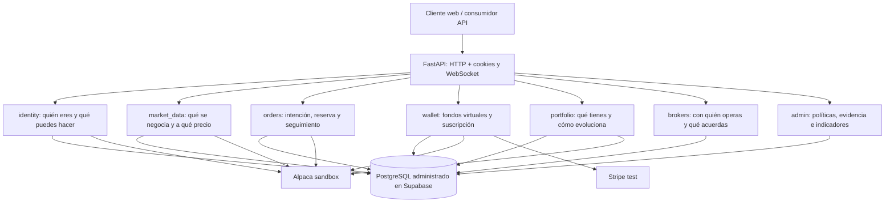

# Guía del sistema Acciones UD Capital Flow

**Revisión documental:** 24 de noviembre de 2026.  
**Objeto:** explicar el backend presente en este repositorio, no proponer módulos
nuevos ni declarar aprobaciones, correcciones o garantías que el código no tiene.

## Qué es este programa

Acciones UD es un backend bursátil que combina identidad propia, consulta de
mercados, órdenes en Alpaca sandbox, fondos virtuales, suscripciones de prueba,
portafolios, relación inversionista–comisionista y controles administrativos.
Se publica como una API FastAPI y un canal WebSocket. El frontend no forma parte
de este repositorio.

No es una bolsa, un motor de calce ni una entidad que liquide operaciones por su
cuenta. Alpaca ejecuta las órdenes y aporta información financiera; Stripe
gestiona Checkout y eventos de suscripción en modo de prueba. PostgreSQL conserva
el estado local, las autorizaciones y la evidencia necesaria para coordinarlos.

## Cómo leer la guía

1. [Arquitectura y tecnologías](01-arquitectura.md).
2. [MOD-01: identidad, seguridad y acceso](02-identidad.md).
3. [MOD-02: exploración de mercado](03-mercado.md).
4. [MOD-03: órdenes y ejecución](04-ordenes.md).
5. [MOD-04: fondos y suscripciones](05-fondos-suscripciones.md).
6. [MOD-05: portafolio y analítica personal](06-portafolio.md).
7. [MOD-06: comisionistas y propuestas](07-comisionistas.md).
8. [MOD-07: administración, auditoría e indicadores](08-administracion.md).
9. [Estrategias, datos y decisiones transversales](09-estrategias-datos.md).
10. [Configuración, operación, pruebas y límites](10-operacion-pruebas.md).
11. [Referencia de API y recorridos entre módulos](11-api-flujos.md).

Cada capítulo distingue **qué hace**, **cómo lo implementa**, **por qué se eligió
esa solución** y **qué límites conserva**. Los ejemplos numéricos son ilustrativos;
no son instrucciones de inversión ni datos reales de cuentas.

## Fuentes y trazabilidad

| Módulo | Referencias funcionales | Spec de requisitos, diseño y tareas |
| --- | --- | --- |
| `identity` | RF-01..03, RF-06..09, RFP-01..03, RFP-08 | [identity-market-backend](../identity-market-backend/requirements.md) |
| `market_data` | RF-24..28 y dashboard RFP-08 | [identity-market-backend](../identity-market-backend/design.md) |
| `orders` | RF-29..35, RFP-10 | [orders-mod-03](../orders-mod-03/requirements.md) |
| `wallet` | RF-10..12, RF-36..40, RFP-11 | [wallet-mod-04](../wallet-mod-04/requirements.md) |
| `portfolio` | RF-04..05, RF-08, RF-41..42, RFP-12 | [portfolio-mod-05](../portfolio-mod-05/requirements.md) |
| `brokers` | RF-13..23, RFP-04..05, RFP-09 | [brokers-mod-06](../brokers-mod-06/requirements.md) |
| `admin` | RF-43..47, RFP-10, RFP-13 | [admin-mod-07](../admin-mod-07/requirements.md) |

El catálogo `requerimientos_acciones_ud_v2 (1).pdf` es la fuente funcional principal;
el [SAD](../../SAD.tex) complementa atributos y decisiones. Los capítulos explican
el código de `src/acciones_ud/`, las revisiones de `migrations/versions/` y las
pruebas de `tests/`. Para MOD-07, las
[decisiones de implementación](../admin-mod-07/implementation-decisions.md)
prevalecen sobre propuestas iniciales de su diseño.

### Desajustes documentales que no deben convertirse en supuestos

- `AGENTS.md` conserva la descripción de una fase limitada a `identity` y
  `market_data`. El árbol actual, `main.py`, las migraciones y los specs ya
  contienen MOD-03..07. Esta guía los describe; no modifica por sí misma la
  política de aprobación de nuevas capacidades.
- Algunos diseños muestran nombres de archivos proyectados. Aquí se citan los
  archivos realmente existentes: por ejemplo, los repositorios de wallet están
  agrupados en `unit_of_work.py`, no necesariamente en un archivo por entidad.
- No toda capacidad prevista en el catálogo está implementada. La existencia de
  un nombre de evento o de un puerto no demuestra un productor funcional.
- Las mediciones y hallazgos de auditorías son evidencia fechada, no una garantía
  permanente. Hay defectos abiertos en
  [la auditoría transversal](../../../documentation/auditoria-e2e-2026-11-24/README.md).

## Mapa rápido de responsabilidades

Las flechas externas resumen adaptadores, no dependencias directas del dominio.
La arquitectura y los contratos entre módulos se explican en el primer capítulo.
