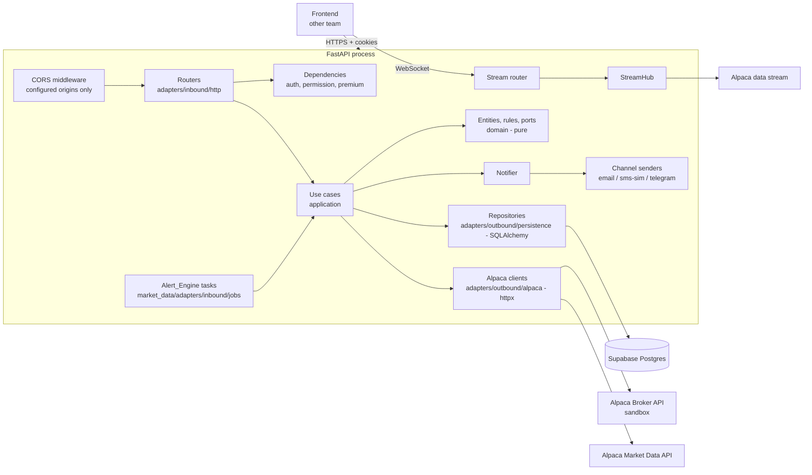
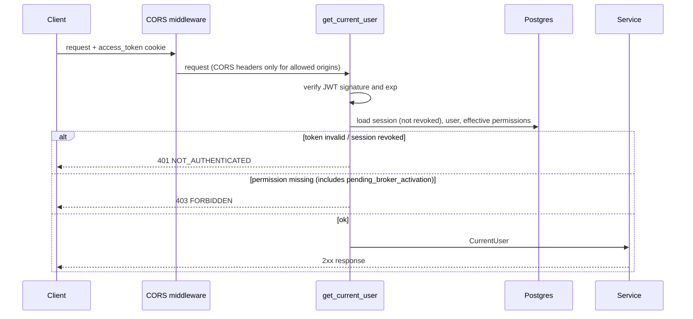
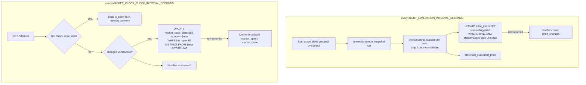
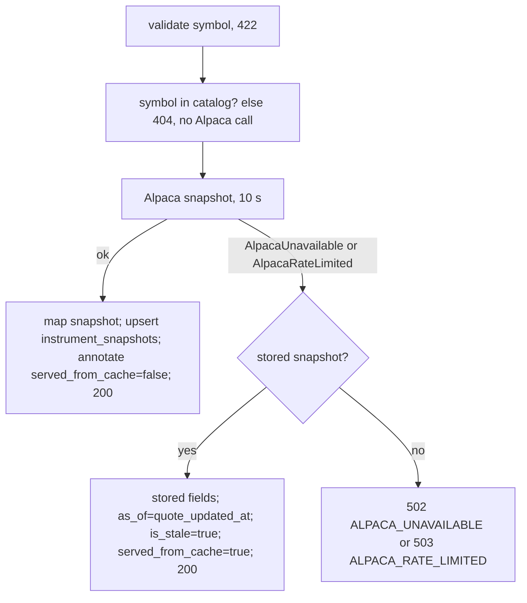
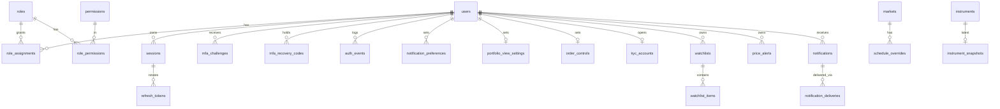

# Design Document

## Overview

This design describes the backend for MOD-01 (Identity, Security and Access Control) and MOD-02 (Market Explorer and Stock Quotes) of AccionesUD Capital Flow. It is a single FastAPI application that:

- implements authentication in-app (Argon2id, TOTP MFA with single-use recovery codes, JWT access token and opaque rotating refresh token in HTTP-only cookies) per decisions D1 and D2; Supabase Auth is not used;
- implements simplified RBAC with time-bounded role assignments per decision D3, with broker accounts that start as `pending_broker_activation` until an Administrator activates them (Requirement 2);
- stores everything in Supabase Postgres, used as plain Postgres through a connection string;
- integrates with Alpaca Broker API (sandbox) for accounts, assets, calendar and clock, and with Alpaca Market Data API for snapshots, latest quotes, bars and optional streaming;
- labels every price with currency, source, feed, age, delayed and stale flags, falls back to the stored snapshot when a quote call fails (Requirement 13), and reports market depth only as far as the feed supplies it (Requirement 19);
- runs the Alert_Engine (price alerts and market open/close notices) as in-process asyncio tasks.

HTTP paths follow the Plan Maestro paths under `/api/v1` (see "Endpoint table"). This spec (`.kiro/specs/identity-market-backend`) is the single documentation base for MOD-01 and MOD-02; `specs/01-identity-security` and `specs/02-market-data` are superseded and are not a source of requirements or paths.

Cookie-authenticated requests carry no CSRF token and get no Origin or Referer check (decision D4). Cookie protection relies on the `SameSite=Lax` or `Strict` attribute, and CORS allows only the configured origins.

The design optimizes for delivery speed. There is no extra infrastructure (no Redis, no Celery, no message broker) and no gate that requires other people. The database schema is the Migration_Set: Alembic revisions in `migrations/versions/` that a developer applies manually with `uv run alembic upgrade head` through `MIGRATION_DATABASE_URL`, using the Alembic setup already in the repository (`alembic.ini`, `migrations/env.py`). The frontend team works from the OpenAPI document that FastAPI generates at `/openapi.json`; the endpoint table in this document lets them start before the code exists.

### Key design decisions

| ID | Decision | Rationale |
|----|----------|-----------|
| DD1 | Modular monolith with two hexagonal modules, `identity` and `market_data` (workspace `AGENTS.md`). The requested layering maps onto it: routers = `adapters/inbound`, services = `application` use cases, repositories and Alpaca clients = `adapters/outbound`, pure rules and ports = `domain`. Wiring lives in `composition.py`. | Follows the project convention; `domain` and `application` import no FastAPI, SQLAlchemy or httpx, so they are trivial to unit test and to property test with Hypothesis. |
| DD2 | Persistence uses SQLAlchemy 2.x async Core statements (`Table` / `text()`) over `asyncpg`, executed through the existing `AsyncSession` factory in `shared/infrastructure/db.py`. No ORM `create_all`: the Migration_Set (hand-written Alembic revisions in `migrations/versions/`) is the only schema source. | Follows `AGENTS.md` (SQLAlchemy 2.x async + asyncpg + Alembic) and the Delivery constraints of the requirements; revisions are versioned, reversible and applied manually. |
| DD3 | Access token: HS256 JWT with `sub` (user id), `sid` (session id), `iat`, `exp`. Refresh token: 32 random bytes (URL-safe base64), stored only as SHA-256 hash. | Opaque refresh tokens make rotation and reuse detection a single atomic SQL `UPDATE`. |
| DD4 | Every authenticated request loads session state, user and effective permissions in one SQL query. No permission cache. | Requirement 3.9 (revoked session rejected) and 5.4 to 5.6 (changes apply to the next check) forbid stale caches. |
| DD5 | TOTP secrets encrypted at rest with Fernet (`TOTP_ENCRYPTION_KEY`). | A database leak alone must not let an attacker generate second factors. Cost is one env var. |
| DD6 | Alert_Engine runs inside the API process. Duplicate work across processes is prevented with conditional SQL updates (`... WHERE status = 'active' RETURNING`), not with locks. | No extra infrastructure; "exactly one Notification" (14.7, 15.9) holds even if two instances run. Recommended deployment is still one Uvicorn worker. |
| DD7 | One shared upstream Alpaca WebSocket per process (`StreamHub`) fans out to client WebSockets. | Alpaca limits concurrent stream connections per key; fan-out is a pure in-memory registry that can be property tested. |
| DD8 | In-memory fakes (`FakeAlpacaAccounts`, `FakeAlpacaBrokerMarket`, `FakeAlpacaData`, `FakeAlpacaStream`) implement the same ports as the httpx adapters and are wired in tests through `composition.py` overrides. | Tests never hit Alpaca; error paths (timeout, 5xx, 429, validation) are scripted. |
| DD9 | Instruments that disappear from a catalog reload are marked `listed = false` instead of deleted. | "Replace the catalog" (12.5) without breaking watchlist and alert rows that reference the symbol. Unlisted instruments behave as absent from the catalog. |
| DD10 | KYC submission reserves a `kyc_accounts` row before calling Alpaca. | Prevents two concurrent submissions from opening two Alpaca accounts, and satisfies 17.9 (DB is checked before any account request). |
| D4 | No CSRF token and no Origin or Referer validation, neither on HTTP endpoints nor on the WebSocket handshake (requirements decision D4). Cookies use `SameSite=Lax` or `Strict` (3.3) and CORS allows only the configured origins (17.4). The former DD11 (CSRF middleware) is retired and its ID is not reused. | Team decision for a university project: no middleware, cookie or header for the frontend to handle. Known limit: SameSite keeps the cookies off requests from other sites, but not off requests from sibling subdomains of the same registrable domain. CSRF tokens and Origin checks can be added later if the frontend team asks. |
| DD12 | Recovery codes are hashed with Argon2id (random salt per code) and consumed with one conditional `UPDATE ... WHERE used_at IS NULL AND invalidated_at IS NULL RETURNING`. | Meets "salted one-way hash" (18.1) and makes concurrent use of one code succeed exactly once (18.10) without locks. Verifying up to 10 hashes costs a few hundred milliseconds on a rare path. |
| DD13 | Instruments are addressed by `{symbol}` in paths (Plan Maestro), not by a surrogate `instrument_id`. | The active catalog holds only Alpaca `us_equity` assets, where the symbol identifies one asset and is the `instruments` primary key. See "Instrument identifier in paths". |
| DD14 | Broker activation is one conditional `UPDATE users ... WHERE account_status = 'pending_broker_activation' RETURNING` followed by the broker Role_Assignment insert, in one transaction. | Atomic (2.12) and exactly-one-winner under concurrency (2.14): a second request waits on the row lock, re-reads the row, finds it active, and gets 409. |

### Research findings that shape the design

- **Alpaca Broker API authentication** is HTTP Basic with the correspondent API key and secret as username and password ([Alpaca: Getting Started with Broker API](https://docs.alpaca.markets/us/v1.1/docs/getting-started-with-broker-api)). The sandbox host is `https://broker-api.sandbox.alpaca.markets`.
- **Alpaca Market Data sandbox host** for Broker API keys is `data.sandbox.alpaca.markets`, for both historical REST and streaming ([Alpaca Market Data FAQ](https://alpaca.markets/docs/market-data-faq)). Base URLs are configuration values, so switching to production hosts needs no code change.
- **Endpoints used** (Alpaca Broker API v1 and Market Data v2): `POST /v1/accounts`, `GET /v1/accounts/{id}`, `GET /v1/assets`, `GET /v1/assets/{symbol}`, `GET /v1/calendar`, `GET /v1/clock`, `GET /v2/stocks/{symbol}/snapshot`, `GET /v2/stocks/snapshots?symbols=...`, `GET /v2/stocks/{symbol}/bars`, and the stream `wss://<stream-host>/v2/{feed}` with `auth` and `subscribe` (trades) actions ([Alpaca Historical API](https://alpaca.markets/docs/historical-api), [Alpaca WebSocket Stream](https://docs.alpaca.markets/us/v1.4.2/docs/streaming-market-data)).
- **Supabase and asyncpg**: Supabase's transaction pooler does not support prepared statements; asyncpg must use `statement_cache_size=0` there ([Supabase: Disabling prepared statements](https://supabase.com/docs/guides/troubleshooting/disabling-prepared-statements-qL8lEL)). With SQLAlchemy's asyncpg dialect that setting alone is not always enough, because the dialect still names prepared statements; the engine also passes `prepared_statement_name_func` returning a unique name. The backend is a persistent server, so the recommended `DATABASE_URL` is the direct connection or the session pooler ([Supabase: Connect to your database](https://supabase.com/docs/guides/database/connecting-to-postgres)); both settings stay on so any connection string works. With asyncpg the TLS URL parameter is `ssl=require`, not `sslmode=require` (`AGENTS.md`).
- **Alembic transactions**: by default `env.py` runs every pending revision inside one transaction, so a failure rolls back to the revision where the run started, not to the previous revision. Passing `transaction_per_migration=True` to `context.configure` commits each revision in its own transaction ([Alembic: EnvironmentContext.configure](https://alembic.sqlalchemy.org/en/latest/api/runtime.html)); Postgres has transactional DDL, so a failing revision leaves the database at the previous revision (17.7). The existing `migrations/env.py` runs async migrations with `asyncio.run`, so it cannot be called from inside a running event loop (relevant for test fixtures).
- **Postgres UUIDs**: `gen_random_uuid()` is built into Postgres 13 and later, so the Migration_Set needs no `pgcrypto` extension on Supabase.
- **Windows development**: Python's `zoneinfo` needs the `tzdata` package on Windows, which has no system IANA database. It is a runtime dependency.
- **Latest quote and depth**: Alpaca's stock latest-quote endpoint (`GET /v2/stocks/{symbol}/quotes/latest`, `feed` parameter) returns the best bid and best ask with their sizes ([Alpaca: Latest quote, single symbol](https://docs.alpaca.markets/us/reference/stocklatestquotesingle-1)). The stock Market Data API documents no order book endpoint (order books are documented only for crypto), which supports assumption A9: stock depth is one top-of-book level. This must still be checked against the contracted plan before release.
- **FastAPI request handling**: `fastapi/routing.py` (`get_request_handler`) reads and JSON-decodes the body before `solve_dependencies` runs, and raises `RequestValidationError` immediately on malformed JSON. Dependencies run before the collected validation errors of a well-formed body are raised. This fixes the order of checks described under "Dependencies".
- **Cookies**: requirement 3.3 allows only `SameSite=Lax` or `Strict`. Those cookies are not sent on cross-site requests, so the frontend must be served same-site with the API (same registrable domain in deployment, a dev-server proxy such as Vite `server.proxy` locally). Browsers accept `Secure` cookies on `http://localhost`, so local development works with `Secure` always on.

Content from the cited pages was rephrased for compliance with licensing restrictions.

### Resolved decisions on project conventions

- **Migrations (resolved, follows `AGENTS.md`):** the schema is versioned with Alembic in `migrations/versions/`, applied manually with `uv run alembic upgrade head` through `MIGRATION_DATABASE_URL`; `DATABASE_URL` is the application connection. Applying migrations is a developer step, not a CI gate or an approval step.
- **Scope (resolved by explicit user decision):** RFP-01 (KYC, Requirement 10) and RFP-08 (interests and dashboard, Requirement 11) are in scope. This decision overrides the "pending approval" status recorded for them in `specs/01-identity-security`.
- **Single documentation base (resolved by team decision):** `.kiro/specs/identity-market-backend` is the only source of requirements and design for MOD-01 and MOD-02. `specs/01-identity-security` and `specs/02-market-data` are superseded. The requirements keep these rules from them: recovery codes (Requirement 18), no self-assignment of privileged roles (Requirement 2), price freshness labels (Requirement 13) and plan-limited depth (Requirement 19). CSRF and Origin validation are left out (D4). The error format is Error_Body; `application/problem+json` is not adopted.
- **Existing code is extended, not replaced:** `src/acciones_ud/config/settings.py` (`Settings`, `get_settings`), `src/acciones_ud/shared/infrastructure/db.py` (`require_database_url`, `engine`, `session_factory`, `get_session`) and `migrations/env.py` keep their names and behavior; this design only adds fields, options and helpers to them (see Data Models, "Migration_Set structure" and "Configuration").

Every other `AGENTS.md` convention (hexagonal modules, `uv`, Python 3.12+, SQLAlchemy 2.x async + asyncpg, ruff, mypy, pytest) is followed.

`AGENTS.md` also says not to create packages for future capabilities such as notifications. The in-app notifications that RF-26 (price alerts) and RF-27 (market open/close) require therefore live inside `market_data` (`market_data/application/notifier.py` and its outbound sender adapters), not in a separate `notifications` module. Notification preferences (RF-07) belong to `identity`; `market_data` reads them through a port.

## Architecture



### Project layout

```
pyproject.toml                      # uv project, ruff and mypy config, pytest config (exists)
.env.example                        # exists; extended with the variables in "Configuration"
alembic.ini                         # exists: script_location = migrations, prepend_sys_path = src
migrations/
  env.py                            # exists; extended with transaction_per_migration=True
  script.py.mako                    # exists
  versions/                         # Migration_Set (see "Migration_Set structure")
    0001_identity_schema.py         # identity + RBAC tables, role/permission seed
    0002_initial_admin.py           # initial Administrator from INITIAL_ADMIN_* variables
    0003_market_data_schema.py      # market data, watchlist, alert, notification tables, market seed
src/acciones_ud/
  main.py                           # exists: create_app(), /health; extended with lifespan (startup validation,
                                    #   http clients, jobs, stream hub), routers and exception handlers
  composition.py                    # builds adapters and use cases, registers FastAPI dependency providers
  config/
    settings.py                     # exists: Settings, get_settings; extended with the fields in "Configuration",
                                    #   require_api_settings() startup validation, InitialAdminSettings
  shared/                           # cross-module technical code only
    errors.py                       # AppError, ErrorCode, Error_Body model, exception handlers
    infrastructure/db.py            # exists: engine, session_factory, get_session; extended with build_engine,
                                    #   unit-of-work helper, DB error translation
    infrastructure/cookies.py       # set/clear access_token and refresh_token together
    clock.py                        # Clock port (now()) + system implementation, injectable in tests
    alpaca/                         # shared httpx client factory, error classification, Alpaca dataclasses
    tools/hash_password.py          # prints an Argon2id hash for INITIAL_ADMIN_PASSWORD_HASH
  identity/
    domain/                         # entities (User, Session, RoleAssignment), value objects, rules:
                                    #   validation, rbac, account_status, totp_window, recovery_codes,
                                    #   mfa_challenge, preferences, settings, redaction;
                                    #   ports.py (repository, hasher, token, TOTP, Alpaca account Protocols)
    application/                    # use cases: register, login, verify_mfa, regenerate_recovery_codes,
                                    #   refresh, sessions, rbac admin, broker_activation, account_info,
                                    #   preferences, portfolio_view, order_controls, interests, kyc; DTOs
    adapters/inbound/http/          # routers, Pydantic schemas, deps (get_current_user, require_permission,
                                    #   require_premium), cookies
    adapters/outbound/persistence/  # SQLAlchemy Core repositories
    adapters/outbound/security/     # Argon2id hasher, JWT + refresh tokens, pyotp TOTP, Fernet cipher
    adapters/outbound/alpaca/       # Alpaca Broker accounts client (KYC, account status) + fake
  market_data/
    domain/                         # entities (Instrument, Market, Watchlist, PriceAlert, Notification),
                                    #   rules: search, catalog_merge, quotes, freshness, depth, bars, alerts,
                                    #   schedule, calendar, clock_watch, streaming registry, notification
                                    #   channels; ports.py
    application/                    # use cases: search, markets, asset_detail, quote (with cache fallback),
                                    #   depth, candles, calendar, clock, market_status, schedule admin,
                                    #   dashboard, watchlists, price alerts, notifier, catalog reload
    adapters/inbound/http/          # routers, Pydantic schemas, WebSocket stream endpoint
    adapters/inbound/jobs/          # PriceAlertLoop, ClockWatcher (asyncio tasks started in lifespan)
    adapters/outbound/persistence/  # SQLAlchemy Core repositories, preferences reader (reads identity tables)
    adapters/outbound/alpaca/       # Broker assets/calendar/clock client, Market Data client, stream client, fakes
    adapters/outbound/senders/      # email, simulated sms, telegram channel senders
tests/
  identity/  market_data/  shared/  # unit/, property/, api/ per module (see Testing Strategy)
```

In the rest of this document, `domain.<name>` means `<module>/domain/<name>.py` of the module that owns the rule, "service" means an application use case, and "repository" means an outbound persistence adapter.

Layer rules:

- Inbound HTTP adapters parse input (Pydantic), call one use case, and map the result to a response schema. They hold no SQL and no business rules.
- Application use cases orchestrate: open a unit of work, call repository ports, call Alpaca ports, call domain functions. They import only `domain`, `shared.errors` and `shared.clock`.
- Outbound persistence adapters hold SQL only (SQLAlchemy Core). They receive the unit of work's `AsyncSession` (from the existing `session_factory`), so one use case can run several repository calls in one transaction. Each module declares the Core `Table` objects its repositories use in `adapters/outbound/persistence/tables.py`; the Migration_Set, not these objects, creates the schema.
- Domain code is pure and synchronous, uses plain dataclasses (not Pydantic models), and defines ports as `typing.Protocol`. Every Hypothesis property targets this layer, except where a property is explicitly DB-backed.
- Alpaca adapters return domain dataclasses and raise `AlpacaError` subclasses defined in `shared/alpaca` (`AlpacaUnavailable`, `AlpacaRateLimited`, `AlpacaValidationError`, `AlpacaNotFound`, `AlpacaAuthError`).
- `market_data` never imports `identity` internals. It needs three things from identity: the current user (the `CurrentUser` dependency from `identity/adapters/inbound/http/deps.py`, which inbound adapters may use), notification preferences and contact data (a `RecipientDirectory` port implemented by a `market_data` persistence adapter that reads `notification_preferences` and `users`), and interests/level for the dashboard (same adapter).

### Request lifecycle for a protected endpoint



### Login, MFA and token issuance

```mermaid
sequenceDiagram
    participant C as Client
    participant A as Auth_Service
    participant DB as Postgres
    C->>A: POST /auth/login {email, password}
    A->>DB: find user by email_normalized
    A->>A: Argon2id verify (dummy hash if unknown email)
    alt bad credentials
        A->>DB: auth_events(failure)
        A-->>C: 401 INVALID_CREDENTIALS
    else ok
        opt no confirmed TOTP
            A->>DB: store new pending secret (encrypted)
        end
        A->>DB: insert mfa_challenges (hash, expires +300 s)
        A->>DB: auth_events(success)
        A-->>C: 200 {mfa_token, expires_at, totp_enrollment?}
    end
    C->>A: POST /auth/mfa/verify {mfa_token, code} or {mfa_token, recovery_code}
    A->>DB: BEGIN; lock challenge row FOR UPDATE
    alt code (TOTP)
        A->>A: match code against steps t-1, t, t+1; step > totp_last_step
    else recovery_code (only if TOTP enrollment confirmed)
        A->>A: Argon2id-verify against unused codes of the current set
        A->>DB: UPDATE mfa_recovery_codes SET used_at=now() WHERE id=$1 AND used_at IS NULL AND invalidated_at IS NULL RETURNING id
    end
    alt invalid
        A->>DB: failed_attempts += 1 (invalidate at 5); auth_events
        A-->>C: 401 MFA_FAILED
    else valid
        A->>DB: mark challenge used; TOTP: set totp_last_step, confirm enrollment and insert 10 recovery code hashes if it was pending
        A->>DB: insert session + refresh token; auth_events; COMMIT
        A-->>C: 200 {user, recovery_codes?, recovery_codes_remaining?} + Set-Cookie access_token, refresh_token
    end
```

### Recovery codes

- **Format and generation** (`identity.domain.recovery_codes`): 10 characters from `A-Z0-9`, drawn with `secrets.choice` (about 51.7 bits each). A set is 10 distinct codes; generation redraws on a collision.
- **Hashing:** each code is hashed with the same Argon2id `PasswordHasher` used for passwords, so each hash has its own random salt. Only the hash is stored; the plaintext exists only in the response that issues the set (18.1, 18.7) and is never passed to a logger.
- **Issuance:** when a TOTP verification confirms a pending enrollment, the same transaction inserts the 10 hashes under a new `set_id`, and the response carries `recovery_codes` (the 10 plaintext codes). Every other response sets `recovery_codes` to null.
- **Verification:** `MfaVerifyIn` accepts exactly one of `code` (TOTP, `^\d{6}$`) and `recovery_code`. The recovery code is trimmed and uppercased, then must match `^[A-Z0-9]{10}$`; any other combination is 422 before the challenge is read, so no attempt is used (18.9). With the challenge row locked, the use case checks, in order: challenge unknown, expired, used or invalidated → 401 (18.6); TOTP enrollment pending → 401 and the code stays unused (18.6); then it verifies the submitted code against every unused hash of the user's current set. No match, or a match whose conditional `UPDATE` returns no row because a concurrent request used it first, is a failed attempt: `failed_attempts += 1`, the challenge is invalidated at 5 (3.10), and the response is 401 `MFA_FAILED`, the same code as a wrong TOTP (18.5). A match whose `UPDATE` returns a row completes the login like a TOTP success, and the response adds `recovery_codes_remaining` (count of unused codes left in the current set) (18.3).
- **Concurrency (18.10):** two logins can hold different challenges, so the challenge lock does not serialize them. The conditional `UPDATE` does: Postgres lets one statement change the row, and the other re-reads it with `used_at` set and returns no row.
- **Audit (18.4):** `auth_events` gets `method = 'recovery_code'` and result `success`, `invalid_recovery_code` or one of the 3.7 reasons. The submitted code is never stored.
- **Regeneration (18.7, 18.8):** `POST /users/me/mfa/recovery-codes`. Without a confirmed enrollment the response is 409 `MFA_NOT_ENROLLED`. Otherwise one transaction locks the user row (`SELECT ... FOR UPDATE`, so two concurrent regenerations cannot leave two valid sets), sets `invalidated_at = now()` on every code of the current set, inserts 10 new hashes under a new `set_id`, and returns the 10 plaintext codes.

### Cookies and CORS

- Cookie helpers in `shared/infrastructure/cookies.py` set `access_token` and `refresh_token` together after MFA verification and refresh, and clear both together on every path that clears the token cookies (4.2, 4.4, 4.6, 4.8). Cookie attributes are listed under "Configuration".
- `CORSMiddleware` runs with `allow_origins` equal to `CORS_ALLOWED_ORIGINS` (exact strings, `*` rejected at startup), `allow_credentials=True`, the methods `GET`, `POST`, `PUT`, `DELETE`, `OPTIONS`, and the request header `Content-Type`. A request whose `Origin` is not in the list gets no `Access-Control-Allow-Origin` header (17.4).
- There is no CSRF token, no CSRF header and no Origin or Referer check, neither on HTTP endpoints nor on the WebSocket handshake (D4).

**Frontend integration notes:**

- Send requests with `credentials: "include"`.
- The cookies use `SameSite=Lax` or `Strict` (3.3), so browsers send them only on same-site requests. Serve the frontend same-site with the API: a dev-server proxy (for example Vite `server.proxy`) locally, and the same registrable domain in deployment, with the frontend origin listed in `CORS_ALLOWED_ORIGINS`.
- Swagger UI at `/docs` is served by the API itself, so "Try it out" needs no CORS entry.

### Refresh rotation and reuse detection

The refresh endpoint runs one atomic statement:

```sql
UPDATE refresh_tokens rt
   SET rotated_at = now()
  FROM sessions s
 WHERE rt.token_hash = $1
   AND rt.session_id = s.id
   AND rt.rotated_at IS NULL
   AND rt.expires_at > now()
   AND s.revoked_at IS NULL
RETURNING rt.session_id;
```

- One row returned: insert the new refresh token for the same session, update `sessions.last_used_at`, issue a new access token, set the access and refresh cookies.
- No row returned, but the hash exists: the token is expired, rotated or revoked. Revoke its session, clear both cookies, return 401 (4.2). Concurrent refreshes with the same token (4.10) resolve the same way: Postgres row locking lets exactly one `UPDATE` win, and every loser sees `rotated_at IS NOT NULL`. As required by 4.10 plus 4.2, a loser revokes the session, which also ends the winner's session. This is standard reuse detection; the frontend must serialize refresh calls (one in-flight refresh at a time).
- Hash unknown, token missing or malformed: clear both cookies, return 401, change nothing (4.8).

### Broker registration and activation

- `users.account_status` is `active` or `pending_broker_activation` (check constraint). Investor registration and administrator creation insert `active` (2.9); revision 0002 inserts the initial Administrator as `active` (2.10).
- `POST /auth/register/broker` inserts the User with `pending_broker_activation`, the firm name, the license number and the 28 notification preferences, and **no** Role_Assignment (2.1). Investor registration inserts one `investor` Role_Assignment. Neither public endpoint reads a role field (`extra="ignore"`), so no public request can create a broker or administrator assignment (2.15).
- The effective-permission query joins `users` with `account_status = 'active'`, so a pending User has no Effective_Role and every permission-protected endpoint returns 403 (2.11). Such a User can still log in, call `/users/me` (which shows `account_status`) and manage sessions.
- `POST /admin/users/{user_id}/broker-activation` (`admin:users`) runs in one transaction (DD14):

```sql
UPDATE users SET account_status = 'active', updated_at = now()
 WHERE id = $1 AND account_status = 'pending_broker_activation'
RETURNING id;
-- row returned: INSERT INTO role_assignments (user_id, role_code, valid_from, valid_to)
--               VALUES ($1, 'broker', now(), NULL) RETURNING ...; COMMIT; 200
-- no row:       SELECT 1 FROM users WHERE id = $1  -> exists: 409 BROKER_NOT_PENDING, else 404 NOT_FOUND
```

- The generic role-assignment endpoint can also give a pending User a broker assignment (it is an administrator request, so 2.15 allows it), but that assignment stays non-effective until activation because of the `account_status` condition. The broker-activation endpoint is the documented path.

### Alert_Engine

Two asyncio tasks start in the FastAPI lifespan when `ALERT_ENGINE_ENABLED=true`:



Each loop iteration catches and logs every exception, so one failed Alpaca call never stops the loop. Notification creation and the status change of the alert happen in one transaction; external channel dispatch runs after commit.

### Price streaming

`StreamHub` owns one upstream connection to `ALPACA_STREAM_BASE_URL` (feed path appended), authenticates with `{"action":"auth","key":...,"secret":...}`, and subscribes to trades for the union of all client subscriptions. It reconnects with exponential backoff (1 s to 30 s). The registry (client → symbol set, symbol → client set) is a pure class in `domain.streaming` with no I/O. Client protocol:

| Direction | Message |
|-----------|---------|
| client → server | `{"action": "subscribe", "symbols": ["AAPL", "MSFT"]}` (replaces the connection's subscription set; 1 to 30 symbols) |
| server → client | `{"type": "subscribed", "symbols": [...]}` |
| server → client | `{"type": "price", "symbol": "AAPL", "price": 189.12, "timestamp": "2025-01-02T15:04:05.123Z"}` |
| server → client | `{"type": "error", "error": <Error_Body>}` (subscription rejected, previous subscription kept) |

Authentication uses the `access_token` cookie sent with the WebSocket handshake; the handshake `Origin` is not checked (D4). If streaming is disabled or the token is missing, invalid or expired, the server accepts the socket, sends one `error` message, and closes with code 1008. The server closes the connection when the access token expires; the client refreshes and reconnects. Clients connect to `WS /ws/v1/market-feed` (outside the `/api/v1` prefix, as in specs/02); the `access_token` cookie has `Path=/`, so the browser sends it with the handshake.

### Price freshness

`market_data.domain.freshness.annotate(asset_class, feed, as_of, now, threshold_seconds) -> Freshness` is a pure function; `now` comes from the `Clock` port at response time, so tests control it.

| Field | Rule | Req |
|-------|------|-----|
| `currency` | `"USD"` when the Instrument's `asset_class` is `us_equity`, else null | 13.11 |
| `source` | always `"alpaca"` | 13.11 |
| `feed` | feed of the returned data (`iex`, `sip` or `delayed_sip`) | 13.11 |
| `as_of` | quote: update timestamp of 13.1 (later of quote and trade timestamps); depth: latest quote timestamp; cached: stored `quote_updated_at` | 13.11, 13.14, 19.1 |
| `data_age_seconds` | `max(0, floor((now - as_of).total_seconds()))`, null when `as_of` is null | 13.11 |
| `is_delayed` | `feed == "delayed_sip"` | 13.12 |
| `is_stale` | `data_age_seconds is None or data_age_seconds > PRICE_STALENESS_THRESHOLD_SECONDS`; forced true when served from cache | 13.13, 13.14 |
| `served_from_cache` | false for a live answer, true for the cache fallback | 13.11, 13.14 |

`is_delayed = false` for `iex` means "not delayed", not "consolidated": IEX is one venue. The frontend should show the feed name next to the price.

Candle responses add `currency`, `source`, `feed` and `is_delayed` (13.16); they carry no age fields because a bar range has no single `as_of`.

**Quote path with cache fallback** (`market_data.application.quote`):



The fallback never writes: the stored snapshot stays unchanged on any failure (13.9). Other Alpaca errors (auth error) are not covered by 17.5/17.6 and keep their error mapping. The decision is the pure function `quote_outcome(live: Snapshot | AlpacaFailure, stored: StoredSnapshot | None)`, so the branch table is property tested without I/O.

**Startup validation (13.17):** `require_api_settings()` rejects `ALPACA_DATA_FEED` outside `iex`, `sip`, `delayed_sip` and `PRICE_STALENESS_THRESHOLD_SECONDS` that is not an integer from 1 to 86,400, reporting only the variable names. Both fields are plain strings in `Settings` and are parsed by this function, so a bad value produces the name-only message instead of a Pydantic error that would echo the value.

### Market depth

`GET /api/v1/instruments/{symbol}/depth` (Requirement 19):

1. Validate the symbol (422, no Alpaca call, 19.6) and check the catalog (404 `SYMBOL_NOT_FOUND`, no Alpaca call, 19.7).
2. Call `AlpacaDataPort.get_latest_quote(symbol)` (`GET /v2/stocks/{symbol}/quotes/latest?feed=<ALPACA_DATA_FEED>`, 10 s).
3. Map with the pure `market_data.domain.depth.from_latest_quote(doc) -> DepthResult`:
   - no `quote` object in the response → `levels = []` (19.5);
   - otherwise exactly one `DepthLevel {bid_price, bid_size, ask_price, ask_size}` taken from `bp`, `bs`, `ap`, `as`; a missing or null key gives null for that value (19.2, 19.4). The mapper never computes, copies or pads values, so `len(levels)` is at most the number of levels in the response (19.3);
   - `full_depth_available = false` for every supported feed (A9).
4. Annotate with the freshness fields (`as_of` = quote `t`, `served_from_cache = false`) and return 200 (19.1).
5. Alpaca failures map as in 17.5/17.6 with no cache fallback and no database write (19.8).

Open verification item (A9): before release, confirm against the contracted Alpaca plan that stocks have no multi-level book, and check in the sandbox whether Alpaca reports an absent side as missing keys or as `0` values. This design maps only missing or null keys to null; if Alpaca uses zeros, 19.4 needs a team decision before the mapper treats zero as absent.

### Instrument identifier in paths

Instrument paths use `{symbol}` (Plan Maestro), not a surrogate `instrument_id`:

- The catalog reload requests only `asset_class=us_equity`. In that class Alpaca addresses an asset by its symbol (`GET /v1/assets/{symbol_or_asset_id}`), and `instruments.symbol` is the primary key, so one symbol is one Instrument in the active scope.
- The superseded specs/02 asked that a `{symbol}` path be exposed only with the market or after showing there is no ambiguity; the argument above shows there is none in the active scope. The ambiguity becomes real only if a later spec adds other asset classes (crypto pairs such as `BTC/USD`) or non-US venues; that spec must then move to `/instruments/{market_code}/{symbol}` or to `alpaca_asset_id`. `instruments.alpaca_asset_id` is stored now so that change needs no data backfill.
- A catalog reload that returns the same symbol twice keeps the `active` asset (or the first one) and logs the duplicate.
- Symbols may contain `.`, `/` and `-` (16.4). Routes declare the parameter as `{symbol:path}` so `/` does not break routing, and the suffix routes (`/quote`, `/candles`, `/depth`) and `/instruments/search` are registered before `GET /instruments/{symbol:path}`.

## Components and Interfaces

### Services

| Component | Main methods | Requirements |
|-----------|--------------|--------------|
| Auth_Service | `register_investor`, `register_broker`, `create_administrator`, `login`, `verify_mfa` (TOTP or recovery code), `regenerate_recovery_codes` | 1, 2.1-2.10, 3, 18 |
| Session_Service | `refresh`, `list_sessions`, `close_session`, `close_other_sessions`, `logout` | 4 |
| RBAC_Service | `list_roles`, `add_permission`, `remove_permission`, `list_assignments`, `create_assignment`, `update_assignment`, `revoke_assignment`, `activate_broker`, `set_premium` | 2.11-2.15, 5 |
| Account_Service | `me` (current user and account information), `get/put_channel_preferences`, `set_telegram_chat`, `get/put_portfolio_view`, `get/put_order_controls`, `put_interests` | 3.8, 6, 7, 8, 9, 11.1-11.2 |
| KYC_Service | `submit`, `status` | 10 |
| Dashboard_Service | `dashboard` | 11.3-11.7 |
| Market_Service | `search`, `markets`, `asset_detail`, `quote` (freshness + cache fallback), `candles`, `depth`, `calendar`, `clock`, `market_status`, schedule admin | 12, 13, 15, 16, 19 |
| CatalogService (part of Market_Service) | `ensure_fresh`, `reload`, `exists(symbol)` | 12.5, 12.7-12.9, 13.5 |
| Watchlist_Service | watchlists, symbols, price alerts | 14.1-14.5, 14.8-14.13 |
| Notifier | `create(user_id, event_type, payload)`, `broadcast(event_type, payload)`, `list_in_app` | 14.7, 14.10, 14.11, 15.9 |
| Alert_Engine | `PriceAlertLoop`, `ClockWatcher` | 14.6, 14.7, 14.14, 15.9, 15.12 |

### Dependencies (`identity/adapters/inbound/http/deps.py`)

- `get_current_user(request) -> CurrentUser`: reads the `access_token` cookie, verifies the JWT, loads `{user_id, session_id, email, names, account_status, is_premium, effective_roles, permissions}` with one query that joins `sessions` (must have `revoked_at IS NULL`), `users`, `role_assignments` (effective at `now()`, and only when `users.account_status = 'active'`) and `role_permissions`. Raises 401 `NOT_AUTHENTICATED` on any failure.
- `require_permission(code)`: dependency factory; raises 403 `FORBIDDEN` if `code not in current.permissions`.
- `require_premium`: raises 403 `PREMIUM_REQUIRED` if `not current.is_premium`.

Order of checks on every protected endpoint: authentication (401) → permission and premium (403) → body/query validation (422) → resource existence (404) → conflicts (409) → limits (422). FastAPI runs an endpoint's dependencies before it raises the collected request validation errors, and an `AppError` raised inside a dependency stops the request immediately, so declaring the auth dependencies on each router (`APIRouter(dependencies=[...])`) gives this order without extra code. One exception: a body that is not valid JSON is rejected with 422 when FastAPI decodes it, before dependencies run; this rejection executes no operation, so 3.9 still holds. Public endpoints only validate their input.

### Alpaca ports (`identity/domain/ports.py`, `market_data/domain/ports.py`)

`identity` owns `AlpacaAccountsPort` (`create_account`, `get_account`); `market_data` owns `AlpacaBrokerMarketPort` (assets, calendar, clock) and `AlpacaDataPort`. They are shown together here:

```python
# identity/domain/ports.py
class AlpacaAccountsPort(Protocol):
    async def create_account(self, request: AccountOpeningRequest) -> AlpacaAccount: ...  # id, status, updated_at
    async def get_account(self, account_id: str, timeout: float = 10) -> AlpacaAccount: ...

# market_data/domain/ports.py
class AlpacaBrokerMarketPort(Protocol):
    async def list_assets(self) -> list[AlpacaAsset]: ...                     # asset_class=us_equity
    async def get_asset(self, symbol: str) -> AlpacaAsset: ...                # raises AlpacaNotFound
    async def get_calendar(self, start: date, end: date) -> list[CalendarDay]: ...
    async def get_clock(self, timeout: float = 10) -> Clock: ...

class AlpacaDataPort(Protocol):
    async def get_snapshot(self, symbol: str, timeout: float = 10) -> Snapshot: ...
    async def get_snapshots(self, symbols: list[str], timeout: float = 10) -> dict[str, Snapshot]: ...
    async def get_bars(self, symbol: str, timeframe: str, start: datetime, end: datetime,
                       limit: int, page_token: str | None) -> BarsPage: ...
    async def get_latest_quote(self, symbol: str, timeout: float = 10) -> LatestQuoteDoc: ...  # depth (Req 19)
```

`LatestQuoteDoc` keeps the optional keys of Alpaca's `quote` object as `None` instead of filling defaults, so the depth mapper can tell an omitted side from a real value.

All calls use one shared `httpx.AsyncClient` per Alpaca host (built in `shared/alpaca`) with Basic auth, `timeout=10` seconds (3 seconds for dashboard snapshot and clock calls), and no automatic retries. The pure function `shared/alpaca/errors.py::classify(status_code | exception) -> AlpacaErrorKind` maps responses:

| Alpaca outcome | Client raises | API response |
|----------------|---------------|--------------|
| connect error, read timeout (10 s), HTTP 5xx | `AlpacaUnavailable` | 502 `ALPACA_UNAVAILABLE` |
| HTTP 429 | `AlpacaRateLimited` | 503 `ALPACA_RATE_LIMITED` |
| HTTP 400, 409, 422 on account creation | `AlpacaValidationError(message)` | 422 `ALPACA_REJECTED` with Alpaca `message` (redacted, max 500 chars) |
| HTTP 404 on asset detail | `AlpacaNotFound` | 404 `SYMBOL_NOT_FOUND` |
| quote call fails with `AlpacaUnavailable` or `AlpacaRateLimited` and a snapshot is stored | caught in the quote use case | 200 cached snapshot, `is_stale = true`, `served_from_cache = true` (13.14) |
| HTTP 401, 403 (bad credentials) | `AlpacaAuthError` | 500 `INTERNAL_ERROR` (logged as configuration error, no secret in log) |

The raw Alpaca body is never copied into an Error_Body (17.5); only the extracted `message` string for 10.7, passed through `domain.redaction.redact` (removes the submitted tax id and any long digit run).

### Notifier and channel senders

```python
class ChannelSender(Protocol):
    channel: Literal["email", "sms", "telegram"]
    async def send(self, user: Recipient, notification: Notification) -> None: ...  # raises on failure
```

Implementations: `SmtpEmailSender` when `SMTP_HOST` is set, otherwise `LogEmailSender`; `SimulatedSmsSender` (logs, always succeeds, per A3); `TelegramBotSender` (httpx call to the Bot API `sendMessage`) when `TELEGRAM_BOT_TOKEN` is set, otherwise `LogTelegramSender`. `Notifier.create` inserts the `notifications` row and one `notification_deliveries` row per channel (`in_app` = `sent`, externals = `pending`) inside the caller's transaction. After commit, `Notifier.dispatch` sends to each external channel independently, catching each failure, and updates that delivery to `sent` or `failed` (14.11). The set of channels comes from `domain.notifications.channels_for(prefs, event_type)` = `{"in_app"} ∪ {enabled external channels}`.

**Real senders (14.15, 14.16, 14.17).** The two external senders live in `market_data/adapters/outbound/senders/` alongside `log.py`:

- `SmtpEmailSender(channel="email")` (`senders/smtp.py`) holds `host`, `port`, `user`, `password` and `from_addr`. `send` builds a plain-text `email.message.EmailMessage` from the Notification `event_type` and `payload` and delivers it with `aiosmtplib` (async SMTP; added to `[project].dependencies`). If `recipient.email` is `None` it raises `NoDestinationError` before any network call.
- `TelegramBotSender(channel="telegram")` (`senders/telegram.py`) holds the bot token and an injected `httpx.AsyncClient` (built like the Alpaca clients in `shared/infrastructure/alpaca_http.py`, with a 10 s timeout and `follow_redirects=False`). `send` issues `POST https://api.telegram.org/bot<token>/sendMessage` with `chat_id` and `text` from the Notification. If `recipient.telegram_chat_id` is `None` it raises `NoDestinationError` before any network call. A non-success HTTP status raises so dispatch records `failed`.

`NoDestinationError` (in `domain/notifications.py`, so the application `Notifier` can catch it without importing an adapter) is a lightweight exception a sender raises when the recipient lacks the address for an enabled external channel. `Notifier.dispatch` maps it to delivery status `failed` with error code `no_destination`; any other exception keeps the existing `sender_error` code, so Property 25 (delivery isolation) is unchanged: a failing channel still records `failed` and the remaining channels still run. The token and SMTP password come only from `Settings` (`SecretStr`) and are never logged (A3, 17.8).

**Recipient contact fields.** `domain.entities.Recipient` carries `user_id`, `channels: frozenset[str]` and the optional contact fields `email: str | None = None` and `telegram_chat_id: str | None = None`. `RecipientDirectory.recipients(event_type)` (`persistence/recipient_directory.py`) joins `notification_preferences` with `users` to read `users.email` and `users.telegram_chat_id` (the column the `PUT /users/me/telegram` endpoint writes for 7.5), populating those fields so the senders know where to deliver. The return type stays `list[Recipient]`; only the extra fields are added. The dashboard `UserProfileReader` is unaffected.

**Sender selection in composition.** `market_data/composition.py` exposes a `build_senders(settings) -> list[ChannelSender]` factory that returns, per channel, `SmtpEmailSender(...)` when `settings.smtp_host` is set else `LogEmailSender()`, `TelegramBotSender(...)` when `settings.telegram_bot_token` is set else `LogTelegramSender()`, and always `SimulatedSmsSender()`. Both the request-scoped `notifier(request)` provider and the Alert_Engine startup build their `Notifier` from this factory; the `request.app.state.notifier` override still wins for tests. The startup path has no request, so it reads `app.state.settings`.

### Endpoint table

All REST paths are prefixed with `/api/v1`; the WebSocket path is `/ws/v1/market-feed`. "Auth" values: **public** (no token), **user** (valid access token), **refresh** (refresh cookie only). "Permission" lists the RBAC permission code required (see Data Models for the seed). Every error response uses Error_Body. Every endpoint with a body or query returns 422 `VALIDATION_ERROR` on invalid input; every protected endpoint returns 401 and, when it needs a permission, 403; every endpoint can return 500 `INTERNAL_ERROR` and 503 `DATABASE_UNAVAILABLE`. The "Errors" column lists the additional ones.

#### Authentication (MOD-01)

| Method | Path | Auth | Permission | Request | Success response | Errors | Req |
|--------|------|------|------------|---------|------------------|--------|-----|
| POST | `/auth/register` | public | – | `RegisterInvestorIn` | 201 `{user_id, account_status: "active"}` | 409 `EMAIL_ALREADY_REGISTERED` | 1, 2.9, 2.15 |
| POST | `/auth/register/broker` | public | – | `RegisterBrokerIn` (= investor fields + `firm_name`, `license_number`) | 201 `{user_id, account_status: "pending_broker_activation"}` | 409 | 2.1, 2.4, 2.6, 2.15 |
| POST | `/auth/login` | public | – | `{email, password}` | 200 `LoginOut {mfa_token, mfa_expires_at, totp_enrollment: {secret, otpauth_uri} \| null}` | 401 `INVALID_CREDENTIALS` | 3.1, 3.2, 3.5, 3.11 |
| POST | `/auth/mfa/verify` | public | – | `MfaVerifyIn {mfa_token, code?, recovery_code?}` (exactly one of `code`, `recovery_code`) | 200 `MfaVerifyOut {user: AuthUserOut, recovery_codes: string[10] \| null, recovery_codes_remaining: int \| null}` + `Set-Cookie` access, refresh | 401 `MFA_FAILED` | 3.3, 3.4, 3.6, 3.10, 18.1, 18.3, 18.5, 18.6, 18.9 |
| POST | `/auth/refresh` | refresh | – | – | 200 `{access_expires_at, refresh_expires_at}` + `Set-Cookie` access, refresh | 401 `REFRESH_INVALID` | 4.1, 4.2, 4.8, 4.10 |
| POST | `/auth/logout` | user | – | – | 204 + both cookies cleared | – | 4.6 |

`AuthUserOut`: `{user_id, first_names, last_names, email, account_status, roles[], is_premium}`. `recovery_codes` is set only when this verification confirmed the enrollment; `recovery_codes_remaining` only when a recovery code was used.

#### Current user, preferences and sessions (MOD-01)

| Method | Path | Auth | Permission | Request | Success response | Errors | Req |
|--------|------|------|------------|---------|------------------|--------|-----|
| GET | `/users/me` | user | – | – | 200 `UserMeOut` (see below) | – | 3.8, 6 |
| GET | `/users/preferences/channels` | user | `account:manage` | – | 200 `{preferences: [{event_type, channel, enabled}] × 28}` | – | 7.8 |
| PUT | `/users/preferences/channels` | user | `account:manage` | `{preferences: [{event_type, channel, enabled: bool}]}` (1..28 items; pairs not listed keep their value) | 200 same as GET | 422 `CHANNEL_NOT_AVAILABLE` | 7.4-7.7 |
| GET | `/users/preferences/portfolio` | user | `account:manage` | – | 200 `PortfolioViewOut {view_type, sort_by, sort_direction, hide_threshold}` | – | 8.3, 8.4 |
| PUT | `/users/preferences/portfolio` | user | `account:manage` | `PortfolioViewIn` (all 4 fields) | 200 `PortfolioViewOut` | – | 8.1, 8.2 |
| GET | `/users/preferences/orders` | user | `account:manage` | – | 200 `OrderControlsOut {default_order_type, daily_order_limit, high_order_threshold_usd, extra_confirmation}` | – | 9.3, 9.4 |
| PUT | `/users/preferences/orders` | user | `account:manage` | `OrderControlsIn` (all 4 fields) | 200 `OrderControlsOut` | – | 9.1, 9.2, 9.6 |
| PUT | `/users/me/telegram` | user | `account:manage` | `{chat_id: string \| null}` | 200 `{chat_id}` | – | supports 7.5 |
| PUT | `/users/me/interests` | user | `account:manage` | `{interests: string[1..20], level: "beginner" \| "experienced"}` | 200 `{interests, level}` | – | 11.1, 11.2 |
| POST | `/users/me/mfa/recovery-codes` | user | – | – | 200 `{recovery_codes: string[10]}` | 409 `MFA_NOT_ENROLLED` | 18.7, 18.8 |
| GET | `/users/me/sessions` | user | – | – | 200 `[SessionOut {session_id, user_agent, ip_address, created_at, last_used_at, current}]` | – | 4.3 |
| DELETE | `/users/me/sessions/{session_id}` | user | – | – | 204 (both cookies cleared if current) | 404 `SESSION_NOT_FOUND` | 4.4, 4.7 |
| POST | `/users/me/sessions/revoke-others` | user | – | – | 200 `{revoked_count}` | – | 4.5 |
| GET | `/dashboard` | user | `market:read` | – | 200 `DashboardOut` (see below) | – | 11.3-11.7 |
| POST | `/kyc/account` | user | `kyc:submit` | `KycSubmissionIn` (see below) | 201 `{alpaca_account_id, status}` | 409 `KYC_ACCOUNT_EXISTS`, 422 `ALPACA_REJECTED`, 502, 503 | 10.1, 10.2, 10.6-10.9 |
| GET | `/kyc/status` | user | `kyc:submit` | – | 200 `{has_account, status, status_updated_at, can_trade, stale}` | – | 10.3-10.5, 10.10, 10.11 |

`GET /users/me` merges the current-user endpoint (3.8) and account information (6) into one response, so the frontend has one bootstrap call. It needs only a valid access token, not `account:manage`, so a User without Effective_Roles (for example a pending broker) can still see `account_status`. It calls Alpaca only when the User has a linked Alpaca account (6.4); that call has the 10-second limit and degraded result of 6.5. Session, logout and recovery-code endpoints also need no permission (5.9 note under "RBAC seed").

`UserMeOut`: `{user_id, first_names, last_names, email, phone, country, account_status, registered_at, contracted_plan: null, is_premium, associated_broker: null, roles[], kyc_status: string | null, kyc_status_unavailable: bool, interests[], investor_level, mfa_enrolled: bool}`. `roles` holds the Effective_Roles. `contracted_plan` and `associated_broker` are always null until MOD-04 and MOD-06 exist (A2). `interests`, `investor_level` and `mfa_enrolled` are extra fields so the frontend can prefill the interests form and show the recovery-code action. The password hash, TOTP secret and recovery codes are never part of it (3.8, 18.2).

`PUT /users/me/telegram` is a design addition: requirement 7.5 depends on a stored Telegram chat identifier, and no other requirement provides a way to store it.

#### Administration (MOD-01)

| Method | Path | Auth | Permission | Request | Success response | Errors | Req |
|--------|------|------|------------|---------|------------------|--------|-----|
| POST | `/admin/users/administrators` | user | `admin:users` | `RegisterBaseIn` | 201 `{user_id, account_status: "active"}` | 409 | 2.2, 2.3, 2.7, 2.9 |
| POST | `/admin/users/{user_id}/broker-activation` | user | `admin:users` | – | 200 `{user_id, account_status: "active", role_assignment: RoleAssignmentOut}` | 404, 409 `BROKER_NOT_PENDING` | 2.12-2.14 |
| PUT | `/admin/users/{user_id}/premium` | user | `admin:users` | `{is_premium: bool}` | 200 `{user_id, is_premium}` | 404 | 5.11, 5.13 |
| GET | `/admin/users/{user_id}/roles` | user | `admin:rbac` | – | 200 `[RoleAssignmentOut {id, role, valid_from, valid_to, effective}]` | 404 | 5.7 |
| POST | `/admin/users/{user_id}/roles` | user | `admin:rbac` | `{role, valid_from, valid_to?}` | 201 `RoleAssignmentOut` | 404 | 5.2, 5.3, 2.15 |
| PUT | `/admin/users/{user_id}/roles/{assignment_id}` | user | `admin:rbac` | `{valid_from, valid_to?}` | 200 `RoleAssignmentOut` | 404, 409 `LAST_ADMINISTRATOR` | 5.3, 5.4, 5.10 |
| POST | `/admin/users/{user_id}/roles/{assignment_id}/revoke` | user | `admin:rbac` | – | 200 `RoleAssignmentOut` | 404, 409 `LAST_ADMINISTRATOR` | 5.5, 5.10 |
| GET | `/admin/roles` | user | `admin:rbac` | – | 200 `[{role, permissions[]}]` | – | 5.1 |
| GET | `/admin/permissions` | user | `admin:rbac` | – | 200 `[{code, description}]` | – | 5.6 |
| POST | `/admin/roles/{role}/permissions` | user | `admin:rbac` | `{permission_code}` | 200 `{role, permissions[]}` | 404 `NOT_FOUND` | 5.6, 5.12 |
| DELETE | `/admin/roles/{role}/permissions/{permission_code}` | user | `admin:rbac` | – | 200 `{role, permissions[]}` | 404 | 5.6, 5.12 |

An `assignment_id` that belongs to a different `user_id` is 404 `NOT_FOUND`. The superseded specs/01 sketched a single `PUT /admin/users/{user_id}/roles` that replaces the whole set; this design uses fine-grained assignment endpoints under that path because 5.2 returns one created assignment (201), 5.5 revokes by setting `valid_to` instead of deleting (5.7 must still list past assignments), and 5.10 checks one change at a time.

`DashboardOut`: `{market_status: "open" | "closed" | null, market_status_unavailable: bool, level: "beginner" | "experienced" | null, beginner: bool, source: "interests" | "default", instruments: [{symbol, name, price: number | null, quote_timestamp: string | null, quote_unavailable: bool}]}`. The requirements do not cover a clock failure on the dashboard; this design returns `market_status: null` with `market_status_unavailable: true` instead of failing the whole dashboard.

`KycSubmissionIn`:

```json
{
  "identity": {"given_name": "", "family_name": "", "date_of_birth": "1990-01-31",
               "tax_id": "", "tax_id_type": "USA_SSN", "country_of_citizenship": "COL",
               "country_of_tax_residence": "USA", "funding_source": ["employment_income"],
               "annual_income_range": "50000-100000", "liquid_net_worth_range": "20000-49999"},
  "contact": {"email_address": "", "phone_number": "+15555550100",
              "street_address": ["123 Main St"], "city": "", "state": "", "postal_code": "", "country": "USA"},
  "employment_status": "employed",
  "disclosures": {"is_control_person": false, "is_affiliated_exchange_or_finra": false,
                  "is_politically_exposed": false, "immediate_family_exposed": false},
  "agreements": {"customer_agreement": true, "account_agreement": true, "margin_agreement": false}
}
```

Income and net worth ranges are enums the service translates to Alpaca `*_min`/`*_max` fields. Agreement `signed_at` is the server time and `ip_address` is the client IP. `customer_agreement` must be `true` (10.8).

#### Market explorer (MOD-02)

| Method | Path | Auth | Permission | Request | Success response | Errors | Req |
|--------|------|------|------------|---------|------------------|--------|-----|
| GET | `/markets` | user | `market:read` | – | 200 `[{code, name}]` | – | 12.3 |
| GET | `/markets/{market_code}/status` | user | `market:read` | query `date` (YYYY-MM-DD), `tz?` | 200 `{market, date, open, open_at, close_at, override: bool}` | 404, 502, 503 | 15.3, 15.8, 15.11 |
| GET | `/markets/calendar` | user | `market:read` | query `start`, `end` (YYYY-MM-DD, ≤366 days), `tz?`, `market?` | 200 `{time_zone, days: [{date, kind: "trading_day" \| "holiday" \| "weekend", open_at, close_at, override: bool}]}` | 404 (unknown `market`), 502, 503 | 15.1, 15.4-15.6, 15.8 |
| GET | `/markets/clock` | user | `market:read` | query `tz?` | 200 `{is_open, next_open, next_close, timestamp, time_zone}` | 502, 503 | 15.2, 15.4, 15.5 |
| GET | `/instruments/search` | user | `market:read` | query `q` (1-50 after trim), `page` (≥1, default 1), `exchange?`, `classification?` (`tradable` \| `view_only`) | 200 `{page, page_size: 50, total, results: [InstrumentOut {symbol, name, exchange, asset_class, status, sector, classification}]}` | 502, 503 (only when cache empty) | 12.1, 12.2, 12.4-12.9 |
| GET | `/instruments/{symbol}` | user | `market:read` | – | 200 `AssetDetailOut {symbol, name, exchange, asset_class, status, tradable, marginable, shortable, easy_to_borrow, fractionable}` | 404 `SYMBOL_NOT_FOUND`, 502, 503 | 16 |
| GET | `/instruments/{symbol}/quote` | user | `market:read` | – | 200 `QuoteOut {symbol, last_trade_price, bid_price, ask_price, bid_size, ask_size, daily_volume, updated_at, currency, source, feed, as_of, data_age_seconds, is_delayed, is_stale, served_from_cache}` | 404, 502, 503 (only without a stored snapshot) | 13.1, 13.5, 13.6, 13.9, 13.11-13.15 |
| GET | `/instruments/{symbol}/candles` | user | `market:read` | query `timeframe`, `start`, `end`, `page_size?` (1-10000, default 1000), `page_token?` | 200 `{symbol, timeframe, currency, source, feed, is_delayed, bars: [{timestamp, open, high, low, close, volume}], next_page_token}` | 404, 502, 503 | 13.2-13.5, 13.8, 13.16 |
| GET | `/instruments/{symbol}/depth` | user | `market:read` | – | 200 `DepthOut {symbol, levels: [{bid_price, bid_size, ask_price, ask_size}], full_depth_available: false, currency, source, feed, as_of, data_age_seconds, is_delayed, is_stale, served_from_cache: false}` | 404, 502, 503 | 19 |
| PUT | `/admin/markets/{market_code}/default-schedule` | user | `admin:markets` | `{open_time: "HH:MM", close_time: "HH:MM"}` | 200 `{market, open_time, close_time}` | 404 | 15.7, 15.10, 15.11 |
| DELETE | `/admin/markets/{market_code}/default-schedule` | user | `admin:markets` | – | 204 | 404 | 15.7 |
| GET | `/admin/markets/{market_code}/schedule-overrides` | user | `admin:markets` | query `from?`, `to?` | 200 `[ScheduleOverrideOut]` | 404 | 15.7 |
| POST | `/admin/markets/{market_code}/schedule-overrides` | user | `admin:markets` | `{date, closed: bool, open_time?, close_time?}` | 201 `ScheduleOverrideOut {id, market, date, closed, open_time, close_time}` | 404, 409 `OVERRIDE_EXISTS` | 15.7, 15.10 |
| PUT | `/admin/markets/{market_code}/schedule-overrides/{override_id}` | user | `admin:markets` | same as POST without `date` | 200 `ScheduleOverrideOut` | 404 | 15.7, 15.10, 15.11 |
| DELETE | `/admin/markets/{market_code}/schedule-overrides/{override_id}` | user | `admin:markets` | – | 204 | 404 | 15.7, 15.11 |
| WS | `/ws/v1/market-feed` (no `/api/v1` prefix) | user (cookie) | `market:read` | messages in "Price streaming" | price messages | error messages | 13.7, 13.10 |

`{symbol}` is declared as `{symbol:path}` (see "Instrument identifier in paths"). `/markets/calendar` and `/markets/clock` do not clash with `/markets/{market_code}/status`, because no route is `/markets/{market_code}` alone. The candles response keeps the list field name `bars`, Alpaca's term; "candles" and "bars" mean the same OHLCV records in this document.

Time zone rules (15.4, 15.5): `tz` defaults to `America/New_York`; every timestamp is ISO 8601 with the offset in effect at that instant. Alpaca calendar `open`/`close` are New York local times; they are combined with the date in `America/New_York` and then converted.

Schedule resolution for a Market and date (`domain.schedule.resolve`), highest precedence first:

1. Schedule_Override for that Market and date: `closed = true` → closed; otherwise its `open_time` and `close_time`.
2. Alpaca calendar says trading day: open, with the Market default times when both are set, otherwise Alpaca's times.
3. Otherwise closed (holiday if Monday to Friday, weekend otherwise).

When a non-closed override is created, both `open_time` and `close_time` are required (design decision; avoids mixing partial overrides with Alpaca values).

#### Watchlists, alerts and notifications (MOD-02)

All watchlist and alert endpoints require `watchlist:manage` and the premium flag (403 `PREMIUM_REQUIRED`).

| Method | Path | Request | Success response | Errors | Req |
|--------|------|---------|------------------|--------|-----|
| GET | `/watchlists` | – | 200 `[WatchlistOut {id, name, symbols[]}]` | – | supports 14.2 |
| POST | `/watchlists` | `{name}` | 201 `WatchlistOut` | 422 (20-watchlist limit) | 14.1, 14.12 |
| GET | `/watchlists/{watchlist_id}` | – | 200 `WatchlistOut` | 404 `NOT_FOUND` | 14.13 |
| POST | `/watchlists/{watchlist_id}/items` | `{symbol}` | 200 `WatchlistOut` | 404, 409 `SYMBOL_ALREADY_IN_WATCHLIST`, 422 (50-symbol limit) | 14.2, 14.3, 14.9, 14.12 |
| DELETE | `/watchlists/{watchlist_id}/items/{symbol}` | – | 200 `WatchlistOut` | 404 | 14.2, 14.13 |
| GET | `/price-alerts` | – | 200 `[PriceAlertOut {id, symbol, comparator, threshold, status, created_at, triggered_at}]` | – | 14.5 |
| POST | `/price-alerts` | `{symbol, comparator, threshold}` | 201 `PriceAlertOut` | 404 | 14.4, 14.9, 14.12 |
| POST | `/price-alerts/{alert_id}/activate` | – | 200 `PriceAlertOut` | 404 | 14.5, 14.13 |
| POST | `/price-alerts/{alert_id}/deactivate` | – | 200 `PriceAlertOut` | 404 | 14.5, 14.13 |
| DELETE | `/price-alerts/{alert_id}` | – | 204 | 404 | 14.5, 14.13 |
| GET | `/notifications` | query `page_size?` (1-100, default 20) | 200 `[NotificationOut {id, event_type, payload, created_at}]` | – | 14.10 (auth: user, no premium) |

`GET /watchlists` and `GET /watchlists/{watchlist_id}` are read helpers the frontend needs to render watchlists; they add no new rules. `DELETE /watchlists/{watchlist_id}/items/{symbol}` returns 200 with the updated Watchlist (14.2 requires the full symbol list in the response).

#### Platform endpoints

| Method | Path | Auth | Purpose |
|--------|------|------|---------|
| GET | `/openapi.json` | public | OpenAPI 3.1 document (17.1) |
| GET | `/docs` | public | Swagger UI (17.1) |
| GET | `/health` | public | Liveness: returns `{status: "ok"}`; no DB call. Already exists in `main.py` (unprefixed) and is kept as is. |

#### Historical notes: differences from the superseded specs/

The endpoint tables above are the only path contract. `.kiro/specs/identity-market-backend` is the single documentation base, and `specs/01-identity-security` and `specs/02-market-data` are superseded. This table is kept only for readers who know those older sketches; it lists where this design differs from them.

| This design | Superseded specs/ | Why it differs |
|-------------|--------|----------------|
| `/instruments/{symbol}/...` | `/instruments/{instrument_id}/...` | Symbol is unique in the active `us_equity` catalog (DD13); the Plan Maestro uses symbols |
| `DELETE /watchlists/{watchlist_id}/items/{symbol}` | `.../items/{instrument_id}` | Symbol instead of `instrument_id` (DD13); returns 200 with the Watchlist, not 204 |
| `DELETE /price-alerts/{alert_id}` deletes | specs/02: "desactiva una alerta propia" | 14.5 has separate activate/deactivate and a real delete with 204; deactivation is `POST /price-alerts/{alert_id}/deactivate` |
| `PUT /users/preferences/channels` merges pairs | specs/01: "sustituye eventos y canales" | 7.4 keeps every pair the submission omits; the body may list 1 to 28 pairs |
| `GET /users/preferences/{channels,portfolio,orders}` | only `PUT` listed | Read counterparts needed by 7.8, 8.3, 8.4, 9.3, 9.4 |
| `/admin/users/{user_id}/roles` + `/{assignment_id}` + `/revoke` | `PUT /admin/users/{user_id}/roles` | Per-assignment create, update and revoke (see note under the Administration table) |
| `POST /auth/register/broker`, `POST /admin/users/administrators` | one `POST /auth/register` | Separate payloads per role (2.1, 2.2); keeps 1.1 "ignore any role value" literal |
| `GET /markets/{market_code}/status` | `/markets/{market_id}/status` | `market_code` is the Alpaca exchange code (`NYSE`, `NASDAQ`, ...) that Instruments reference, not a MIC; the market model of specs/02 (MIC, country, currency) is not adopted |
| `GET /markets/calendar`, `GET /markets/clock` | not listed | 15.1, 15.2 |
| `GET /instruments/{symbol}` (detail) | not listed | 16 |
| `/users/me/sessions/revoke-others`, `/users/me/telegram`, `/users/me/interests`, `/users/me/mfa/recovery-codes` | not listed | 4.5, 7.5, 11.1, 18.7 |
| `/dashboard`, `/kyc/account`, `/kyc/status`, `/notifications` | not listed | 11, 10, 14.10 (RFP-01 and RFP-08 were pending in specs/01) |
| `/admin/users/{user_id}/broker-activation`, `/admin/users/{user_id}/premium`, `/admin/roles...`, `/admin/permissions`, `/admin/markets/...` | not listed | 2.12, 5.6, 5.11, 15.7 |
| Error_Body | `application/problem+json` | Not adopted (requirements Introduction) |
| No CSRF token, no Origin/Referer check | CSRF and Origin validation | Left out by team decision D4 |

### Validation rules (Pydantic schemas in each module's `adapters/inbound/http/schemas.py`)

All request models use `model_config = ConfigDict(extra="ignore", str_strip_whitespace=False)` and explicit trimming validators where the requirements say "after trimming". Booleans and integers use strict types (`StrictBool`, `StrictInt`) so `"true"`, `1` or `5.0` are rejected where the requirements say "not a boolean" or "integer". Decimals accept JSON numbers or numeric strings and are checked for range and scale.

| Field | Rule | Req |
|-------|------|-----|
| first_names, last_names | trimmed, 1-100 chars | 1.6 |
| email | `email-validator` syntax, ≤254 chars; stored as typed and as `email_normalized = lower(trim(email))` | 1.5, 1.6 |
| phone | regex `^\+[1-9]\d{1,14}$` (E.164) | 1.6 |
| country | `pycountry` alpha-2 lookup, uppercase | 1.6 |
| password | 8-128 chars, ≥1 letter, ≥1 digit | 1.6 |
| terms_accepted | `Literal[True]` with StrictBool | 1.4 |
| monthly_report | StrictBool, required | 1.1, 1.6 |
| broker_requested, premium_requested | StrictBool, optional (default false) | 1.2 |
| investor_level | `Literal["beginner", "experienced"]`, optional | 1.2 |
| interests (registration) | 0-20 items, each 1-50 chars | 1.2 |
| role (registration) | ignored (`extra="ignore"`) | 1.1 |
| firm_name / license_number | trimmed, 1-200 / 1-50 chars | 2.1, 2.4 |
| valid_from / valid_to | `AwareDatetime` (offset required), `valid_to > valid_from` | 5.3 |
| TOTP code | regex `^\d{6}$` | 3.11 |
| recovery_code | trimmed, uppercased, then `^[A-Z0-9]{10}$` | 18.9 |
| MFA verify body | exactly one of `code` and `recovery_code` (model validator; both or neither → 422 naming `code` and `recovery_code`) | 18.9 |
| channel preferences (PUT) | known event type and channel, StrictBool, no duplicate pair, no `in_app=false` | 7.6 |
| hide_threshold | 0.00-999,999,999.99, ≤2 decimals | 8.2 |
| daily_order_limit | StrictInt 1-1000 | 9.2 |
| high_order_threshold_usd | >0, ≤999,999,999.99, ≤2 decimals | 9.2 |
| interests (PUT) | 1-20 items, each 1-50 chars, each a known Market code or sector (case-insensitive), duplicates removed | 11.1, 11.2 |
| search q | trimmed 1-50 | 12.6 |
| symbol (path) | 1-20 chars, `^[A-Za-z0-9./-]+$`, uppercased | 16.4 |
| candles timeframe | `1Min`, `5Min`, `15Min`, `1Hour`, `1Day` | 13.4 |
| candles start / end | ISO 8601 date or datetime; a date-only `end` means the end of that day (UTC); `start <= end` | 13.2, 13.4 |
| tz | `zoneinfo.ZoneInfo(tz)` must succeed | 15.6 |
| calendar range | `start <= end`, `(end - start).days + 1 <= 366` | 15.6 |
| watchlist name | trimmed 1-100 | 14.12 |
| comparator / threshold | `above`/`below`/`crosses`; 0 < threshold ≤ 999,999,999.99 | 14.12 |

Rules that need data (known interests, catalog symbols, phone or Telegram present) live in services and raise `AppError(422, VALIDATION_ERROR or CHANNEL_NOT_AVAILABLE)`.

## Data Models

All tables live in schema `public` and are created by the Migration_Set (see "Migration_Set structure"). Supabase exposes `public` tables through its auto-generated REST and GraphQL APIs. Every revision enables Row Level Security on each table it creates and adds no policies, which blocks that access for the `anon` and `authenticated` keys; revision 0001 also enables it on Alembic's own `alembic_version` table. The backend and Alembic connect as `postgres`, the owner of the tables, and table owners bypass RLS, so both keep full access.



### Tables

**Identity and RBAC**

| Table | Columns (type, constraints) |
|-------|-----------------------------|
| `roles` | `code text PK check (code in ('investor','broker','administrator'))`, `name text not null` |
| `permissions` | `code text PK`, `description text not null` |
| `role_permissions` | `role_code text FK roles`, `permission_code text FK permissions`, PK (`role_code`, `permission_code`) |
| `users` | `id uuid PK default gen_random_uuid()`, `first_names text not null`, `last_names text not null`, `email text not null`, `email_normalized text not null unique`, `phone text not null`, `country char(2) not null`, `password_hash text not null check (password_hash like '$argon2id$%')`, `account_status text not null default 'active' check (account_status in ('active','pending_broker_activation'))`, `terms_accepted_at timestamptz not null`, `monthly_report boolean not null`, `broker_requested boolean not null default false`, `premium_requested boolean not null default false`, `is_premium boolean not null default false`, `investor_level text null check (investor_level in ('beginner','experienced'))`, `interests text[] not null default '{}'`, `firm_name text null`, `license_number text null`, `telegram_chat_id text null`, `totp_secret_enc text null`, `totp_confirmed_at timestamptz null`, `totp_last_step bigint null`, `created_at timestamptz not null default now()`, `updated_at timestamptz not null default now()` |
| `role_assignments` | `id uuid PK`, `user_id uuid FK users on delete cascade`, `role_code text FK roles`, `valid_from timestamptz not null`, `valid_to timestamptz null`, `created_at timestamptz default now()`, `check (valid_to is null or valid_to > valid_from)`, index (`user_id`), index (`role_code`) |
| `mfa_challenges` | `id uuid PK`, `token_hash bytea unique not null`, `user_id uuid FK users`, `expires_at timestamptz not null`, `used_at timestamptz null`, `failed_attempts int not null default 0`, `invalidated_at timestamptz null`, `created_at timestamptz default now()` |
| `mfa_recovery_codes` | `id uuid PK default gen_random_uuid()`, `user_id uuid not null FK users on delete cascade`, `set_id uuid not null`, `code_hash text not null check (code_hash like '$argon2id$%')`, `used_at timestamptz null`, `invalidated_at timestamptz null`, `created_at timestamptz not null default now()`, index (`user_id`) where `used_at is null and invalidated_at is null` |
| `sessions` | `id uuid PK`, `user_id uuid FK users`, `user_agent text not null` (≤512), `ip_address text not null`, `created_at timestamptz default now()`, `last_used_at timestamptz not null`, `revoked_at timestamptz null`, index (`user_id`) where `revoked_at is null` |
| `refresh_tokens` | `id uuid PK`, `session_id uuid FK sessions on delete cascade`, `token_hash bytea unique not null`, `expires_at timestamptz not null`, `rotated_at timestamptz null`, `created_at timestamptz default now()` |
| `auth_events` | `id bigint generated always as identity PK`, `user_id uuid null FK users`, `kind text check (kind in ('login','mfa_verify'))`, `occurred_at timestamptz not null default now()`, `ip_address text`, `user_agent text` (≤512), `method text null check (method in ('totp','recovery_code'))` (null for `login`), `result text not null check (result in ('success','unknown_email','wrong_password','invalid_totp','replayed_totp','invalid_recovery_code','expired_challenge','invalid_challenge','attempt_limit_exceeded'))` |

An active Session (4.1) is `revoked_at is null` and its newest refresh token has `expires_at > now()`.

The current recovery-code set of a User is the rows with `invalidated_at is null`; a code "belongs to a previous set" when `invalidated_at` is set (18.5). The User's `users` row lock serializes regenerations (18.7).

**Preferences and settings**

| Table | Columns |
|-------|---------|
| `notification_preferences` | `user_id uuid FK users on delete cascade`, `event_type text check (in the 7 types)`, `channel text check (in ('in_app','email','sms','telegram'))`, `enabled boolean not null`, PK (`user_id`, `event_type`, `channel`), `check (channel <> 'in_app' or enabled)` |
| `portfolio_view_settings` | `user_id uuid PK FK users`, `view_type text check in ('table','cards','chart')`, `sort_by text check in ('symbol','market_value','gain_loss','allocation')`, `sort_direction text check in ('asc','desc')`, `hide_threshold numeric(11,2) check (hide_threshold between 0 and 999999999.99)`, `updated_at timestamptz` |
| `order_controls` | `user_id uuid PK FK users`, `default_order_type text check in ('market','limit','stop','stop_limit','trailing_stop')`, `daily_order_limit int check between 1 and 1000`, `high_order_threshold_usd numeric(11,2) check (> 0 and <= 999999999.99)`, `extra_confirmation boolean not null`, `updated_at timestamptz` |
| `kyc_accounts` | `user_id uuid PK FK users`, `alpaca_account_id text unique null`, `status text null`, `status_updated_at timestamptz null`, `tax_id_last4 varchar(4) null`, `reserved_at timestamptz not null default now()`, `created_at timestamptz default now()` |

Defaults (8.3, 9.3) are constants in `domain.settings`, returned when no row exists and never written by a GET.

A `kyc_accounts` row with `alpaca_account_id is null` is a reservation (DD10). A reservation older than 120 seconds is treated as abandoned and replaced by the next submission.

**Market data**

| Table | Columns |
|-------|---------|
| `markets` | `code text PK` (Alpaca exchange code, uppercase), `name text not null`, `timezone text not null default 'America/New_York'`, `default_open_time time null`, `default_close_time time null`, `check ((default_open_time is null) = (default_close_time is null))`, `check (default_close_time > default_open_time)` |
| `schedule_overrides` | `id uuid PK`, `market_code text FK markets on delete cascade`, `date date not null`, `closed boolean not null`, `open_time time null`, `close_time time null`, unique (`market_code`, `date`), `check ((closed and open_time is null and close_time is null) or (not closed and open_time is not null and close_time is not null and close_time > open_time))` |
| `instruments` | `symbol text PK` (uppercase), `alpaca_asset_id uuid null`, `name text not null`, `exchange text not null`, `asset_class text not null`, `status text not null check in ('active','inactive')`, `tradable boolean`, `marginable boolean`, `shortable boolean`, `easy_to_borrow boolean`, `fractionable boolean`, `sector text null`, `listed boolean not null default true`, `updated_at timestamptz not null`, index (`exchange`), index (`lower(name)` text_pattern_ops) |
| `catalog_state` | `id int PK check (id = 1)`, `last_reload_at timestamptz null` |
| `instrument_snapshots` | `symbol text PK FK instruments`, `last_trade_price numeric(18,6) null`, `bid_price numeric(18,6) null`, `ask_price numeric(18,6) null`, `bid_size bigint null`, `ask_size bigint null`, `daily_volume bigint null`, `quote_updated_at timestamptz null` (the `as_of` of a cached answer), `feed text not null check (feed in ('iex','sip','delayed_sip'))` (gives `is_delayed` of a cached answer), `retrieved_at timestamptz not null` |
| `market_clock_state` | `id int PK check (id = 1)`, `is_open boolean null`, `observed_at timestamptz null` |

The Market seed contains the Alpaca exchange codes `AMEX`, `ARCA`, `BATS`, `NYSE`, `NASDAQ`, `NYSEARCA`, `OTC` with display names. A catalog reload inserts any unknown exchange code with `name = code`, so the exchange list (12.3) never misses a Market.

**Watchlists, alerts and notifications**

| Table | Columns |
|-------|---------|
| `watchlists` | `id uuid PK`, `user_id uuid FK users on delete cascade`, `name text not null check (char_length(name) between 1 and 100)`, `created_at timestamptz` |
| `watchlist_items` | `watchlist_id uuid FK watchlists on delete cascade`, `symbol text FK instruments`, `added_at timestamptz`, PK (`watchlist_id`, `symbol`) |
| `price_alerts` | `id uuid PK`, `user_id uuid FK users on delete cascade`, `symbol text FK instruments`, `comparator text check in ('above','below','crosses')`, `threshold numeric(18,6) check (> 0 and <= 999999999.99)`, `status text check in ('active','inactive','triggered')`, `last_evaluated_price numeric(18,6) null`, `triggered_at timestamptz null`, `created_at timestamptz`, index (`status`) where `status = 'active'` |
| `notifications` | `id uuid PK`, `user_id uuid FK users on delete cascade`, `event_type text check (in the 7 types)`, `payload jsonb not null`, `created_at timestamptz not null default now()`, index (`user_id`, `created_at desc`) |
| `notification_deliveries` | `notification_id uuid FK notifications on delete cascade`, `channel text check (in the 4 channels)`, `status text check in ('pending','sent','failed')`, `attempted_at timestamptz null`, `error_code text null`, PK (`notification_id`, `channel`) |

Watchlist limits (20 per user, 50 symbols per watchlist) are checked in the service inside a transaction that first locks the owner's row (`SELECT ... FROM users WHERE id = $1 FOR UPDATE`), so concurrent adds cannot exceed the limit.

Price alert `payload` for `price_changes`: `{alert_id, symbol, comparator, threshold, observed_price, observed_at}`. Market notices: `{event: "market_open" | "market_close", observed_at, next_open | next_close}`.

### RBAC seed

| Permission code | investor | broker | administrator |
|-----------------|:--------:|:------:|:-------------:|
| `account:manage` | ✓ | ✓ | ✓ |
| `market:read` | ✓ | ✓ | ✓ |
| `watchlist:manage` | ✓ | ✓ | ✓ |
| `kyc:submit` | ✓ | | |
| `admin:users` | | | ✓ |
| `admin:rbac` | | | ✓ |
| `admin:markets` | | | ✓ |

Authentication endpoints (`/auth/*`), `GET /users/me`, the session endpoints under `/users/me/sessions` and `POST /users/me/mfa/recovery-codes` need only a valid access token. A User who loses every Effective_Role, or whose Account_Status is `pending_broker_activation` (2.11), keeps the ability to log in, see `/users/me`, manage sessions and regenerate recovery codes, but every other endpoint returns 403 (5.9). Broker activation uses `admin:users`, so no new permission code is seeded.

### Migration_Set structure (`migrations/versions/`)

The Migration_Set is three hand-written Alembic revisions in one linear chain. They use `op.create_table`, `op.create_index`, `sa.CheckConstraint` and `op.execute` for SQL that Alembic has no operation for (RLS, seed inserts). Revisions never import the repositories' `Table` objects, so a later change to application code cannot change what an old revision does. A developer applies them manually:

```powershell
uv run alembic upgrade head        # apply every pending revision through MIGRATION_DATABASE_URL
uv run alembic downgrade base      # remove every table and seed row the Migration_Set created
uv run alembic current             # show the applied revision
```

| Revision (file) | Revises | `upgrade()` | `downgrade()` | Req |
|-----------------|---------|-------------|---------------|-----|
| `0001_identity_schema` (`0001_identity_schema.py`) | – | Creates `roles`, `permissions`, `role_permissions`, `users` (including the `account_status` check), `role_assignments`, `mfa_challenges`, `mfa_recovery_codes`, `sessions`, `refresh_tokens`, `auth_events` (including `method` and the `invalid_recovery_code` result), `notification_preferences`, `portfolio_view_settings`, `order_controls`, `kyc_accounts` with every column, constraint and index in "Tables"; enables RLS on each and on `alembic_version`; seeds the three roles, the permission codes and the role-permission pairs of "RBAC seed" | Drops those tables in reverse foreign-key order | 2.1, 2.11, 5.1, 17.7, 18.1 |
| `0002_initial_admin` (`0002_initial_admin.py`) | `0001_identity_schema` | Creates the initial Administrator from the `INITIAL_ADMIN_*` variables (see below), with `account_status = 'active'` | No-op (see below) | 2.5, 2.8, 2.10, 7.3 |
| `0003_market_data_schema` (`0003_market_data_schema.py`) | `0002_initial_admin` | Creates `markets`, `schedule_overrides`, `instruments`, `catalog_state`, `instrument_snapshots` (including the `feed` check), `market_clock_state`, `watchlists`, `watchlist_items`, `price_alerts`, `notifications`, `notification_deliveries`; enables RLS on each; seeds the Market codes, the `catalog_state` row (`id = 1`) and the `market_clock_state` row (`id = 1`) | Drops those tables in reverse foreign-key order | 13.14, 17.7 |

Revision 0003 depends on 0001 through foreign keys to `users`; the chain is linear so `upgrade head` always applies them in order. Identifiers are fixed strings (`revision = "0001_identity_schema"`), not random hashes, so the order is readable.

`migrations/versions/` holds only `.gitkeep` today, so the new tables and columns of this iteration (`mfa_recovery_codes`, `users.account_status` check, `auth_events.method`, `instrument_snapshots.feed` check) go into the three planned revisions instead of extra revisions. Once a revision has been applied to a shared database, later schema changes must be new revisions.

**Initial administrator (revision 0002).** `upgrade()` reads `InitialAdminSettings` (see "Configuration") and then:

1. If any `INITIAL_ADMIN_*` variable is missing or empty, raises an error that names each missing variable and reports no value. The revision fails and the database stays at `0001_identity_schema`.
2. Validates the values with the same pure validators the registration flow uses (`identity.domain.validation`: names, email, E.164 phone, ISO 3166-1 alpha-2 country) and checks that `INITIAL_ADMIN_PASSWORD_HASH` starts with `$argon2id$`. An invalid value fails the revision the same way, naming the variable only.
3. If a User with `email_normalized = lower(trim(INITIAL_ADMIN_EMAIL))` exists, returns without changes (2.8).
4. Otherwise inserts, with bound parameters (`sa.text(...).bindparams(...)`, never string formatting), one `users` row (`account_status = 'active'`, `terms_accepted_at = now()`, `monthly_report = false`), one `role_assignments` row (`administrator`, `valid_from = now()`, `valid_to = null`) and the 28 `notification_preferences` rows (in_app enabled, the rest disabled, 7.3).

`downgrade()` of 0002 deletes nothing: after the revision runs the Administrator may own sessions and assignments, and deleting a user on downgrade would destroy data. `downgrade base` still removes the Administrator, because 0001's downgrade drops the `users` table. Upgrading 0002 again finds the existing user and changes nothing (2.8).

**Changes to `migrations/env.py`** (extension only; URL selection, async engine and offline mode stay as they are):

- Pass `transaction_per_migration=True` to both `context.configure` calls, so each revision commits on its own and a failing revision leaves the database at the previous revision (17.7).
- `target_metadata` stays `None`: revisions are hand-written, not autogenerated.
- `MIGRATION_DATABASE_URL` must be the Supabase direct connection or the session pooler (port 5432), never the transaction pooler, because DDL and `alembic_version` updates need a session-level connection.

**Fix to `migrations/script.py.mako`:** line 12 currently reads `revision: str = ${repr(up_revision)}So`; the trailing `So` makes every generated revision a syntax error and must be removed. The template should also use `str | None` instead of `Union[...]`, so `uv run ruff check .` (rule set `UP`) passes on generated files.

**Application settings during migrations.** `env.py` calls `get_settings()`. Every field added to `Settings` is optional at the model level, and required values are checked only by `require_api_settings()` when the API starts (see "Configuration"). Running Alembic therefore needs `MIGRATION_DATABASE_URL` (or `DATABASE_URL`, the existing fallback) and the `INITIAL_ADMIN_*` variables, but no Alpaca or JWT variables.

### Configuration (environment variables)

Loaded by `pydantic-settings` from the environment (and `.env` in development) through the existing `Settings` class and `get_settings()` in `src/acciones_ud/config/settings.py`. The existing fields (`app_name`, `app_env`, `database_url`, `migration_database_url`) keep their names and defaults; the variables below are added as fields of the same class. New fields are typed optional (`None` or a default) so that `get_settings()` keeps working for Alembic and for tests that only need part of the configuration.

`require_api_settings(settings) -> None` (new, same file) enforces the "Required" column. The FastAPI lifespan calls it first, so `uv run uvicorn acciones_ud.main:app` refuses to start and reports the name of each missing or empty variable, never a value (17.8). Importing the app without running the lifespan, as `tests/unit/test_health.py` does with `TestClient(create_app())`, needs no variable. The same function rejects, by variable name: a database URL whose scheme is not `postgresql+asyncpg://`, a database URL that contains `sslmode=` or lacks `ssl=require` (17.3; skipped when `APP_ENV=test` so a local test Postgres without TLS works), `CORS_ALLOWED_ORIGINS` containing `*`, a `JWT_SECRET` shorter than 32 bytes, TTLs outside their ranges, an `ALPACA_DATA_FEED` other than `iex`, `sip` or `delayed_sip`, a `PRICE_STALENESS_THRESHOLD_SECONDS` that is not an integer from 1 to 86,400 (13.17), and a `COOKIE_SAMESITE` other than `lax` or `strict`.

`InitialAdminSettings` (new, same file) is a separate `BaseSettings` class with `env_prefix="INITIAL_ADMIN_"`, read only by revision `0002_initial_admin`. It is not part of `Settings`, so the API never loads the initial administrator's password hash.

| Variable | Required | Default | Notes |
|----------|:--------:|---------|-------|
| `APP_NAME` | | `Acciones UD API` | existing field |
| `APP_ENV` | | `development` | existing field; `test` relaxes the `ssl=require` check |
| `ALPACA_BROKER_API_KEY` | ✓ | – | Basic auth username |
| `ALPACA_BROKER_API_SECRET` | ✓ | – | Basic auth password |
| `ALPACA_BROKER_BASE_URL` | ✓ | – | `https://broker-api.sandbox.alpaca.markets` |
| `ALPACA_DATA_BASE_URL` | ✓ | – | `https://data.sandbox.alpaca.markets` |
| `ALPACA_STREAM_BASE_URL` | ✓ | – | `wss://stream.data.sandbox.alpaca.markets`; feed path appended |
| `ALPACA_DATA_FEED` | ✓ | – | `iex` (A4); only `iex`, `sip` or `delayed_sip` are accepted at startup (13.17) |
| `PRICE_STALENESS_THRESHOLD_SECONDS` | | `900` | Staleness_Threshold, integer 1-86,400 (13.13, 13.17) |
| `DATABASE_URL` | ✓ | – | existing field; application connection: `postgresql+asyncpg://...?ssl=require`, Supabase direct connection or session pooler |
| `MIGRATION_DATABASE_URL` | ✓ | – | existing field; Alembic connection: `postgresql+asyncpg://...?ssl=require`, direct connection (IPv6) or session pooler port 5432 (IPv4). `env.py` falls back to `DATABASE_URL` when unset, but the API requires it (17.3) |
| `JWT_SECRET` | ✓ | – | ≥32 bytes, checked at startup |
| `ACCESS_TOKEN_TTL_SECONDS` | ✓ | – | 1-900; `.env.example` uses 900 (A7) |
| `REFRESH_TOKEN_TTL_SECONDS` | ✓ | – | 1-604800; `.env.example` uses 604800 (A7) |
| `CORS_ALLOWED_ORIGINS` | ✓ | – | comma-separated exact origins allowed for credentialed CORS (17.4); `*` is rejected at startup |
| `TOTP_ENCRYPTION_KEY` | ✓ | – | Fernet key (DD5) |
| `PRICE_STREAMING_ENABLED` | | `false` | 13.7, 13.10 |
| `ALERT_ENGINE_ENABLED` | | `true` | disable in tests |
| `ALERT_EVALUATION_INTERVAL_SECONDS` | | `60` | 10-3600 (14.6) |
| `MARKET_CLOCK_CHECK_INTERVAL_SECONDS` | | `60` | 15.9 |
| `CATALOG_MAX_AGE_HOURS` | | `24` | 12.5 |
| `DASHBOARD_DEFAULT_SYMBOLS` | | `AAPL,MSFT,AMZN,GOOGL,META,NVDA,TSLA,JPM,V,KO` | 11.4 |
| `COOKIE_SAMESITE` | | `lax` | `lax` or `strict` only (3.3); applies to the access and refresh cookies |
| `COOKIE_DOMAIN` | | unset | applies to the access and refresh cookies; leave unset unless the cookies must reach several hosts of one parent domain |
| `SMTP_HOST`, `SMTP_PORT`, `SMTP_USER`, `SMTP_PASSWORD`, `SMTP_FROM` | | unset | email sender; log sender when unset |
| `TELEGRAM_BOT_TOKEN` | | unset | Telegram sender; log sender when unset |
| `LOG_LEVEL` | | `INFO` | |

Migration and test variables (never read by the API; the `INITIAL_ADMIN_*` values are read by revision `0002_initial_admin` through `InitialAdminSettings`):

| Variable | Required at migration time | Notes |
|----------|:--------------------------:|-------|
| `INITIAL_ADMIN_EMAIL` | ✓ | ≤254 chars, email format; compared as `lower(trim(...))` (2.8) |
| `INITIAL_ADMIN_PASSWORD_HASH` | ✓ | precomputed Argon2id hash from `uv run python -m acciones_ud.shared.tools.hash_password`; must start with `$argon2id$`. In `.env` or PowerShell, wrap it in single quotes so `$` is not expanded |
| `INITIAL_ADMIN_FIRST_NAMES` | ✓ | 1-100 chars after trimming |
| `INITIAL_ADMIN_LAST_NAMES` | ✓ | 1-100 chars after trimming |
| `INITIAL_ADMIN_PHONE` | ✓ | E.164 |
| `INITIAL_ADMIN_COUNTRY` | ✓ | ISO 3166-1 alpha-2 |
| `TEST_DATABASE_URL` | | tests only: disposable Postgres used by `db`-marked tests (see Testing Strategy) |

`.env.example` gets every variable of both tables with placeholder values and no real secret.

Secret values use `pydantic.SecretStr`, so `repr()` and logs show `**********`. The OpenAPI document is generated from schemas only and contains no settings.

Cookies: `access_token` (`Path=/`, `Max-Age=ACCESS_TOKEN_TTL_SECONDS`) and `refresh_token` (`Path=/api/v1/auth`, `Max-Age=REFRESH_TOKEN_TTL_SECONDS`), both `HttpOnly; Secure; SameSite=<COOKIE_SAMESITE>`. The cookie names are fixed constants, not variables, because the frontend depends on them.

### Database connection (`shared/infrastructure/db.py`)

The existing module keeps `require_database_url()`, `engine`, `session_factory` and `get_session()`. It is extended with:

- `build_engine(url: str) -> AsyncEngine`: `create_async_engine(url, pool_pre_ping=True, pool_timeout=10, connect_args={"statement_cache_size": 0, "prepared_statement_name_func": <unique name per statement>, "command_timeout": 10})`. The module-level `engine` becomes `build_engine(require_database_url())`, so the existing behavior is kept and the Supabase pooler settings from "Research findings" apply to every connection. Tests call `build_engine(TEST_DATABASE_URL)` directly.
- `unit_of_work()`: an async context manager that opens a session from `session_factory` and runs `session.begin()`, so a use case commits all its repository calls together or none.
- DB error translation (see Error Handling): connection errors, pool timeouts and statement timeouts become `AppError(503, DATABASE_UNAVAILABLE)`.

The module creates its engine when imported and raises if `DATABASE_URL` is unset. `composition.py` therefore imports it inside the lifespan and the dependency providers, not at module level, so importing `acciones_ud.main` keeps working without a database (as `/health` and `tests/unit/test_health.py` require).

### Dependencies

Managed with `uv` (`uv add ...`), Python 3.12+. Already in `pyproject.toml`: `alembic`, `asyncpg`, `fastapi`, `pydantic-settings`, `sqlalchemy[asyncio]`, `uvicorn[standard]`, and in the `dev` group `httpx`, `mypy`, `pytest`, `pytest-asyncio`, `ruff`.

Runtime additions: `email-validator`, `httpx` (moved from dev to runtime, used by the Alpaca and Telegram clients), `aiosmtplib` (async SMTP for the email sender), `websockets`, `argon2-cffi`, `PyJWT`, `pyotp`, `cryptography`, `pycountry`, `tzdata`. Development additions: `hypothesis`, `asgi-lifespan`.

Commands (from `AGENTS.md`): `uv run ruff check .`, `uv run mypy src`, `uv run pytest`, `uv run alembic upgrade head` to apply the Migration_Set, and `uv run uvicorn acciones_ud.main:app --reload` for local runs. `/health` needs no database connection, so the API can be checked before Supabase is configured.

`argon2-cffi`'s `PasswordHasher` uses Argon2id by default. `pyotp` provides `TOTP.timecode()` and `TOTP.generate_otp(step)`; `domain.totp_window.match` uses them to find which step matched, which `TOTP.verify(valid_window=1)` does not expose and which replay protection (3.6) needs.

## Correctness Properties

*A property is a characteristic or behavior that should hold true across all valid executions of a system-essentially, a formal statement about what the system should do. Properties serve as the bridge between human-readable specifications and machine-verifiable correctness guarantees.*

PBT fits this feature because most rules are pure functions with large input spaces: validators, normalizers, token and TOTP logic, RBAC evaluation, preference merging, search ranking, catalog merging, quote and bar mapping, schedule resolution, time zone conversion, alert evaluation and stream fan-out. These functions live in the `domain` packages and in `shared`, so they are tested without I/O. Criteria that depend on concurrency, the database being down, or the Migration_Set are covered by integration and smoke tests in the Testing Strategy instead.

Redundancy was removed before writing this list: field-format validation, terms acceptance, broker field validation and password exclusion (1.4, 1.6, 1.7, 2.4, 2.6) form one validator property; optional-field defaults (1.2) are part of the same property's acceptance branch; the in_app invariant (7.2) is part of the merge property; filters and result fields (12.2, 12.4) are part of the search model property; the 429 rule (17.6) is part of the Alpaca classification property; unavailable prices (14.14) and status filtering (14.6) are part of the alert engine property; the first-check baseline (15.12) is part of the clock watcher property; asset detail upserts (16.2) reuse the catalog merge property.

The criteria added in this iteration were consolidated the same way: broker status and the ban on public privileged assignments (2.1, 2.9, 2.15) extend Property 1; the pending-broker rule (2.11) extends Property 7; recovery-code attempts and pending enrollment (18.5, 18.6) extend Property 5; invalid feed and staleness settings (13.17) extend Property 32; the freshness fields of quotes, depth and candles (13.11 to 13.13, 13.16) form one property; the fallback branches (13.9, 13.14, 13.15) form one property; depth criteria 19.1 to 19.5 form one property. Broker activation (2.12 to 2.14), plaintext code exclusion (18.2), audit content (18.4), regeneration without enrollment (18.8) and concurrent code use (18.10) are example, integration or smoke tests. The requirements have no CSRF or Origin criteria (D4), so no property covers them; CORS stays covered by Property 31.

### Property 1: Registration validation reports exactly the invalid fields

*For any* registration payload (investor, broker or administrator) built from a valid payload by corrupting or removing a random subset of fields (including terms acceptance set to false, missing or non-boolean, booleans replaced by strings or numbers, out-of-range lengths, bad E.164 phones, unknown country codes, weak passwords, bad investor levels, bad interests, and empty or too long firm name or license number), the validator SHALL reject the payload if and only if the subset is non-empty, SHALL name exactly the fields in the subset, and SHALL never include the submitted password in its output. When the subset is empty, the mapped new-user record SHALL ignore any supplied role value and SHALL have, by registration type, investor: Account_Status `active` and exactly one `investor` Role_Assignment; administrator: `active` and exactly one `administrator` Role_Assignment; broker: `pending_broker_activation` and no Role_Assignment. In no case SHALL a public (investor or broker) registration produce a broker or administrator Role_Assignment. The record SHALL carry every supplied optional field, and SHALL use an empty interests list, no investor level, or false for each omitted optional field.

**Validates: Requirements 1.1, 1.2, 1.4, 1.6, 1.7, 2.1, 2.4, 2.6, 2.9, 2.15**

### Property 2: Email normalization makes duplicates case- and whitespace-insensitive

*For any* valid email address and any variant of it obtained by changing letter case and adding leading or trailing whitespace, the normalized email of the variant SHALL equal the normalized email of the original, and *for any* two emails that differ after lowercasing and trimming, their normalized values SHALL differ.

**Validates: Requirements 1.5, 3.1**

### Property 3: Password hashing round trip

*For any* valid password, the stored hash SHALL start with `$argon2id$`, SHALL not contain the password, SHALL verify against the same password, and SHALL not verify against any different password.

**Validates: Requirements 1.3**

### Property 4: TOTP window and replay protection

*For any* TOTP secret, any instant `t`, any step offset `k` in -5..5, and any last accepted step `L` (or none), the code generated for step `step(t) + k` SHALL be accepted by `match(secret, code, t, L)` if and only if `|k| <= 1` and (`L` is none or `step(t) + k > L`), and when accepted the returned step SHALL equal `step(t) + k`. Any string that is not exactly 6 digits SHALL be rejected.

**Validates: Requirements 3.4, 3.6, 3.11**

### Property 5: MFA challenge attempt limit and single use

*For any* MFA_Challenge, any TOTP enrollment state (pending or confirmed) and any sequence of verification attempts (each a TOTP_Code or a Recovery_Code, each valid or invalid, each at a time before or after expiry), a valid attempt SHALL succeed if and only if the challenge is unexpired at that time, has not succeeded before, fewer than 5 invalid attempts of either kind precede it, and, for a Recovery_Code, the enrollment is confirmed; after 5 invalid attempts or one success, every later attempt SHALL fail. A Recovery_Code attempt rejected because the challenge is unusable or the enrollment is pending SHALL leave the Recovery_Code unused.

**Validates: Requirements 3.6, 3.10, 18.5, 18.6**

### Property 6: Access token codec

*For any* user identifier, session identifier and issue time, decoding an encoded Access_Token at any instant before its expiry SHALL return the same user and session identifiers, decoding at any instant at or after its expiry SHALL fail, and decoding any token whose header, payload or signature has been altered, or that was signed with a different secret, SHALL fail.

**Validates: Requirements 3.3, 3.9**

### Property 7: Effective roles and permission checks

*For any* set of Role_Assignments, any role-to-permission mapping, any Account_Status, any instant `t` and any permission code `p`, an assignment SHALL be reported effective at `t` if and only if the Account_Status is `active`, `valid_from <= t` and (`valid_to` is null or `t < valid_to`), and the authorization check for `p` SHALL grant access if and only if `p` belongs to at least one role of an effective assignment at `t`. In particular, a User with Account_Status `pending_broker_activation` SHALL be denied every permission code.

**Validates: Requirements 2.11, 5.5, 5.7, 5.8, 5.9**

### Property 8: Role assignment validity validation

*For any* `valid_from` and `valid_to` values (aware datetimes, naive datetimes, non-timestamp strings, missing values), a create or update request SHALL be accepted if and only if `valid_from` is present and has a time zone offset, and `valid_to` is either absent or has a time zone offset and is strictly later than `valid_from`.

**Validates: Requirements 5.2, 5.3**

### Property 9: The last administrator cannot be removed

*For any* set of Role_Assignments across users, any instant `t`, and any proposed revoke or validity update of one assignment, the guard SHALL reject the change if and only if at least one user holds an effective administrator assignment at `t` before the change and no user would hold one at `t` after the change, matching a naive recount over the modified set.

**Validates: Requirements 5.10**

### Property 10: Notification preference merge round trip

*For any* complete stored preference set (28 pairs with in_app enabled) and any valid patch, merging SHALL produce exactly 28 pairs, SHALL give every patched pair its submitted value, SHALL give every other pair its stored value, and SHALL keep every in_app pair enabled; reading the stored result back SHALL return the same 28 values.

**Validates: Requirements 7.2, 7.4, 7.7, 7.8**

### Property 11: Rejected preference patches change nothing

*For any* stored preference set, any contact availability (phone present or not, Telegram chat identifier present or not), and any patch containing at least one invalid entry (unknown event type, unknown channel, non-boolean value, disabled in_app pair, duplicated pair, sms enabled without a phone, telegram enabled without a chat identifier), validation SHALL reject the whole patch, SHALL identify an offending entry, and the preference set after the request SHALL equal the set before it.

**Validates: Requirements 7.5, 7.6**

### Property 12: Settings validators accept exactly their domains

*For any* portfolio view candidate and any order controls candidate whose fields are drawn from both valid and invalid values (unknown enum strings, missing fields, wrong JSON types including booleans for integers, amounts below or above the bounds, amounts with more than 2 decimal places, non-numeric strings), the validator SHALL accept the candidate if and only if every field is present and inside the domain stated in the requirement, SHALL name every invalid or missing field when it rejects, and SHALL return the submitted values unchanged when it accepts.

**Validates: Requirements 8.1, 8.2, 9.1, 9.2**

### Property 13: Tax identifier never leaks

*For any* tax identifier of 4 or more characters and any text that embeds it (an Alpaca error message, a log line, an exception message), the stored value SHALL equal the last four characters of the identifier, and the redacted text SHALL not contain the full identifier.

**Validates: Requirements 10.2, 10.7**

### Property 14: can_trade follows the Alpaca status

*For any* account status string or no account, `can_trade` SHALL be true if and only if the status is exactly `ACTIVE`.

**Validates: Requirements 10.3, 10.5, 10.10, 10.11**

### Property 15: Interest normalization

*For any* list of candidate interests, any set of known Market codes and sector names, and any level value, the interest validator SHALL accept if and only if the list has 1 to 20 entries, every entry has 1 to 50 characters and matches a known code or sector case-insensitively, and the level is `beginner` or `experienced`; when it accepts, the stored list SHALL contain no duplicates (case-insensitive), SHALL keep the first occurrence order, and SHALL contain exactly the distinct submitted interests in their canonical form.

**Validates: Requirements 11.1, 11.2**

### Property 16: Dashboard assembly

*For any* instrument catalog, any stored interests, any default symbol list and any partial map of available quotes, the dashboard SHALL contain at most 10 instruments in ascending symbol order; if at least one instrument matches an interest by Market code or sector, every returned instrument SHALL match an interest and the count SHALL equal `min(10, number of matches)`; otherwise the returned instruments SHALL come from the default list; every returned instrument whose quote is missing SHALL have null price and timestamp and `quote_unavailable = true`, and every other returned instrument SHALL carry its quote.

**Validates: Requirements 11.3, 11.4, 11.7**

### Property 17: Search matches a reference model (DB-backed)

*For any* generated instrument catalog stored in a test database, any query of 1 to 50 characters after trimming (including `%`, `_` and mixed case), any optional exchange and classification filters, and any page number of 1 or more, the search result SHALL equal a pure Python reference that selects instruments whose symbol starts with the query or whose name contains it (case-insensitive) and that match every filter, orders them by exact symbol match, then symbol prefix, then name contains, with symbol ascending within each group, and returns the requested 50-item page with the total count; every result SHALL carry `classification = tradable` exactly when the instrument's tradable flag is true and `view_only` otherwise.

**Validates: Requirements 12.1, 12.2, 12.4**

### Property 18: Catalog merge preserves sectors

*For any* cached instrument set (with arbitrary sectors) and any fetched Alpaca asset list, the merged catalog SHALL mark as listed exactly the fetched symbols, SHALL take every Alpaca-provided field from the fetched asset, SHALL keep the cached sector of every symbol present in both, and SHALL give a null sector to every newly fetched symbol. Merging a single fetched asset (asset detail) SHALL obey the same rules for that symbol and leave all other instruments unchanged.

**Validates: Requirements 12.5, 12.7, 16.2**

### Property 19: Snapshot mapping

*For any* Alpaca snapshot document in which any subset of `latestTrade`, `latestQuote`, `dailyBar` and their fields is omitted, the mapped quote SHALL hold the provided value for each present field and null for each omitted field, and its update timestamp SHALL be the later of the quote and trade timestamps that are present (null when neither is present), expressed in UTC.

**Validates: Requirements 13.1**

### Property 20: Bars mapping

*For any* list of Alpaca bars (in any order, with timestamps inside and outside a requested range), any range and any page size from 1 to 10,000, the mapped result SHALL contain only bars whose timestamps fall inside the range inclusive, SHALL be in ascending timestamp order, SHALL contain at most page size bars, and SHALL preserve the open, high, low, close and volume of each returned bar.

**Validates: Requirements 13.2**

### Property 21: Bars request validation

*For any* combination of symbol, timeframe, start, end and page size values (missing values, non-ISO strings, start later than end, unknown timeframes, page sizes outside 1 to 10,000), the bars validator SHALL accept if and only if every parameter is valid, and SHALL name every invalid parameter when it rejects.

**Validates: Requirements 13.4**

### Property 22: Symbol path validation

*For any* string, the symbol validator SHALL accept it if and only if, after trimming, it has 1 to 20 characters drawn only from letters, digits, period, slash and hyphen, and when it accepts it SHALL return the uppercase form.

**Validates: Requirements 16.1, 16.4**

### Property 23: Stream fan-out delivers exactly the subscribed symbols

*For any* set of client connections, any sequence of subscription messages (valid lists of 1 to 30 catalog symbols, and invalid ones with 0 symbols, more than 30 symbols or unknown symbols) and any sequence of upstream price updates interleaved with them, each client SHALL receive exactly the updates for symbols in its currently accepted subscription set, in upstream order; an invalid subscription message SHALL leave that client's accepted set unchanged; and the upstream subscription SHALL always equal the union of all clients' accepted sets.

**Validates: Requirements 13.7, 13.10**

### Property 24: Alert engine triggers once at the first satisfying evaluation

*For any* price alert (comparator above, below or crosses, any threshold), any initial status, and any sequence of evaluation prices where some entries are unavailable, simulating the engine SHALL evaluate the alert only while its status is active, SHALL skip unavailable prices without changing status or the previously evaluated price, SHALL trigger at the first evaluation where the comparator holds (above: price >= threshold; below: price <= threshold; crosses: previous evaluated price and current price lie on opposite sides of the threshold, or current price equals the threshold), SHALL produce exactly one notification for that trigger, and SHALL produce none afterwards.

**Validates: Requirements 14.6, 14.7, 14.14**

### Property 25: Notification channel selection and delivery isolation

*For any* recipient preferences, event type, and subset of external senders that fail, the Notifier SHALL create one stored in-app notification and one delivery per channel in `{in_app} ∪ {external channels enabled for that event type}`, SHALL record `sent` for in_app and for every selected external channel whose sender succeeds (including simulated sms), SHALL record `failed` for every selected external channel whose sender fails, and SHALL attempt every selected channel regardless of earlier failures.

**Validates: Requirements 14.7, 14.11, 15.9**

### Property 26: Calendar expansion and schedule resolution

*For any* date range of at most 366 days, any set of Alpaca trading days inside it, any Market default schedule (set or unset) and any set of Schedule_Overrides, the expanded calendar SHALL contain exactly one entry per date in ascending order; an override date SHALL use the override (closed, or its open and close times); otherwise an Alpaca trading day SHALL be open with the Market default times when set and the Alpaca times otherwise; otherwise a Monday-to-Friday date SHALL be a holiday and a Saturday or Sunday a weekend, both with null times. The Market status for any single date SHALL equal that date's calendar entry.

**Validates: Requirements 15.1, 15.3, 15.7, 15.8**

### Property 27: Time zone conversion preserves the instant

*For any* aware instant within years 2000 to 2100 and any IANA time zone name, the converted ISO 8601 string SHALL parse back to the same instant, and its UTC offset SHALL equal the offset of that time zone at that instant.

**Validates: Requirements 15.4, 15.5**

### Property 28: Clock watcher emits events exactly on transitions

*For any* sequence of observed `is_open` values (with failed checks represented as missing observations), the watcher SHALL emit no event for the first successful observation, SHALL emit `market_open` exactly when an observation is true and the previous successful observation was false, SHALL emit `market_close` exactly when an observation is false and the previous successful observation was true, and SHALL emit nothing otherwise.

**Validates: Requirements 15.9, 15.12**

### Property 29: Schedule validation

*For any* closed flag and any optional open and close times, a Schedule_Override request SHALL be accepted if and only if either it is closed with no times, or it is not closed with both times and the close time is strictly later than the open time; a Market default schedule SHALL be accepted if and only if both times are present and the close time is strictly later than the open time.

**Validates: Requirements 15.10**

### Property 30: Alpaca error classification

*For any* HTTP status code from 100 to 599 and any transport exception (connect error, read timeout, pool timeout), `classify` SHALL return unavailable for every 5xx status and every transport exception, rate-limited for 429, not-found for 404, auth-error for 401 and 403, validation for 400, 409 and 422 in account creation, and success for 2xx; and the resulting Error_Body SHALL never contain the raw Alpaca response body.

**Validates: Requirements 17.5, 17.6**

### Property 31: CORS never reflects an unlisted origin

*For any* configured list of allowed origins and any request Origin string, the response SHALL carry `Access-Control-Allow-Origin` equal to the request origin together with `Access-Control-Allow-Credentials: true` if and only if the origin exactly matches a configured origin, and SHALL never carry the value `*`.

**Validates: Requirements 17.4**

### Property 32: Missing configuration is reported by name only

*For any* non-empty subset of the required environment variables that is missing or empty, any `ALPACA_DATA_FEED` string, any `PRICE_STALENESS_THRESHOLD_SECONDS` string, and any random values for the others, startup validation SHALL fail if and only if a required variable is missing or empty, the feed is not `iex`, `sip` or `delayed_sip`, or the threshold is not an integer from 1 to 86,400; it SHALL list exactly the names of the missing or invalid variables, and its message SHALL not contain any configured value.

**Validates: Requirements 13.17, 17.3, 17.8**

### Property 33: Unexpected errors produce a fixed, safe body

*For any* exception type and any exception message (including file paths, SQL text, stack-trace-like text and the configured secret values), the response SHALL be HTTP 500 with an Error_Body whose code is `INTERNAL_ERROR`, whose message is the fixed text "An unexpected error occurred.", and whose details are null.

**Validates: Requirements 17.10**

### Property 34: Recovery code sets are well formed and salted

*For any* number of generated Recovery_Code sets, each set SHALL contain exactly 10 distinct codes matching `^[A-Z0-9]{10}$`; each stored hash SHALL start with `$argon2id$`, SHALL not contain its code, SHALL verify against its own code and SHALL not verify against any other code of the set; and hashing the same code twice SHALL produce two different hashes.

**Validates: Requirements 18.1, 18.7**

### Property 35: Recovery code consumption follows the reference model

*For any* User code state built from a random sequence of operations (issue, regenerate, submit), where submissions include current unused codes in random case with surrounding whitespace, already used codes, codes of a previous set, codes of another User and random well-formed strings, a submission SHALL succeed if and only if its trimmed, uppercased form equals an unused code of that User's current set; a success SHALL mark exactly that code used and report a remaining count equal to the number of unused codes left in the current set; a failure SHALL leave every code unchanged; and after a regeneration every code of the previous set SHALL fail and exactly 10 new codes SHALL be usable, all matching a pure reference model of the same operations.

**Validates: Requirements 18.3, 18.5, 18.7**

### Property 36: MFA verification input validation

*For any* MFA verification body with any combination of `code` and `recovery_code` values (absent, null, empty, random strings, 6-digit strings, 10-character strings with lowercase letters, whitespace or symbols), validation SHALL accept the body if and only if exactly one of the two is present, a present `code` is exactly 6 digits, and a present `recovery_code` matches `^[A-Z0-9]{10}$` after trimming and uppercasing; a rejected body SHALL name the invalid field and SHALL not reach the challenge, so no attempt is counted.

**Validates: Requirements 3.11, 18.9**

### Property 37: Freshness fields follow their formulas

*For any* asset class, feed in `iex`, `sip` and `delayed_sip`, `as_of` instant or null, response instant `now` (before or after `as_of`), Staleness_Threshold from 1 to 86,400 and cache flag, the annotation SHALL have `currency = "USD"` exactly when the asset class is `us_equity` (else null), `source = "alpaca"`, the given feed and `as_of`, `data_age_seconds = max(0, floor(now - as_of))` in whole seconds (null when `as_of` is null), `is_delayed` true exactly for `delayed_sip`, `is_stale` true exactly when served from cache, `data_age_seconds` is null, or `data_age_seconds` is greater than the threshold, and `served_from_cache` equal to the cache flag; the candle metadata SHALL equal the `currency`, `source`, `feed` and `is_delayed` subset of the same annotation.

**Validates: Requirements 13.11, 13.12, 13.13, 13.16**

### Property 38: Quote fallback decision

*For any* live outcome (a snapshot, `AlpacaUnavailable` or `AlpacaRateLimited`) and any stored snapshot (present with arbitrary fields and feed, or absent), the quote use case running with in-memory fakes SHALL return the live data with `served_from_cache = false` and replace the stored snapshot when the live call succeeds; SHALL return the stored fields with `as_of` equal to the stored update timestamp, `is_stale = true` and `served_from_cache = true` when the live call fails and a snapshot is stored; SHALL raise 502 `ALPACA_UNAVAILABLE` or 503 `ALPACA_RATE_LIMITED`, matching the failure, when no snapshot is stored; and on every failure the stored snapshot after the request SHALL equal the stored snapshot before it.

**Validates: Requirements 13.9, 13.14, 13.15**

### Property 39: Depth never fabricates levels

*For any* Alpaca latest-quote document, with the `quote` object absent or present and any subset of `bp`, `bs`, `ap`, `as` and `t` omitted or null, the depth mapping SHALL return an empty levels list when the quote is absent and exactly one level otherwise; every non-null value in a level SHALL equal the corresponding value of the document, every omitted or null key SHALL be null in the level, the number of levels SHALL never exceed the number of price levels in the document, `full_depth_available` SHALL be false, and `as_of` SHALL equal the quote timestamp `t` (null when absent).

**Validates: Requirements 19.1, 19.2, 19.3, 19.4, 19.5**

## Error Handling

### Error_Body

```json
{"code": "VALIDATION_ERROR", "message": "body.email: value is not a valid email address", "details": {"errors": [{"field": "body.email", "issue": "value is not a valid email address"}]}}
```

`shared/errors.py` defines `class AppError(Exception)` with `status`, `code`, `message`, `details`. Application use cases raise `AppError` (or domain exceptions that the composition layer maps to `AppError`); inbound adapters never build JSON errors by hand. Four exception handlers are registered:

| Handler | Produces |
|---------|----------|
| `AppError` | its status and Error_Body |
| `RequestValidationError` (FastAPI) | 422 `VALIDATION_ERROR`; `message` names the first invalid field (17.2); `details.errors` lists every invalid field (1.6, 2.4, 8.2, 9.2, 12.6, 13.4, 15.6). Input values are never echoed (the `input` key Pydantic adds is dropped), so passwords and tax identifiers cannot leak (1.7, 10.2). |
| `StarletteHTTPException` | same status, Error_Body with code `NOT_FOUND` (404), `METHOD_NOT_ALLOWED` (405) or `HTTP_ERROR` |
| `Exception` | 500 `INTERNAL_ERROR` with a fixed message; the exception is logged with a request id, never returned (17.10) |

Database errors are translated in `shared/infrastructure/db.py`: connection failures, pool acquisition timeouts and statement timeouts (10 seconds, set with `command_timeout` and `pool_timeout`) raise `AppError(503, DATABASE_UNAVAILABLE)` (1.9, 3.12, 9.6, 17.9). Unique violations on `users.email_normalized` become 409 `EMAIL_ALREADY_REGISTERED` (1.5, 1.8). Every write use case runs inside one transaction, so a failure leaves no partial data.

### Error codes

| HTTP | Code | Used by |
|------|------|---------|
| 401 | `NOT_AUTHENTICATED` | missing, invalid, expired access token or revoked session (2.7, 3.9, 4.9, 6.3, 7.9, 8.5, 9.5) |
| 401 | `INVALID_CREDENTIALS` | unknown email or wrong password, same code for both (3.5) |
| 401 | `MFA_FAILED` | invalid or replayed TOTP, invalid, used, previous-set or other-user recovery code, recovery code with pending enrollment, expired, used, unknown or invalidated challenge (3.6, 3.10, 18.5, 18.6) |
| 401 | `REFRESH_INVALID` | refresh token missing, malformed, expired, rotated or revoked (4.2, 4.8) |
| 403 | `FORBIDDEN` | missing permission, including every permission of a pending broker (2.3, 2.11, 5.9) |
| 403 | `PREMIUM_REQUIRED` | watchlist or alert operation by a non-premium user (14.8) |
| 404 | `NOT_FOUND` | missing user, role, assignment, permission, market, override, watchlist, alert (5.12, 14.13, 15.11); `details.resource` names the kind |
| 404 | `SESSION_NOT_FOUND` | session of another user, unknown or revoked (4.7) |
| 404 | `SYMBOL_NOT_FOUND` | symbol not in the catalog or unknown to Alpaca (13.5, 14.9, 16.3, 19.7) |
| 409 | `EMAIL_ALREADY_REGISTERED` | duplicate email (1.5, 1.8, 2.6) |
| 409 | `LAST_ADMINISTRATOR` | change would leave no administrator (5.10) |
| 409 | `BROKER_NOT_PENDING` | broker activation of a User whose Account_Status is not `pending_broker_activation`, including the losers of concurrent activations (2.13, 2.14) |
| 409 | `MFA_NOT_ENROLLED` | recovery-code regeneration without a confirmed TOTP enrollment (18.8) |
| 409 | `KYC_ACCOUNT_EXISTS` | Alpaca account already stored or reservation in progress (10.6) |
| 409 | `SYMBOL_ALREADY_IN_WATCHLIST` | duplicate symbol (14.3) |
| 409 | `OVERRIDE_EXISTS` | second override for the same Market and date |
| 422 | `VALIDATION_ERROR` | every input validation failure, including data-dependent rules (unknown interest, watchlist limits) (17.2) |
| 422 | `CHANNEL_NOT_AVAILABLE` | sms without phone or telegram without chat identifier (7.5); `details.channel` |
| 422 | `ALPACA_REJECTED` | Alpaca rejected the KYC submission; `message` is the redacted Alpaca message (10.7) |
| 500 | `INTERNAL_ERROR` | anything else (16.6, 17.10) |
| 502 | `ALPACA_UNAVAILABLE` | Alpaca unreachable, 10-second timeout, 5xx (10.9, 12.9, 13.15, 16.5, 17.5, 19.8) |
| 503 | `ALPACA_RATE_LIMITED` | Alpaca 429, no retry (12.9, 13.15, 16.5, 17.6, 19.8) |
| 503 | `DATABASE_UNAVAILABLE` | database unreachable or 10-second timeout (1.9, 3.12, 9.6, 17.9) |

### Degraded responses instead of errors

These requirements turn an Alpaca failure into a partial success, not an error:

| Situation | Response |
|-----------|----------|
| KYC status lookup fails in `/users/me` (6.5) | `kyc_status: null`, `kyc_status_unavailable: true` |
| Quote call fails (17.5, 17.6) and a snapshot is stored (13.14) | 200 with the stored snapshot, `is_stale: true`, `served_from_cache: true` |
| KYC status refresh fails in `/kyc/status` (10.10) | last stored status, `stale: true` |
| Dashboard quote fails or exceeds 3 s (11.7) | instrument kept with `quote_unavailable: true` |
| Dashboard clock fails (not covered by requirements) | `market_status: null`, `market_status_unavailable: true` |
| Catalog reload fails with a non-empty cache (12.8) | search answered from cache, reload timestamp unchanged |
| Price unavailable during alert evaluation (14.14) | alert skipped, still active |

### Logging and secrets

- Standard `logging` with a JSON formatter; each request gets a `request_id` (also returned in the `X-Request-ID` header).
- Request and response bodies and request headers are never logged. Log calls never receive tokens, passwords, TOTP codes, recovery codes or secrets (18.2).
- A logging filter in `shared` replaces every configured secret value (Alpaca key and secret, JWT secret, Fernet key, the password inside `DATABASE_URL`) with `***` as a last line of defense (17.3).
- The `httpx` and `httpcore` loggers are set to `WARNING` so request headers (Basic auth) never reach the log.
- `auth_events` stores only the method and the outcome, never the password, the TOTP code, the recovery code or the secret (3.7, 18.4).

### Background task failures

The Alert_Engine loops catch every exception per iteration, log it, and continue at the next interval. A notification dispatch failure only marks its delivery `failed` (14.11). If the upstream stream connection drops, `StreamHub` reconnects with backoff and resubscribes to the current union of symbols; clients keep their connections.

## Testing Strategy

### Test layout and tools

```
tests/
  conftest.py                 # Hypothesis profile, Settings fixture, fake clock, fakes, ASGI client
  shared/                     # Properties 30-33: Alpaca classification, CORS, config, errors
  identity/unit/              # example tests for use cases with in-memory fakes of the ports
  identity/property/          # Properties 1-15, 34-36
  identity/api/               # HTTP tests through httpx.AsyncClient + ASGITransport (db marker)
  market_data/unit/
  market_data/property/       # Properties 16-29, 37-39
  market_data/api/            # (db marker)
  migrations/                 # Migration_Set smoke tests (db marker)
  unit/test_health.py         # exists; /health without database
```

- `pytest` + `pytest-asyncio` (`asyncio_mode = "auto"`), `hypothesis` for properties, `httpx.AsyncClient` with `ASGITransport` and `asgi-lifespan` for API tests.
- Alpaca is never called. `composition.py` accepts overrides, and tests wire `FakeAlpacaAccounts`, `FakeAlpacaBrokerMarket`, `FakeAlpacaData` and `FakeAlpacaStream`. Each fake can be scripted per call to return data, raise `AlpacaUnavailable`, `AlpacaRateLimited`, `AlpacaValidationError`, or sleep past a timeout; each fake records its calls so tests can assert "no Alpaca call" (10.6, 10.8, 10.11, 13.4, 13.5, 16.4) and "no retry" (17.6).
- Time is injected through `shared.clock.Clock`; tests use a controllable fake clock for token expiry, MFA challenge expiry, TOTP steps, catalog age, Role_Assignment validity and price age (`data_age_seconds`).
- Validation commands: `uv run ruff check .`, `uv run mypy src`, `uv run pytest`. These are local developer commands; no CI gate is part of this work.

### Database-backed tests

Tests marked `@pytest.mark.db` need `TEST_DATABASE_URL`, pointing at a disposable Postgres 15+ (a local Docker `postgres` container or a separate Supabase project, never the shared development database, because the fixtures run `downgrade base`).

- A session-scoped fixture sets `MIGRATION_DATABASE_URL` and `DATABASE_URL` to `TEST_DATABASE_URL`, sets test values for every `INITIAL_ADMIN_*` variable, calls `get_settings.cache_clear()`, and runs the Migration_Set with `alembic.command.upgrade(Config("alembic.ini"), "head")`. This also exercises 2.5, 5.1, 7.1 and 7.3 on every run.
- The fixture is synchronous. The existing `env.py` runs migrations with `asyncio.run`, which fails inside a running event loop, so the fixture must not be async.
- Each test builds its engine with `build_engine(TEST_DATABASE_URL)` and runs inside a transaction that is rolled back at the end.
- At session end the fixture runs `alembic.command.downgrade(config, "base")`, which leaves the disposable database empty for the next run.
- When `TEST_DATABASE_URL` is unset, `db` tests are skipped with a visible reason in the pytest summary, so pure tests stay runnable on any machine. No CI gate is part of this work; developers run these tests locally.

### Property-based tests

- Library: Hypothesis. Each property in the Correctness Properties section is implemented by exactly one property test.
- Configuration: a Hypothesis profile in `tests/conftest.py` sets `max_examples=100` minimum for every property test; DB-backed Property 17 and the Argon2id Properties 3, 34 and 35 also set `deadline=None`.
- Each property test carries a tag comment in this format:
  `# Feature: identity-market-backend, Property 4: TOTP window and replay protection`
- Generators live next to the tests (`strategies.py` per module): valid and corrupted registration payloads, emails with case and whitespace variants, Role_Assignment sets, preference sets and patches, instrument catalogs (symbols from `[A-Z0-9./-]{1,6}`, names with `%`, `_` and Unicode), Alpaca snapshot and bar documents with omitted fields, calendars and overrides, IANA zone names from `zoneinfo.available_timezones()`, price sequences with `None` for unavailable prices, CORS origin lists and request origins, recovery-code operation sequences, freshness inputs (feeds, `as_of`, `now`, thresholds) and latest-quote documents with omitted keys.
- Properties target pure functions in `domain` and `shared`, except Property 17 (search, against the test database) and the read-back half of Property 10 (one DB round trip per example).

### Example-based unit and API tests

Example tests cover the criteria classified as examples in the prework, one or a few cases each, focusing on behavior that properties do not exercise:

- **Auth flow** (3.1 to 3.3, 3.5, 3.7, 3.8): login returns a challenge and no cookies; enrollment data only before confirmation; verify sets both token cookies with `HttpOnly`, `Secure`, `SameSite=Lax`; identical code for unknown email and wrong password; `auth_events` row content; `/users/me` returns the 3.8 and 6 fields and no secret.
- **Cookies** (3.3, 4.2, 4.4, 4.6, 4.8): MFA verify and refresh set exactly the `access_token` and `refresh_token` cookies with `HttpOnly`, `Secure` and the configured SameSite; logout, closing the current session and refresh failure clear both; no response sets any other cookie.
- **Recovery codes** (18.1, 18.2, 18.4, 18.8): enrollment confirmation returns 10 codes once and later responses (`/users/me`, a second verify) do not; `auth_events` row has `method = 'recovery_code'` and no code; regeneration without enrollment returns 409 `MFA_NOT_ENROLLED` and stores nothing; captured logs contain no issued code.
- **Broker activation** (2.1, 2.10 to 2.13): broker registration returns `pending_broker_activation` and the user gets 403 on `account:manage` endpoints; activation returns 200 with the broker assignment and the next request succeeds; activating an active user returns 409 `BROKER_NOT_PENDING` with no new assignment.
- **Sessions** (4.1 to 4.9): rotation replaces the refresh cookie and invalidates the old one; reuse revokes the session; list ordering and `current` flag; close one, close others with count, logout; 404 for another user's session.
- **RBAC endpoints** (2.2, 2.3, 5.2, 5.4 to 5.6, 5.9, 5.11 to 5.13): change applies to the very next request; 403 leaves data unchanged.
- **Account and settings** (6.x, 7.3, 7.8, 8.3, 8.4, 9.3, 9.4): defaults returned without inserting rows; per-user isolation.
- **KYC** (10.1, 10.3, 10.4, 10.6 to 10.11): stored last four only; 409 without an Alpaca call; Alpaca validation and unavailability store nothing; status refresh updates the stored status only when it changed.
- **Market** (12.3, 12.5, 12.8, 12.9, 13.3, 13.5, 13.6, 13.8, 13.9, 15.2, 15.5, 15.7, 15.11, 16.1, 16.3, 16.5): reload triggers on age and empty cache; one snapshot row per instrument; page tokens pass through; a symbol containing `/` reaches the symbol validator and the catalog check instead of a routing 404.
- **Depth** (19.6 to 19.8): invalid symbol 422 and unknown symbol 404 without an Alpaca call; Alpaca failure returns the 17.5/17.6 error and writes nothing.
- **Watchlists and alerts** (14.1 to 14.5, 14.8 to 14.10, 14.12, 14.13): limits of 20 watchlists and 50 symbols; ownership 404s.
- **Platform** (17.1, 17.2, 17.3): `/openapi.json` and `/docs` reachable without a token; every router declares its error responses with the Error_Body schema (a test walks the OpenAPI document and checks each operation lists 401, 422 and its documented errors); the OpenAPI JSON and captured logs contain no configured secret value.

### Integration tests (real Postgres, db marker)

- Concurrent duplicate registrations with `asyncio.gather` produce one 201 and the rest 409 (1.8).
- Concurrent refreshes with the same token produce at most one success (4.10).
- Database unavailable (engine pointed at a closed port) returns 503 `DATABASE_UNAVAILABLE`, stores nothing, and makes no Alpaca account call (1.9, 3.12, 9.6, 17.9).
- A failed instrument write during asset detail returns 500 and leaves the cached row unchanged (16.6).
- Two Alert_Engine evaluations racing on the same alert create exactly one notification (DD6).
- Concurrent broker activations of one pending User produce one 200 and the rest 409 `BROKER_NOT_PENDING`, with exactly one broker Role_Assignment (2.14).
- Two logins with different challenges submitting the same unused recovery code concurrently produce one success and one 401, and the losing challenge's `failed_attempts` grows by one (18.10).
- Two concurrent regenerations leave exactly 10 codes in the current set (18.7).

### Smoke tests

These run in `tests/migrations/` with the `db` marker, each starting from `downgrade base` on the disposable database:

- `upgrade head` on an empty database finishes with zero errors, `alembic current` reports `0003_market_data_schema`, and every table, the three roles, the RBAC seed, the Market seed, the `catalog_state` and `market_clock_state` rows, the initial Administrator with `account_status = 'active'`, one administrator Role_Assignment (`valid_to` null) and its 28 notification preferences exist (17.7, 2.5, 2.10, 5.1, 7.3).
- `downgrade base` after `upgrade head` leaves no table of the Migration_Set; a second `upgrade head` succeeds again (17.7).
- Existing administrator email: upgrade to `0001_identity_schema`, insert a User whose email is `INITIAL_ADMIN_EMAIL` in a different case with surrounding spaces, then `upgrade head`: that User and its Role_Assignments are unchanged and no Administrator is created (2.8).
- Missing variable: with `INITIAL_ADMIN_PHONE` set to an empty value (environment variables take precedence over `.env`, so a developer's `.env` cannot mask the case), `upgrade head` fails, the error names `INITIAL_ADMIN_PHONE` and contains no other variable's value, and `alembic current` reports `0001_identity_schema` (2.5, 17.7).
- Failing revision: with a copy of `migrations/` in a `tmp_path` script location plus an extra revision after head that creates a table and then executes an invalid statement, `upgrade head` fails, `alembic current` reports `0003_market_data_schema`, and the extra table does not exist (17.7).
- The app refuses to start with a missing required variable (17.8 example; Property 32 covers the general case).

### Manual checks against the Alpaca sandbox

Not automated. With sandbox keys in `.env`, a developer runs the API locally and checks once: catalog reload, one search, one quote, one candles page, one depth request (record whether a one-sided quote arrives as missing keys or as zeros, see "Market depth"), calendar and clock, one KYC submission, and (with `PRICE_STREAMING_ENABLED=true`) one streaming subscription during market hours. The depth result must also be checked against the contracted plan (A9) before release.
