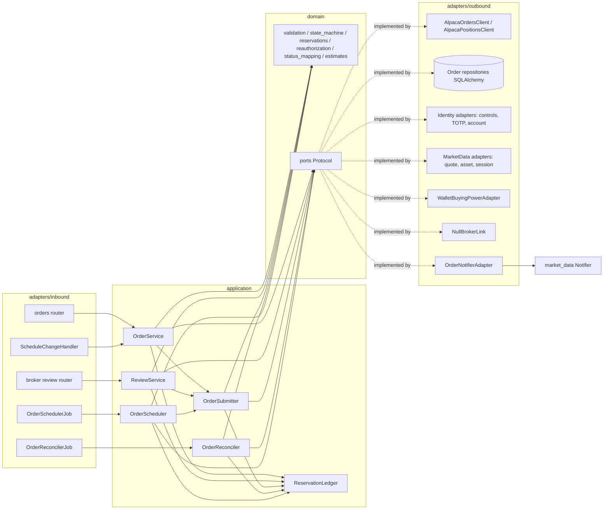
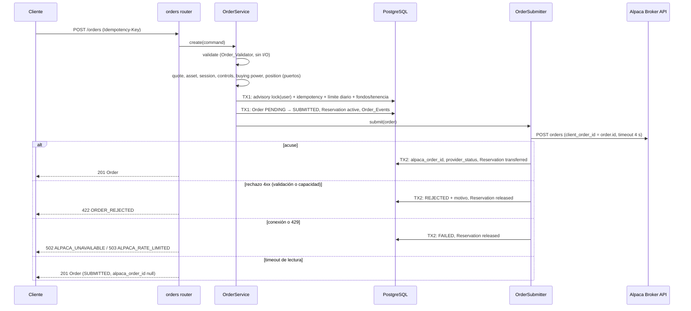
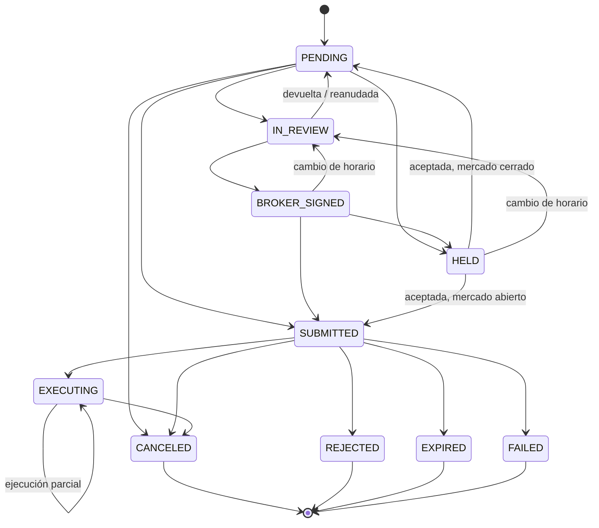

# Design Document: orders-mod-03

## Overview

Este diseño implementa MOD-03 como el paquete `orders` (`src/acciones_ud/orders/`) del monolito modular hexagonal. Cubre creación y validación de órdenes (RF-29), validaciones previas, autorización adicional y revisión con el comisionista (RF-30), reserva de saldo y tenencia y cancelación (RF-34), nueva autorización por cambio de cotización (RF-31), envío idempotente a Alpaca y registro de ejecuciones (RF-32), seguimiento y aviso de ejecución (RF-33), programación fuera de horario (RF-35) y estados de orden con revisión por cambio de horario (RFP-10).

El módulo no tiene motor de calce propio. Toda orden se envía a Alpaca Broker API sandbox. `orders` consume `identity`, `market_data` y `wallet` solo mediante puertos propios (Req. 15.9) y publica dos contratos estables para módulos futuros: Broker_Link_Port (MOD-06) y Schedule_Change_Port (MOD-07).

Decisiones de diseño adicionales a las del requisito (O1 a O17, A1, A2):

- **D1 (envío en dos transacciones):** la creación confirma primero una transacción que guarda la Order, su Reservation, su Idempotency_Key y el paso a Enviada sin identificador externo (`submit_attempted_at`). Después llama a Alpaca fuera de la transacción y confirma una segunda transacción con el resultado. Si el proceso cae entre ambas, la Order queda en Enviada sin identificador externo y el Order_Reconciler la resuelve por Client_Order_Id (Req. 8.4, 8.5). Así nunca hay una Order en Alpaca sin registro local.
- **D2 (fallo ambiguo de Alpaca):** un error de conexión antes de enviar la solicitud o un 429 son "fallo sin recibir la Order" y la Order pasa a Fallida (Req. 8.7). Un 5xx puede haber llegado a Alpaca: el Order_Submitter hace una sola consulta por Client_Order_Id dentro del presupuesto de 5 s; si la Order no aparece, pasa a Fallida; si aparece, se registra como acuse normal. Un timeout de lectura sigue el Req. 8.4.
- **D3 (bloqueo por Investor):** las verificaciones de fondos, tenencia y límite diario y la creación de la Reservation se hacen bajo `pg_advisory_xact_lock` con una clave derivada del `user_id` del Investor (Req. 6.6, 3.3). El bloqueo vive solo dentro de la primera transacción; la llamada a Alpaca ocurre sin bloqueo.
- **D4 (ejecuciones desde actividades):** la cantidad ejecutada y el precio promedio se derivan solo de las Executions registradas desde actividades `FILL` (`fill` y `partial_fill`), no de `filled_qty` del objeto de orden, para cumplir Req. 9.4. Un estado `filled` de Alpaca sin la actividad correspondiente deja la Order en En Ejecución con `fully_filled` en false hasta que llega la actividad.
- **D5 (redondeo del Estimated_Amount):** el Estimated_Amount se cuantiza a 0.01 con `ROUND_UP` (hacia arriba), para que la Reservation nunca sea menor que el costo estimado.
- **D6 (cursor de actividades propio):** `orders` mantiene su propio cursor de actividades `FILL` por cuenta (`order_activity_cursors`), independiente de `wallet_activity_cursors`, porque los dos módulos procesan las mismas actividades con fines distintos (W10 y RF-32).
- **D7 (aceptación tardía de nueva autorización):** si el Investor responde una Reauthorization_Request cuya fecha límite ya pasó pero el barrido aún no la expiró, el Order_Service la expira en ese momento y responde 409 `INVALID_ORDER_STATE`.

### Investigación (resumen)

- **Alpaca Broker API, órdenes** (`.agents/skills/alpaca-broker-trading-orders/SKILL.md`, [Orders at Alpaca](https://docs.alpaca.markets/docs/orders-at-alpaca), [createOrderForAccount](https://docs.alpaca.markets/reference/createorderforaccount)):
  - `POST /v1/trading/accounts/{account_id}/orders` con `symbol`, `qty` (cadena, hasta 9 decimales), `side`, `type`, `time_in_force`, `limit_price`, `stop_price`, `trail_price` | `trail_percent`, `order_class` (`simple` | `bracket`), `take_profit.limit_price`, `stop_loss.stop_price` y `client_order_id` (≤ 128 caracteres).
  - `GET /v1/trading/accounts/{account_id}/orders:by_client_order_id?client_order_id=…` recupera una orden cuya respuesta de creación se perdió. `GET …/orders/{order_id}?nested=true` devuelve las piernas de un `bracket` en `legs`.
  - `DELETE …/orders/{order_id}` responde 204 si acepta la cancelación y 422 si la orden ya no es cancelable.
  - Estados: `new`, `partially_filled`, `filled`, `done_for_day`, `canceled`, `expired`, `replaced`, `pending_cancel`, `pending_replace`, `accepted`, `pending_new`, `accepted_for_bidding`, `stopped`, `rejected`, `suspended`, `calculated`. `held` existe en la Trading API y se mapea igual por la decisión O5. `replaced` no aplica porque no se hace replace; si aparece, se trata con el Req. 10.5.
  - Restricciones relevantes: compra con valor de mercado mínimo de 1 USD (se deja al rechazo de Alpaca, Req. 8.6); fracciones solo con `fractionable: true` y `day` (O2; la guía de fracciones admite también `limit`, `stop` y `stop_limit`, se confirma en sandbox); `bracket` con `day` o `gtc`, TP por encima de SL en compras y piernas activas solo tras la ejecución completa de la entrada.
- **Posiciones:** `GET /v1/trading/accounts/{account_id}/positions/{symbol}` devuelve `qty` y `qty_available` como cadenas; 404 significa sin posición y se interpreta como `qty_available = 0`.
- **Actividades:** se reutiliza la forma de consulta de `wallet` (`GET /v1/accounts/activities?account_id=…&activity_types=FILL&after=…&page_size=…&page_token=…`). Cada `FILL` trae `id` (`<timestamp>::<uuid>`), `order_id`, `type` (`fill` | `partial_fill`), `qty`, `price`, `side`, `symbol` y `transaction_time`. El `id` de la actividad es el identificador de ejecución.
- **Seguimiento por consulta periódica (O12):** la skill recomienda el stream SSE, pero el módulo sigue la decisión W3 de `wallet` por simplicidad operativa. Con intervalo de 15 s la latencia del aviso de ejecución es de hasta un ciclo.

## Architecture



Estructura de paquetes:

```
src/acciones_ud/orders/
  domain/        model.py, validation.py, state_machine.py, status_mapping.py,
                 estimates.py, reservations.py, reauthorization.py, idempotency.py,
                 errors.py, ports.py
  application/   order_service.py, review_service.py, order_submitter.py,
                 order_reconciler.py, order_scheduler.py, schedule_change.py,
                 reservation_ledger.py, dtos.py
  adapters/inbound/http/   routers/{orders,broker_reviews}.py, schemas/*.py, deps.py
  adapters/inbound/jobs/   order_reconcile_job.py, order_scheduler_job.py
  adapters/outbound/alpaca/      orders_client.py, positions_client.py, fake_orders.py
  adapters/outbound/persistence/ tables.py, order_repository.py, reservation_repository.py,
                                 execution_repository.py, idempotency_repository.py,
                                 schedule_change_repository.py, cursor_repository.py, unit_of_work.py
  adapters/outbound/identity/    controls_reader.py, totp_verifier.py, account_reader.py
  adapters/outbound/market_data/ quote_reader.py, asset_reader.py, market_session.py
  adapters/outbound/wallet/      buying_power.py
  adapters/outbound/brokers/     null_broker_link.py
  adapters/outbound/notifications/ order_notifier.py
  composition.py
```

`main.py` agrega `orders.register(app)`, `orders.startup(app)` y `orders.shutdown(app)` después de `wallet`, porque `orders` usa el adaptador de capacidad de compra que publica `wallet`. `startup` arranca el Order_Reconciler y el Order_Scheduler solo si `ORDERS_JOBS_ENABLED` es `true` (por defecto `true`; las pruebas lo apagan).

### Flujo de creación con mercado abierto



Con Broker vinculado, la Order queda en En Revisión en TX1 y no hay envío (Req. 5.1). Con el mercado cerrado y `schedule_if_closed` en true, queda en Pendiente con `scheduled_for` (Req. 13.2).

Las validaciones que no requieren bloqueo (parámetros, activo, cotización, controles, TOTP) se hacen antes de TX1. Las lecturas de `buying_power` y `qty_available` en Alpaca también se hacen antes de TX1 para no mantener el bloqueo durante I/O externo; dentro de TX1 se comparan con las Reservations activas leídas bajo el bloqueo (Req. 6.6).

### Ciclo de vida de una Order



El diagrama omite algunas flechas para legibilidad. La tabla completa de transiciones es la del Req. 10.2 y vive en `state_machine.ALLOWED`. `HELD` → `BROKER_SIGNED` se usa cuando la Order venía firmada por el Broker y la nueva autorización se acepta con el mercado cerrado.

## Components and Interfaces

### Puertos de salida (`orders/domain/ports.py`)

```python
class AccountReader(Protocol):
    async def get(self, user_id: UUID) -> LinkedAccount | None: ...

class OrderControlsReader(Protocol):
    async def get(self, user_id: UUID) -> OrderControls: ...

class TotpVerifier(Protocol):
    async def has_active_totp(self, user_id: UUID) -> bool: ...
    async def verify(self, user_id: UUID, code: str, at: datetime) -> bool: ...

class QuoteReader(Protocol):
    async def current_price(self, symbol: str) -> Decimal | None: ...

class AssetReader(Protocol):
    async def get(self, symbol: str) -> TradableAsset | None: ...

class MarketSessionPort(Protocol):
    async def is_open(self, exchange: str, at: datetime) -> bool: ...
    async def next_open(self, exchange: str, at: datetime) -> SessionWindow: ...

class BuyingPowerPort(Protocol):
    async def buying_power(self, alpaca_account_id: str) -> Decimal: ...

class PositionPort(Protocol):
    async def qty_available(self, alpaca_account_id: str, symbol: str) -> Decimal: ...

class AlpacaOrdersPort(Protocol):
    async def create(self, account_id: str, submission: OrderSubmission, timeout_s: float) -> RawAlpacaOrder: ...
    async def get_by_client_order_id(self, account_id: str, client_order_id: str) -> RawAlpacaOrder | None: ...
    async def get(self, account_id: str, alpaca_order_id: str) -> RawAlpacaOrder: ...
    async def cancel(self, account_id: str, alpaca_order_id: str) -> CancelOutcome: ...
    async def list_fills(self, account_id: str, after_id: str | None) -> list[RawFill]: ...

class BrokerLinkPort(Protocol):
    async def reviewing_broker(self, investor_id: UUID) -> UUID | None: ...
    async def is_linked(self, broker_id: UUID, investor_id: UUID) -> bool: ...
    async def linked_investors(self, broker_id: UUID) -> list[UUID]: ...

class OrderNotifierPort(Protocol):
    async def notify(self, user_id: UUID, event_type: OrderEventType, payload: dict[str, object]) -> None: ...
```

`OrderEventType = Literal["order_executions", "order_updates"]`. `CancelOutcome = Literal["accepted", "not_cancelable"]`.

Errores de los adaptadores: los clientes de Alpaca reutilizan `raise_for_alpaca` y la clasificación de `shared/domain/alpaca_errors.py`. `AlpacaOrdersClient.create` distingue cuatro resultados: acuse, rechazo (4xx, `AlpacaRejectedError` con el `message` de Alpaca), no recibida (error de conexión o 429) y desconocida (timeout de lectura o 5xx). Los dos últimos se modelan como `OrderSubmissionNotReceived` y `OrderSubmissionUnknown` en `orders/domain/errors.py`, para que la aplicación no importe `httpx`.

### Contratos publicados para módulos futuros

**Broker_Link_Port (para MOD-06).** El Protocol anterior es el contrato estable. Semántica:

- `reviewing_broker(investor_id)` devuelve el Broker vinculado con revisión de órdenes habilitada, o `None`.
- `is_linked(broker_id, investor_id)` es `True` solo si existe el vínculo vigente.
- `linked_investors(broker_id)` devuelve los Investors vinculados al Broker; la cola de revisión filtra por esta lista (Req. 5.2).

`NullBrokerLink` devuelve `None`, `False` y `[]`. MOD-06 instala su adaptador asignando `app.state.order_broker_link` antes de `orders.startup`; `orders.composition` usa ese valor si existe y `NullBrokerLink` en otro caso. El contrato HTTP de `orders` no cambia.

**Schedule_Change_Port (para MOD-07).** Puerto de entrada en `orders/application/schedule_change.py`:

```python
@dataclass(frozen=True)
class ScheduleChange:
    change_id: UUID          # identificador único del cambio; clave de idempotencia
    market_code: str         # código de mercado de market_data (p. ej. "XNYS")
    effective_from: date
    description: str

class ScheduleChangePort(Protocol):
    async def apply(self, change: ScheduleChange, now: datetime) -> ScheduleChangeResult: ...
```

`ScheduleChangeResult(affected_order_ids: list[UUID], already_applied: bool)`. `orders.register` publica la implementación en `app.state.order_schedule_change_port`. No hay endpoint HTTP (O14). La relación mercado–instrumento se resuelve con el campo `exchange` que la Order guarda al crearse, tomado del Instrument de `market_data`.

### Casos de uso (`orders/application/`)

| Servicio | Operaciones | Requisitos |
|---|---|---|
| OrderService | `preview`, `create`, `get`, `list`, `cancel`, `answer_reauthorization`, `resubmit`, `resume`, `expire_stale` | 1, 2, 3.1–3.4, 4, 6, 7.2–7.5, 10.3, 10.6, 10.7, 11.1, 11.2, 12, 14.4 |
| ReviewService | `route_new_order`, `queue`, `return_for_changes`, `approve` | 5 |
| OrderSubmitter | `submit(order_id, waited: bool)` | 3.5, 7.1, 7.6, 8.1, 8.4, 8.6, 8.7 |
| OrderReconciler | `run_once()` | 8.5, 9, 10.4, 10.5, 11.3, 11.4, 12.3, 12.7 |
| OrderScheduler | `run_once()` | 7.5, 10.7, 13.3–13.5 |
| ScheduleChangeService | `apply(change, now)` | 14.1–14.3, 14.5 |
| ReservationLedger | `reserve`, `adjust`, `transfer`, `release`, `active_usd`, `active_shares` | 6 |

`OrderSubmitter.submit` con `waited=True` (programada, devuelta, firmada o reanudada) repite las validaciones del Req. 3.5 descontando la Reservation propia y aplica `reauthorization.requires_reauthorization` antes de llamar a Alpaca.

Reglas puras del dominio que concentran la lógica crítica:

- `validation.validate(request: OrderRequest, asset: TradableAsset, base_price: Decimal) -> list[FieldError]`: aplica Req. 2.1 a 2.6 y devuelve todos los campos inválidos, no solo el primero (Req. 2.8). No hace I/O y es determinista (Req. 2.9). La negociabilidad (Req. 2.7) se comprueba antes con `TradableAsset` y produce `ASSET_NOT_TRADABLE`.
- `validation.allows_fraction(asset, order_class, order_type, tif) -> bool`: O2.
- `estimates.base_price(order_type, limit_price, stop_price, reference_price) -> Decimal` y `estimates.estimated_amount(side, qty, base_price, commission_rate) -> Decimal`: definición del glosario con `ROUND_UP` a 0.01 (D5).
- `estimates.requires_extra_authorization(amount, controls) -> Literal["none", "totp", "acknowledgement"]`: O10; `amount > high_order_threshold_usd` estricto.
- `state_machine.transition(current: OrderStatus, target: OrderStatus, fully_filled: bool) -> OrderStatus`: lanza `InvalidTransitionError` si `(current, target)` no está en `ALLOWED` o si la Order es terminal. `state_machine.is_terminal(status, fully_filled) -> bool`.
- `status_mapping.map_alpaca(provider_status: str, filled_qty: Decimal) -> OrderStatus | None`: Req. 10.4; `None` para estados desconocidos (Req. 10.5).
- `reservations.check_buy(estimated, buying_power, active_usd, own=0) -> None` y `reservations.check_sell(qty, qty_available, reserved_shares, own=0) -> None`: lanzan `InsufficientBuyingPowerError` o `InsufficientPositionError` (Req. 3.1, 3.2, 3.5, 7.3). `reservations.next_state(current, target)` rechaza toda salida de `transferred` o `released` (Req. 6.5).
- `reauthorization.requires_reauthorization(order_type, waited, reference_price, current_price, threshold_pct) -> bool`: `True` solo si `order_type == "market"`, `waited` y `|current − reference| / reference × 100 > threshold_pct` (Req. 7.1, O11).
- `idempotency.request_hash(request: OrderRequest) -> str`: SHA-256 de la representación canónica con decimales normalizados (`Decimal.normalize()`), campos opcionales ausentes como `null` y claves ordenadas. Excluye `totp_code` para no derivar datos del secreto.

### Endpoints HTTP

Todos usan la cookie `access_token` mediante `get_current_user` de `identity`. Los endpoints de Investor usan `require_investor` (igual que `wallet`); los de revisión usan `require_broker` (rol `broker` vigente). Sin sesión responden 401 y sin rol 403 con el Error_Body de `identity-market-backend` (Req. 15.1, 15.3). Una Order ajena o inexistente responde 404 `ORDER_NOT_FOUND` con el mismo cuerpo (Req. 15.2). Los tags OpenAPI son `orders` y `broker-reviews`.

| Método y ruta | Descripción | Respuestas de error declaradas |
|---|---|---|
| `POST /orders/preview` | vista previa sin crear Order (Req. 1.4) | 401, 403, 409 `ORDER_ACCOUNT_NOT_ACTIVE`, 422 (`VALIDATION_ERROR`, `ASSET_NOT_TRADABLE`), 502, 503 (`QUOTE_UNAVAILABLE`, `DATABASE_UNAVAILABLE`) |
| `POST /orders` | crear; `Idempotency-Key` obligatorio (Req. 1, 2, 3, 4, 8, 13) | 401 (`EXTRA_AUTHORIZATION_INVALID`), 403, 409 (`ORDER_ACCOUNT_NOT_ACTIVE`, `INSUFFICIENT_BUYING_POWER`, `INSUFFICIENT_POSITION`, `DAILY_ORDER_LIMIT_REACHED`, `EXTRA_AUTHORIZATION_REQUIRED`, `MFA_ENROLLMENT_REQUIRED`, `IDEMPOTENCY_CONFLICT`, `MARKET_CLOSED`), 422 (`VALIDATION_ERROR`, `ASSET_NOT_TRADABLE`, `ORDER_REJECTED`), 502 `ALPACA_UNAVAILABLE`, 503 (`ALPACA_RATE_LIMITED`, `QUOTE_UNAVAILABLE`, `DATABASE_UNAVAILABLE`) |
| `GET /orders` | `status`, `symbol`, `from`, `to`, `page_size` (1–100, defecto 20), `cursor` (Req. 11.2) | 401, 403, 422, 503 |
| `GET /orders/{id}` | detalle completo (Req. 11.1) | 401, 403, 404, 503 |
| `POST /orders/{id}/cancel` | `{reason, reason_text?, confirmed}`; 200 o 202 (Req. 12) | 401, 403, 404, 409 `ORDER_NOT_CANCELLABLE`, 422, 502, 503 |
| `POST /orders/{id}/reauthorization` | `{decision: "accept" \| "reject"}` (Req. 7.2–7.4) | 401, 403, 404, 409 (`INVALID_ORDER_STATE`, `INSUFFICIENT_BUYING_POWER`, `INSUFFICIENT_POSITION`), 502, 503 |
| `POST /orders/{id}/resubmit` | Order devuelta: `{qty?, limit_price?, stop_price?, trail_price?, trail_percent?, time_in_force?, take_profit?, stop_loss?, totp_code?, high_amount_acknowledged?}` (Req. 5.4) | las de creación salvo `IDEMPOTENCY_CONFLICT` y `MARKET_CLOSED`, más 404 y 409 `INVALID_ORDER_STATE` |
| `POST /orders/{id}/resume` | reanudar tras cambio de horario: envía si el mercado está abierto; si está cerrado, recalcula `scheduled_for`, pasa a Pendiente y notifica `order_updates` con la nueva fecha (Req. 14.4) | 401, 403, 404, 409 (`INVALID_ORDER_STATE`, fondos o tenencia), 422 `ORDER_REJECTED`, 502, 503 |
| `GET /broker/order-reviews` | cola de revisión del Broker (Req. 5.2, 5.7) | 401, 403, 503 |
| `POST /broker/order-reviews/{id}/return` | `{comment}` de 1 a 500 caracteres (Req. 5.3) | 401, 403, 404, 409 `INVALID_ORDER_STATE`, 422, 503 |
| `POST /broker/order-reviews/{id}/approve` | registra de inmediato Broker, instante y paso a Firmada por Comisionista; luego envía con mercado abierto o programa según Req. 13 con mercado cerrado (Req. 5.5) | 401, 403, 404, 409, 422 `ORDER_REJECTED`, 502, 503 |

Cuerpo de creación (y de vista previa, que ignora `confirmed`, `totp_code` y `high_amount_acknowledged`):

```json
{
  "symbol": "AAPL", "side": "buy", "qty": "10", "type": "limit",
  "order_class": "simple", "time_in_force": "day",
  "limit_price": "190.00", "stop_price": null, "trail_price": null, "trail_percent": null,
  "take_profit": null, "stop_loss": null,
  "schedule_if_closed": false, "confirmed": true,
  "totp_code": null, "high_amount_acknowledged": false
}
```

Cantidades, precios e importes viajan como cadenas decimales (Req. 15.4); los esquemas Pydantic los declaran como `str` con patrón decimal y se convierten a `Decimal` sin pasar por `float`. `type` es opcional (Req. 1.2). Una repetición idempotente devuelve la Order almacenada con 201 y su estado actual. `Idempotency-Key` ausente o fuera de 8 a 128 caracteres ASCII imprimibles responde 422 `VALIDATION_ERROR`.

La respuesta `Order` incluye `id`, `status`, `provider_status`, `updated_at`, `symbol`, `exchange`, `side`, `qty`, `filled_qty`, `filled_avg_price`, `fully_filled`, `type`, `order_class`, `time_in_force`, precios, `reference_price`, `estimated_amount`, `reference_commission` (rotulada `reference_commission_estimated: true`, Req. 11.5), `scheduled_for`, `returned_for_changes`, `alpaca_order_id`, `legs`, `executions`, `events`, `reservation`, `reauthorizations` y `review_comments`. El listado devuelve un resumen sin `executions`, `events` ni `reauthorizations`.

Nuevos códigos en `ErrorCode` (`shared/domain/errors.py`): `ORDER_ACCOUNT_NOT_ACTIVE`, `QUOTE_UNAVAILABLE`, `ASSET_NOT_TRADABLE`, `INSUFFICIENT_BUYING_POWER`, `INSUFFICIENT_POSITION`, `DAILY_ORDER_LIMIT_REACHED`, `EXTRA_AUTHORIZATION_REQUIRED`, `EXTRA_AUTHORIZATION_INVALID`, `ORDER_REJECTED`, `ORDER_NOT_FOUND`, `INVALID_ORDER_STATE`, `ORDER_NOT_CANCELLABLE`, `MARKET_CLOSED`. `IDEMPOTENCY_CONFLICT`, `MFA_ENROLLMENT_REQUIRED`, `ALPACA_UNAVAILABLE`, `ALPACA_RATE_LIMITED` y `DATABASE_UNAVAILABLE` se reutilizan si ya existen; si `MFA_ENROLLMENT_REQUIRED` no existe, se agrega.

### Adaptadores hacia otros módulos

1. **`identity`** (decisión explícita según la regla de módulos, igual que `wallet`):
   - `account_reader.py` lee `kyc_accounts` (Active_Account).
   - `controls_reader.py` lee las Order_Controls de las preferencias existentes de `identity` (O9), sin copiarlas.
   - `totp_verifier.py` reutiliza la verificación TOTP existente de `identity` (secreto cifrado con `SecretCipher` y la ventana de pasos configurada). Si `identity` expone un caso de uso de verificación, el adaptador lo llama; si no, se agrega una función de aplicación en `identity` que `orders` invoca. El código TOTP no se registra en logs ni en Order_Events (Req. 4.5, 15.8).
   - Nuevos tipos de evento `order_executions` y `order_updates` en `EVENT_TYPES` de `identity/domain/preferences.py`, con `in_app` habilitado por defecto (O15). Es un cambio aditivo del contrato de preferencias que el frontend debe mostrar. Si las preferencias se guardan por fila, la migración `0007_orders_schema` inserta los valores por defecto.
2. **`market_data`**:
   - `quote_reader.py` usa el caso de uso de cotización existente de `market_data` (el mismo que atiende la consulta de cotización) y devuelve el último precio, o `None` si la cotización no está disponible (Req. 1.6).
   - `asset_reader.py` usa `InstrumentRepository.get(symbol)` y expone `TradableAsset(symbol, exchange, active, tradable, fractionable)`.
   - `market_session.py` usa el calendario y los horarios de mercado de `market_data` (`MarketRepository` con sus overrides y `AlpacaBrokerMarketPort.calendar`) para `is_open` y `next_open` por `exchange`.
   - `order_notifier.py` usa `RecipientDirectory.recipient(user_id, event_type)`, agregado por el diseño de `wallet`, y `Notifier.notify`. Si devuelve `None`, no hay notificación.
3. **`wallet`**: `wallet.register(app)` publica en `app.state.wallet_funding_port` su `AlpacaFundingPort` (cambio aditivo en `wallet/composition.py`). `buying_power.py` llama `get_trading_account(account_id, timeout_s=4)` y devuelve `buying_power` como `Decimal`. `wallet` no cambia su comportamiento (O7).

### Order_Reconciler

Tarea asyncio en `adapters/inbound/jobs/order_reconcile_job.py` con intervalo `ORDER_RECONCILE_INTERVAL_SECONDS` (por defecto 15). Cada ejecución agrupa por cuenta las Orders en Enviada o en En Ejecución con `fully_filled` en false y, por cuenta:

1. **Sin identificador externo:** llama `get_by_client_order_id`. Si aparece, registra `alpaca_order_id` y transfiere la Reservation. Si no aparece, incrementa `lookup_misses`; con 2 fallos pasa a Fallida y libera la Reservation (Req. 8.5).
2. **Con identificador externo:** llama `get(…, nested=true)`, aplica `map_alpaca`, guarda `provider_status` y las Order_Legs (Req. 9.6). La transición se aplica con un UPDATE condicional (`WHERE id = :id AND status = :expected`) y su Order_Event en la misma transacción (Req. 10.6). Un estado desconocido o una transición no permitida solo actualizan `provider_status` y registran una advertencia (Req. 10.5).
3. **Ejecuciones:** consulta `list_fills(account_id, after_id=cursor)`. Por cada `FILL` cuyo `order_id` corresponde a una Order local, inserta la Execution con `ON CONFLICT (alpaca_execution_id) DO NOTHING` (Req. 9.3). Si insertó, recalcula `filled_qty = Σ qty` y `filled_avg_price = Σ(qty × price) / Σ qty` desde las Executions, pone `fully_filled` y `completed_at` cuando `filled_qty = qty` (Req. 9.2, 9.4, 9.5) y, después de confirmar, notifica `order_executions` (Req. 11.3). Al final avanza el cursor.
4. **Cancelación:** si una solicitud de cancelación está pendiente y Alpaca informa `filled`, marca la solicitud como no aplicada (Req. 12.7).
5. Un error de Alpaca en una cuenta se registra en el log sin credenciales y la ejecución sigue con la siguiente cuenta (Req. 9.7).

Una Execution cuya cantidad haría `filled_qty > qty` se rechaza y se registra como advertencia; nunca se inserta (Req. 9.4).

### Order_Scheduler

Tarea asyncio en `adapters/inbound/jobs/order_scheduler_job.py` con intervalo `ORDER_SCHEDULER_INTERVAL_SECONDS` (por defecto 30). Cada ejecución:

1. Selecciona Orders en Pendiente o Firmada por Comisionista con `scheduled_for <= now`, no devueltas, con `FOR UPDATE SKIP LOCKED`, y para cada una con mercado abierto llama `OrderSubmitter.submit(order_id, waited=True)` (Req. 13.3). Con el mercado cerrado no hace nada (Req. 13.4). Una Order en En Revisión no se selecciona (Req. 13.5).
2. Expira las Reauthorization_Requests vencidas (Req. 7.5), las Unsent_Orders con `created_at < now − ORDER_LOCAL_MAX_AGE_DAYS` y las Orders programadas `day` cuya sesión prevista terminó sin envío (Req. 10.7), liberando la Reservation y notificando `order_updates`.

## Data Models

### Entidades de dominio (dataclasses `frozen=True`)

- `OrderStatus` (StrEnum): `PENDING`, `SUBMITTED`, `BROKER_SIGNED`, `EXECUTING`, `CANCELED`, `REJECTED`, `EXPIRED`, `IN_REVIEW`, `FAILED`, `HELD`.
- `OrderRequest(symbol, side, qty: Decimal, type, order_class, time_in_force, limit_price, stop_price, trail_price, trail_percent, take_profit_limit_price, stop_loss_stop_price, schedule_if_closed, confirmed, high_amount_acknowledged)`; `totp_code` viaja aparte, en el comando.
- `Order(id, user_id, alpaca_account_id, symbol, exchange, side, qty, type, order_class, time_in_force, limit_price, stop_price, trail_price, trail_percent, reference_price, estimated_amount, status, status_cause, provider_status, alpaca_order_id, client_order_id, filled_qty, filled_avg_price, fully_filled, scheduled_for, returned_for_changes, submit_attempted_at, lookup_misses, completed_at, created_at, updated_at)`.
- `OrderLeg(order_id, role: "take_profit" | "stop_loss", alpaca_order_id, price, provider_status)`.
- `OrderEvent(id, order_id, from_status, to_status, cause, actor_type: "investor" | "broker" | "system", actor_id, metadata, at)`. `metadata` guarda el método de autorización adicional (Req. 4.5) y el motivo de rechazo, nunca un código TOTP.
- `Execution(alpaca_execution_id, order_id, qty, price, executed_at, recorded_at)`.
- `Reservation(order_id, user_id, kind: "usd" | "shares", symbol, amount: Decimal, status: "active" | "transferred" | "released", updated_at)`.
- `ReauthorizationRequest(id, order_id, previous_price, updated_price, deadline, decision: "accepted" | "rejected" | "no_response" | None, answered_at)`.
- `CancelRequest(id, order_id, previous_status, reason, reason_text, confirmed, requested_at, outcome: "applied" | "pending" | "not_applied")`.
- `ReviewComment(id, order_id, broker_id, comment, at)`.
- `OrderControls(default_order_type, daily_order_limit, high_order_threshold_usd: Decimal, extra_confirmation: bool)`.
- `TradableAsset(symbol, exchange, active, tradable, fractionable)`; `LinkedAccount(user_id, alpaca_account_id, status)`.

### Tablas (migración `migrations/versions/0007_orders_schema.py`)

| Tabla | Columnas principales | Restricciones |
|---|---|---|
| `orders` | campos de `Order`; importes y cantidades `numeric(20,9)`, precios `numeric(18,4)` | PK `id`; UNIQUE `client_order_id`; UNIQUE `alpaca_order_id`; CHECK `qty > 0`; CHECK `filled_qty <= qty`; CHECK `status IN (…10…)`; índice `(user_id, created_at DESC, id)`; índice parcial sobre estados no terminales; índice `(status, scheduled_for)` |
| `order_legs` | campos de `OrderLeg` | PK `(order_id, role)` |
| `order_events` | campos de `OrderEvent` | índice `(order_id, at)`; sin UPDATE ni DELETE desde la aplicación |
| `order_executions` | campos de `Execution` | PK `alpaca_execution_id`; CHECK `qty > 0` |
| `order_reservations` | campos de `Reservation` | PK `order_id` (una por Order, Req. 6.5); índice parcial `(user_id, kind, symbol) WHERE status = 'active'` |
| `order_idempotency_keys` | `user_id`, `idempotency_key`, `request_hash`, `order_id`, `created_at` | PK `(user_id, idempotency_key)` |
| `order_reauthorizations` | campos de `ReauthorizationRequest` | índice único parcial `(order_id) WHERE decision IS NULL` |
| `order_cancel_requests` | campos de `CancelRequest` | índice `(order_id)` |
| `order_review_comments` | campos de `ReviewComment` | índice `(order_id, at)` |
| `order_schedule_changes` | `change_id`, `market_code`, `applied_at`, `affected_count` | PK `change_id` (Req. 14.5) |
| `order_activity_cursors` | `alpaca_account_id`, `last_activity_id`, `updated_at` | PK `alpaca_account_id` (D6) |

`downgrade` elimina las tablas en orden inverso. La migración no modifica datos existentes salvo, si aplica, la inserción de preferencias `order_executions` y `order_updates`.

### Configuración (`config/settings.py`)

| Variable | Validación en `require_api_settings` | Defecto |
|---|---|---|
| `ORDER_REFERENCE_COMMISSION_RATE` | decimal entre 0 y 1 | `0.02` |
| `ORDER_REAUTH_PRICE_DEVIATION_PCT` | decimal > 0 y ≤ 100 | `1.00` |
| `ORDER_REAUTH_WINDOW_MINUTES` | entero entre 1 y 1440 | `30` |
| `ORDER_LOCAL_MAX_AGE_DAYS` | entero entre 1 y 90 | `5` |
| `ORDER_RECONCILE_INTERVAL_SECONDS` | entero entre 5 y 3600 | `15` |
| `ORDER_SCHEDULER_INTERVAL_SECONDS` | entero entre 5 y 3600 | `30` |
| `ORDER_ALPACA_SUBMIT_TIMEOUT_SECONDS` | decimal entre 1 y 4 | `4` |
| `ORDERS_JOBS_ENABLED` | `true`/`false` | `true` |

Cada variable se lee por separado y, si falta, toma su propio defecto sin afectar a las demás (Req. 15.5). Las credenciales de Alpaca son las existentes. El error de arranque lista solo nombres de variables (Req. 15.5). `.env.example` se actualiza.

## Correctness Properties

*A property is a characteristic or behavior that should hold true across all valid executions of a system-essentially, a formal statement about what the system should do. Properties serve as the bridge between human-readable specifications and machine-verifiable correctness guarantees.*

Solo se definen propiedades para las partes críticas de la política de pruebas. En la reflexión se unieron los criterios 2.1 a 2.6, 2.8 y 2.9 en una sola propiedad de validación contra un modelo de referencia; los criterios 10.2, 10.3, 10.6 y 10.8 en una propiedad de la máquina de estados; los criterios 6.1 a 6.5, 6.7 y 12.2 en el invariante de reservas; los criterios 7.2 a 7.5 en un modelo de respuesta a la nueva autorización; y los criterios 9.3 a 9.5 y 12.6 en una propiedad de ejecuciones. Los criterios 3.1 y 3.2 quedan dentro de la propiedad de serialización de reservas.

### Property 1: Validación de parámetros contra el modelo de referencia

*For any* solicitud de orden generada (lado, tipo, clase y vigencia arbitrarios o válidos; cantidades y precios decimales con escala y magnitud variables, incluidos valores alrededor de 1.00, 0.1 y 50.0; activo con `fractionable` true o false; piernas `bracket` alrededor de precio base ± 0.01), `validation.validate` devuelve exactamente el conjunto de campos inválidos que calcula un modelo de referencia escrito directamente a partir de los Requisitos 2.1 a 2.6 y O2, la solicitud se acepta si y solo si ese conjunto es vacío, y evaluar dos veces la misma solicitud produce el mismo resultado.

**Validates: Requirements 2.1, 2.2, 2.3, 2.4, 2.5, 2.6, 2.8, 2.9**

### Property 2: Máquina de estados cerrada y terminales inmutables

*For any* Order_Status inicial y cualquier secuencia de transiciones solicitadas (con `fully_filled` arbitrario), `state_machine.transition` acepta una transición si y solo si el par está en la tabla del Requisito 10.2 y la Order no es Terminal_Order; cada transición aceptada produce exactamente un Order_Event con estado anterior y nuevo; cada transición rechazada deja la Order sin cambios y sin Order_Event; y al final de la secuencia la Order está en uno de los diez Order_Status.

**Validates: Requirements 10.2, 10.3, 10.6, 10.8**

### Property 3: Mapeo de estados de Alpaca

*For any* cadena de estado del proveedor (de la lista conocida o arbitraria) y cualquier `filled_qty` no negativo, `status_mapping.map_alpaca` devuelve el Order_Status de la tabla del Requisito 10.4 (con `done_for_day` según `filled_qty > 0`), y para un estado no incluido devuelve `None`, de modo que el Order_Reconciler conserva el Order_Status y almacena el estado del proveedor.

**Validates: Requirements 10.4, 10.5**

### Property 4: Invariante del Reservation_Ledger

*For any* secuencia generada de operaciones sobre Orders de un Investor (crear compra o venta, acuse de Alpaca, cancelar, rechazar, fallar, expirar, aceptar nueva autorización con otro precio, reenviar devuelta), después de cada operación: cada Order tiene como máximo una Reservation; ninguna Reservation sale de `transferred` o `released`; las Orders con acuse tienen Reservation `transferred`; las Orders terminales sin identificador externo tienen Reservation `released`; y el importe `active` en USD es igual a la suma de los Estimated_Amount de las compras no terminales sin identificador externo (análogo para acciones por símbolo).

**Validates: Requirements 6.1, 6.2, 6.3, 6.4, 6.5, 6.7, 12.2**

### Property 5: Reservas serializadas sin sobrecompromiso

*For any* `buying_power`, `qty_available` por símbolo y lista de solicitudes de compra y venta del mismo Investor procesadas por el ReservationLedger en cualquier orden de llegada, cada solicitud se acepta si y solo si su importe (o cantidad) más las Reservations `active` vigentes no supera el `buying_power` (o la `qty_available`), las rechazadas responden `INSUFFICIENT_BUYING_POWER` o `INSUFFICIENT_POSITION` sin crear Order, y la suma final de Reservations `active` nunca supera esos valores.

**Validates: Requirements 3.1, 3.2, 6.6**

### Property 6: Detección de cambio de precio y bloqueo de envío

*For any* tipo de orden, indicador `waited`, Reference_Price y precio vigente positivos y umbral configurado, el Order_Submitter pasa la Order a Detenida y no llama a Alpaca_Broker_API si y solo si el tipo es `market`, `waited` es true y `|vigente − referencia| / referencia × 100 > umbral`; y *for any* Order en Detenida, ninguna ejecución del Order_Submitter ni del Order_Scheduler produce una llamada de creación a Alpaca_Broker_API.

**Validates: Requirements 7.1, 7.6**

### Property 7: Respuesta a la nueva autorización

*For any* Reauthorization_Request pendiente, instante de respuesta, decisión (`accept`, `reject` o ninguna) y Available_Buying_Power, el resultado coincide con el modelo: aceptar antes de la fecha límite con fondos suficientes actualiza Reference_Price, Estimated_Amount y Reservation y deja la Order lista para envío o programada; aceptar sin fondos responde `INSUFFICIENT_BUYING_POWER` y la Order sigue en Detenida sin cambios; rechazar deja la Order en Cancelada con causa `reauthorization_rejected` y la Reservation `released`; y sin respuesta al vencer la Order queda en Expirada con la Reservation `released`. En todos los casos se registra la decisión y el instante.

**Validates: Requirements 7.2, 7.3, 7.4, 7.5**

### Property 8: Idempotencia de la creación

*For any* Investor, Idempotency_Key y secuencia de solicitudes de creación con esa clave, si todas tienen el mismo cuerpo existe exactamente una Order y como máximo una llamada de creación a Alpaca_Broker_API, y cada respuesta devuelve esa Order; si alguna tiene un cuerpo distinto (según `request_hash`), esa solicitud responde `IDEMPOTENCY_CONFLICT` sin crear Order ni llamar a Alpaca.

**Validates: Requirements 8.2, 8.3**

### Property 9: Envío como máximo una vez por Order

*For any* Order y secuencia generada de resultados de Alpaca (acuse, rechazo, no recibida, timeout, 5xx) seguida de cualquier número de ciclos del Order_Reconciler con respuestas de búsqueda por Client_Order_Id (encontrada o no), el fake de Alpaca recibe como máximo una llamada de creación con ese Client_Order_Id; una Order con timeout permanece en Enviada sin identificador externo hasta que la búsqueda la encuentra (registrando el identificador) o falla 2 veces (pasando a Fallida con la Reservation `released`).

**Validates: Requirements 8.4, 8.5**

### Property 10: Ejecuciones idempotentes y acotadas

*For any* Order con cantidad `q` y lista de actividades `FILL` con identificadores posiblemente repetidos y cantidades positivas, aplicada en cualquier orden y en cualquier número de ciclos (incluida una cancelación intermedia de una ejecución parcial): cada identificador de ejecución se registra una sola vez; `filled_qty` es igual a la suma de las Executions registradas y nunca supera `q`; `filled_avg_price` es el promedio ponderado de esas Executions; `fully_filled` es true si y solo si `filled_qty = q`; y la cancelación conserva todas las Executions.

**Validates: Requirements 9.3, 9.4, 9.5, 12.6**

### Property 11: Propiedad de recursos sin filtración

*For any* par de usuarios distintos (Investor dueño y otro Investor, o Broker no vinculado según Broker_Link_Port) y cualquier Order, toda consulta o acción del no dueño sobre la Order responde 404 `ORDER_NOT_FOUND` con un Error_Body idéntico al que recibe para un identificador inexistente, y la Order queda sin cambios.

**Validates: Requirements 15.2, 5.6**

## Error Handling

| Situación | Respuesta | Efecto |
|---|---|---|
| Parámetros inválidos, `confirmed` distinto de true, `Idempotency-Key` inválida | 422 `VALIDATION_ERROR` con `details.fields` | sin Order |
| Activo inexistente, inactivo o no negociable | 422 `ASSET_NOT_TRADABLE` | sin Order |
| Sin Active_Account | 409 `ORDER_ACCOUNT_NOT_ACTIVE` | sin llamada a Alpaca |
| Cotización no disponible | 503 `QUOTE_UNAVAILABLE` | sin Order |
| Fondos o tenencia insuficientes | 409 `INSUFFICIENT_BUYING_POWER` (`details.estimated_amount`, `details.available_buying_power`) / `INSUFFICIENT_POSITION` | sin Order |
| Límite diario | 409 `DAILY_ORDER_LIMIT_REACHED` | sin Order |
| Autorización adicional | 409 `EXTRA_AUTHORIZATION_REQUIRED` (`details.method`), 401 `EXTRA_AUTHORIZATION_INVALID`, 409 `MFA_ENROLLMENT_REQUIRED` | sin Order |
| Mercado cerrado sin `schedule_if_closed` | 409 `MARKET_CLOSED` (`details.next_open`) | sin Order |
| Clave reutilizada con otro cuerpo | 409 `IDEMPOTENCY_CONFLICT` | sin Order |
| Alpaca rechaza la Order | 422 `ORDER_REJECTED` (`details.reason`, `details.order_id`) | Rechazada, Reservation `released` |
| Alpaca no recibe la Order | 502 `ALPACA_UNAVAILABLE` / 503 `ALPACA_RATE_LIMITED` con `details.order_id` | Fallida, Reservation `released` |
| Timeout de Alpaca al enviar | 201 con la Order en Enviada y `alpaca_order_id: null` | el Order_Reconciler resuelve |
| `buying_power` o posición no disponibles | 502 `ALPACA_UNAVAILABLE` | sin Order |
| Transición no permitida | 409 `INVALID_ORDER_STATE` | Order sin cambios |
| Cancelar Terminal_Order | 409 `ORDER_NOT_CANCELLABLE` | sin llamada a Alpaca |
| Order ajena o inexistente | 404 `ORDER_NOT_FOUND` | — |
| Base de datos caída | 503 `DATABASE_UNAVAILABLE` | — |
| Error de Alpaca en jobs | log sin secretos, reintento en el siguiente ciclo | estados conservados |

Las excepciones de dominio (`OrderDomainError` y subclases en `orders/domain/errors.py`) heredan de `AppError` y se traducen en `shared/infrastructure/http_errors.py`. Los logs usan `order_id`, `client_order_id` y `alpaca_order_id`; nunca credenciales, códigos TOTP ni el cuerpo con `totp_code` (Req. 15.8). Los esquemas de respuesta de error se declaran por endpoint con `responses=` en cada router (Req. 15.7).

## Testing Strategy

Siguiendo la política del requisito, las pruebas son obligatorias solo para las partes críticas. El resto es opcional y se marca así en las tareas.

**Obligatorias (property-based con `hypothesis`, mínimo 100 ejemplos por propiedad):**

- `tests/orders/property/test_validation.py`: Property 1.
- `tests/orders/property/test_state_machine.py`: Properties 2 y 3.
- `tests/orders/property/test_reservations.py`: Properties 4 y 5, sobre el ReservationLedger con un repositorio en memoria.
- `tests/orders/property/test_reauthorization.py`: Properties 6 y 7, con fakes de cotización y de Alpaca.
- `tests/orders/property/test_idempotency.py`: Properties 8 y 9, con `fake_orders.py` que cuenta las llamadas de creación por Client_Order_Id.
- `tests/orders/property/test_executions.py`: Property 10.
- `tests/orders/api/test_ownership.py`: Property 11 sobre la API con fakes, y una prueba de ejemplo por endpoint para 401, 403 y rol (Req. 15.1, 15.3).

Cada prueba de propiedad implementa una sola propiedad, usa `@settings(max_examples=100)` o más, y lleva el comentario:

```python
# Feature: orders-mod-03, Property 4: Invariante del Reservation_Ledger
```

**Obligatoria de integración (marcada `db`, se salta sin `TEST_DATABASE_URL`):**

- `tests/orders/unit/test_reservation_lock_db.py`: dos creaciones concurrentes del mismo Investor contra PostgreSQL con `pg_advisory_xact_lock`; la suma de Reservations `active` no supera el `buying_power` (Req. 6.6).

**Opcionales (ejemplos):** creación y vista previa (Req. 1), activo no negociable (2.7), límite diario y revalidación (3.3–3.5), autorización adicional (4), revisión con un fake de Broker_Link_Port (5), rechazo y fallo de Alpaca (8.6, 8.7), reconciliación y piernas (9.1, 9.2, 9.6, 9.7), consulta y notificación (11), cancelación (12.1, 12.3–12.5, 12.7), programación (13), cambio de horario e idempotencia de Schedule_Change_Port (14), configuración y contrato OpenAPI (15.4–15.7).

Las integraciones con Alpaca usan `fake_orders.py`, que implementa `AlpacaOrdersPort` y `PositionPort` en memoria. No se llama al sandbox en las pruebas automáticas. La validación final es `uv run ruff check .`, `uv run mypy src` y `uv run pytest`.
