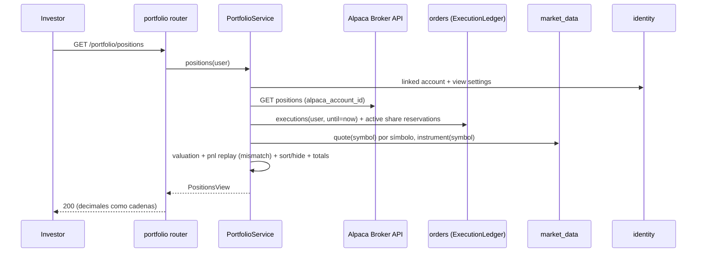

# Design Document: portfolio-mod-05

## Overview

Este diseño implementa MOD-05 como el paquete `portfolio` (`src/acciones_ud/portfolio/`) del monolito modular hexagonal. Cubre la consulta de posiciones (RF-41, RF-08), el historial de operaciones ejecutadas (RF-41), el costo promedio y los resultados realizado y no realizado (RF-41, RF-42), las estadísticas descriptivas (RF-05), el perfil de riesgo (RF-04), los reportes bajo demanda, programados y de comisionista (RF-42, RFP-12) y el adaptador definitivo del Position_Port de `orders` (decisión O3 de `orders-mod-03`).

`portfolio` no tiene fuente de datos propia para posiciones ni ejecuciones. Lee las posiciones de Alpaca Broker API (P1), las Executions y Reservations de `orders`, las cotizaciones, instrumentos y calendario de `market_data`, las preferencias de `identity` y el `equity` de `wallet`, siempre mediante puertos propios. Solo persiste los Reports. Publica dos contratos estables para módulos futuros: Commission_Port (MOD-07) y Broker_Client_Port (MOD-06), con adaptadores por defecto Reference_Commission y Null_Broker_Client.

Decisiones de diseño adicionales a las del requisito (P1 a P14, A1 a A3):

- **D1 (costo total en lugar de costo promedio):** el Pnl_Calculator guarda por símbolo la cantidad y el **costo total** (`total_cost`), no el costo promedio. Una compra suma `qty × price` al costo total. Una venta de `q` acciones retira `cost_removed = total_cost × q ÷ qty` (y exactamente `total_cost` cuando `q == qty`), y registra `realized_gross = q × price − cost_removed`. Es algebraicamente igual a la fórmula de P4, `(price − avg) × q`, pero como el mismo `cost_removed` se resta del costo total y entra en el resultado realizado, el invariante de conservación del Req. 3.4 se cumple con igualdad exacta aunque la división no sea exacta. El costo promedio se calcula solo para la salida como `total_cost ÷ qty`. Todo el cálculo corre en un `decimal.localcontext(prec=40)`.
- **D2 (lectura de Executions con Broker firmante, cambio aditivo en `orders`):** la entidad `Execution` de `orders` no trae lado, símbolo ni Broker. `orders` agrega la consulta de aplicación `ExecutionLedger` (solo lectura), que une `order_executions` con `orders` y con el último `order_events` hacia `BROKER_SIGNED` con `actor_type = 'broker'`, y devuelve `signed_by_broker_id` (o `None`). No hay columna nueva ni migración en `orders`; el contrato HTTP de `orders` no cambia. El adaptador `portfolio/adapters/outbound/orders/execution_reader.py` llama esa consulta.
- **D3 (Reservations de venta):** `orders` agrega a la misma consulta `active_share_reservations(user_id) -> dict[str, Decimal]`, que suma `amount` de `order_reservations` con `kind = 'shares'` y `status = 'active'` por símbolo, usando el índice parcial existente.
- **D4 (valores de `sort_by`):** los valores permitidos son los que ya valida `identity` en `identity/domain/settings.py` y `PortfolioViewIn`: `symbol`, `market_value`, `gain_loss` y `allocation`. `gain_loss` ordena por Unrealized_Pnl. `allocation` ordena por Market_Value ÷ Market_Value total, que da el mismo orden que `market_value`; se conserva porque es un valor válido de la preferencia. El desempate es siempre `symbol` ascendente. `hide_threshold` omite las Positions con Market_Value **estrictamente menor** que el umbral (Req. 1.5).
- **D5 (Position_Port de `orders`, P11):** `portfolio.register(app)` asigna `app.state.order_position_port` con `PortfolioPositionPort`. `orders.composition` ya debe usar ese valor si existe, igual que con `app.state.order_broker_link`; si no existe, sigue usando su `positions_client.py`. Por eso `main.py` llama `portfolio.register(app)` antes de `orders.startup(app)`.
- **D6 (instrumento desconocido):** si un símbolo no existe en el catálogo de `market_data`, la estadística lo agrupa en el mercado `unknown` y en el sector `unclassified`. Un sector nulo o cadena vacía también se agrupa en `unclassified` (Req. 4.3); el mercado `unknown` se documenta como decisión.
- **D7 (reintento y notificación de reportes programados):** cada ciclo del Report_Scheduler calcula los Reports pendientes (los que no existen) para la última sesión cerrada y, durante el mes en curso, para el mes anterior. Un fallo deja el Report sin crear y el siguiente ciclo lo reintenta (Req. 7.5). La notificación se marca con `notified_at`; los Reports con `notified_at` nulo se vuelven a notificar en el siguiente ciclo, sin generar el Report de nuevo (excepción explícita del Req. 7.4). Un Report existente con `notified_at` no nulo no produce ninguna notificación (Req. 7.4).
- **D8 (inmutabilidad en base de datos):** además de que el repositorio no expone UPDATE ni DELETE, la migración crea un trigger `BEFORE UPDATE` sobre `portfolio_reports` que rechaza cualquier cambio de columnas distintas de `notified_at` (Req. 6.4).
- **D9 (Period):** `from` y `to` son fechas obligatorias. Una Execution pertenece al Period si la fecha de `executed_at` convertida a `America/New_York` está entre `from` y `to` inclusive. El Period es inválido si `from > to` o si `(to − from).days + 1 > 366`.

### Investigación (resumen)

- **Alpaca Broker API, posiciones** (`.agents/skills/alpaca-broker-trading-orders/SKILL.md`, [getPositionsForAccount](https://docs.alpaca.markets/reference/getpositionsforaccount)):
  - `GET /v1/trading/accounts/{account_id}/positions` devuelve por símbolo `symbol`, `exchange`, `qty`, `qty_available`, `avg_entry_price`, `current_price`, `market_value`, `cost_basis` y `side`, con los valores numéricos como cadenas decimales.
  - `GET /v1/trading/accounts/{account_id}/positions/{symbol}` devuelve una posición o 404 si no existe; el adaptador del Position_Port traduce ese 404 a `qty_available = 0` (Req. 10.2).
  - `qty_available` excluye las acciones comprometidas en órdenes abiertas, por eso P2 lo usa para la cantidad reservada.
- **Alpaca, cuenta de trading:** `GET /v1/trading/accounts/{account_id}/account` devuelve `equity` como cadena decimal; `wallet` ya lo lee (`wallet-mod-04`, sección de investigación).
- **Componentes existentes reutilizados:** `market_data/application/notifier.py` (`Notifier.notify(recipients, event_type, payload)`), `RecipientDirectory.recipient(user_id, event_type)` agregado por `wallet-mod-04`, el caso de uso de cotización de `market_data`, `instruments.sector` y el calendario de sesiones de `market_data`, y `portfolio_view_settings` de `identity` (tabla `identity/adapters/outbound/persistence/tables.py`).

## Architecture

```mermaid
flowchart LR
    subgraph inbound[adapters/inbound]
        R1[portfolio router]
        R2[broker portfolio router]
        J1[ReportSchedulerJob]
    end
    subgraph app[application]
        PS[PortfolioService]
        SS[StatisticsService]
        RP[RiskProfileService]
        RS[ReportService]
        SCH[ReportScheduler]
        PP[PortfolioPositionPort]
    end
    subgraph dom[domain]
        PNL[pnl / valuation / statistics / risk / profitability / rounding / period]
        P[ports Protocol]
    end
    subgraph outbound[adapters/outbound]
        AP[AlpacaPositionsClient]
        OR[orders: ExecutionReader, ReservationReader]
        MD[market_data: quote, instrument, session, notifier]
        ID[identity: account, view settings, report preferences]
        WL[wallet: EquityReader]
        CM[ReferenceCommission]
        NB[NullBrokerClient]
        DB[(portfolio_reports)]
    end
    R1 --> PS & SS & RP & RS
    R2 --> PS & RS
    J1 --> SCH --> RS
    PS & SS & RP & RS --> PNL
    app --> P
    P -.implementa.- outbound
    PP --> AP
    PP -. app.state.order_position_port .-> ORD[orders.composition]
```

Estructura del paquete:

```text
src/acciones_ud/portfolio/
  domain/        model.py, period.py, pnl.py, valuation.py, statistics.py, risk.py,
                 profitability.py, rounding.py, access.py, errors.py, ports.py
  application/   portfolio_service.py, statistics_service.py, risk_profile_service.py,
                 report_service.py, report_builder.py, report_scheduler.py,
                 position_port.py, dtos.py
  adapters/inbound/http/   routers/{portfolio,broker_portfolio}.py, schemas/*.py, deps.py
  adapters/inbound/jobs/   report_scheduler_job.py
  adapters/outbound/alpaca/        positions_client.py, fake_positions.py
  adapters/outbound/persistence/   tables.py, report_repository.py, unit_of_work.py
  adapters/outbound/orders/        execution_reader.py, reservation_reader.py
  adapters/outbound/market_data/   quote_reader.py, instrument_reader.py, session_reader.py,
                                   report_notifier.py
  adapters/outbound/identity/      account_reader.py, view_settings_reader.py,
                                   report_preferences_reader.py
  adapters/outbound/wallet/        equity_reader.py
  adapters/outbound/commissions/   reference_commission.py
  adapters/outbound/brokers/       null_broker_client.py
  composition.py
```

`main.py` agrega `portfolio.register(app)` antes de `orders.startup(app)` (D5) y `portfolio.startup(app)` y `portfolio.shutdown(app)` después de los de `orders`. `startup` arranca el Report_Scheduler solo si `PORTFOLIO_JOBS_ENABLED` es `true` (por defecto `true`; las pruebas lo apagan).

### Flujo de consulta de posiciones



Las lecturas de Alpaca, `orders` y `market_data` se hacen en paralelo con `asyncio.gather` cuando no dependen entre sí. Las cotizaciones se piden una vez por símbolo; un fallo de cotización de un símbolo activa P3 solo para ese símbolo.

## Components and Interfaces

### Puertos de salida (`portfolio/domain/ports.py`)

```python
class LinkedAccountReader(Protocol):
    async def get(self, user_id: UUID) -> LinkedAccount | None: ...

class AlpacaPositionPort(Protocol):
    async def list(self, alpaca_account_id: str) -> list[RawPosition]: ...
    async def get(self, alpaca_account_id: str, symbol: str) -> RawPosition | None: ...

class ExecutionQueryPort(Protocol):
    async def list(self, user_id: UUID, until: datetime | None = None,
                   since: datetime | None = None, symbol: str | None = None) -> list[ExecutionRecord]: ...
    async def list_page(self, user_id: UUID, since: datetime, until: datetime,
                        symbol: str | None, cursor: PageCursor | None, size: int) -> Page[ExecutionRecord]: ...

class ReservationQueryPort(Protocol):
    async def active_share_reservations(self, user_id: UUID) -> dict[str, Decimal]: ...

class QuotePort(Protocol):
    async def last_price(self, symbol: str) -> Decimal | None: ...

class InstrumentPort(Protocol):
    async def classify(self, symbols: set[str]) -> dict[str, InstrumentInfo]: ...

class MarketSessionPort(Protocol):
    async def last_closed_session(self, at: datetime) -> date | None: ...

class ViewSettingsPort(Protocol):
    async def get(self, user_id: UUID) -> ViewSettings: ...

class ReportPreferencesPort(Protocol):
    async def daily_summary_investors(self) -> list[UUID]: ...
    async def monthly_report_investors(self) -> list[UUID]: ...

class EquityPort(Protocol):
    async def equity(self, alpaca_account_id: str) -> Decimal | None: ...

class CommissionPort(Protocol):
    def commission(self, execution: ExecutionRecord) -> CommissionQuote: ...

class BrokerClientPort(Protocol):
    async def linked_investors(self, broker_id: UUID) -> list[UUID]: ...
    async def is_linked(self, broker_id: UUID, investor_id: UUID) -> bool: ...

class ReportNotifierPort(Protocol):
    async def notify(self, user_id: UUID, payload: dict[str, object]) -> bool: ...
```

`CommissionQuote(amount: Decimal, source: Literal["reference", "official"])`. `ReportNotifierPort.notify` devuelve `False` si el usuario no tiene canales habilitados.

Errores de los adaptadores: `AlpacaPositionsClient` reutiliza `raise_for_alpaca` de `shared/infrastructure/alpaca_http.py` y la clasificación de `shared/domain/alpaca_errors.py`, así que la aplicación recibe `AlpacaUnavailableError` o `AlpacaRateLimitedError` sin importar `httpx` (Req. 1.8, 10.3). Los errores de base de datos se traducen a `DatabaseUnavailableError` en `unit_of_work.py`, igual que en `identity`.

### Contratos estables para módulos futuros

**Commission_Port (MOD-07).** `commission(execution)` es síncrono y puro respecto al adaptador por defecto. `ReferenceCommission` devuelve `qty × price × ORDER_REFERENCE_COMMISSION_RATE` sin redondear y `source = "reference"` (P5, Req. 2.3). MOD-07 instala su adaptador asignando `app.state.portfolio_commission_port` antes de `portfolio.startup`; si su cálculo necesita I/O, MOD-07 precarga las comisiones y el contrato pasa a una versión asíncrona en una nueva versión de este spec. `source = "official"` queda reservado para ese adaptador.

**Broker_Client_Port (MOD-06).** `linked_investors(broker_id)` devuelve los Investors vinculados vigentes; `is_linked(broker_id, investor_id)` es `True` solo con vínculo vigente. `NullBrokerClient` devuelve `[]` y `False` (P10, Req. 9.4). MOD-06 instala su adaptador en `app.state.portfolio_broker_clients`; `portfolio.composition` usa ese valor si existe. Es el mismo contrato que `BrokerLinkPort.linked_investors`/`is_linked` de `orders`, así que MOD-06 puede usar una sola implementación para ambos.

### Reglas de dominio puras (`portfolio/domain/`)

- `period.parse(from_, to) -> Period`: lanza `InvalidPeriodError` según D9 (Req. 2.4, 4.6, 6.5). `Period.bounds() -> (since, until)` en UTC a partir de las 00:00 de `from` y las 00:00 del día siguiente a `to` en `America/New_York`.
- `pnl.replay(executions: Iterable[ExecutionRecord]) -> dict[str, SymbolLedger]`: ordena por `(executed_at, execution_id)` (Req. 3.3) y aplica D1. `SymbolLedger(symbol, qty, total_cost, realized_gross, realized_net, sold_cost, mismatch, events: list[RealizedEvent])`. Una venta con `q > qty` se trata como venta de `qty` acciones; la cantidad excedente no genera Realized_Pnl, la cantidad queda en 0 y `mismatch = True` (Req. 3.6). `realized_net = realized_gross − comisión` por venta (Req. 3.2). `RealizedEvent(execution_id, executed_at, qty, gross, net, cost_removed)` permite sumar solo las ventas de un Period (Req. 6.2).
- `pnl.average_cost(ledger) -> Decimal | None`: `total_cost ÷ qty`, o `None` si `qty == 0`.
- `valuation.value(raw: RawPosition, quote: Decimal | None, reserved_local: Decimal) -> PositionValue`: precio = `quote` o `raw.current_price` con `price_source` (P3, Req. 1.4); `reserved = qty − qty_available + reserved_local` (P2, Req. 1.2); `market_value = qty × price`; `cost_basis = qty × avg_entry_price`; `unrealized = market_value − cost_basis` (Req. 1.3).
- `valuation.arrange(values, settings) -> (visible, totals)`: totales sobre todas las Positions (Req. 1.6), luego orden por D4 y filtro de `hide_threshold` (Req. 1.5).
- `statistics.summarize(executions, info: dict[str, InstrumentInfo]) -> Statistics`: conteos, volumen `Σ qty × price` (Req. 4.1) y desgloses por mercado, instrumento y sector con `unclassified` y `unknown` (Req. 4.2, 4.3, D6). Sin Executions devuelve ceros y desgloses vacíos (Req. 4.5).
- `rounding.shares(parts: Mapping[str, Decimal]) -> dict[str, Decimal]`: método de mayor residuo (P12, Req. 4.4). Calcula `raw_k = part_k ÷ total × 100`, toma `floor` a 0,01, reparte las centésimas faltantes a los mayores residuos con desempate por clave ascendente. Con total cero devuelve `{}`.
- `rounding.money/qty/price/pct(x)`: `quantize` a 0,01, 0,000000001, 0,0001 y 0,01 con `ROUND_HALF_EVEN`. Solo se llaman al construir DTOs de salida (Req. 11.1).
- `risk.profile(inputs: RiskInputs) -> RiskProfile`: subíndices F, C, E, T, Risk_Score y clasificación según P6 (Req. 5.2, 5.5). `RiskInputs(window_days, execution_count, traded_volume, market_values: list[Decimal], equity: Decimal | None)`. F usa `execution_count ÷ (window_days ÷ 7)`. C = `Σ wᵢ² × 100` con `wᵢ = mvᵢ ÷ Σ mv`, y 0 sin Positions. Con `equity` nulo o cero, E = T = 0 y `equity_unavailable = True` (Req. 5.7). Sin Executions ni Positions, clasificación `insufficient_data` y `risk_score = None` (Req. 5.6). Los subíndices se calculan sin redondeo; el Risk_Score se redondea a 2 decimales antes de clasificar, porque los cortes de P6 están expresados sobre el valor de dos decimales.
- `profitability.rate(realized_period, unrealized, current_cost, sold_cost_period) -> Decimal | None`: P14 (Req. 6.3).
- `access.resolve(user: AuthenticatedUser, required: Literal["investor", "broker"]) -> None`: lanza `ForbiddenError` (Req. 12.2). La propiedad de Reports y la vinculación de clientes se resuelven en el servicio con `NotFoundError` (Req. 9.3, 12.3).

### Servicios de aplicación

- **PortfolioService.** `positions(user_id)` y `client_positions(broker_id, investor_id)`. Resuelve la Linked_Account (409 `ACCOUNT_NOT_LINKED`, Req. 12.4), lee posiciones de Alpaca con `qty > 0`, Reservations, Executions hasta ahora y cotizaciones; aplica `valuation` y marca `reconciliation_mismatch` si `ledger.qty != raw.qty` o `ledger.mismatch` (Req. 1.7, 3.6). Registra `portfolio.reconciliation_mismatch` con `symbol`, `alpaca_qty` y `executions_qty`, sin identificadores de cuenta. `executions(user_id, period, symbol, cursor, size)` pagina por `(executed_at DESC, execution_id DESC)` con `size ≤ 100` (Req. 2.1, 2.2) y agrega `commission` y `commission_source` desde Commission_Port.
- **StatisticsService.** `statistics(user_id, period)`: Executions del Period, `InstrumentPort.classify` y `statistics.summarize`. No requiere Linked_Account porque solo lee datos locales (Req. 4).
- **RiskProfileService.** `profile(user_id)`: ventana `now − PORTFOLIO_RISK_WINDOW_DAYS`, posiciones valoradas de PortfolioService, Executions de la ventana y `EquityPort.equity`. Las métricas descriptivas (mercados, instrumentos, distribución por Market_Value con `rounding.shares`) no entran en `risk.profile` (P6, Req. 5.1).
- **ReportBuilder.** Construye el contenido de un Report para un Investor y un Period: Positions vigentes con `positions_as_of = now` (P8), volumen del Period, `pnl.replay` sobre Executions hasta `until` sumando solo `RealizedEvent` del Period (Req. 6.2), Unrealized_Pnl vigente, comisiones del Period, Executions del Period, resumen de activos (Market_Value total, Cost_Basis total, número de Positions) y rentabilidad (Req. 6.1, 6.3, 9.5). Todo valor se redondea al serializar el contenido.
- **ReportService.** `create_on_demand(user_id, period)` → 201 (Req. 6.1); `create_broker(broker_id, period)` construye un bloque por Investor de `linked_investors` y los totales agregados; las comisiones atribuidas al Broker son la suma de comisiones de Executions con `signed_by_broker_id == broker_id` (Req. 9.1, 9.2, 9.4). `list(owner_id, type, cursor, size)` (Req. 8.1, 8.3) y `get(owner_id, report_id)` (Req. 8.2, 12.3). `get_client_report(broker_id, investor_id, report_id)` exige `is_linked` antes de buscar (Req. 9.3).
- **ReportScheduler.** Ver la sección siguiente.
- **PortfolioPositionPort.** Implementa `orders.domain.ports.PositionPort.qty_available(alpaca_account_id, symbol)` con `AlpacaPositionPort.get`: devuelve `qty_available`, `0` si no hay posición y propaga los errores clasificados de Alpaca (Req. 10.1 a 10.3).

### Report_Scheduler (`application/report_scheduler.py`)

Cada `PORTFOLIO_REPORT_INTERVAL_SECONDS` ejecuta `run_cycle(now)`:

1. **Diario:** `session = MarketSessionPort.last_closed_session(now)`. Para cada Investor de `daily_summary_investors()` con Linked_Account, si no existe un Report `daily_summary` con Period `(session, session)`, genera el contenido; lo guarda solo si tiene al menos una Execution del Period o una Position vigente (Req. 7.1).
2. **Mensual:** si `now` en `America/New_York` cae en un mes `m`, el Period es el mes `m − 1`. Para cada Investor de `monthly_report_investors()`, genera el Report `monthly` si no existe (Req. 7.2). Se intenta desde el día 1 y los ciclos siguientes del mes reintentan los que faltan (D7).
3. **Idempotencia:** el INSERT usa `ON CONFLICT DO NOTHING` sobre el índice único parcial de Reports programados (Req. 7.4).
4. **Notificación:** para cada Report programado con `notified_at` nulo, llama `ReportNotifierPort.notify` con `event_type = "daily_summary"` y el payload `{report_id, report_type, period, executions_count, volume, realized_pnl, unrealized_pnl, profitability, commissions, link: "/portfolio/reports/{id}"}` y marca `notified_at` (Req. 7.3, P9).
5. Un error en un Investor se registra como `portfolio.report_failed` con `user_id`, tipo y Period, sin credenciales, y el ciclo continúa (Req. 7.5).

### Endpoints (`adapters/inbound/http/routers/`)

| Método y ruta | Rol | Respuesta | Errores declarados |
|---|---|---|---|
| `GET /portfolio/positions` | investor | 200 `PositionsResponse` | 401, 403, 409, 502, 503 |
| `GET /portfolio/executions?from&to&symbol&cursor&page_size` | investor | 200 `ExecutionPage` | 401, 403, 422, 503 |
| `GET /portfolio/statistics?from&to` | investor | 200 `StatisticsResponse` | 401, 403, 422, 503 |
| `GET /portfolio/risk-profile` | investor | 200 `RiskProfileResponse` | 401, 403, 409, 502, 503 |
| `POST /portfolio/reports` `{from, to}` | investor | 201 `ReportResponse` | 401, 403, 409, 422, 502, 503 |
| `GET /portfolio/reports?type&cursor&page_size` | investor | 200 `ReportPage` | 401, 403, 409, 503 |
| `GET /portfolio/reports/{report_id}` | investor | 200 `ReportResponse` | 401, 403, 404, 409, 503 |
| `POST /portfolio/broker/reports` `{from, to}` | broker | 201 `ReportResponse` | 401, 403, 422, 502, 503 |
| `GET /portfolio/broker/reports?cursor&page_size` | broker | 200 `ReportPage` | 401, 403, 503 |
| `GET /portfolio/broker/reports/{report_id}` | broker | 200 `ReportResponse` | 401, 403, 404, 503 |
| `GET /portfolio/broker/clients/{investor_id}/positions` | broker | 200 `PositionsResponse` | 401, 403, 404, 502, 503 |
| `GET /portfolio/broker/clients/{investor_id}/reports/{report_id}` | broker | 200 `ReportResponse` | 401, 403, 404, 503 |

Los 409 `ACCOUNT_NOT_LINKED` de los endpoints de Investor aplican a posiciones, perfil y reportes (Req. 12.4). `page_size` admite 1 a 100 con defecto 50; `cursor` es un token opaco base64 de `(timestamp, id)` del último elemento. Cada ruta declara `responses={...: {"model": ErrorBody}}` (Req. 12.8). Los routers usan la dependencia de autenticación existente de `identity` (cookie `access_token`), que responde 401 antes de llegar al servicio (Req. 12.1).

Los esquemas usan `DecimalStr = Annotated[Decimal, PlainSerializer(lambda d: str(d), return_type=str), WithJsonSchema({"type": "string", "format": "decimal"})]` para importes, cantidades, precios y porcentajes (Req. 11.2). Los valores ya llegan redondeados desde la aplicación.

### Cambios en módulos existentes

1. **`orders`** (aditivos, sin cambio de contrato HTTP ni de esquema):
   - `orders/application/execution_ledger.py` con `ExecutionLedger.list(...)`, `list_page(...)` y `active_share_reservations(user_id)` (D2, D3). Devuelve `ExecutionRecord(execution_id, order_id, user_id, symbol, exchange, side, qty, price, executed_at, signed_by_broker_id)`.
   - `execution_repository.py` agrega la consulta con JOIN a `orders` y subconsulta lateral del último `order_events` con `to_status = 'BROKER_SIGNED'` y `actor_type = 'broker'`. Se agrega índice `(user_id, ...)` solo si el plan lo requiere; `orders` ya indexa `(user_id, created_at DESC, id)`.
   - `orders/composition.py` usa `app.state.order_position_port` si existe (D5).
2. **`market_data`:** `quote_reader.py` reutiliza el caso de uso de cotización; `instrument_reader.py` lee `exchange` y `sector` del catálogo; `session_reader.py` usa el calendario existente para la última sesión cerrada de `NYSE`; `report_notifier.py` usa `RecipientDirectory.recipient(user_id, "daily_summary")` y `Notifier.notify`.
3. **`identity`:** `view_settings_reader.py` lee `portfolio_view_settings` y aplica `PORTFOLIO_DEFAULTS` si no hay fila (P13). `report_preferences_reader.py` lista Investors vigentes con `monthly_report = true` y los que tienen `daily_summary` habilitado en algún canal. No se agrega tipo de evento nuevo (P9).
4. **`wallet`:** `equity_reader.py` reutiliza la consulta de saldo de `wallet` y devuelve `equity` o `None` cuando `BalanceView.unavailable` es verdadero o la cuenta no está activa (Req. 5.7).

## Data Models

### Entidades de dominio (dataclasses `frozen=True`)

- `LinkedAccount(user_id, alpaca_account_id, status)`.
- `RawPosition(symbol, exchange, qty: Decimal, qty_available: Decimal, avg_entry_price: Decimal, current_price: Decimal)`.
- `ExecutionRecord(execution_id, order_id, user_id, symbol, exchange, side: "buy" | "sell", qty, price, executed_at, signed_by_broker_id: UUID | None)`.
- `SymbolLedger` y `RealizedEvent` (ver `pnl.replay`).
- `PositionValue(symbol, exchange, sector, qty, reserved_qty, price, price_source: "market_data" | "alpaca_position", average_cost, market_value, cost_basis, unrealized_pnl, reconciliation_mismatch)`.
- `ViewSettings(view_type: "table" | "cards" | "chart", sort_by: "symbol" | "market_value" | "gain_loss" | "allocation", sort_direction: "asc" | "desc", hide_threshold: Decimal)`.
- `InstrumentInfo(symbol, market, sector)`.
- `Statistics(execution_count, buy_count, sell_count, volume, by_market, by_instrument, by_sector)`; cada desglose es una lista de `Share(key, volume, percentage)`.
- `RiskInputs`, `RiskProfile(window_days, f, c, e, t, risk_score: Decimal | None, classification: "conservative" | "moderate" | "aggressive" | "insufficient_data", equity_unavailable, metrics)`.
- `Period(from_: date, to: date)`.
- `Report(id, owner_id, owner_role: "investor" | "broker", type: "on_demand" | "daily_summary" | "monthly" | "broker", period, positions_as_of, content: dict[str, object], generated_at, notified_at)`.

### Tabla (migración `migrations/versions/0008_portfolio_schema.py`)

| Tabla | Columnas principales | Restricciones |
|---|---|---|
| `portfolio_reports` | `id uuid`, `owner_id uuid`, `owner_role text`, `type text`, `period_from date`, `period_to date`, `positions_as_of timestamptz`, `content jsonb`, `generated_at timestamptz`, `notified_at timestamptz NULL` | PK `id`; CHECK `type IN ('on_demand','daily_summary','monthly','broker')`; CHECK `period_from <= period_to`; índice `(owner_id, generated_at DESC, id)`; índice `(owner_id, type, generated_at DESC)`; índice único parcial `(owner_id, type, period_from, period_to) WHERE type IN ('daily_summary','monthly')`; índice parcial `(generated_at) WHERE notified_at IS NULL`; trigger `portfolio_reports_immutable` (D8) |

`content` guarda los decimales como cadenas ya redondeadas, así que leer el Report devuelve exactamente lo generado. `downgrade` elimina el trigger, su función y la tabla. La migración depende de `0007_orders_schema` y no modifica datos existentes (Req. 12.9).

### Configuración (`config/settings.py`)

| Variable | Validación en `require_api_settings` | Defecto |
|---|---|---|
| `PORTFOLIO_RISK_WINDOW_DAYS` | entero entre 7 y 365 | `90` |
| `PORTFOLIO_REPORT_INTERVAL_SECONDS` | entero entre 60 y 86400 | `900` |
| `PORTFOLIO_JOBS_ENABLED` | `true`/`false` | `true` |

`ORDER_REFERENCE_COMMISSION_RATE` se reutiliza de `orders`. El error de arranque lista solo los nombres de las variables inválidas (Req. 12.6). `.env.example` se actualiza.

## Correctness Properties

*A property is a characteristic or behavior that should hold true across all valid executions of a system-essentially, a formal statement about what the system should do. Properties serve as the bridge between human-readable specifications and machine-verifiable correctness guarantees.*

Solo se definen propiedades para las partes críticas de la política de pruebas. En la reflexión se unieron los criterios 1.2 y 1.3 en una propiedad de valoración; 3.1, 3.2 y 3.6 en un modelo de referencia del Pnl_Calculator; 3.3 y 3.5 en una propiedad de confluencia; 4.2 a 4.4 en una propiedad de desgloses; 5.2, 5.3, 5.5 y 5.7 en un modelo del Risk_Profiler; 11.2 y 11.3 en el round-trip de serialización; y 9.3 con 12.1 a 12.4 en una propiedad de control de acceso. El criterio 9.4 se prueba con un ejemplo.

### Property 1: Valoración de una posición

*For any* posición de Alpaca con `qty > 0`, `0 ≤ qty_available ≤ qty`, `avg_entry_price` y `current_price` decimales positivos, cotización presente o ausente y acciones reservadas localmente no negativas, `valuation.value` devuelve `reserved_qty = qty − qty_available + reservadas`, `price` igual a la cotización con `price_source = "market_data"` o a `current_price` con `price_source = "alpaca_position"` cuando la cotización falta, `market_value = qty × price` y `unrealized_pnl = market_value − qty × avg_entry_price`, todo sin redondeo.

**Validates: Requirements 1.2, 1.3, 1.4**

### Property 2: Pnl_Calculator contra el modelo de referencia

*For any* secuencia ordenada de Executions de un símbolo (compras y ventas con cantidades y precios decimales arbitrarios, incluidas ventas mayores que la cantidad acumulada y ventas que dejan la cantidad en cero), `pnl.replay` produce la misma cantidad final, el mismo costo promedio, el mismo Realized_Pnl bruto y neto y la misma marca `mismatch` que un modelo de referencia escrito directamente con las fórmulas de los Requisitos 3.1 y 3.2, donde la venta excedente no genera Realized_Pnl y marca `mismatch = True`, y una venta nunca cambia el costo promedio vigente.

**Validates: Requirements 3.1, 3.2, 3.6**

### Property 3: Conservación del resultado

*For any* secuencia de Executions de un símbolo sin venta mayor que la cantidad acumulada y *for any* precio de valoración `P ≥ 0`, la suma del Realized_Pnl bruto más `P × qty_final − total_cost_final` es exactamente igual a `P × qty_final − Σ importes de compra + Σ importes de venta`, comparando con `==` sobre `Decimal` sin tolerancia.

**Validates: Requirements 3.4**

### Property 4: Confluencia y determinismo del replay

*For any* conjunto de Executions de uno o varios símbolos, incluidas Executions con igual marca de tiempo, procesar cualquier permutación del conjunto con `pnl.replay` devuelve el mismo resultado por símbolo, y procesar dos veces la misma entrada devuelve resultados iguales.

**Validates: Requirements 3.3, 3.5**

### Property 5: Desgloses de participación

*For any* lista de Executions con instrumentos con o sin sector y con o sin entrada en el catálogo, cada desglose de `statistics.summarize` tiene volúmenes por grupo que suman el volumen total, agrupa los instrumentos sin sector en `unclassified`, y cuando el volumen total es mayor que cero sus porcentajes son no negativos, tienen dos decimales, suman exactamente 100,00 y difieren del porcentaje exacto de su grupo en menos de 0,01.

**Validates: Requirements 4.2, 4.3, 4.4**

### Property 6: Risk_Profiler contra el modelo de referencia

*For any* `RiskInputs` con ventana válida, conteo y volumen no negativos, Market_Values no negativos y `equity` positivo, cero o ausente, `risk.profile` devuelve los subíndices F, C, E y T y el Risk_Score que calcula un modelo de referencia escrito con las fórmulas de P6, todos entre 0 y 100 inclusive, E = T = 0 con `equity_unavailable = True` cuando `equity` es cero o ausente, y la clasificación que corresponde a los cortes 33,33 y 66,66 sobre el Risk_Score de dos decimales.

**Validates: Requirements 5.2, 5.3, 5.5, 5.7**

### Property 7: Concentración monótona

*For any* lista de Market_Values no negativos con al menos dos Positions y *for any* traslado de un importe `δ > 0` desde una Position hacia otra de Market_Value mayor o igual, el subíndice C del resultado es mayor o igual que el C de la lista original.

**Validates: Requirements 5.4**

### Property 8: Rentabilidad del periodo

*For any* Realized_Pnl del periodo, Unrealized_Pnl vigente y costos no negativos de posiciones vigentes y de acciones vendidas, `profitability.rate` devuelve `None` si y solo si la suma de costos es cero, y en otro caso devuelve `(realized + unrealized) ÷ (current_cost + sold_cost) × 100` sin redondeo.

**Validates: Requirements 6.3**

### Property 9: Redondeo solo en la salida

*For any* lista de importes decimales con hasta 9 decimales, el total redondeado que devuelven los servicios es igual a `money(Σ importes)` con `ROUND_HALF_EVEN`, y cada función `money`, `qty`, `price` y `pct` coincide con `Decimal.quantize` a su escala con `ROUND_HALF_EVEN`.

**Validates: Requirements 11.1**

### Property 10: Round-trip de decimales serializados

*For any* valor decimal de salida ya redondeado a su escala, serializarlo con `DecimalStr` produce una cadena JSON, y deserializar esa cadena con el mismo esquema devuelve un `Decimal` igual al original con el mismo exponente.

**Validates: Requirements 11.2, 11.3**

### Property 11: Control de acceso de los endpoints

*For any* endpoint del módulo y *for any* combinación de autenticación (ausente, inválida o válida), roles vigentes (`investor`, `broker`, ambos o ninguno), Linked_Account (presente o ausente), propietario del Report (el usuario u otro) y vínculo Broker–Investor (vigente o no), el código HTTP y el `code` del Error_Body coinciden con un modelo de decisión que aplica en orden 401, 403 `FORBIDDEN`, 404 `NOT_FOUND` para Report ajeno o cliente no vinculado, y 409 `ACCOUNT_NOT_LINKED`; en todos los casos 401, 403 y 404 por vínculo, el fake de Alpaca registra cero llamadas.

**Validates: Requirements 9.3, 12.1, 12.2, 12.3, 12.4**

## Error Handling

| Situación | Error de dominio o aplicación | HTTP | `code` |
|---|---|---|---|
| Sin cookie o token inválido | dependencia de `identity` | 401 | `UNAUTHENTICATED` (existente) |
| Sin rol requerido | `ForbiddenError` | 403 | `FORBIDDEN` |
| Report ajeno o inexistente; cliente no vinculado | `NotFoundError` | 404 | `NOT_FOUND` |
| Investor sin Linked_Account | `AccountNotLinkedError` | 409 | `ACCOUNT_NOT_LINKED` |
| Period inválido | `InvalidPeriodError` | 422 | `INVALID_PERIOD` |
| Parámetros de consulta inválidos (`page_size`, `type`, cursor) | validación de FastAPI | 422 | `VALIDATION_ERROR` (existente) |
| Alpaca falla o responde 5xx | `AlpacaUnavailableError` | 502 | `ALPACA_UNAVAILABLE` |
| Alpaca responde 429 | `AlpacaRateLimitedError` | 503 | `ALPACA_RATE_LIMITED` |
| Base de datos no disponible | `DatabaseUnavailableError` | 503 | `DATABASE_UNAVAILABLE` |

- La traducción vive en `shared/infrastructure/http_errors.py`; `portfolio` solo registra sus errores nuevos (`InvalidPeriodError`) con su `ErrorCode`. Si `ACCOUNT_NOT_LINKED` ya existe por `wallet`, se reutiliza.
- La cotización no disponible no es error: activa P3 (Req. 1.4). Un error de `EquityPort` tampoco: activa `equity_unavailable` (Req. 5.7).
- Un fallo de Alpaca durante la generación de un Report bajo demanda responde 502/503 y no almacena el Report. En el Report_Scheduler el mismo fallo se registra y se reintenta (Req. 7.5).
- `details` de `INVALID_PERIOD` indica `{"field": "from" | "to", "reason": "from_after_to" | "too_long"}`. Ningún Error_Body ni log incluye `alpaca_account_id`, credenciales o cuerpos de respuesta de Alpaca (Req. 12.7).

## Testing Strategy

Por indicación del usuario, solo son obligatorias las pruebas de las partes críticas. El resto de las pruebas es opcional y se marca así en `tasks.md`.

**Obligatorias (propiedades):** Properties 1 a 11 con `hypothesis`, mínimo 100 ejemplos por propiedad (`@settings(max_examples=100)`), una prueba por propiedad. Cada prueba lleva el comentario `# Feature: portfolio-mod-05, Property {n}: {texto}`. Ubicación: `tests/portfolio/property/`. Los generadores usan `st.decimals(allow_nan=False, allow_infinity=False, places=…)` con escalas de 2, 4 y 9 decimales y magnitudes de 0,000000001 a 10⁹. Las Properties 1 a 10 prueban funciones puras de `domain/` e `adapters/inbound/http/schemas/`. La Property 11 usa `TestClient` con fakes en memoria de todos los puertos y un fake de Alpaca que cuenta llamadas; no necesita base de datos.

**Obligatorias (ejemplos):** Null_Broker_Client genera un Report `broker` sin clientes y con totales en cero (Req. 9.4), en `tests/portfolio/unit/`.

**Opcionales (unidad y API con fakes):** fallback de precio y `price_source` (1.4), orden y `hide_threshold` con los cuatro valores de `sort_by` (1.5, 1.6), `reconciliation_mismatch` y log (1.7), errores de Alpaca (1.8, 10.3), comisión de referencia (2.3), Period inválido (2.4, 4.6, 6.5), estadísticas vacías (4.5), `insufficient_data` (5.6), contenido de Reports (6.1, 6.2, 9.1, 9.2, 9.5), Report_Scheduler con reloj y calendario falsos (7.1 a 7.5), Position_Port (10.1, 10.2), configuración inválida (12.6), ausencia de secretos (12.7) y presencia de esquemas de error en `/openapi.json` (12.8).

**Opcionales (base de datos, marca `db`):** paginación de historial y reportes (2.2, 8.1, 8.3), trigger de inmutabilidad (6.4), índice único de Reports programados (7.4), consulta `ExecutionLedger` con Broker firmante (9.2) y migración `0008` con `upgrade`/`downgrade` (12.9). Sin `TEST_DATABASE_URL` se saltan.

**Por qué PBT aplica:** el núcleo del módulo son cálculos puros sobre decimales (costo, resultado, porcentajes, puntaje de riesgo, redondeo) con un espacio de entradas grande, invariantes claros (conservación, suma 100,00, rango 0–100) y modelos de referencia simples. Las partes de I/O (Alpaca, base de datos, notificaciones) no usan PBT.

Validación antes de cerrar cada tarea: `uv run ruff check .`, `uv run mypy src` y `uv run pytest`.
