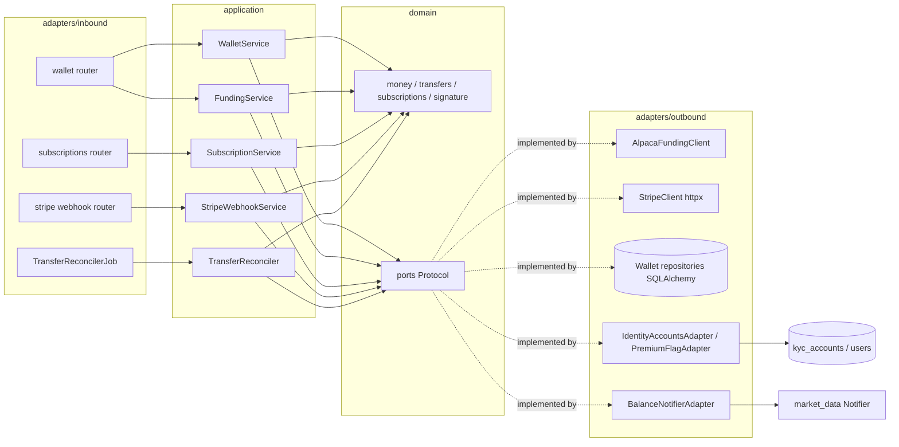
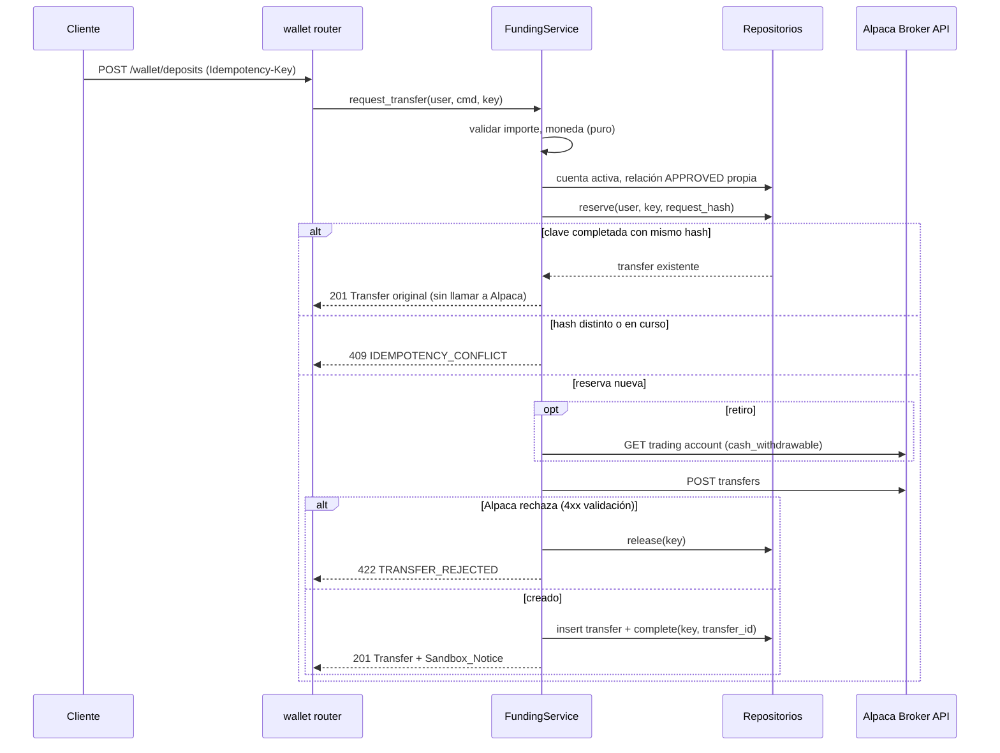
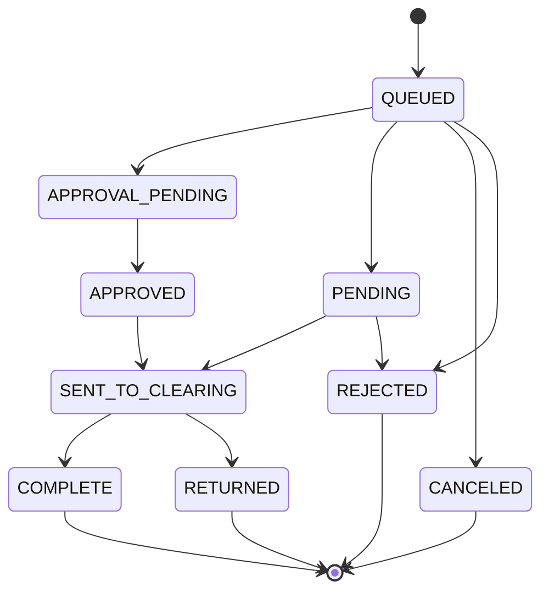
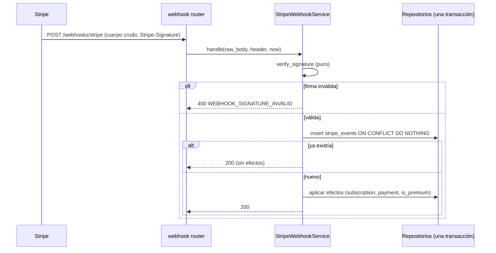

# Design Document: wallet-mod-04

## Overview

Este diseño implementa MOD-04 como el paquete `wallet` (`src/acciones_ud/wallet/`) del monolito modular hexagonal. Cubre consulta de saldos (RF-36), relaciones bancarias de prueba y transferencias ACH simuladas (RF-37, RF-39), reconciliación de confirmaciones externas y movimientos (RF-40), identificación de moneda (RF-38), suscripciones premium con Stripe sandbox (RF-10 a RF-12) y avisos de cambio de saldo (RFP-11).

El módulo depende de `identity` (cuenta Alpaca asociada, estado de cuenta, flag `is_premium`, rol) y de `market_data` (Notifier). Ambas dependencias entran por puertos definidos en `wallet/domain/ports.py`; ningún caso de uso importa tablas ni servicios de otro módulo.

Decisiones de diseño adicionales a las del documento de requisitos (prefijo D):

- **D1 (Stripe por HTTP propio):** el cliente de Stripe usa `httpx` contra `https://api.stripe.com/v1` con el encabezado `Stripe-Version` fijado (`2024-06-20`), igual que los clientes de Alpaca. No se agrega el SDK `stripe`. La verificación de firma del webhook es una función pura del dominio (HMAC-SHA256), lo que permite probarla con propiedades sin red. La versión se fija porque, desde la versión `2025-03-31.basil`, `current_period_start` y `current_period_end` se movieron de la suscripción a sus items ([Stripe changelog](https://docs.stripe.com/changelog/basil/2025-03-31/deprecate-subscription-current-period-start-and-end)).
- **D2 (solo claves de prueba):** la configuración rechaza claves que no empiecen por `sk_test_`, para cumplir "Stripe solo en sandbox".
- **D3 (URLs de retorno de Checkout, supuesto):** Stripe Checkout exige `success_url`. Se agregan `STRIPE_CHECKOUT_SUCCESS_URL` y `STRIPE_CHECKOUT_CANCEL_URL` como variables opcionales con valor por defecto `http://localhost:3000/subscription/success` y `http://localhost:3000/subscription/cancel`. El Requisito 13 criterio 7 no las lista; si el equipo las quiere obligatorias, se debe actualizar ese criterio.
- **D4 (reserva de idempotencia):** la Idempotency_Key se reserva en una tabla propia antes de llamar a Alpaca. Una segunda solicitud con la misma clave mientras la primera sigue en curso recibe 409 `IDEMPOTENCY_CONFLICT` con `details.reason = "in_progress"`. Si Alpaca rechaza, la reserva se borra, de modo que la clave puede reutilizarse (coherente con "omitir el almacenamiento del Transfer", Requisito 3 criterio 7).
- **D5 (404 frente a 409 para relaciones bancarias):** el Requisito 13 criterio 3 (404 `NOT_FOUND`) aplica a la lectura directa `GET /wallet/bank-relationships/{id}`. Dentro del cuerpo de un depósito o retiro, una relación ajena o no aprobada responde 409 `BANK_RELATIONSHIP_NOT_USABLE` (Requisito 3 criterio 4). En ambos casos la respuesta no distingue "ajena" de "inexistente".
- **D6 (cursor inicial de actividades):** la primera ejecución del Transfer_Reconciler para una cuenta fija el cursor de actividades en la hora actual y no genera avisos de actividades anteriores.
- **D7 (orden de eventos de Stripe):** la Subscription guarda `stripe_event_created_at`; un evento de suscripción con `created` anterior al almacenado se registra como aplicado sin cambiar el estado, para tolerar la entrega fuera de orden de Stripe.

### Investigación (resumen)

- **Alpaca Broker API (sandbox `https://broker-api.sandbox.alpaca.markets`, Basic auth con key/secret):**
  - `POST /v1/accounts/{account_id}/ach_relationships` con `account_owner_name`, `bank_account_type` (`CHECKING` | `SAVINGS`), `bank_account_number`, `bank_routing_number`. Estados: `QUEUED`, `APPROVED`, `PENDING`, `CANCEL_REQUESTED`, `CANCELED`. `GET` en la misma ruta lista las relaciones.
  - `POST /v1/accounts/{account_id}/transfers` con `transfer_type: "ach"`, `relationship_id`, `amount` (cadena), `direction` (`INCOMING` | `OUTGOING`). `GET /v1/accounts/{account_id}/transfers` lista con `direction`, `limit` y `offset`. El objeto incluye `id`, `status`, `reason`, `amount`, `currency` (puede faltar), `created_at` y `updated_at`. Estados: `QUEUED`, `APPROVAL_PENDING`, `PENDING`, `SENT_TO_CLEARING`, `APPROVED`, `COMPLETE`, `CANCELED`, `RETURNED`, `REJECTED`.
  - `GET /v1/trading/accounts/{account_id}/account` devuelve `status`, `currency`, `cash`, `cash_withdrawable`, `buying_power`, `equity`, `portfolio_value` y `long_market_value` como cadenas decimales.
  - `GET /v1/accounts/activities?account_id=…&activity_types=…&after=…&until=…&page_size=…&page_token=…`. Los IDs de actividad tienen la forma `<timestamp>::<uuid>`; la paginación pasa el `id` de la última actividad como `page_token` (`.agents/skills/alpaca-broker-integration/SKILL.md`, sección de convenciones). Las actividades `FILL` traen `side`, `symbol`, `qty`, `price` y `transaction_time`.
- **Stripe:** Checkout `POST /v1/checkout/sessions` con `mode=subscription`, `line_items[0][price]`, `line_items[0][quantity]=1`, `client_reference_id` y `metadata[user_id]`. Cancelación `POST /v1/subscriptions/{id}` con `cancel_at_period_end=true`. La firma del webhook llega en `Stripe-Signature: t=<unix>,v1=<hex>[,v1=…]` y se calcula como HMAC-SHA256 de `"{t}.{payload}"` con el secreto `whsec_…`; la tolerancia por defecto es 300 s ([Stripe webhook signatures](https://docs.stripe.com/webhooks#verify-manually)). Eventos usados: `checkout.session.completed`, `customer.subscription.created`, `customer.subscription.updated`, `customer.subscription.deleted`, `invoice.paid`, `invoice.payment_failed`.

## Architecture



Estructura de paquetes:

```
src/acciones_ud/wallet/
  domain/        money.py, balances.py, transfers.py, bank.py, activities.py,
                 subscriptions.py, stripe_signature.py, idempotency.py, ports.py
  application/   wallet_service.py, funding_service.py, transfer_reconciler.py,
                 subscription_service.py, stripe_webhook_service.py, dtos.py
  adapters/inbound/http/   routers/{wallet,subscriptions,stripe_webhook}.py, schemas/*.py, deps.py
  adapters/inbound/jobs/   transfer_reconcile_job.py
  adapters/outbound/alpaca/      funding_client.py, fake_funding.py
  adapters/outbound/stripe/      stripe_client.py, fake_stripe.py
  adapters/outbound/persistence/ tables.py, transfer_repository.py, bank_repository.py,
                                 idempotency_repository.py, subscription_repository.py,
                                 payment_repository.py, stripe_event_repository.py,
                                 notification_marker_repository.py
  adapters/outbound/identity/    account_reader.py, premium_flag_writer.py, contracted_plan_reader.py
  adapters/outbound/notifications/ balance_notifier.py
  composition.py
```

`main.py` agrega `wallet.register(app)`, `wallet.startup(app)` y `wallet.shutdown(app)`, igual que los otros módulos. `startup` arranca el Transfer_Reconciler solo si `WALLET_RECONCILER_ENABLED` es `true` (por defecto `true`; las pruebas lo apagan).

### Flujo de depósito o retiro



### Ciclo de vida de un Transfer



El diagrama es orientativo. El sistema no valida la secuencia entre estados no terminales: acepta cualquier estado que informe Alpaca, siempre que el Transfer no sea terminal y la marca `updated_at` sea estrictamente posterior (Requisito 5 criterios 2 a 4). Como `COMPLETE` es terminal por requisito, un `RETURNED` posterior a `COMPLETE` se ignora; se documenta como limitación del sandbox.

### Webhook de Stripe



El registro del evento y sus efectos se confirman en la misma transacción. Si la transacción falla por base de datos, nada queda registrado, la respuesta es 503 y Stripe reintenta (Requisito 9 criterio 9). El identificador del evento no aplicado se registra en el log con `event_id` y `applied=false`, porque la base de datos no está disponible para guardarlo.

## Components and Interfaces

### Puertos de salida (`wallet/domain/ports.py`)

```python
class LinkedAccountReader(Protocol):
    async def get(self, user_id: UUID) -> LinkedAccount | None: ...
    async def list_active(self) -> list[LinkedAccount]: ...

class AccountStatusWriter(Protocol):
    async def update_status(self, user_id: UUID, status: str, at: datetime) -> None: ...

class PremiumFlagWriter(Protocol):
    async def set_premium(self, user_id: UUID, value: bool) -> None: ...

class AlpacaFundingPort(Protocol):
    async def get_trading_account(self, account_id: str, timeout_s: float) -> RawTradingAccount: ...
    async def create_ach_relationship(self, account_id: str, data: BankRelationshipInput) -> RawBankRelationship: ...
    async def list_ach_relationships(self, account_id: str) -> list[RawBankRelationship]: ...
    async def create_transfer(self, account_id: str, relationship_id: str, amount: Decimal, direction: Direction) -> RawTransfer: ...
    async def list_transfers(self, account_id: str) -> list[RawTransfer]: ...
    async def list_activities(self, query: ActivityQuery) -> ActivityPage: ...

class StripePort(Protocol):
    async def create_checkout_session(self, user_id: UUID, price_id: str) -> CheckoutSession: ...
    async def cancel_at_period_end(self, stripe_subscription_id: str) -> RawStripeSubscription: ...

class BalanceNotifierPort(Protocol):
    async def notify(self, user_id: UUID, payload: dict[str, object]) -> None: ...
```

Los repositorios propios (`TransferRepository`, `BankRelationshipRepository`, `IdempotencyRepository`, `SubscriptionRepository`, `PaymentRepository`, `StripeEventRepository`, `NotificationMarkerRepository`) también son Protocol y se agrupan en un `WalletWork` obtenido de una fábrica de unidad de trabajo, igual que `market_data` (`catalog_uow`, `alert_uow`).

Errores de los adaptadores: los clientes de Alpaca reutilizan `raise_for_alpaca` y la clasificación de `shared/domain/alpaca_errors.py`. El cliente de Stripe lanza `StripeUnavailableError` (definido en `wallet/domain`) ante timeout de 10 s, error de red o respuesta 5xx/429, y `StripeRejectedError` ante 4xx.

### Casos de uso (`wallet/application/`)

| Servicio | Operaciones | Requisitos |
|---|---|---|
| WalletService | `get_balances`, `get_currencies`, `list_activities` | 1, 6.2–6.6, 7 |
| FundingService | `create_bank_relationship`, `list_bank_relationships`, `get_bank_relationship`, `request_transfer(direction)`, `list_transfers`, `get_transfer` | 2, 3, 4, 5.6, 6.1 |
| TransferReconciler | `run_once()` | 5.1–5.5, 12.1, 12.2, 12.4 |
| SubscriptionService | `list_plans`, `start_checkout`, `cancel`, `get_current`, `list_payments`, `get_payment` | 8, 10, 11.1–11.3 |
| StripeWebhookService | `handle(raw_body, signature_header, now)` | 9, 10.5 |

Reglas puras del dominio que concentran la lógica crítica:

- `money.parse_transfer_amount(raw: str, maximum: Decimal) -> Decimal`: acepta solo cadenas decimales finitas con a lo sumo dos decimales y valor entre `1.00` y `maximum`; en otro caso lanza `InvalidAmountError`.
- `money.exact_amount(raw: str | None) -> str | None`: valida que la cadena de Alpaca sea un decimal finito y devuelve la misma cadena sin redondear (Requisito 1 criterio 3).
- `transfers.check_withdrawable(amount, cash_withdrawable) -> None`: lanza `InsufficientFundsError(withdrawable)` si `amount > cash_withdrawable`.
- `transfers.decide_update(stored: TransferState, incoming: TransferUpdate) -> TransferState | None`: devuelve el estado nuevo o `None` si la actualización se descarta (terminal o marca no posterior).
- `idempotency.request_hash(direction, bank_relationship_id, amount, currency) -> str`: SHA-256 de la representación canónica (importe normalizado con `Decimal.quantize(Decimal("0.01"))`).
- `stripe_signature.verify(payload: bytes, header: str | None, secret: str, now: datetime, tolerance_s: int = 300) -> None`: compara con `hmac.compare_digest` cada `v1` del encabezado; lanza `InvalidSignatureError` si falta el encabezado, no hay `t`, ninguna firma coincide o `|now - t| > tolerance_s`.
- `subscriptions.premium_effect(new_status) -> bool | None`: `True` para `active`/`trialing`, `False` para `canceled`/`unpaid`/`incomplete_expired`, `None` (sin cambio) para el resto, incluido `past_due`.

### Endpoints HTTP

Todos excepto el webhook usan la cookie `access_token` mediante `get_current_user` de `identity` y una dependencia `require_investor` que verifica el rol `investor` vigente en `CurrentUser` (403 `FORBIDDEN` en otro caso). El prefijo de tags OpenAPI es `wallet` y `subscriptions`.

| Método y ruta | Descripción | Respuestas de error declaradas |
|---|---|---|
| `GET /wallet/balances` | Balance_View (Req. 1) | 401, 403, 409 `WALLET_ACCOUNT_REQUIRED`, 503 `DATABASE_UNAVAILABLE` |
| `GET /wallet/currencies` | monedas y `conversion_supported: false` (Req. 7.2) | 401, 403, 409, 502, 503 |
| `POST /wallet/bank-relationships` | crear relación de prueba (Req. 2.1) | 401, 403, 409 `WALLET_ACCOUNT_NOT_ACTIVE`, 422, 502, 503 |
| `GET /wallet/bank-relationships` | listar (Req. 2.3) | 401, 403, 409, 503 |
| `GET /wallet/bank-relationships/{id}` | detalle (Req. 13.3) | 401, 403, 404, 503 |
| `POST /wallet/deposits` | depósito; encabezado `Idempotency-Key` obligatorio (Req. 3) | 401, 403, 409 (`WALLET_ACCOUNT_NOT_ACTIVE`, `BANK_RELATIONSHIP_NOT_USABLE`, `IDEMPOTENCY_CONFLICT`), 422 (`VALIDATION_ERROR`, `CURRENCY_NOT_SUPPORTED`, `TRANSFER_REJECTED`), 502, 503 |
| `POST /wallet/withdrawals` | retiro (Req. 4) | las del depósito más 422 `INSUFFICIENT_FUNDS` |
| `GET /wallet/transfers` | `from`, `to`, `direction`, `page_size`, `cursor` (Req. 6.1) | 401, 403, 409, 422, 503 |
| `GET /wallet/transfers/{id}` | detalle con última confirmación (Req. 5.6) | 401, 403, 404, 503 |
| `GET /wallet/activities` | `from`, `to`, `types`, `page_size`, `cursor` (Req. 6.2) | 401, 403, 409, 422, 502, 503 |
| `GET /subscriptions/plans` | planes (Req. 8.1) | 401, 403 |
| `POST /subscriptions/checkout` | `{ "plan": "monthly" \| "annual" }` (Req. 8.2) | 401, 403, 409 `SUBSCRIPTION_ALREADY_ACTIVE`, 422, 502 `STRIPE_UNAVAILABLE`, 503 |
| `POST /subscriptions/me/cancel` | `{ "reason": "…" }` (Req. 10) | 401, 403, 409 `SUBSCRIPTION_NOT_CANCELABLE`, 422, 502, 503 |
| `GET /subscriptions/me` | suscripción vigente o `null` (Req. 11.1–11.2) | 401, 403, 503 |
| `GET /subscriptions/me/payments` | pagos paginados (Req. 11.3) | 401, 403, 422, 503 |
| `GET /subscriptions/me/payments/{id}` | detalle (Req. 13.3) | 401, 403, 404, 503 |
| `POST /webhooks/stripe` | sin cookie; lee el cuerpo crudo (`await request.body()`) antes de parsear (Req. 9, 13.4) | 400 `WEBHOOK_SIGNATURE_INVALID`, 503 |

Los importes viajan como cadenas decimales en request y response (`amount: "150.00"`), nunca como `float`. El request de depósito y retiro es `{ "bank_relationship_id": UUID, "amount": "string", "currency": "USD" }`. `Idempotency-Key` ausente o fuera de 8 a 128 caracteres ASCII imprimibles responde 422 `VALIDATION_ERROR`.

El Sandbox_Notice es un texto fijo en inglés, coherente con los mensajes existentes de la API: `"Virtual funds in the Alpaca sandbox environment. They do not represent real money."`

### Cambios de contrato en `identity` y `market_data` (consumidos por el frontend)

1. **Nuevo tipo de evento `balance_changes`** (Req. 12.3). Se agrega a `EVENT_TYPES` en `identity/domain/preferences.py`. `GET /users/me/preferences` (o la ruta de preferencias existente) devolverá una combinación más por canal, con `in_app` habilitado y los demás deshabilitados. `PUT` acepta el nuevo valor. Es un cambio aditivo, pero el frontend debe mostrar el tipo nuevo. La migración `0006_wallet_schema` inserta las filas por defecto de `balance_changes` para los usuarios existentes si las preferencias se guardan por fila; si se derivan de `default_preferences()` al leer, no hace falta dato nuevo. Esto se confirma al implementar la tarea.
2. **`contracted_plan` en `/users/me`** (Req. 11.4, W7). El esquema cambia de `contracted_plan: None = None` a `contracted_plan: Literal["monthly", "annual"] | None = None`. Para no invertir dependencias, `identity` define el Protocol `ContractedPlanReader` en `identity/domain/` y lo resuelve desde `app.state.contracted_plan_reader`; si no existe, devuelve `null`. `wallet.register(app)` instala su implementación (`adapters/outbound/identity/contracted_plan_reader.py`), que consulta la tabla `subscriptions`.
3. **Notificación a un usuario concreto** en `market_data`: `RecipientDirectory` hoy resuelve destinatarios por tipo de evento. Se agrega `recipient(user_id, event_type) -> Recipient | None`, que aplica las mismas preferencias de canal. `BalanceNotifierAdapter` la usa y llama a `Notifier.notify([recipient], "balance_changes", payload)`. Si devuelve `None` (todos los canales deshabilitados), no se crea notificación (Req. 12.5).

Adaptadores hacia `identity` (decisión explícita según la regla de módulos): `account_reader.py`, `premium_flag_writer.py` y `account_status_writer` usan las tablas `kyc_accounts` y `users` definidas en `identity/adapters/outbound/persistence/tables.py` dentro de la sesión de la unidad de trabajo de `wallet`. Así, el cambio de `is_premium` y el registro del Stripe_Event se confirman en la misma transacción.

`AccountStatusWriter.update_status` en la consulta de saldos es la excepción: corre en su propia transacción. Si falla o excede el tiempo de espera, el caso de uso registra el fallo en el log sin secretos y devuelve igualmente el Balance_View con el estado obtenido de Alpaca (Req. 1.6).

### Transfer_Reconciler

Tarea asyncio en `adapters/inbound/jobs/transfer_reconcile_job.py` con intervalo `WALLET_RECONCILE_INTERVAL_SECONDS` (por defecto 60). Cada ejecución:

1. Agrupa por cuenta los Transfers no terminales y llama `list_transfers(account_id)`.
2. Por cada Transfer coincidente aplica `decide_update` y persiste con un UPDATE condicional (`WHERE id = :id AND status NOT IN (terminales) AND (alpaca_updated_at IS NULL OR alpaca_updated_at < :incoming)`), de modo que dos ejecuciones concurrentes no retroceden el estado.
3. Si el UPDATE cambió una fila y el estado nuevo es `COMPLETE`, inserta un marcador `('transfer', alpaca_transfer_id)` en `wallet_balance_notifications` con `ON CONFLICT DO NOTHING`; solo si insertó, llama a `BalanceNotifierPort` (Req. 12.1, 12.4).
4. Para cada Active_Account consulta las actividades de todos los tipos desde su cursor; solo por cada `FILL` inserta el marcador `('activity', activity_id)` y notifica si insertó; al final avanza el cursor al último `id` procesado, cualquiera sea su tipo (Req. 12.2, 12.6).
5. Un error de Alpaca en una cuenta se registra en el log (sin credenciales) y la ejecución continúa con la siguiente cuenta (Req. 5.5).

La notificación se envía después de confirmar el marcador, por lo que un fallo del Notifier pierde el aviso en lugar de duplicarlo. Esto cumple "como máximo una notificación".

## Data Models

### Entidades de dominio (dataclasses `frozen=True`)

- `LinkedAccount(user_id, alpaca_account_id, status)`; `is_active` si `status == "ACTIVE"`.
- `BalanceView(status, currency, cash, cash_withdrawable, buying_power, equity, portfolio_value, long_market_value, retrieved_at, unavailable)`; importes `str | None`.
- `BankRelationship(id, user_id, alpaca_relationship_id, owner_name, account_type, account_last4, status, created_at)`.
- `Transfer(id, user_id, alpaca_transfer_id, bank_relationship_id, direction, amount: Decimal, currency, status, reason, description, alpaca_updated_at, last_confirmed_at, created_at)`.
- `TransferState(status, alpaca_updated_at)` y `TransferUpdate(status, updated_at, reason)` para `decide_update`.
- `Activity(id, type, date, amount, currency, direction, status, description, side, symbol, qty, price)`.
- `Plan(code: Literal["monthly","annual"], price: Decimal, currency: "USD", interval: "month" | "year", stripe_price_id)`. Precios fijos en el dominio: 12.00 y 120.00 (W4).
- `Subscription(id, user_id, plan, status, stripe_checkout_session_id, stripe_subscription_id, stripe_customer_id, current_period_start, current_period_end, cancel_at_period_end, cancel_reason, cancel_requested_at, stripe_event_created_at)`.
- `Payment(id, user_id, subscription_id, stripe_invoice_id, plan, amount, currency, period_start, period_end, result: "paid" | "failed", occurred_at)`.

### Tablas (migración `migrations/versions/0006_wallet_schema.py`)

| Tabla | Columnas principales | Restricciones |
|---|---|---|
| `wallet_bank_relationships` | `id uuid`, `user_id`, `alpaca_account_id`, `alpaca_relationship_id`, `owner_name`, `account_type`, `account_last4 char(4)`, `status`, `created_at`, `updated_at` | PK `id`; UNIQUE `alpaca_relationship_id`; FK `user_id → users.id` |
| `wallet_transfers` | `id`, `user_id`, `alpaca_account_id`, `alpaca_transfer_id`, `bank_relationship_id`, `direction`, `amount numeric(14,2)`, `currency char(3)`, `status`, `reason`, `description`, `alpaca_updated_at`, `last_confirmed_at`, `created_at`, `updated_at` | UNIQUE `alpaca_transfer_id`; CHECK `amount >= 1`; CHECK `direction IN ('INCOMING','OUTGOING')`; índice `(user_id, created_at DESC, id)`; índice parcial sobre estados no terminales |
| `wallet_idempotency_keys` | `user_id`, `idempotency_key`, `request_hash`, `state ('in_progress','completed')`, `transfer_id`, `created_at` | PK `(user_id, idempotency_key)` |
| `wallet_activity_cursors` | `alpaca_account_id`, `last_activity_id`, `updated_at` | PK `alpaca_account_id` |
| `wallet_balance_notifications` | `source ('transfer','activity')`, `external_id`, `user_id`, `created_at` | PK `(source, external_id)` |
| `subscriptions` | campos de `Subscription`, `created_at`, `updated_at` | UNIQUE `stripe_checkout_session_id`, UNIQUE `stripe_subscription_id`; índice único parcial `(user_id) WHERE status IN ('active','trialing','past_due')` |
| `subscription_payments` | campos de `Payment` | UNIQUE `stripe_invoice_id` |
| `stripe_events` | `event_id`, `type`, `outcome ('applied','unassociated','stale')`, `received_at` | PK `event_id` |

No se guarda el número completo de cuenta bancaria ni ningún dato de tarjeta. `downgrade` elimina las tablas en orden inverso. La migración no modifica datos existentes salvo, si aplica, la inserción de preferencias `balance_changes`.

### Configuración (`config/settings.py`)

| Variable | Validación en `require_api_settings` | Defecto |
|---|---|---|
| `STRIPE_SECRET_KEY` | obligatoria, prefijo `sk_test_` | — |
| `STRIPE_WEBHOOK_SECRET` | obligatoria, prefijo `whsec_` | — |
| `STRIPE_PRICE_MONTHLY_ID`, `STRIPE_PRICE_ANNUAL_ID` | obligatorias, prefijo `price_` | — |
| `WALLET_MAX_TRANSFER_AMOUNT` | decimal ≥ 1.00 con ≤ 2 decimales | `50000.00` |
| `WALLET_RECONCILE_INTERVAL_SECONDS` | entero entre 10 y 3600 | `60` |
| `STRIPE_CHECKOUT_SUCCESS_URL`, `STRIPE_CHECKOUT_CANCEL_URL` | URL http(s) (D3) | ver D3 |
| `WALLET_RECONCILER_ENABLED` | `true`/`false` | `true` |

Los secretos se declaran como `SecretStr`. El error de arranque lista solo nombres de variables, como hoy (Req. 13.7, 13.8). `.env.example` se actualiza con valores de ejemplo no reales.

## Correctness Properties

*A property is a characteristic or behavior that should hold true across all valid executions of a system-essentially, a formal statement about what the system should do. Properties serve as the bridge between human-readable specifications and machine-verifiable correctness guarantees.*

Solo se definen propiedades para las partes críticas de la política de pruebas. En la reflexión se unieron moneda e importe en una sola propiedad de validación, depósito y retiro se parametrizan por dirección en lugar de duplicar propiedades, y los criterios 5.2, 5.3 y 5.4 quedan en un solo modelo de transición.

### Property 1: Validación de importe y moneda de transferencias

*For any* cadena de importe, moneda, máximo configurado y dirección (`INCOMING` u `OUTGOING`), la solicitud pasa la validación si y solo si la moneda es `USD`, el importe es un decimal finito con a lo sumo dos decimales y `1.00 <= importe <= máximo`; toda solicitud rechazada responde `VALIDATION_ERROR` o `CURRENCY_NOT_SUPPORTED` y produce cero llamadas de creación a Alpaca_Broker_API.

**Validates: Requirements 3.2, 3.3, 4.4**

### Property 2: Importes de saldo exactos

*For any* conjunto de importes decimales en cadena devueltos por Alpaca_Broker_API para la cuenta, cada importe del Balance_View es igual, como `Decimal` y como cadena, al valor recibido.

**Validates: Requirements 1.3**

### Property 3: Retiro limitado por el efectivo retirable

*For any* importe válido y `cash_withdrawable` informado por Alpaca_Broker_API, el retiro se rechaza con `INSUFFICIENT_FUNDS` y `details.cash_withdrawable` igual al valor informado si y solo si `importe > cash_withdrawable`; en el rechazo no hay llamada de creación de Transfer.

**Validates: Requirements 4.2**

### Property 4: Idempotencia de depósitos y retiros

*For any* Investor, Idempotency_Key y secuencia de solicitudes con esa clave, la primera solicitud aceptada genera exactamente una llamada de creación a Alpaca_Broker_API; cada repetición con el mismo cuerpo devuelve el mismo Transfer, y cada repetición con un cuerpo distinto responde `IDEMPOTENCY_CONFLICT`, sin llamadas de creación adicionales en ningún caso.

**Validates: Requirements 3.5, 3.6, 4.4**

### Property 5: Modelo de transición de estados de Transfer

*For any* estado almacenado y secuencia de actualizaciones de Alpaca (estado y marca `updated_at`), aplicar `decide_update` en orden produce el mismo resultado que el modelo de referencia: una actualización se aplica si y solo si el estado almacenado no es terminal y su marca es estrictamente posterior a la almacenada; una vez alcanzado un Terminal_Status, el estado y la marca no cambian.

**Validates: Requirements 5.2, 5.3, 5.4**

### Property 6: Recursos ajenos indistinguibles de inexistentes

*For any* par de Investors A y B distintos y cualquier Transfer, Bank_Relationship o Payment de B, la solicitud de A por ese recurso responde HTTP 404 `NOT_FOUND` con un cuerpo idéntico al de un identificador inexistente generado al azar.

**Validates: Requirements 13.3**

### Property 7: Verificación de firma del webhook

*For any* cuerpo en bytes, secreto y desfase de marca de tiempo, un encabezado `Stripe-Signature` calculado con ese secreto sobre ese cuerpo se acepta si y solo si `|desfase| <= 300` segundos; cualquier alteración del cuerpo, de la firma o del secreto, o la ausencia del encabezado, provoca `WEBHOOK_SIGNATURE_INVALID` sin cambios en Subscriptions, Payments ni flag premium.

**Validates: Requirements 9.1, 9.2**

### Property 8: Idempotencia de Stripe_Events

*For any* secuencia de Stripe_Events verificados que contenga identificadores repetidos, el estado final de Subscriptions, Payments y flags premium es igual al obtenido aplicando una sola vez cada identificador en el orden de su primera aparición.

**Validates: Requirements 9.3**

### Property 9: Efecto de la suscripción sobre `is_premium`

*For any* secuencia de estados de una Subscription aplicada por webhook y valor inicial del flag, el `is_premium` final del Investor es `true` si el último estado con efecto fue `active` o `trialing`, `false` si fue `canceled`, `unpaid` o `incomplete_expired`, y el valor inicial si ningún estado tuvo efecto.

**Validates: Requirements 9.6, 9.7**

### Property 10: Eventos no asociados sin efectos

*For any* estado almacenado y Stripe_Event verificado cuyo identificador de suscripción o cliente no corresponde a ninguna Subscription almacenada, el manejador responde HTTP 200 y el estado de Subscriptions y flags premium queda idéntico al previo.

**Validates: Requirements 9.8**

## Error Handling

Nuevos valores en `ErrorCode` (`shared/domain/errors.py`): `WALLET_ACCOUNT_REQUIRED`, `WALLET_ACCOUNT_NOT_ACTIVE`, `CURRENCY_NOT_SUPPORTED`, `BANK_RELATIONSHIP_NOT_USABLE`, `IDEMPOTENCY_CONFLICT`, `TRANSFER_REJECTED`, `INSUFFICIENT_FUNDS`, `SUBSCRIPTION_ALREADY_ACTIVE`, `SUBSCRIPTION_NOT_CANCELABLE`, `STRIPE_UNAVAILABLE`, `WEBHOOK_SIGNATURE_INVALID`.

| Situación | HTTP | Código | `details` |
|---|---|---|---|
| Sin cookie válida | 401 | `NOT_AUTHENTICATED` | — |
| Sin rol `investor` | 403 | `FORBIDDEN` | — |
| Recurso ajeno o inexistente | 404 | `NOT_FOUND` | — (mismo cuerpo en ambos casos) |
| Sin Linked_Account | 409 | `WALLET_ACCOUNT_REQUIRED` | — |
| Cuenta no `ACTIVE` | 409 | `WALLET_ACCOUNT_NOT_ACTIVE` | `{"status": …}` |
| Relación no usable | 409 | `BANK_RELATIONSHIP_NOT_USABLE` | — |
| Clave reutilizada o en curso | 409 | `IDEMPOTENCY_CONFLICT` | `{"reason": "body_mismatch" \| "in_progress"}` |
| Importe, periodo, plan, motivo o clave inválidos | 422 | `VALIDATION_ERROR` | `{"fields": [nombres]}` sin valores |
| Moneda distinta de USD | 422 | `CURRENCY_NOT_SUPPORTED` | `{"supported": ["USD"]}` |
| Retiro mayor que retirable | 422 | `INSUFFICIENT_FUNDS` | `{"cash_withdrawable": "…"}` |
| Alpaca rechaza el Transfer | 422 | `TRANSFER_REJECTED` | `{"reason": mensaje de Alpaca truncado a 300 caracteres}` |
| Alpaca caído | 502 | `ALPACA_UNAVAILABLE` | — |
| Alpaca 429 | 503 | `ALPACA_RATE_LIMITED` | — |
| Stripe caído o timeout 10 s | 502 | `STRIPE_UNAVAILABLE` | — |
| Firma de webhook inválida | 400 | `WEBHOOK_SIGNATURE_INVALID` | — |
| Base de datos caída | 503 | `DATABASE_UNAVAILABLE` | — |

Reglas:

- Las excepciones de dominio (`InvalidAmountError`, `InsufficientFundsError`, `InvalidSignatureError`, etc.) se traducen a `AppError` en los servicios de aplicación o en el router; `shared/infrastructure/http_errors.py` produce el Error_Body.
- La consulta de saldos es la única excepción al mapeo de errores de Alpaca: captura `AlpacaUnavailable`, `AlpacaRateLimited` y el timeout de 5 s y devuelve `unavailable: true` con importes `null` (Req. 1.4).
- Los errores de validación de Pydantic sobre importes o cuentas bancarias nunca incluyen el valor recibido (Req. 2.5, 13.8); el manejador existente de validación se revisa para que `details` contenga solo nombres de campo en las rutas de `wallet`.
- Los logs de Alpaca y Stripe registran método, ruta sin query sensible, código de estado e identificadores externos; nunca cuerpos con números de cuenta, claves ni el encabezado `Stripe-Signature`.
- Riesgo aceptado: si el proceso cae después de que Alpaca crea el Transfer y antes de guardarlo, la reserva queda `in_progress` y el Transfer no queda registrado localmente. La reserva bloquea reintentos con esa clave (409 `in_progress`); se documenta en el runbook y no se automatiza en este módulo.

## Testing Strategy

Se sigue la política del documento de requisitos: **las pruebas son obligatorias solo para las partes críticas**. Las demás se marcan opcionales en `tasks.md`.

Pruebas obligatorias:

- **Propiedades (Hypothesis)**, en `tests/wallet/property/`, una prueba por propiedad del apartado Correctness Properties, con al menos 100 ejemplos (`@settings(max_examples=100)`) y la etiqueta en comentario `# Feature: wallet-mod-04, Property N: <texto>`. Prueban funciones puras del dominio y servicios de aplicación con fakes en memoria (`fake_funding.py`, `fake_stripe.py`, repositorios en memoria).
- **Ejemplos unitarios**, en `tests/wallet/unit/`: saldos no disponibles (timeout, 5xx y 429 de Alpaca devuelven `unavailable: true` con importes `null`, Req. 1.4); 401 sin cookie y 403 sin rol `investor` sin llamadas a fakes (Req. 13.1, 13.2); 503 con identificador no aplicado ante base de datos caída en el webhook (Req. 9.9).
- **API**, en `tests/wallet/api/` con `TestClient` y fakes inyectados por `app.state`: un depósito completo, un retiro con fondos insuficientes y un webhook firmado de punta a punta.

Pruebas opcionales: planes, checkout, cancelación, consultas de movimientos y actividades, moneda por defecto, avisos `balance_changes`, contrato OpenAPI y migración. Las pruebas que requieren PostgreSQL se marcan `db` y se saltan sin `TEST_DATABASE_URL`.

No se usa PBT para la integración real con Alpaca o Stripe, el cableado de `composition.py`, la migración ni el contrato OpenAPI; esas partes se cubren, si se decide, con pruebas de ejemplo o de humo.

Validación de cierre: `uv run ruff check .`, `uv run mypy src`, `uv run pytest`.
